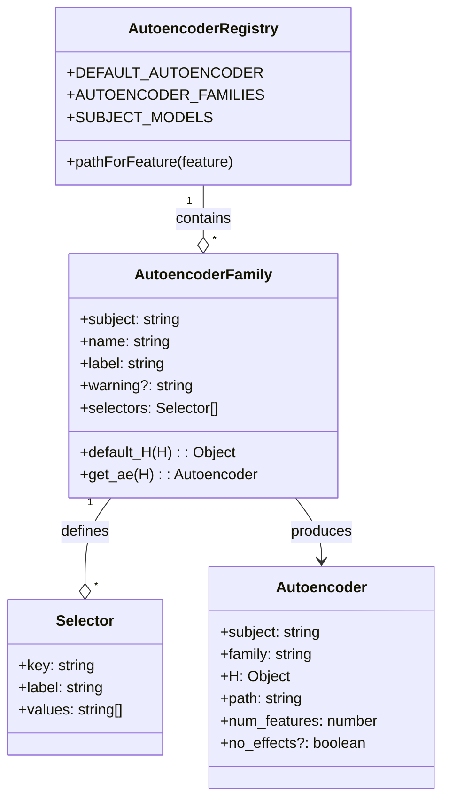
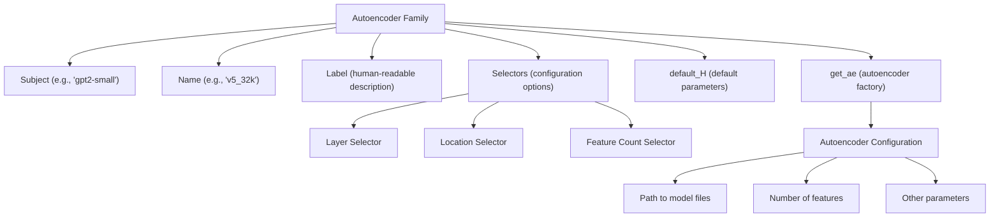
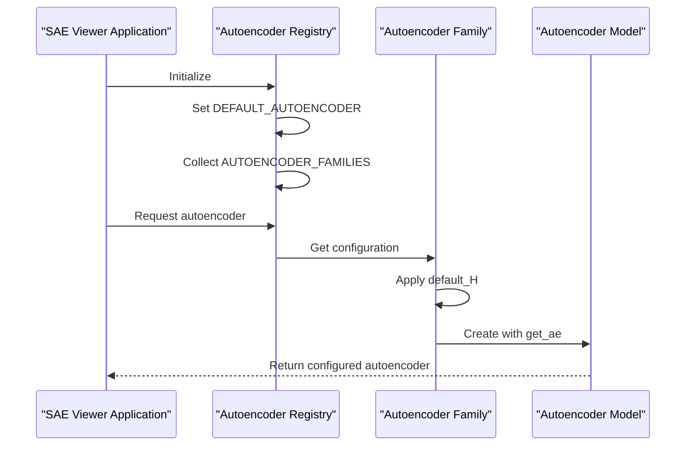
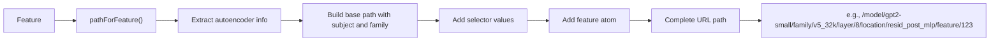
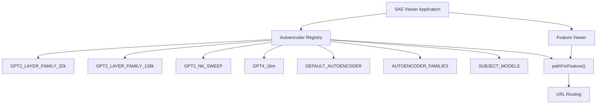

<!-- source: DeepWiki mcp.deepwiki.com · repo openai/sparse_autoencoder · page 5.2 Autoencoder Registry · fetched 2026-10-26 -->

# Autoencoder Registry

<details>
<summary>Relevant source files</summary>

The following files were used as context for generating this wiki page:

- [sae-viewer/src/autoencoder_registry.tsx](sae-viewer/src/autoencoder_registry.tsx)

</details>


## Purpose and Scope

The Autoencoder Registry is a core configuration component of the SAE Viewer application that defines, organizes, and provides access to different families of sparse autoencoders. It serves as a central registry for various pretrained autoencoder models with different configurations, allowing users to select and visualize features from these models.

For information about visualizing the features themselves, see [Visualization Features](#5.3).

Sources: [sae-viewer/src/autoencoder_registry.tsx:1-114]()

## Registry Architecture

The Autoencoder Registry is structured as a collection of autoencoder families, each representing a set of autoencoders with similar characteristics but different parameters.



Sources: [sae-viewer/src/autoencoder_registry.tsx:90-97](), [sae-viewer/src/autoencoder_registry.tsx:5-44]()

## Registry Components

### Autoencoder Families

The registry defines several autoencoder families, each with specific configurations:

| Family Name | Subject | Features | Active Features | Description |
|-------------|---------|----------|----------------|-------------|
| `v5_32k` | gpt2-small | 32,768 | 32 | Covers all layers and locations |
| `v5_128k` | gpt2-small | 131,072 | 32 | Covers all layers and locations |
| `v5_l8_postmlp` | gpt2-small | Varies (2K-2M) | Varies (8-512) | Layer 8, resid post MLP with n/k sweep |
| `v5_latelayer_postmlp` | gpt4 | 16M (65K available) | 256 | Late layer, resid post MLP |

Sources: [sae-viewer/src/autoencoder_registry.tsx:5-81]()

### Family Configuration Structure

Each autoencoder family in the registry is defined with a specific structure that enables flexible configuration and selection.



Sources: [sae-viewer/src/autoencoder_registry.tsx:5-44](), [sae-viewer/src/autoencoder_registry.tsx:46-64]()

## Detailed Family Descriptions

### GPT2 Layer Family (32K)

This family contains autoencoders trained on GPT2-small with 32,768 features and 32 active features per input.

```
Configuration:
- subject: gpt2-small
- name: v5_32k
- Selectors:
  - layer: 0-11
  - location: resid_post_attn, resid_post_mlp
- Default: layer 8, resid_post_mlp
```

Sources: [sae-viewer/src/autoencoder_registry.tsx:5-23]()

### GPT2 Layer Family (128K)

This family contains autoencoders trained on GPT2-small with 131,072 features and 32 active features per input.

```
Configuration:
- subject: gpt2-small
- name: v5_128k
- Selectors:
  - layer: 0-11
  - location: resid_post_attn, resid_post_mlp
- Default: layer 8, resid_post_mlp
- Additional: no_effects is true
```

Sources: [sae-viewer/src/autoencoder_registry.tsx:25-44]()

### GPT2 N/K Sweep

This family contains autoencoders trained on layer 8, resid_post_mlp of GPT2-small with varying numbers of total features and active features.

```
Configuration:
- subject: gpt2-small
- name: v5_l8_postmlp
- Selectors:
  - num_features: 2048, 8192, 32768, 131072, 524288, 2097152
  - num_active_features: 8, 16, 32, 64, 128, 256, 512
- Default: 2,097,152 features, 16 active features
```

Sources: [sae-viewer/src/autoencoder_registry.tsx:46-64]()

### GPT4 Model

This family contains an autoencoder trained on GPT4 with 16 million features (though only 65,536 are available for visualization).

```
Configuration:
- subject: gpt4
- name: v5_latelayer_postmlp
- No selectors (fixed configuration)
- Warning: Only 65,536 features available
- Additional: Shows activations on The Pile dataset
```

Sources: [sae-viewer/src/autoencoder_registry.tsx:66-81]()

## Registry Initialization and Default Values

The Autoencoder Registry initializes with a default autoencoder (currently set to the GPT4 model) and collects all families into a single object.



Sources: [sae-viewer/src/autoencoder_registry.tsx:83-97]()

## Feature Path Generation

The registry provides a `pathForFeature` function that generates URL paths for specific features of an autoencoder, enabling navigation within the SAE Viewer application.



Sources: [sae-viewer/src/autoencoder_registry.tsx:101-112]()

## Integration with SAE Viewer

The Autoencoder Registry integrates with the SAE Viewer application to provide a structured way to access and visualize different autoencoder models.



Sources: [sae-viewer/src/autoencoder_registry.tsx:1-114]()

## Supported Models

The registry currently supports autoencoders trained on the following models:

- GPT2-small: A 124 million parameter transformer model
- GPT4: A large language model with significantly more parameters

These models serve as the "subjects" for the autoencoders in the registry.

Sources: [sae-viewer/src/autoencoder_registry.tsx:99]()

---

