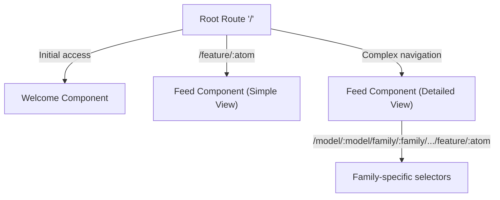
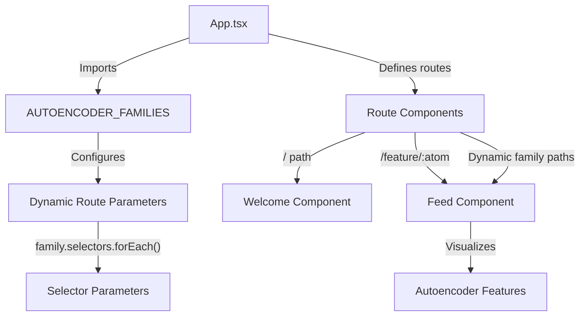
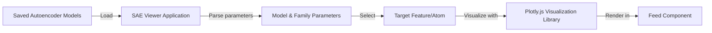
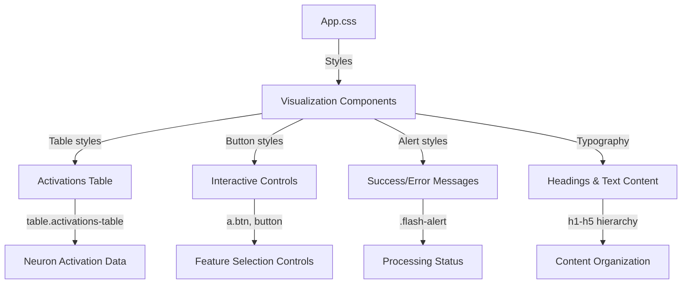
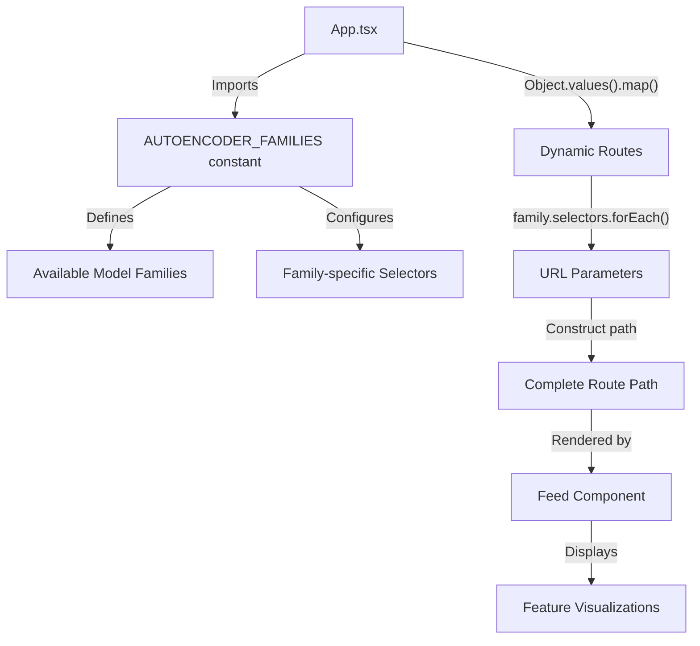

<!-- source: DeepWiki mcp.deepwiki.com · repo openai/sparse_autoencoder · page 5.3 Visualization Features · fetched 2026-10-26 -->

# Visualization Features

Relevant source files

The following files were used as context for generating this wiki page:

- [sae-viewer/src/App.css](sae-viewer/src/App.css)
- [sae-viewer/src/App.tsx](sae-viewer/src/App.tsx)

This document describes the visualization capabilities of the SAE Viewer application within the `sparse_autoencoder` repository. The SAE Viewer provides an interactive web interface for exploring and analyzing features learned by sparse autoencoders. This page focuses specifically on the visualization functionality, rendering methods, and user interface elements available for feature exploration.

For information about setting up the SAE Viewer, see [Viewer Setup](#5.1). For details on how the autoencoder registry configures the available models and families, see [Autoencoder Registry](#5.2).

## Navigation and Routing Architecture

The SAE Viewer employs a hierarchical navigation system built with React Router, allowing users to traverse through models, families, and individual features (neuron activations).

The routing system dynamically generates paths based on the autoencoder families defined in the registry. Each family can have custom selectors that appear as path parameters, allowing fine-grained navigation to specific features.

Sources: [sae-viewer/src/App.tsx:8-28]()

## Feature Visualization Components

The SAE Viewer's main visualization component is the `Feed` component, which renders different views of autoencoder features based on selected parameters.

The SAE Viewer uses feature-specific routing to allow direct linking to particular visualizations. Each feature (or "atom") can be accessed directly via its URL, making it easy to share findings or bookmark interesting features.

Sources: [sae-viewer/src/App.tsx:3-4](), [sae-viewer/src/App.tsx:14-22]()

## Visualization Data Flow

The SAE Viewer follows a specific data flow pattern to transform model data into visual representations:

The viewer application loads the appropriate autoencoder model based on URL parameters, extracts the requested feature data, and visualizes it using the Plotly.js library, which renders inside the Feed component.

## UI Components and Styling

The SAE Viewer employs a consistent UI design system with specialized components for different visualization needs:

The viewer uses specialized CSS classes for different visualization elements:

1. `activations-table` for displaying numerical activation data in tabular format
2. Button styles for interactive controls
3. Alert components for notification messages
4. Typography hierarchy for organizing content

Sources: [sae-viewer/src/App.css:14-27](), [sae-viewer/src/App.css:196-243]()

## Key Visualization Features

The SAE Viewer provides several specialized visualization capabilities:

### Feature Patterns Visualization

The viewer renders visual representations of the patterns that individual neurons in the sparse autoencoder have learned to detect. These visualizations help researchers understand what specific features the model has extracted from the data.

### Activation Magnitude Display

For each feature, the viewer can display the magnitude of activations, showing how strongly each neuron responds to different inputs. This helps identify the most important features in the model.

### Comparative Feature Analysis

The routing system enables easy comparison between features across different models or families by simply changing URL parameters, facilitating comparative analysis.

### Responsive Layout

Visualizations adapt to different screen sizes using responsive design techniques:

1. Full-width layouts for larger visualizations
2. Tailwind CSS utilities for responsive components
3. Media queries for different device types

Sources: [sae-viewer/src/App.css:28-33](), [sae-viewer/src/App.css:87-92]()

## Integration with Autoencoder Registry

The visualization features are tightly integrated with the autoencoder registry configuration, which defines the structure and organization of available models:

The application dynamically generates routes based on the autoencoder families defined in the registry. Each family can specify its own selectors, which become URL parameters that control what data is visualized.

Sources: [sae-viewer/src/App.tsx:5-5](), [sae-viewer/src/App.tsx:16-22]()

## Limitations and Considerations

When using the SAE Viewer's visualization features, keep in mind:

1. Feature rendering depends on having properly configured autoencoder models in the registry
2. Complex visualizations may be computationally intensive, especially with large models
3. Direct URLs to features rely on consistent model availability and paths

## Summary

The SAE Viewer provides powerful visualization capabilities for exploring features learned by sparse autoencoders. Through its dynamic routing system, specialized UI components, and integration with the autoencoder registry, it allows researchers to navigate, analyze, and compare features across different models and families. The visualizations help interpret what patterns the autoencoder has learned to identify, supporting research into how transformer models represent information internally.

Sources: [sae-viewer/src/App.tsx:1-30](), [sae-viewer/src/App.css:1-280]()

---

