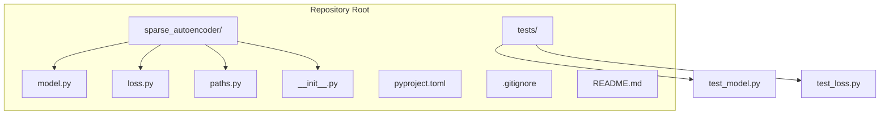
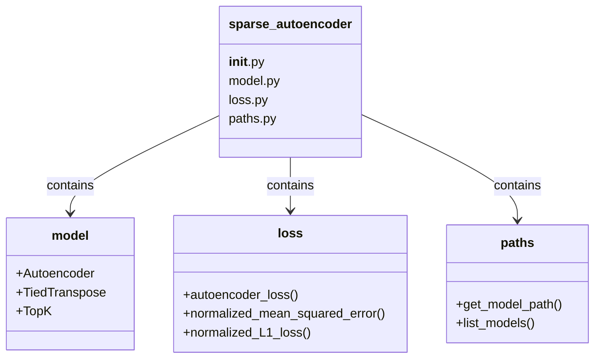
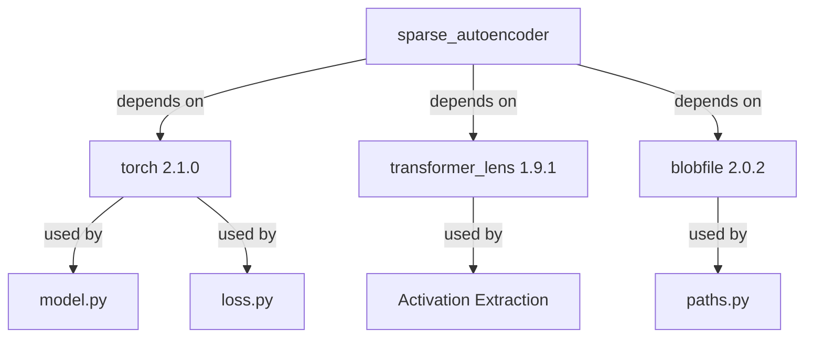
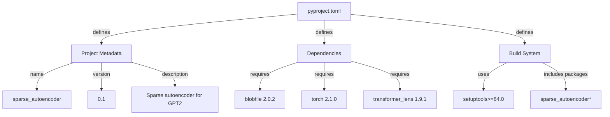
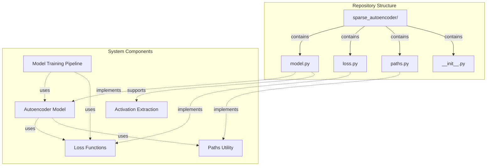

<!-- source: DeepWiki mcp.deepwiki.com · repo openai/sparse_autoencoder · page 6.1 Repository Structure · fetched 2026-10-26 -->

# Repository Structure

<details>
<summary>Relevant source files</summary>

The following files were used as context for generating this wiki page:

- [.gitignore](.gitignore)
- [pyproject.toml](pyproject.toml)

</details>


This document provides a comprehensive overview of the sparse_autoencoder repository structure, file organization, and key components. It serves as a guide for developers who want to understand the codebase layout or contribute to the project. For information about security policies and license terms, see [Security and Licensing](#6.2).

## Overview of Repository Organization

The sparse_autoencoder repository follows a standard Python package structure with a focus on modular design. The repository is organized to separate core functionality, utilities, and development-related files.



Sources: [pyproject.toml](), [.gitignore]()

## Package Structure

The `sparse_autoencoder` package is the core of the repository, containing all the functional code for creating, training, and using sparse autoencoders.



The package consists of several key modules:

1. **model.py**: Contains the implementation of the `Autoencoder` class and related components such as `TiedTranspose` and `TopK` activation function
2. **loss.py**: Implements loss functions used for training the autoencoder, including reconstruction loss and L1 sparsity penalty
3. **paths.py**: Provides utilities for managing file paths, saving and loading models
4. **__init__.py**: Exports the main classes and functions, making them available when importing the package

Sources: [pyproject.toml]()

## Dependencies Management

The project's dependencies are defined in the `pyproject.toml` file. The sparse_autoencoder relies on three primary external libraries:

| Dependency | Version | Purpose |
|------------|---------|---------|
| blobfile | 2.0.2 | File operations for model saving/loading |
| torch | 2.1.0 | Deep learning framework for tensor operations |
| transformer_lens | 1.9.1 | Library for accessing and analyzing transformer model activations |



Sources: [pyproject.toml]()

## Code to File Mapping

The following diagram maps the key functional components of the sparse autoencoder system to their corresponding files in the repository structure:

```mermaid
graph TD
    subgraph "Functional Components"
        A["Autoencoder"]
        B["Loss Functions"]
        C["Paths Utility"]
        D["Activation Extraction"]
    end
    
    subgraph "File Structure"
        E["model.py"]
        F["loss.py"]
        G["paths.py"]
    end
    
    A -->|implemented in| E
    B -->|implemented in| F
    C -->|implemented in| G
    D -->|uses| E
    D -->|external: transformer_lens|
```

This mapping shows how the conceptual components of the system are implemented in specific files within the repository.

Sources: [pyproject.toml]()

## Development Infrastructure

The repository includes several files that support the development workflow but are not part of the functional code:

1. **.gitignore**: Specifies intentionally untracked files that Git should ignore, such as:
   - Python bytecode files (`__pycache__/`, `*.pyc`, etc.)
   - Distribution & packaging files (`dist/`, `*.egg-info/`, etc.)
   - Development environment files (`.env`, `venv/`)
   - Testing artifacts (`.coverage`, `.pytest_cache/`)

2. **pyproject.toml**: Contains project metadata and build system configuration:
   - Project name, version, and description
   - Dependencies specification
   - Build system requirements (setuptools)
   - Package discovery settings

3. **README.md**: The main documentation file that provides an overview of the project

4. **tests/**: Directory containing unit tests for the codebase

Sources: [.gitignore](), [pyproject.toml]()

## Project Packaging Configuration

The `pyproject.toml` file sets up the project as a standard Python package, using setuptools as the build backend. The relevant configuration is shown below:



Sources: [pyproject.toml]()

## File Exclusion Patterns

The `.gitignore` file specifies files that should be excluded from version control. Below is a summary of the main exclusion patterns:

| Category | Excluded Patterns |
|----------|------------------|
| Python Bytecode | `__pycache__/`, `*.py[cod]`, `*$py.class` |
| Build Artifacts | `build/`, `dist/`, `*.egg-info/` |
| Unit Test Artifacts | `.coverage`, `.pytest_cache/`, `htmlcov/` |
| Development Environments | `.env`, `.venv`, `env/`, `venv/` |
| Caches | `.mypy_cache/`, `.ipynb_checkpoints/` |

These exclusions ensure that only source code and necessary configuration files are tracked in the repository, while generated and environment-specific files are ignored.

Sources: [.gitignore]()

## Integration with System Architecture

The repository structure aligns with the overall system architecture. Here's how the file organization maps to the key functional components:



This diagram shows how the repository files implement specific components of the overall system architecture, providing a bridge between the code structure and the functional architecture of the sparse autoencoder system.

Sources: [pyproject.toml]()

## Conclusion

The sparse_autoencoder repository follows a clean, modular structure that separates concerns between model implementation, loss functions, and utility features. The simple organization makes it easy to navigate and understand the codebase, with clear mapping between files and functional components of the system.

---

