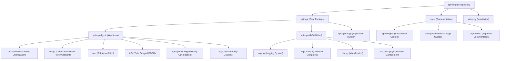
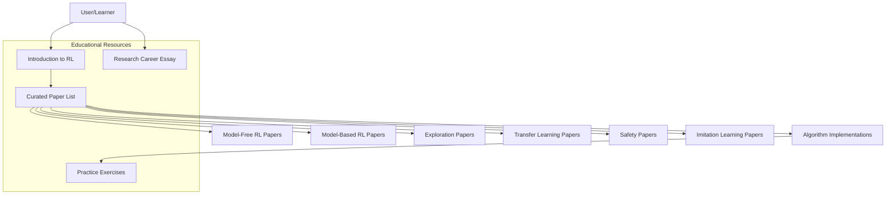
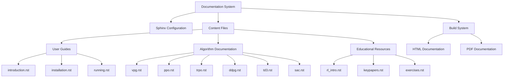
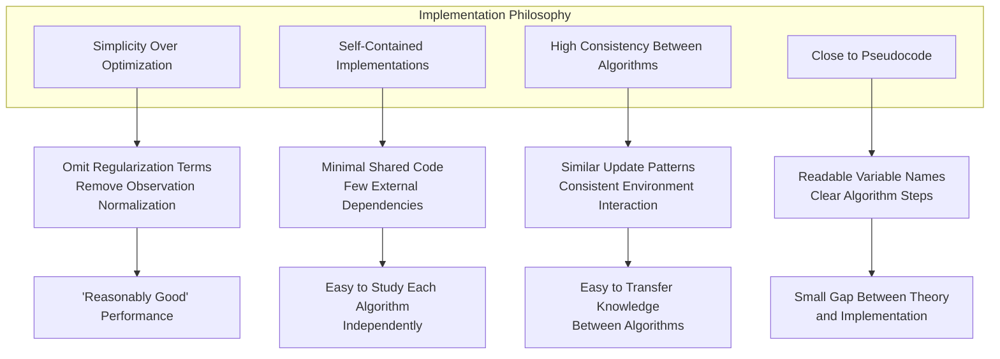

<!-- source: DeepWiki mcp.deepwiki.com · repo openai/spinningup · page 1 Spinning Up Overview · fetched 2026-10-26 -->

# Spinning Up Overview

Relevant source files

The following files were used as context for generating this wiki page:

- [.gitignore](.gitignore)
- [docs/user/introduction.rst](docs/user/introduction.rst)

## Purpose and Scope

This document provides a comprehensive overview of Spinning Up in Deep RL, an educational resource developed by OpenAI that makes it easier to learn about deep reinforcement learning. The purpose of Spinning Up is to serve as a bridge between reinforcement learning theory and practical implementation, lowering the barrier to entry for those interested in the field. This overview covers the system's main components, their relationships, and the overall design philosophy.

For detailed installation instructions, see [Installation Guide](#2). For information about the documentation system itself, see [Documentation System](#3).

Sources: [docs/user/introduction.rst:7-21]()

## What is Spinning Up?

Spinning Up is an educational resource aimed at making deep reinforcement learning (RL) more accessible. It combines carefully designed documentation, clean algorithm implementations, and a curated collection of educational resources to help users understand both the theory and practice of deep RL.

The project was created to address the challenge that while deep learning has many resources to help beginners ramp up quickly, deep RL has traditionally had a higher barrier to entry due to:
- The need for background in math, coding, and deep learning
- The scarcity of high-level views of the field
- Difficulty in translating algorithm theory into working code

Spinning Up is designed to serve as the "missing middle step" for those who want to learn deep RL but don't know where to start.

Sources: [docs/user/introduction.rst:7-44]()

## System Architecture

**Diagram 1: High-Level Architecture of Spinning Up Repository**

Sources: [docs/user/introduction.rst:15-20]()

## Core Components

### Educational Resources

Spinning Up provides a comprehensive set of educational materials designed to help users understand reinforcement learning concepts and implementation details:

1. **Introduction to RL**: Covers terminology, algorithm types, and basic theory
2. **Essay on RL Research**: Guidance on how to grow into an RL research role
3. **Curated Paper List**: Important papers organized by topic areas
4. **Algorithm Documentation**: Detailed explanations of implemented algorithms
5. **Exercises**: Warm-up tasks to practice implementing RL concepts

**Diagram 2: Educational Resource Structure and Learning Path**

Sources: [docs/user/introduction.rst:15-20](), [docs/user/introduction.rst:104-109]()

### Algorithm Implementations

Spinning Up includes standalone implementations of key reinforcement learning algorithms. The implementations follow a consistent structure to highlight similarities between algorithms while keeping each implementation self-contained for easier study.

The algorithms are implemented in both TensorFlow and PyTorch, following the January 2020 update.

Key implemented algorithms include:

| Algorithm | Description | Type |
|-----------|-------------|------|
| VPG | Vanilla Policy Gradient | Policy Gradient |
| TRPO | Trust Region Policy Optimization | Trust Region Method |
| PPO | Proximal Policy Optimization | Trust Region Method |
| DDPG | Deep Deterministic Policy Gradient | Actor-Critic |
| TD3 | Twin Delayed DDPG | Actor-Critic |
| SAC | Soft Actor-Critic | Actor-Critic |

All implementations prioritize clarity and pedagogical value over maximizing performance or including every optimization trick. This design choice makes the code more accessible to learners.

Sources: [docs/user/introduction.rst:64-75]()

### Documentation System

The documentation system is built using Sphinx and provides comprehensive information about:

1. Installation and setup
2. Educational resources on reinforcement learning
3. Algorithm implementations and explanations
4. Benchmarks and performance metrics
5. Usage guides for running experiments

**Diagram 3: Documentation System Structure**

Sources: [docs/user/introduction.rst:15-20]()

### Utility Modules

Spinning Up includes several utility modules that support the algorithm implementations:

1. **Logging System** (logx.py): Handles experiment data recording and output management
2. **Visualization Tools** (plot.py): For plotting learning curves and other performance metrics
3. **MPI Utilities** (mpi_tools.py): Supports parallel computing for faster training
4. **Experiment Management** (run_utils.py): Handles configuration and execution of training runs

These utilities are shared across algorithm implementations but kept minimal to maintain the self-contained nature of each algorithm.

Sources: [docs/user/introduction.rst:69]()

## Code Design Philosophy

The Spinning Up codebase follows specific design principles that guide how the algorithms are implemented:

1. **Simplicity First**: Implementations are as simple as possible while maintaining reasonable performance
2. **High Consistency**: Algorithms follow similar patterns to highlight fundamental similarities
3. **Self-Contained Code**: Minimal shared code between implementations to allow studying each algorithm independently
4. **Pseudocode Proximity**: Code structure mirrors algorithm pseudocode to minimize the theory-to-code gap
5. **Consistent Structure**: All implementations follow the same structure, making it easy to transition between algorithms

The implementations deliberately omit certain optimization tricks and regularization terms found in the original papers to maintain clarity. All algorithms are "reasonably good" in terms of performance but may not match state-of-the-art benchmarks.

**Diagram 4: Code Design Philosophy**

Sources: [docs/user/introduction.rst:64-76]()

## Support and History

Spinning Up was initially released in November 2018, followed by a three-week period of high-bandwidth support. After a community feedback review in April 2019, a PyTorch update was released in January 2020.

Currently, Spinning Up is in maintenance mode, meaning that critical bugs will be fixed to ensure the resource remains usable, but no major feature updates are planned.

The project has been integrated into OpenAI's Scholars and Fellows programs curricula, furthering its educational mission.

Sources: [docs/user/introduction.rst:78-101]()

## Relation to OpenAI's Mission

Spinning Up aligns with OpenAI's mission to ensure the safe development of AGI and the broad distribution of AI benefits by:

1. Helping people understand AI and how it works, empowering critical thinking about AI issues
2. Building expertise in deep RL, which is considered important for AI safety work
3. Lowering barriers to entry for those interested in contributing to AI safety research

The project exemplifies OpenAI's approach to education and talent development in the AI field.

Sources: [docs/user/introduction.rst:50-57]()

---

