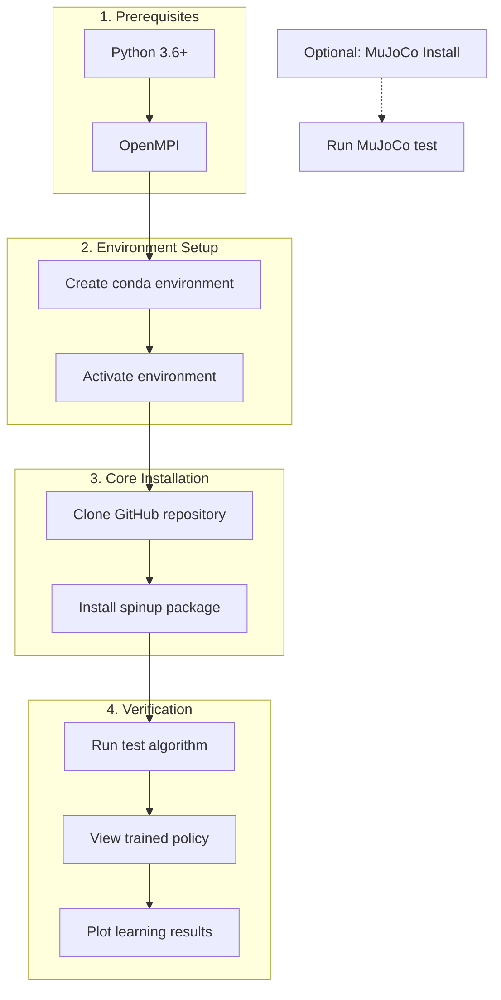
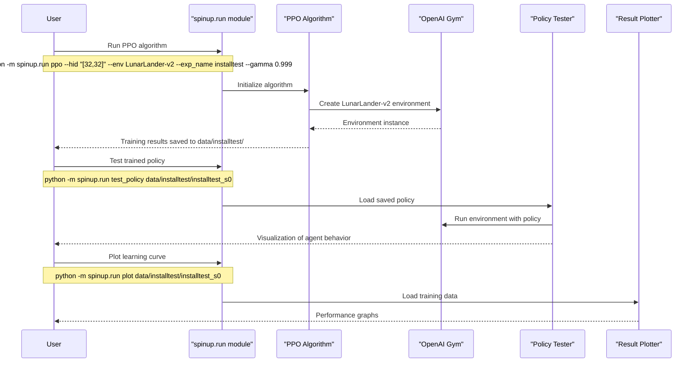

<!-- source: DeepWiki mcp.deepwiki.com · repo openai/spinningup · page 2 Installation Guide · fetched 2026-10-26 -->

# Installation Guide

<details>
<summary>Relevant source files</summary>

The following files were used as context for generating this wiki page:

- [docs/user/installation.rst](docs/user/installation.rst)
- [setup.py](setup.py)
- [spinup/version.py](spinup/version.py)

</details>


This document provides comprehensive instructions for installing OpenAI's Spinning Up reinforcement learning library on your system. You'll learn how to set up all prerequisites, install the core package, and verify that your installation works correctly. For details about specific package dependencies, see [Dependencies and Requirements](#2.1).

## System Requirements

Spinning Up has the following requirements:

- **Operating Systems**: Linux and macOS (primary support)
  - Windows is not officially supported but may work with workarounds
- **Python**: Version 3.6 or higher (enforced by setup script)
- **OpenMPI**: Required for parallel algorithm implementations
- **OpenAI Gym**: Required for reinforcement learning environments

The Python version requirement is checked during installation:

```python
assert sys.version_info.major == 3 and sys.version_info.minor >= 6, \
    "The Spinning Up repo is designed to work with Python 3.6 and greater." \
    + "Please install it before proceeding."
```

Sources: [setup.py:5-7]()

## Installation Workflow

The installation process follows a structured workflow:



Sources: [docs/user/installation.rst:8-10](), [docs/user/installation.rst:77-85]()

## Python Environment Setup

Anaconda is recommended for managing Python environments and packages:

1. Download and install Anaconda from their official website
2. Create a dedicated environment for Spinning Up:
   ```bash
   conda create -n spinningup python=3.6
   ```
3. Activate the environment:
   ```bash
   conda activate spinningup
   ```

Sources: [docs/user/installation.rst:25-40]()

## Installing OpenMPI

OpenMPI is required for parallel algorithm implementations. Installation depends on your operating system:

### Ubuntu/Debian
```bash
sudo apt-get update && sudo apt-get install libopenmpi-dev
```

### macOS
Using Homebrew:
```bash
brew install openmpi
```

Sources: [docs/user/installation.rst:56-74]()

## Installing Spinning Up

After setting up Python and OpenMPI:

1. Clone the repository:
   ```bash
   git clone https://github.com/openai/spinningup.git
   ```

2. Navigate to the repository directory:
   ```bash
   cd spinningup
   ```

3. Install the package:
   ```bash
   pip install -e .
   ```

This command installs Spinning Up and all its dependencies as specified in `setup.py`.

Sources: [docs/user/installation.rst:77-84]()

## Dependencies Overview

Spinning Up installs the following core dependencies:

```mermaid
graph TD
    subgraph "spinup Package"
        SpinningUp["spinup v0.2.0"]
    end
    
    subgraph "Machine Learning"
        tensorflow["tensorflow>=1.8.0,<2.0"]
        torch["torch==1.3.1"]
    end
    
    subgraph "RL Environments"
        gym["gym[atari,box2d,classic_control]"]
    end
    
    subgraph "Data Processing"
        numpy["numpy"]
        pandas["pandas"]
        scipy["scipy"]
        joblib["joblib"]
        cloudpickle["cloudpickle==1.2.1"]
    end
    
    subgraph "Visualization"
        matplotlib["matplotlib==3.1.1"]
        seaborn["seaborn==0.8.1"]
    end
    
    subgraph "Utilities"
        mpi4py["mpi4py"]
        tqdm["tqdm"]
        ipython["ipython"]
        psutil["psutil"]
        pytest["pytest"]
    end
    
    SpinningUp --> tensorflow
    SpinningUp --> torch
    SpinningUp --> gym
    SpinningUp --> numpy
    SpinningUp --> pandas
    SpinningUp --> scipy
    SpinningUp --> matplotlib
    SpinningUp --> seaborn
    SpinningUp --> mpi4py
    SpinningUp --> tqdm
    SpinningUp --> ipython
    SpinningUp --> joblib
    SpinningUp --> cloudpickle
    SpinningUp --> psutil
    SpinningUp --> pytest
```



Sources: [setup.py:16-31](), [spinup/version.py:1-9]()

## Verifying Your Installation

After installing Spinning Up, verify that everything works correctly:



### Step 1: Run a Training Algorithm

Run the PPO algorithm on the LunarLander-v2 environment:

```bash
python -m spinup.run ppo --hid "[32,32]" --env LunarLander-v2 --exp_name installtest --gamma 0.999
```

This will run for about 10 minutes and save results to the `data/installtest/` directory.

### Step 2: Watch the Trained Agent

To see your trained agent in action:

```bash
python -m spinup.run test_policy data/installtest/installtest_s0
```

### Step 3: Plot Training Results

To visualize learning progress:

```bash
python -m spinup.run plot data/installtest/installtest_s0
```

Sources: [docs/user/installation.rst:92-114]()

## Installing MuJoCo (Optional)

MuJoCo is a proprietary physics engine commonly used as a benchmark environment in reinforcement learning research. While not required, it's recommended for running many standard RL benchmarks:

1. Obtain a MuJoCo license:
   - Free 30-day trial licenses are available to anyone
   - Free 1-year licenses are available to full-time students

2. Follow the installation instructions on the mujoco-py GitHub page

3. Install the Gym MuJoCo environments:
   ```bash
   pip install gym[mujoco,robotics]
   ```

4. Verify MuJoCo installation:
   ```bash
   python -m spinup.run ppo --hid "[32,32]" --env Walker2d-v2 --exp_name mujocotest
   ```

Sources: [docs/user/installation.rst:116-139]()

## Troubleshooting

### Common Issues

1. **Package Not Found**:
   - Ensure your conda environment is activated
   - Check that you ran `pip install -e .` from the repository root directory

2. **MPI-related Errors**:
   - Verify OpenMPI is installed correctly
   - Ensure the `mpi4py` Python package installed successfully

3. **Gym Environment Errors**:
   - For issues with specific environments, consult the OpenAI Gym documentation

4. **Python Version Errors**:
   - Make sure you're using Python 3.6 or higher within your conda environment
   - Check that your environment is properly activated

If you encounter issues not covered here, refer to the official GitHub repository for additional help or consult [Algorithm Implementations](#5) for specific algorithm-related problems.

Sources: [docs/user/installation.rst:10-23](), [setup.py:5-7]()

---

