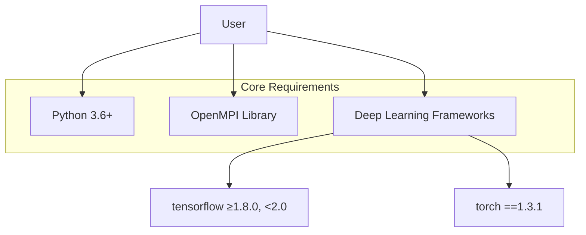
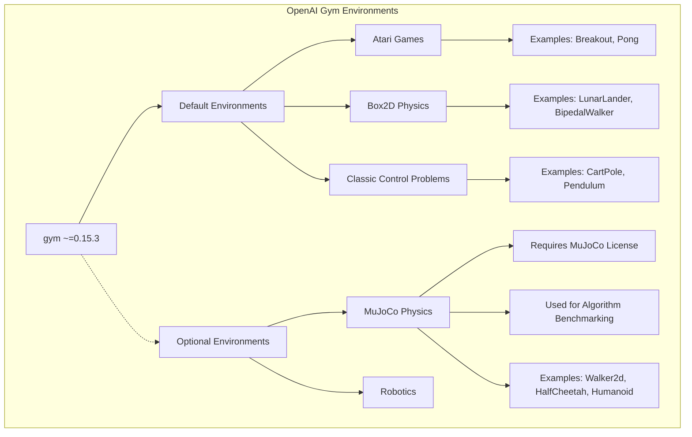
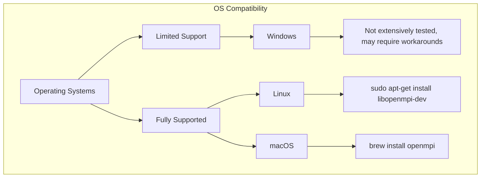
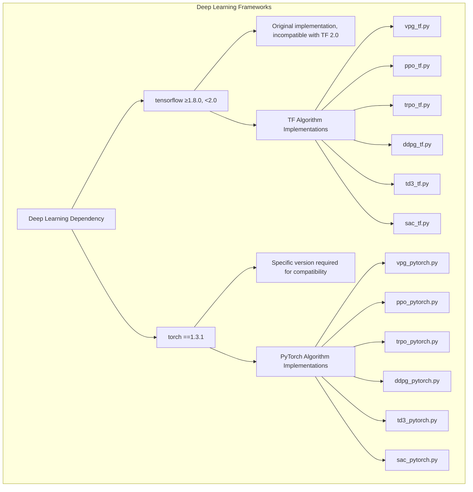
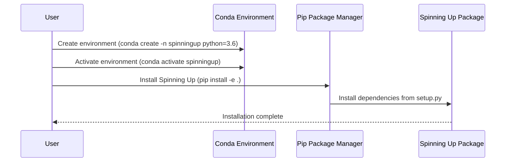

<!-- source: DeepWiki mcp.deepwiki.com · repo openai/spinningup · page 2.1 Dependencies and Requirements · fetched 2026-10-26 -->

# Dependencies and Requirements

<details>
<summary>Relevant source files</summary>

The following files were used as context for generating this wiki page:

- [docs/user/installation.rst](docs/user/installation.rst)
- [setup.py](setup.py)
- [spinup/version.py](spinup/version.py)

</details>


This document provides a detailed explanation of all dependencies required to run OpenAI's Spinning Up. It covers Python version requirements, core libraries, environment dependencies, and optional components. For installation instructions, see [Installation Guide](#2).

## Core Requirements

Spinning Up has three fundamental requirements:

- Python 3.6 or higher
- OpenMPI (for parallel algorithm implementations)
- Deep learning frameworks (TensorFlow 1.x and PyTorch)



Sources: [setup.py:5-7](), [setup.py:29-30](), [docs/user/installation.rst:8]()

## Python Package Dependencies

Spinning Up depends on several Python packages that handle different aspects of the reinforcement learning workflow:

| Category | Package | Version | Purpose |
|----------|---------|---------|---------|
| **Environments** | gym | ~=0.15.3 | RL environment interface with atari, box2d, and classic_control |
| **Deep Learning** | tensorflow | >=1.8.0,<2.0 | Deep learning framework (original implementation) |
| | torch | ==1.3.1 | Deep learning framework (alternative implementation) |
| **Data Processing** | numpy | latest | Numerical computation |
| | pandas | latest | Data analysis and manipulation |
| | scipy | latest | Scientific computing |
| | cloudpickle | ==1.2.1 | Serialization of Python objects |
| **Visualization** | matplotlib | ==3.1.1 | Plotting library |
| | seaborn | ==0.8.1 | Statistical data visualization |
| **Utilities** | mpi4py | latest | MPI for Python (parallel computing) |
| | joblib | latest | Lightweight pipelining |
| | tqdm | latest | Progress bars |
| | psutil | latest | Process utilities |
| | ipython | latest | Interactive Python interface |
| **Testing** | pytest | latest | Python testing framework |

Sources: [setup.py:16-31]()

## Dependency Relationships

The following diagram illustrates how the various dependencies relate to each other in the Spinning Up ecosystem:

```mermaid
flowchart TD
    SpinUpPackage["spinup Package"]
    
    SpinUpPackage --> CoreModules["Core Modules"]
    SpinUpPackage --> Algorithms["Algorithm Implementations"]
    SpinUpPackage --> Utils["Utilities"]
    
    CoreModules --> Version["version.py"]
    
    Algorithms --> PolicyGradient["Policy Gradient Methods"]
    Algorithms --> ActorCritic["Actor-Critic Methods"]
    
    PolicyGradient --> VPG["VPG"]
    ActorCritic --> PPO["PPO"]
    ActorCritic --> TRPO["TRPO"]
    ActorCritic --> DDPG["DDPG"]
    ActorCritic --> TD3["TD3"]
    ActorCritic --> SAC["SAC"]
    
    Utils --> Loggers["Logging System"]
    Utils --> RunUtils["Experiment Management"]
    Utils --> PlotUtils["Visualization Tools"]
    Utils --> MpiTools["MPI Utilities"]
    
    subgraph "External Dependencies"
        DL["Deep Learning Libraries"]
        EnvFramework["Environment Framework"]
        DataTools["Data Processing Tools"]
        VisTools["Visualization Tools"]
        ParallelTools["Parallel Computing"]
        UtilityLibs["Utility Libraries"]
    end
    
    DL --> TF["tensorflow"]
    DL --> PyTorch["torch"]
    
    EnvFramework --> Gym["gym"]
    Gym --> GymEnvs["gym[atari,box2d,classic_control]"]
    Gym -.-> MuJoCo["gym[mujoco,robotics] (Optional)"]
    
    DataTools --> Numpy["numpy"]
    DataTools --> Pandas["pandas"]
    DataTools --> Scipy["scipy"]
    DataTools --> CloudPickle["cloudpickle"]
    
    VisTools --> Matplotlib["matplotlib"]
    VisTools --> Seaborn["seaborn"]
    
    ParallelTools --> MPI4Py["mpi4py"]
    ParallelTools --> Joblib["joblib"]
    
    UtilityLibs --> TQDM["tqdm"]
    UtilityLibs --> PSUtil["psutil"]
    UtilityLibs --> IPython["ipython"]
    UtilityLibs --> PyTest["pytest"]
    
    Algorithms --> DL
    Algorithms --> EnvFramework
    Algorithms --> DataTools
    Algorithms --> ParallelTools
    
    Utils --> VisTools
    Utils --> DataTools
    Utils --> UtilityLibs
```



Sources: [setup.py:16-31](), [docs/user/installation.rst:8-9]()

## OpenAI Gym Environments

Spinning Up uses OpenAI Gym for reinforcement learning environments. The following environments are included by default:

- **Atari**: Classic Atari 2600 game environments
- **Box2D**: 2D physics environments (including LunarLander)
- **Classic Control**: Simple control theory environments like CartPole

MuJoCo environments are optional but recommended for benchmarking purposes:



Sources: [setup.py:18](), [docs/user/installation.rst:14-16](), [docs/user/installation.rst:116-136]()

## Operating System Compatibility

Spinning Up has specific operating system requirements and recommendations:



Sources: [docs/user/installation.rst:10-11](), [docs/user/installation.rst:59-74]()

## Deep Learning Framework Requirements

Spinning Up includes implementations in both TensorFlow and PyTorch with specific version requirements:



Sources: [setup.py:29-30]()

## Optional Components

The MuJoCo environments are optional but recommended for standard benchmarking purposes:

| Component | Purpose | Installation Method | Notes |
|-----------|---------|---------------------|-------|
| MuJoCo | Physics simulation engine | Install from [mujoco-py](https://github.com/openai/mujoco-py) | Requires license (free for students) |
| MuJoCo Gym Environments | RL environments using MuJoCo | `pip install gym[mujoco,robotics]` | Installed after MuJoCo |

Sources: [docs/user/installation.rst:116-139]()

## Version Information

Spinning Up's version information is maintained in a dedicated file:

```
version_info = (0, 2, 0)
# format:
# ('spinup_major', 'spinup_minor', 'spinup_patch')
```

This information is used by `setup.py` during installation to properly version the package.

Sources: [spinup/version.py:1-9](), [setup.py:9-10](), [setup.py:15]()

## Hardware Recommendations

While Spinning Up doesn't have strict hardware requirements, the following are recommended for optimal performance:

- **CPU**: Multi-core processor (for parallel algorithm implementations using MPI)
- **RAM**: At least 8GB
- **GPU**: CUDA-compatible GPU recommended for faster training (especially for complex environments)
- **Storage**: At least 1GB of free disk space

Note that MuJoCo environments and deep learning frameworks benefit significantly from GPU acceleration, though all algorithms can run on CPU-only systems.

## Dependency Management

It is recommended to use conda environments to manage Spinning Up dependencies:



Sources: [docs/user/installation.rst:32-34](), [docs/user/installation.rst:36-40]()

## Verification Process

After installation, users can verify their setup with the following steps:

1. Run a test experiment with PPO on LunarLander-v2
2. Watch a video of the trained policy
3. Plot the learning results

This verifies that all dependencies are correctly installed and working together.

Sources: [docs/user/installation.rst:92-113]()

---

