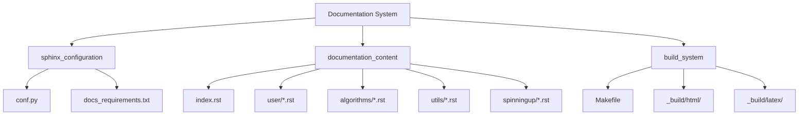
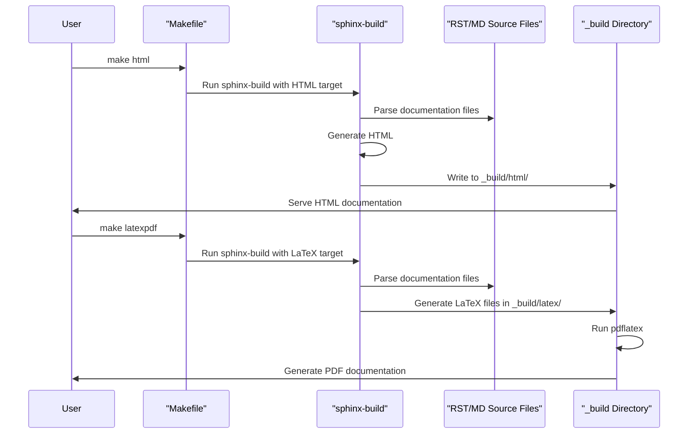
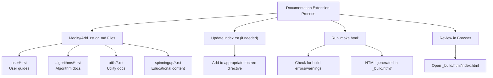

<!-- source: DeepWiki mcp.deepwiki.com · repo openai/spinningup · page 3 Documentation System · fetched 2026-10-26 -->

# Documentation System

<details>
<summary>Relevant source files</summary>

The following files were used as context for generating this wiki page:

- [docs/Makefile](docs/Makefile)
- [docs/conf.py](docs/conf.py)
- [docs/docs_requirements.txt](docs/docs_requirements.txt)
- [docs/index.rst](docs/index.rst)

</details>


## Purpose and Scope

This document explains the documentation system used in the Spinning Up project. It covers the structure of the documentation, technologies used for building it, configuration settings, and build processes. The documentation system serves both as a technical reference for the codebase and as an educational resource for learning reinforcement learning concepts. For information about the actual educational content contained within the documentation, see [Educational Resources](#4).

## Documentation System Overview

The Spinning Up documentation is built using Sphinx, a powerful documentation generator commonly used for Python projects. The system consists of configuration files, content files in ReStructuredText and Markdown formats, and a build system that generates HTML and PDF outputs.



Sources: [docs/conf.py:1-241](), [docs/index.rst:1-72](), [docs/Makefile:1-20]()

## Documentation Structure

The documentation is organized into a hierarchical structure defined in the `index.rst` file, which serves as the root of the documentation tree. The structure is divided into several main sections, each targeting different aspects of the project.

```mermaid
graph TD
    RootToctree["index.rst (root toctree)"]
    
    RootToctree --> UserDocs["User Documentation"]
    RootToctree --> RLIntro["Introduction to RL"]
    RootToctree --> Resources["Resources"]
    RootToctree --> AlgoDocs["Algorithms Docs"]
    RootToctree --> UtilsDocs["Utilities Docs"]
    
    UserDocs --> Introduction["user/introduction.rst"]
    UserDocs --> Installation["user/installation.rst"]
    UserDocs --> Algorithms["user/algorithms.rst"]
    UserDocs --> Running["user/running.rst"]
    UserDocs --> SavingLoading["user/saving_and_loading.rst"]
    UserDocs --> Plotting["user/plotting.rst"]
    
    RLIntro --> RLIntro1["spinningup/rl_intro.rst"]
    RLIntro --> RLIntro2["spinningup/rl_intro2.rst"]
    RLIntro --> RLIntro3["spinningup/rl_intro3.rst"]
    
    Resources --> SpinningUpGuide["spinningup/spinningup.rst"]
    Resources --> KeyPapers["spinningup/keypapers.rst"]
    Resources --> Exercises["spinningup/exercises.rst"]
    Resources --> Benchmarks["spinningup/bench.rst"]
    
    AlgoDocs --> VPG["algorithms/vpg.rst"]
    AlgoDocs --> TRPO["algorithms/trpo.rst"]
    AlgoDocs --> PPO["algorithms/ppo.rst"]
    AlgoDocs --> DDPG["algorithms/ddpg.rst"]
    AlgoDocs --> TD3["algorithms/td3.rst"]
    AlgoDocs --> SAC["algorithms/sac.rst"]
    
    UtilsDocs --> Logger["utils/logger.rst"]
    UtilsDocs --> Plotter["utils/plotter.rst"]
    UtilsDocs --> MPI["utils/mpi.rst"]
    UtilsDocs --> RunUtils["utils/run_utils.rst"]
```



Sources: [docs/index.rst:11-64]()

The table below summarizes the main documentation sections and their purposes:

| Section | Purpose | Files |
|---------|---------|-------|
| User Documentation | Practical guides for installation, running experiments, etc. | `user/*.rst` |
| Introduction to RL | Educational content explaining RL concepts | `spinningup/rl_intro*.rst` |
| Resources | Additional materials including key papers, exercises | `spinningup/{spinningup,keypapers,exercises,bench}.rst` |
| Algorithms Docs | Technical documentation for each implemented algorithm | `algorithms/{vpg,trpo,ppo,ddpg,td3,sac}.rst` |
| Utilities Docs | Documentation for utility modules | `utils/{logger,plotter,mpi,run_utils}.rst` |

Sources: [docs/index.rst:11-64]()

## Sphinx Configuration

The documentation system is configured through the `conf.py` file, which specifies various Sphinx settings and extensions to enhance the functionality of the documentation.

### Key Configuration Components

```mermaid
graph TD
    ConfPy["conf.py"]
    
    ConfPy --> PathConfig["sys.path.insert<br>Module accessibility"]
    ConfPy --> MockModules["mock_modules<br>RTD compatibility"]
    ConfPy --> Parsers["source_parsers<br>MD support"]
    ConfPy --> Extensions["extensions<br>Sphinx plugins"]
    ConfPy --> Templates["templates_path<br>Custom templates"]
    ConfPy --> SourceConfig["source_suffix<br>File types"]
    ConfPy --> ProjectInfo["project_metadata<br>Name, author, etc."]
    ConfPy --> ThemeConfig["html_theme<br>Visual appearance"]
    ConfPy --> MathConfig["imgmath_config<br>Math rendering"]
    ConfPy --> CustomCSS["setup(app)<br>Custom styling"]
    
    MockModules --> MPIMockModule["'mpi4py'"]
    MockModules --> TorchMockModules["'torch' and submodules"]
    
    Extensions --> ImgMath["'sphinx.ext.imgmath'"]
    Extensions --> ViewCode["'sphinx.ext.viewcode'"]
    Extensions --> AutoDoc["'sphinx.ext.autodoc'"]
    Extensions --> Napoleon["'sphinx.ext.napoleon'"]
    
    ThemeConfig --> RTDTheme["sphinx_rtd_theme"]
    ThemeConfig --> Logo["html_logo"]
    ThemeConfig --> Favicon["html_favicon"]
    
    MathConfig --> ImgFormat["imgmath_image_format='svg'"]
    MathConfig --> FontSize["imgmath_font_size=14"]
    MathConfig --> LatexPreamble["imgmath_latex_preamble"]
```



Sources: [docs/conf.py:20-241]()

### Extensions

The documentation uses several Sphinx extensions to enhance its capabilities:

```python
extensions = ['sphinx.ext.imgmath',
    'sphinx.ext.viewcode',
    'sphinx.ext.autodoc',
    'sphinx.ext.napoleon']
```

| Extension | Purpose |
|-----------|---------|
| `sphinx.ext.imgmath` | Renders mathematical equations as images |
| `sphinx.ext.viewcode` | Adds links to source code for documented Python objects |
| `sphinx.ext.autodoc` | Automatically extracts documentation from docstrings |
| `sphinx.ext.napoleon` | Supports Google and NumPy style docstrings |

Sources: [docs/conf.py:66-69]()

### Mock Modules for Read the Docs

To handle dependencies that might not be available during documentation building (especially on Read the Docs), the configuration mocks certain modules:

```python
MOCK_MODULES = ['mpi4py', 
                'torch', 
                'torch.optim', 
                'torch.nn',
                'torch.distributions',
                'torch.distributions.normal',
                'torch.distributions.categorical',
                'torch.nn.functional',
                ]
```

This allows the documentation to build even when these dependencies are not installed.

Sources: [docs/conf.py:36-44]()

### Theme Configuration

The documentation uses the Read the Docs theme with customizations:

```python
html_theme = "sphinx_rtd_theme"
html_logo = 'images/spinning-up-logo2.png'
html_theme_options = {
    'logo_only': True
}
html_favicon = 'openai_icon.ico'
```

Sources: [docs/conf.py:127-146]()

### Mathematical Notation

The documentation includes special configuration for mathematical notation, which is particularly important for reinforcement learning documentation:

```python
imgmath_latex_preamble = r'''
\usepackage{algorithm}
\usepackage{algorithmic}
\usepackage{amsmath}
\usepackage{cancel}

\usepackage[verbose=true,letterpaper]{geometry}
\geometry{
    textheight=12in,
    textwidth=6.5in,
    top=1in,
    headheight=12pt,
    headsep=25pt,
    footskip=30pt
    }

\newcommand{\E}{{\mathrm E}}

\newcommand{\underE}[2]{\underset{\begin{subarray}{c}#1 \end{subarray}}{\E}\left[ #2 \right]}

\newcommand{\Epi}[1]{\underset{\begin{subarray}{c}\tau \sim \pi \end{subarray}}{\E}\left[ #1 \right]}
'''
```

Sources: [docs/conf.py:156-177]()

## Documentation Dependencies

The documentation system has specific dependencies listed in the `docs_requirements.txt` file, which must be installed to build the documentation:

| Package | Version | Purpose |
|---------|---------|---------|
| `sphinx` | 1.5.6 | Core documentation generator |
| `sphinx-autobuild` | 0.7.1 | Automatic rebuilding of docs on changes |
| `sphinx-rtd-theme` | 0.4.1 | Read the Docs theme |
| `cloudpickle` | ~=1.2.1 | Serialization for code examples |
| `gym` | ~=0.15.3 | OpenAI Gym for RL environments |
| `tensorflow` | >=1.8.0,<2.0 | Machine learning framework |
| `matplotlib`, `numpy`, `pandas`, `seaborn` | varies | Data visualization and analysis |

Sources: [docs/docs_requirements.txt:1-16]()

## Build Process

The documentation is built using a standard Sphinx Makefile, which provides various build targets.

### Build Flow



Sources: [docs/Makefile:1-20]()

### Common Build Commands

The Makefile provides several targets for building the documentation:

| Command | Purpose |
|---------|---------|
| `make html` | Build HTML documentation in `_build/html/` |
| `make latexpdf` | Build PDF documentation using LaTeX |
| `make clean` | Remove all build artifacts |
| `make help` | Show available make targets |

Sources: [docs/Makefile:1-20]()

## Extending the Documentation

To extend or modify the Spinning Up documentation, you would typically follow these steps:

1. Add or modify `.rst` or `.md` files in the appropriate directory
2. Update `index.rst` if adding new top-level pages
3. Run `make html` to build and preview changes
4. If adding a new algorithm, create a new file in the `algorithms/` directory and add it to the "Algorithms Docs" section in `index.rst`



Sources: [docs/index.rst:11-64](), [docs/Makefile:1-20]()

## Custom Styling

The documentation includes custom CSS modifications through a setup function in `conf.py`:

```python
def setup(app):
    app.add_stylesheet('css/modify.css')
```

This adds a custom stylesheet to modify the appearance of the generated documentation beyond the default theme settings.

Sources: [docs/conf.py:240-241]()

## Integration with Codebase

The documentation system is designed to integrate closely with the actual codebase. The `autodoc` extension pulls documentation directly from docstrings in the Python code, ensuring that API documentation stays synchronized with the implementation.

To make this possible, the `conf.py` file adds the root directory to the Python path:

```python
# Make sure spinup is accessible without going through setup.py
dirname = os.path.dirname
sys.path.insert(0, dirname(dirname(__file__)))
```

Sources: [docs/conf.py:23-25]()

This allows Sphinx to import the `spinup` package during the documentation build process and extract documentation from docstrings.

---

