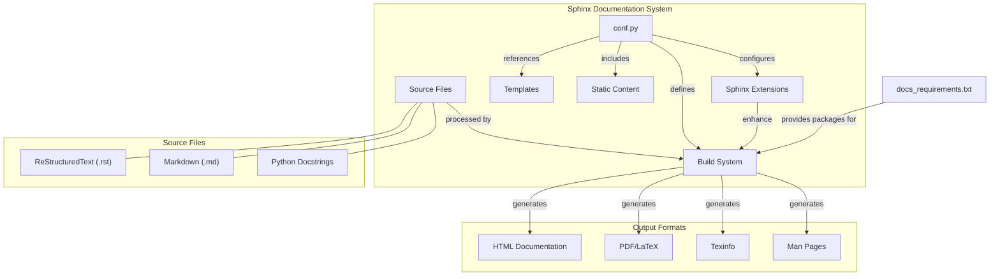
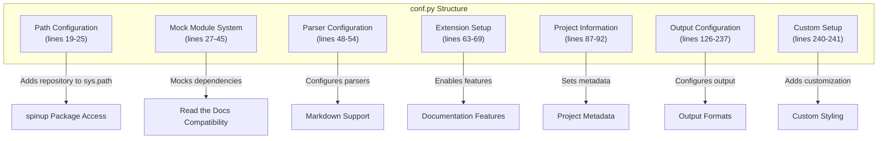
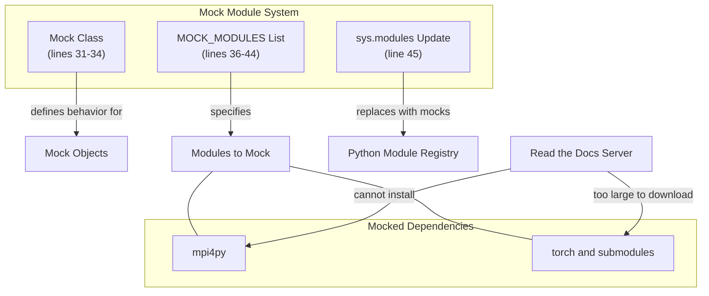
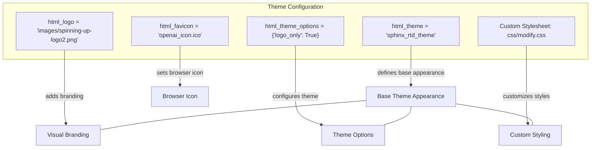
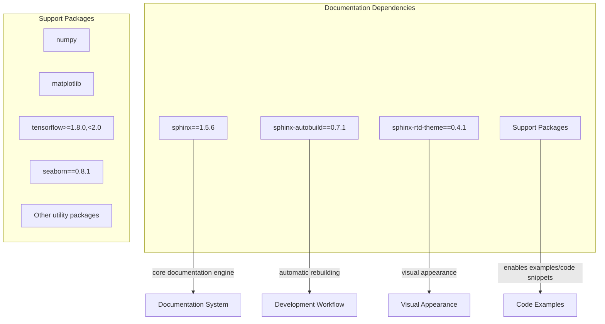
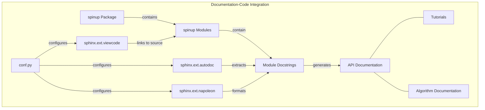

<!-- source: DeepWiki mcp.deepwiki.com · repo openai/spinningup · page 3.1 Sphinx Configuration · fetched 2026-10-26 -->

# Sphinx Configuration

<details>
<summary>Relevant source files</summary>

The following files were used as context for generating this wiki page:

- [docs/conf.py](docs/conf.py)
- [docs/docs_requirements.txt](docs/docs_requirements.txt)

</details>


## Purpose and Scope

This document details the Sphinx configuration used in the Spinning Up documentation system. It covers the structure of the configuration file, extensions, theme settings, math rendering settings, and other customizations that enable the generation of the Spinning Up educational content. For information about the documentation build process itself, see [Documentation Build Process](#3.2).

## Documentation System Overview

The Sphinx documentation system is a core component of Spinning Up's educational resources, rendering complex reinforcement learning concepts in an accessible format.



Sources: [docs/conf.py:1-241](), [docs/docs_requirements.txt:1-16]()

## Configuration File Structure

The Sphinx configuration for Spinning Up is defined in `conf.py`, which is organized into several logical sections:



Sources: [docs/conf.py:1-241]()

### Path Configuration

The configuration begins by ensuring the Spinning Up package is accessible without requiring installation:

```
import os
import sys

# Make sure spinup is accessible without going through setup.py
dirname = os.path.dirname
sys.path.insert(0, dirname(dirname(__file__)))
```

This allows the documentation to reference and extract information from the actual code modules during the build process.

Sources: [docs/conf.py:19-25]()

## Mock Module System

To address the limitations of Read the Docs (RTD) build environment, Spinning Up uses Python's `unittest.mock` to create mock objects for dependencies that would be difficult to install on the RTD servers:



Sources: [docs/conf.py:27-45]()

The mock system replaces the following modules with mock objects:
- `mpi4py` (installation issues on RTD)
- `torch` and its submodules (too large for RTD)

This allows the documentation to be built successfully without these dependencies.

## Parser and Source Configuration

Spinning Up's documentation supports both reStructuredText (`.rst`) and Markdown (`.md`) formats:

```python
source_parsers = {
    '.md': CommonMarkParser,
}

source_suffix = ['.rst', '.md']
```

This flexibility allows documentation contributors to use their preferred format while maintaining a consistent output style.

Sources: [docs/conf.py:48-54](), [docs/conf.py:81-84]()

## Sphinx Extensions

The documentation system uses several Sphinx extensions to enhance functionality:

| Extension | Purpose |
|-----------|---------|
| `sphinx.ext.imgmath` | Renders mathematical expressions as images |
| `sphinx.ext.viewcode` | Links documentation to source code |
| `sphinx.ext.autodoc` | Generates API documentation from docstrings |
| `sphinx.ext.napoleon` | Supports Google and NumPy style docstrings |

Sources: [docs/conf.py:63-69]()

### Math Rendering Configuration

Given the mathematics-heavy nature of reinforcement learning, Spinning Up configures detailed math rendering settings:

```python
# imgmath settings
imgmath_image_format = 'svg'
imgmath_font_size = 14
```

Additionally, the configuration includes an extensive LaTeX preamble with custom commands for reinforcement learning notation:

```python
imgmath_latex_preamble = r'''
\usepackage{algorithm}
\usepackage{algorithmic}
\usepackage{amsmath}
\usepackage{cancel}

\usepackage[verbose=true,letterpaper]{geometry}
\geometry{
    textheight=12in,
    textwidth=6.5in,
    top=1in,
    headheight=12pt,
    headsep=25pt,
    footskip=30pt
    }

\newcommand{\E}{{\mathrm E}}
\newcommand{\underE}[2]{\underset{\begin{subarray}{c}#1 \end{subarray}}{\E}\left[ #2 \right]}
\newcommand{\Epi}[1]{\underset{\begin{subarray}{c}\tau \sim \pi \end{subarray}}{\E}\left[ #1 \right]}
'''
```

These custom commands allow for consistent mathematical notation throughout the documentation, particularly for expectation operators commonly used in reinforcement learning equations.

Sources: [docs/conf.py:73-75](), [docs/conf.py:156-177]()

## Theme and Styling

Spinning Up uses the Read the Docs theme for its clean, responsive design:



Sources: [docs/conf.py:126-146](), [docs/conf.py:240-241]()

The theme configuration includes:
- Setting the theme to Read the Docs (`sphinx_rtd_theme`)
- Adding the Spinning Up logo
- Setting a custom favicon
- Configuring theme options for logo display
- Adding a custom stylesheet for additional styling

## Output Format Configuration

The configuration supports multiple output formats:

| Format | Configuration Section | Lines |
|--------|------------------------|-------|
| HTML | HTML output | 126-146 |
| LaTeX/PDF | LaTeX output | 153-215 |
| Man Pages | Manual page output | 219-225 |
| Texinfo | Texinfo output | 229-237 |

Each format has specific configuration options to ensure proper formatting and appearance.

Sources: [docs/conf.py:126-237]()

## Build Dependencies

The documentation build system requires several Python packages, specified in `docs_requirements.txt`:



Sources: [docs/docs_requirements.txt:1-16]()

Key dependencies include:
- `sphinx==1.5.6`: The core documentation generation engine
- `sphinx-autobuild==0.7.1`: For automatic rebuilding during development
- `sphinx-rtd-theme==0.4.1`: The Read the Docs theme package
- Support packages like `numpy`, `matplotlib`, and `tensorflow` to ensure code examples work properly

## Integration with Spinning Up Package

The Sphinx configuration integrates closely with the Spinning Up package structure:



Sources: [docs/conf.py:19-25](), [docs/conf.py:63-69]()

This integration allows the documentation to automatically stay in sync with the codebase, as API documentation is generated directly from docstrings in the Python modules.

## Conclusion

The Sphinx configuration in Spinning Up creates a comprehensive documentation system that effectively communicates complex reinforcement learning concepts. Through careful extension selection, theme configuration, and custom styling, it produces documentation that is both informative and accessible to learners at various levels.

The configuration balances the need for technical accuracy (through features like precise math rendering) with educational clarity (through a clean, responsive theme), supporting Spinning Up's primary goal as an educational resource.

---

