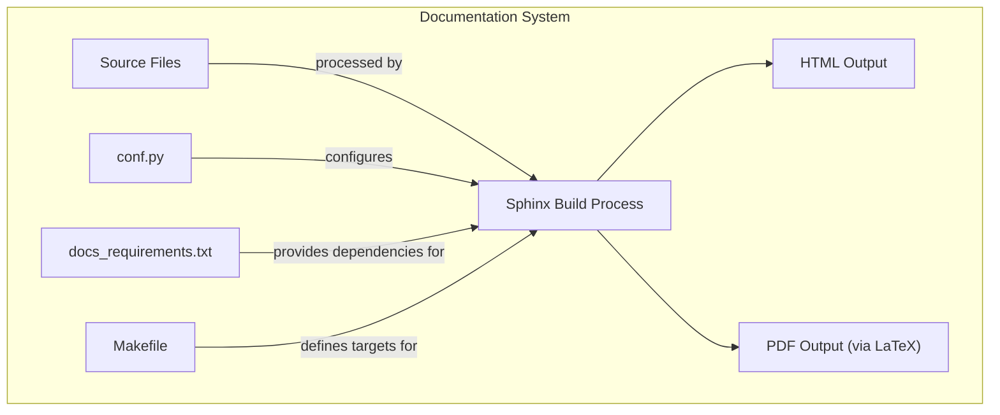
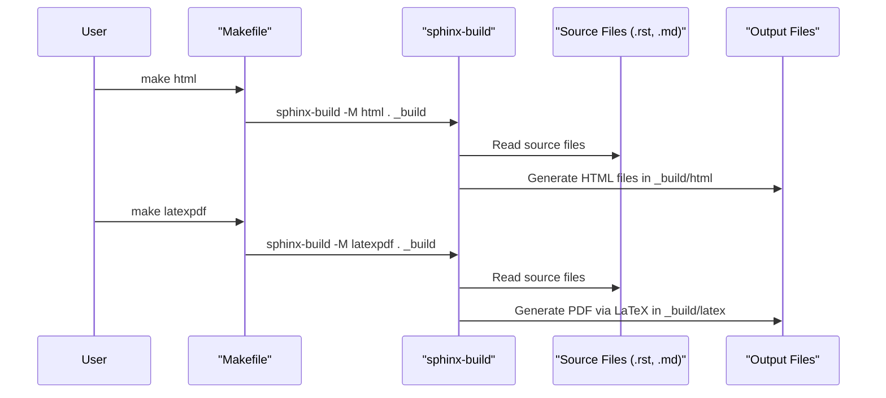
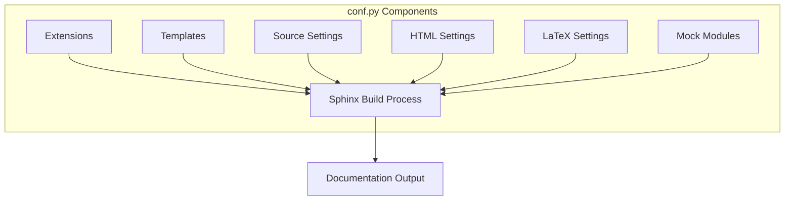

<!-- source: DeepWiki mcp.deepwiki.com · repo openai/spinningup · page 3.2 Documentation Build Process · fetched 2026-10-26 -->

# Documentation Build Process

<details>
<summary>Relevant source files</summary>

The following files were used as context for generating this wiki page:

- [docs/Makefile](docs/Makefile)
- [docs/conf.py](docs/conf.py)
- [docs/docs_requirements.txt](docs/docs_requirements.txt)
- [docs/index.rst](docs/index.rst)

</details>


This document explains the process for building the Spinning Up documentation, including prerequisites, build commands, customization options, and troubleshooting. It focuses specifically on how to generate the HTML and PDF documentation from the source files. For information about the Sphinx configuration itself, see [Sphinx Configuration](#3.1).

## Overview of the Documentation System

The Spinning Up documentation is built using Sphinx, a powerful documentation generator widely used in the Python ecosystem. The documentation system consists of several key components that work together to produce the final documentation.



Sources: [docs/conf.py](), [docs/Makefile](), [docs/docs_requirements.txt](), [docs/index.rst]()

## Prerequisites

Before building the Spinning Up documentation, you need to install the required dependencies. These are specified in the `docs_requirements.txt` file.

### Required Dependencies

The following table shows the key dependencies required for building the documentation:

| Dependency | Version | Purpose |
|------------|---------|---------|
| sphinx | 1.5.6 | Core documentation generator |
| sphinx-autobuild | 0.7.1 | Live reload for development |
| sphinx-rtd-theme | 0.4.1 | ReadTheDocs theme for HTML output |
| tensorflow | >=1.8.0,<2.0 | Required for code examples |
| matplotlib | - | For generating plots |
| numpy | - | For numerical operations |
| seaborn | 0.8.1 | For enhanced visualizations |

Sources: [docs/docs_requirements.txt:1-16]()

### Installing Dependencies

To install all required dependencies for building the documentation:

```bash
# Navigate to the docs directory
cd docs
# Install all required packages
pip install -r docs_requirements.txt
```

## Build Process

The documentation build process is managed through the `Makefile` in the `docs` directory. This section explains how to use the Makefile to build the documentation in different formats.



Sources: [docs/Makefile:1-20]()

### Building HTML Documentation

To build the HTML documentation:

```bash
# Navigate to the docs directory
cd docs
# Build HTML documentation
make html
```

The HTML output will be generated in the `_build/html` directory. You can open `_build/html/index.html` in a web browser to view the documentation.

### Building PDF Documentation

To build the PDF documentation (requires LaTeX):

```bash
# Navigate to the docs directory
cd docs
# Build PDF documentation
make latexpdf
```

The PDF output will be generated as `_build/latex/SpinningUp.pdf`.

### Other Build Formats

The Makefile supports several other build formats:

| Target | Description | Output Location |
|--------|-------------|-----------------|
| `html` | HTML documentation | `_build/html/` |
| `latexpdf` | PDF via LaTeX | `_build/latex/SpinningUp.pdf` |
| `epub` | EPUB e-book | `_build/epub/SpinningUp.epub` |
| `text` | Plain text | `_build/text/` |
| `clean` | Remove build directory | - |

To see all available targets:

```bash
make help
```

Sources: [docs/Makefile:1-20]()

## Understanding the Build Configuration

The Sphinx build process is configured through the `conf.py` file, which defines various settings that control the output of the documentation.



Sources: [docs/conf.py:57-237]()

### Key Configuration Elements

#### Extensions

Sphinx extensions that provide additional functionality:

```python
extensions = ['sphinx.ext.imgmath',
    'sphinx.ext.viewcode',
    'sphinx.ext.autodoc',
    'sphinx.ext.napoleon']
```

- `imgmath`: Renders math as images
- `viewcode`: Adds links to source code
- `autodoc`: Extracts documentation from Python docstrings
- `napoleon`: Supports Google/NumPy style docstrings

Sources: [docs/conf.py:66-69]()

#### Source Settings

Configuration for source files:

```python
source_suffix = ['.rst', '.md']
master_doc = 'index'
```

This allows both reStructuredText (.rst) and Markdown (.md) files to be used as source documents.

Sources: [docs/conf.py:83-87]()

#### HTML Theme Settings

The documentation uses the ReadTheDocs theme:

```python
html_theme = "sphinx_rtd_theme"
html_logo = 'images/spinning-up-logo2.png'
html_theme_options = {
    'logo_only': True
}
```

Sources: [docs/conf.py:127-144]()

#### Mock Modules

To handle dependencies that are difficult to install or not necessary for documentation building (like PyTorch and MPI), the configuration uses mocking:

```python
MOCK_MODULES = ['mpi4py', 
                'torch', 
                'torch.optim', 
                'torch.nn',
                'torch.distributions',
                'torch.distributions.normal',
                'torch.distributions.categorical',
                'torch.nn.functional',
                ]
sys.modules.update((mod_name, Mock()) for mod_name in MOCK_MODULES)
```

This allows the documentation to build successfully on platforms like ReadTheDocs without requiring all dependencies to be installed.

Sources: [docs/conf.py:27-45]()

## Customizing the Documentation

You can customize the documentation by modifying various files in the documentation system.

### Adding New Pages

To add a new page to the documentation:

1. Create a new `.rst` or `.md` file in the appropriate directory
2. Add the file to the appropriate `toctree` directive in `index.rst` or another parent document

For example, to add a new algorithm documentation:

```rst
.. toctree::
   :maxdepth: 2
   :caption: Algorithms Docs

   algorithms/vpg
   algorithms/trpo
   algorithms/ppo
   algorithms/ddpg
   algorithms/td3
   algorithms/sac
   algorithms/your_new_algorithm
```

Sources: [docs/index.rst:40-48]()

### Modifying the Theme

You can customize the appearance by:

1. Modifying the `html_theme_options` in `conf.py`
2. Adding custom CSS in the `_static/css/` directory and referencing it in the `setup` function

```python
def setup(app):
    app.add_stylesheet('css/modify.css')
```

Sources: [docs/conf.py:240-241]()

## Troubleshooting

Here are solutions to common issues that may arise during the documentation build process:

### Missing Dependencies

If you see errors about missing packages:

```
ImportError: No module named 'sphinx_rtd_theme'
```

Solution: Install the required dependencies using the `docs_requirements.txt` file:

```bash
pip install -r docs_requirements.txt
```

### MPI4Py or PyTorch Import Errors

The build is configured to mock certain modules like `mpi4py` and `torch` to avoid having to install them. However, if you're still seeing import errors:

1. Check if the module is included in the `MOCK_MODULES` list in `conf.py`
2. If not, add it to the list

Sources: [docs/conf.py:27-45]()

### Math Rendering Issues

If math equations aren't rendering correctly:

1. Check that `imgmath` extension is enabled in `conf.py`
2. Verify LaTeX is properly installed if building PDF documentation
3. Adjust the `imgmath_image_format` and `imgmath_font_size` settings if needed

Sources: [docs/conf.py:73-75]()

### ReadTheDocs Build Failures

If your documentation fails to build on ReadTheDocs:

1. Ensure all required modules are properly mocked in `conf.py`
2. Check for large dependencies that might exceed ReadTheDocs limits
3. Verify your `.readthedocs.yml` configuration if you're using it

## Conclusion

The Spinning Up documentation build process is managed through a standard Sphinx setup with customizations for handling mathematical content and code examples. By using the `Makefile` and understanding the configuration in `conf.py`, you can build, customize, and troubleshoot the documentation effectively.

For more information about the Sphinx configuration itself and how it's structured, see [Sphinx Configuration](#3.1).

---

