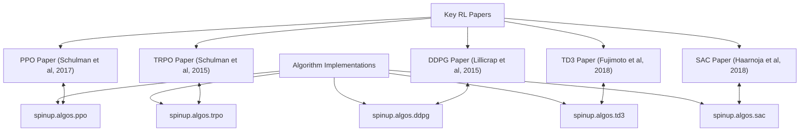
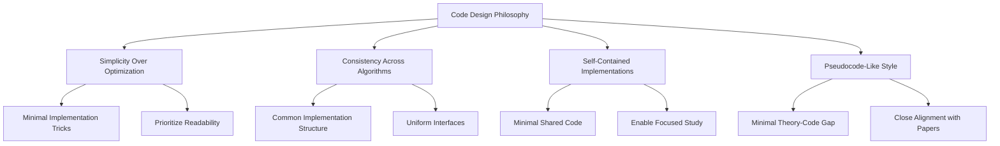

<!-- source: DeepWiki mcp.deepwiki.com · repo openai/spinningup · page 4 Educational Resources · fetched 2026-10-26 -->

# Educational Resources

Relevant source files

The following files were used as context for generating this wiki page:

- [docs/spinningup/keypapers.rst](docs/spinningup/keypapers.rst)
- [docs/user/introduction.rst](docs/user/introduction.rst)

## Purpose and Scope

This document provides an overview of the educational content in the Spinning Up repository, explaining the resources available to help users learn about deep reinforcement learning (RL). The educational components include an introduction to RL terminology and theory, a curated list of key papers, learning exercises, and connections to practical implementations. These resources are designed to bridge the gap between theoretical understanding and code implementation in deep RL.

For information about the specific algorithm implementations, see [Algorithm Implementations](#5).

## Educational Content Structure

Spinning Up serves as an educational ecosystem, with carefully structured components that work together to make deep reinforcement learning accessible.

### Educational Components Overview

```mermaid
graph TD
    SpinUpEdu["Spinning Up Educational Resources"]
    
    SpinUpEdu --> RLIntro["Introduction to RL"]
    SpinUpEdu --> ResearchEssay["Research Career Essay"]
    SpinUpEdu --> KeyPapers["Curated Papers List"]
    SpinUpEdu --> Exercises["Learning Exercises"]
    SpinUpEdu --> AlgoImpl["Algorithm Implementations"]
    
    RLIntro --> Terminology["RL Terminology"]
    RLIntro --> AlgoTypes["Algorithm Types"]
    RLIntro --> Theory["Basic Theory"]
    
    KeyPapers --> ModelFreeRL["Model-Free RL"]
    KeyPapers --> Exploration["Exploration"]
    KeyPapers --> TransferRL["Transfer & Multitask RL"]
    KeyPapers --> Hierarchy["Hierarchy"]
    KeyPapers --> Memory["Memory"]
    KeyPapers --> ModelBasedRL["Model-Based RL"]
    KeyPapers --> MetaRL["Meta-RL"]
    KeyPapers --> ScalingRL["Scaling RL"]
    KeyPapers --> Safety["Safety"]
    KeyPapers --> ImitationLearning["Imitation Learning"]
    
    AlgoImpl --> VPG["Vanilla Policy Gradient (VPG)"]
    AlgoImpl --> PPO["Proximal Policy Optimization (PPO)"]
    AlgoImpl --> TRPO["Trust Region Policy Optimization (TRPO)"]
    AlgoImpl --> DDPG["Deep Deterministic Policy Gradient (DDPG)"]
    AlgoImpl --> TD3["Twin Delayed DDPG (TD3)"]
    AlgoImpl --> SAC["Soft Actor-Critic (SAC)"]
```

Sources: [docs/user/introduction.rst:10-20](), [docs/spinningup/keypapers.rst:1-295]()

The educational content in Spinning Up consists of five main components:

1. **Introduction to RL**: A concise primer on reinforcement learning concepts, terminology, and theory
2. **Research Career Essay**: Guidance on how to develop a career in RL research 
3. **Curated Papers List**: A comprehensive collection of important papers in deep RL
4. **Learning Exercises**: Practical exercises to apply theoretical concepts
5. **Algorithm Implementations**: Clean, readable implementations of key RL algorithms

## Introduction to RL

The Introduction to RL component provides foundational knowledge about reinforcement learning concepts, terminology, and basic theory. It serves as an entry point for newcomers to the field and helps establish the vocabulary needed to understand the more advanced materials.

Key aspects covered in the introduction include:
- Fundamental RL terminology (states, actions, rewards, policies, value functions)
- Types of RL algorithms and their characteristics
- Basic theoretical principles underlying RL methods

This resource is designed to be accessible while providing sufficient depth to prepare users for engaging with the algorithm implementations and research papers.

Sources: [docs/user/introduction.rst:16]()

## Key Papers in Deep RL

One of the most valuable educational resources in Spinning Up is the curated list of key papers in deep reinforcement learning. This list serves as a roadmap to the field, organizing important research papers by topic area to help users navigate the vast RL literature.

### Organization of Key Papers

```mermaid
flowchart TD
    KeyPapers["Key Papers in Deep RL"]
    
    KeyPapers --> ModelFree["1. Model-Free RL"]
    KeyPapers --> Exploration["2. Exploration"]
    KeyPapers --> Transfer["3. Transfer and Multitask RL"]
    KeyPapers --> Hierarchy["4. Hierarchy"]
    KeyPapers --> Memory["5. Memory"]
    KeyPapers --> ModelBased["6. Model-Based RL"]
    KeyPapers --> MetaRL["7. Meta-RL"]
    KeyPapers --> Scaling["8. Scaling RL"]
    KeyPapers --> RealWorld["9. RL in the Real World"]
    KeyPapers --> Safety["10. Safety"]
    KeyPapers --> Imitation["11. Imitation Learning and IRL"]
    KeyPapers --> Reproducibility["12. Reproducibility and Analysis"]
    KeyPapers --> Classic["13. Classic Papers"]
    
    ModelFree --> DQL["a. Deep Q-Learning"]
    ModelFree --> PG["b. Policy Gradients"]
    ModelFree --> DPG["c. Deterministic Policy Gradients"]
    ModelFree --> DistRL["d. Distributional RL"]
    ModelFree --> ADBL["e. Action-Dependent Baselines"]
    ModelFree --> PCL["f. Path-Consistency Learning"]
    ModelFree --> Hybrid["g. Policy-Learning and Q-Learning"]
    ModelFree --> EA["h. Evolutionary Algorithms"]
```

Sources: [docs/spinningup/keypapers.rst:7-297]()

The papers are organized into 13 major categories with subcategories for specific research directions. Each paper entry includes:
- Full citation with link to the original paper
- Author names and publication year
- Algorithm name or key contribution
- Sometimes brief notes about the significance

For example, in the Policy Gradients subcategory, key papers include:
- Trust Region Policy Optimization (Schulman et al, 2015)
- Proximal Policy Optimization Algorithms (Schulman et al, 2017)
- Generalized Advantage Estimation (Schulman et al, 2015)

This organization helps users identify relevant papers based on their interests and provides a structured way to explore the field's development.

### Mapping Papers to Implementations

A particularly valuable aspect of Spinning Up's educational approach is the connection between theoretical papers and their practical implementations in the codebase:

Sources: [docs/spinningup/keypapers.rst:38-42](), [docs/spinningup/keypapers.rst:55-60](), [docs/spinningup/keypapers.rst:49-50]()

This bidirectional mapping allows users to:
1. Read a paper to understand the theoretical foundations
2. Study the corresponding implementation to see how theory translates to code
3. Run experiments to observe algorithm behavior and performance

## Learning Philosophy and Exercises

Spinning Up adopts a distinctive learning philosophy focused on making deep RL accessible and understandable. This is reflected in both the organization of educational resources and the design of the exercises.

### Learning Philosophy

The educational approach in Spinning Up is guided by several principles:

| Principle | Description |
|-----------|-------------|
| **Simplicity First** | Resources prioritize clarity and simplicity over comprehensive coverage |
| **Theory-Practice Connection** | Strong emphasis on connecting theoretical concepts to practical implementations |
| **Consistency** | Similar structure across resources to facilitate comparison and transfer of knowledge |
| **Self-Contained Learning** | Resources designed to be understood with minimal external references |
| **Progressive Complexity** | Materials arranged to allow progressive learning from basics to advanced topics |

Sources: [docs/user/introduction.rst:61-73]()

### Exercises

Spinning Up includes exercises that serve as warm-up activities for working with RL algorithms. These exercises are designed to help users:
- Solidify their understanding of RL concepts
- Practice implementing key components of RL algorithms
- Gain experience with debugging and optimizing RL systems
- Develop intuition about algorithm behavior and performance

The exercises complement the other educational resources by providing hands-on practice with the concepts covered in the introduction and papers list.

Sources: [docs/user/introduction.rst:20]()

## Code Design Philosophy

The algorithm implementations in Spinning Up follow a specific design philosophy that enhances their educational value:

Sources: [docs/user/introduction.rst:61-73]()

Key aspects of this design philosophy include:

1. **Simplicity Over Optimization**: Implementations prioritize clarity and readability over performance optimizations. Some optimization tricks found in original algorithm implementations are intentionally omitted to maintain clarity.

2. **Consistency Across Algorithms**: All implementations follow a similar structure, making it easier to compare different algorithms and understand their relationships.

3. **Self-Contained Code**: Each algorithm implementation is almost entirely self-contained, with minimal dependencies on shared code. This allows users to study each algorithm in isolation.

4. **Pseudocode-Like Style**: The implementations are structured to closely resemble pseudocode, minimizing the gap between theoretical descriptions in papers and actual code.

This design philosophy directly supports the educational goals of Spinning Up by making algorithm implementations approachable and understandable.

## Framework Support

Spinning Up provides implementations in two major deep learning frameworks:

1. **TensorFlow v1**: The original implementations
2. **PyTorch**: Added in January 2020 based on community feedback

This dual-framework approach allows users to learn with their preferred framework while maintaining the same educational principles across implementations.

Sources: [docs/user/introduction.rst:97]()

## Educational Integration with OpenAI Programs

The Spinning Up educational resources have been integrated into OpenAI's educational programs, including:

- **OpenAI Scholars**: A program supporting individuals from underrepresented groups in AI research
- **OpenAI Fellows**: A program supporting promising AI researchers

This integration demonstrates the effectiveness of these resources in structured educational settings and their role in developing technical talent for AI safety research.

Sources: [docs/user/introduction.rst:101-102]()

## Conclusion

The educational resources in Spinning Up form a comprehensive learning ecosystem designed to make deep reinforcement learning accessible to a wide audience. By combining theoretical explanations, curated research papers, practical exercises, and clear algorithm implementations, Spinning Up provides a structured path for learning deep RL from fundamentals to cutting-edge research.

The careful design of these resources reflects OpenAI's mission to ensure the safe development of AI and the broad distribution of AI benefits by empowering more people to understand and contribute to the field.

Sources: [docs/user/introduction.rst:27-47](), [docs/user/introduction.rst:50-58]()

---

