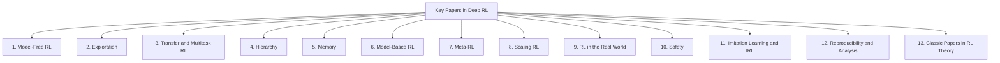
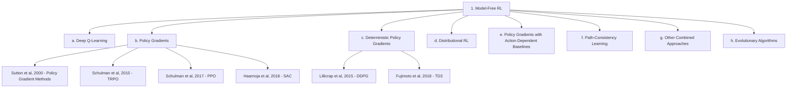
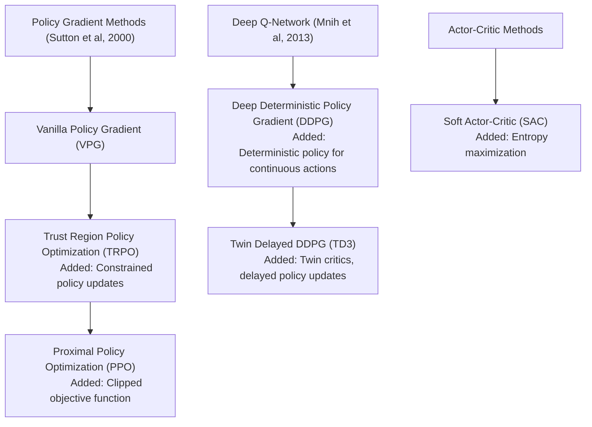

<!-- source: DeepWiki mcp.deepwiki.com · repo openai/spinningup · page 4.1 Key Papers in Deep RL · fetched 2026-10-26 -->

# Key Papers in Deep RL

Relevant source files

The following files were used as context for generating this wiki page:

- [docs/spinningup/keypapers.rst](docs/spinningup/keypapers.rst)

## Purpose and Scope

This document provides an explanation of the curated list of significant research papers in Deep Reinforcement Learning (Deep RL) included as part of the Spinning Up educational resource. This collection serves as:

1. A structured guide to important papers in Deep RL, organized by research areas
2. A reference for the theoretical foundations of algorithms implemented in Spinning Up
3. A starting point for researchers and practitioners looking to explore the field

While not exhaustive, this collection covers major developments in Deep RL, with emphasis on papers that have introduced influential algorithms or concepts. For implementation details of specific algorithms, see [Algorithm Implementations](#5).

## Organization of the Paper Collection

The paper collection is organized into 13 categories representing different research areas in Deep RL. This structure helps understand how different algorithms relate to each other and how the field has evolved over time.

### Paper Categories Structure

Sources: [docs/spinningup/keypapers.rst:5-13]

## Model-Free RL Category

The Model-Free RL category is particularly significant as it contains papers introducing all the algorithms implemented in Spinning Up. This category is further divided into subcategories:

### Model-Free RL Subcategories

Sources: [docs/spinningup/keypapers.rst:11-107]

## Implemented Algorithms and Their Source Papers

Spinning Up implements six key algorithms from the Model-Free RL category. The following table summarizes these algorithms and the papers that introduced them:

| Algorithm | Paper | Category | Key Innovation |
|-----------|-------|----------|----------------|
| VPG | "Policy Gradient Methods for Reinforcement Learning with Function Approximation" (Sutton et al., 2000) | Policy Gradients | Established policy gradient theorem and showed convergence |
| TRPO | "Trust Region Policy Optimization" (Schulman et al., 2015) | Policy Gradients | Constrained policy updates for stability |
| PPO | "Proximal Policy Optimization Algorithms" (Schulman et al., 2017) | Policy Gradients | Simplified TRPO with clipped objective function |
| SAC | "Soft Actor-Critic" (Haarnoja et al., 2018) | Policy Gradients | Added entropy maximization for better exploration |
| DDPG | "Continuous Control With Deep Reinforcement Learning" (Lillicrap et al., 2015) | Deterministic Policy Gradients | Applied DQN concepts to continuous action spaces |
| TD3 | "Addressing Function Approximation Error in Actor-Critic Methods" (Fujimoto et al., 2018) | Deterministic Policy Gradients | Improved DDPG with twin critics and delayed updates |

Sources: [docs/spinningup/keypapers.rst:35-59]

### Algorithm Implementation in Spinning Up Codebase

The following diagram illustrates how the papers relate to the algorithm implementations in the Spinning Up codebase:

```mermaid
graph TD
    subgraph "Key Papers"
        P1["Sutton et al, 2000: Policy Gradient Methods"]
        P2["Schulman et al, 2015: TRPO"]
        P3["Schulman et al, 2017: PPO"]
        P4["Haarnoja et al, 2018: SAC"]
        P5["Lillicrap et al, 2015: DDPG"]
        P6["Fujimoto et al, 2018: TD3"]
    end
    
    subgraph "spinup.algos"
        TF1["tf1 (TensorFlow 1.x)"]
        PT["pytorch"]
        
        TF1 --> VPG_TF["vpg"]
        TF1 --> TRPO_TF["trpo"]
        TF1 --> PPO_TF["ppo"]
        TF1 --> SAC_TF["sac"]
        TF1 --> DDPG_TF["ddpg"]
        TF1 --> TD3_TF["td3"]
        
        PT --> VPG_PT["vpg"]
        PT --> PPO_PT["ppo"]
        PT --> SAC_PT["sac"]
        PT --> DDPG_PT["ddpg"]
        PT --> TD3_PT["td3"]
    end
    
    P1 --> VPG_TF
    P1 --> VPG_PT
    P2 --> TRPO_TF
    P3 --> PPO_TF
    P3 --> PPO_PT
    P4 --> SAC_TF
    P4 --> SAC_PT
    P5 --> DDPG_TF
    P5 --> DDPG_PT
    P6 --> TD3_TF
    P6 --> TD3_PT
```

Sources: [docs/spinningup/keypapers.rst:35-59]

## Evolution of Algorithm Development

The algorithms implemented in Spinning Up represent different evolutionary paths in the development of deep reinforcement learning. The following diagram illustrates some of the key relationships and improvements between these algorithms:

Sources: [docs/spinningup/keypapers.rst:35-59]

## Model-Free RL Subcategories

### a. Deep Q-Learning

This subcategory focuses on value-based methods derived from the original DQN paper. These methods learn to approximate the optimal action-value function.

Key papers include:
- "Playing Atari with Deep Reinforcement Learning" (Mnih et al, 2013)
- "Deep Recurrent Q-Learning for Partially Observable MDPs" (Hausknecht and Stone, 2015)
- "Dueling Network Architectures for Deep Reinforcement Learning" (Wang et al, 2015)
- "Deep Reinforcement Learning with Double Q-learning" (Hasselt et al, 2015)
- "Prioritized Experience Replay" (Schaul et al, 2015)
- "Rainbow: Combining Improvements in Deep Reinforcement Learning" (Hessel et al, 2017)

Sources: [docs/spinningup/keypapers.rst:14-28]

### b. Policy Gradients

This subcategory includes methods that directly optimize policy functions by gradient ascent. Four of the six algorithms implemented in Spinning Up (VPG, TRPO, PPO, and SAC) come from this subcategory.

Key papers include:
- "Asynchronous Methods for Deep Reinforcement Learning" (Mnih et al, 2016)
- "Trust Region Policy Optimization" (Schulman et al, 2015)
- "High-Dimensional Continuous Control Using Generalized Advantage Estimation" (Schulman et al, 2015)
- "Proximal Policy Optimization Algorithms" (Schulman et al, 2017)
- "Soft Actor-Critic" (Haarnoja et al, 2018)

Sources: [docs/spinningup/keypapers.rst:31-49]

### c. Deterministic Policy Gradients

This subcategory covers methods that learn deterministic policies rather than stochastic ones. Two of the six algorithms implemented in Spinning Up (DDPG and TD3) come from this subcategory.

Key papers include:
- "Deterministic Policy Gradient Algorithms" (Silver et al, 2014)
- "Continuous Control With Deep Reinforcement Learning" (Lillicrap et al, 2015)
- "Addressing Function Approximation Error in Actor-Critic Methods" (Fujimoto et al, 2018)

Sources: [docs/spinningup/keypapers.rst:51-59]

## Other Important Categories

While the Model-Free RL category contains the papers most directly relevant to Spinning Up implementations, the other categories cover important areas such as:

### 2. Exploration

Papers focusing on strategies for efficient exploration of the environment, including intrinsic motivation approaches and unsupervised RL methods.

Sources: [docs/spinningup/keypapers.rst:109-139]

### 3. Transfer and Multitask RL

Papers on approaches for transferring knowledge between tasks and learning to perform multiple tasks.

Sources: [docs/spinningup/keypapers.rst:142-160]

### 6. Model-Based RL

Papers on methods that learn and use models of the environment, divided into approaches where the model is learned from data and where the model is given.

Sources: [docs/spinningup/keypapers.rst:184-210]

### 10. Safety

Papers addressing safety concerns in reinforcement learning, including constrained optimization and human oversight.

Sources: [docs/spinningup/keypapers.rst:248-261]

### 11. Imitation Learning and Inverse RL

Papers on learning from demonstrations and inferring reward functions from observed behavior.

Sources: [docs/spinningup/keypapers.rst:264-277]

## Relationship between Key Papers and Spinning Up Implementation

The Key Papers list serves as both a theoretical foundation for the algorithms implemented in Spinning Up and a broader educational resource for the field of Deep RL. The papers directly related to Spinning Up implementations (VPG, TRPO, PPO, SAC, DDPG, and TD3) are highlighted in the Model-Free RL category, while the other categories provide context and directions for further exploration.

This organization reflects the educational purpose of Spinning Up: to provide accessible implementations of core Deep RL algorithms while also offering guidance for deeper study of the field.

Sources: [docs/spinningup/keypapers.rst:5-10]

---

