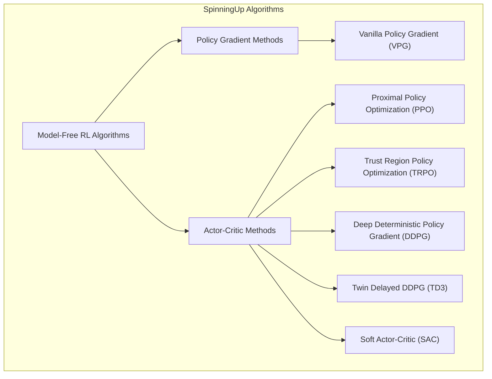
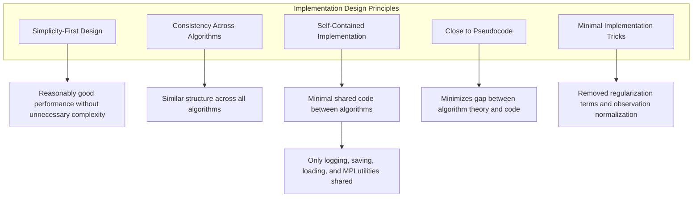
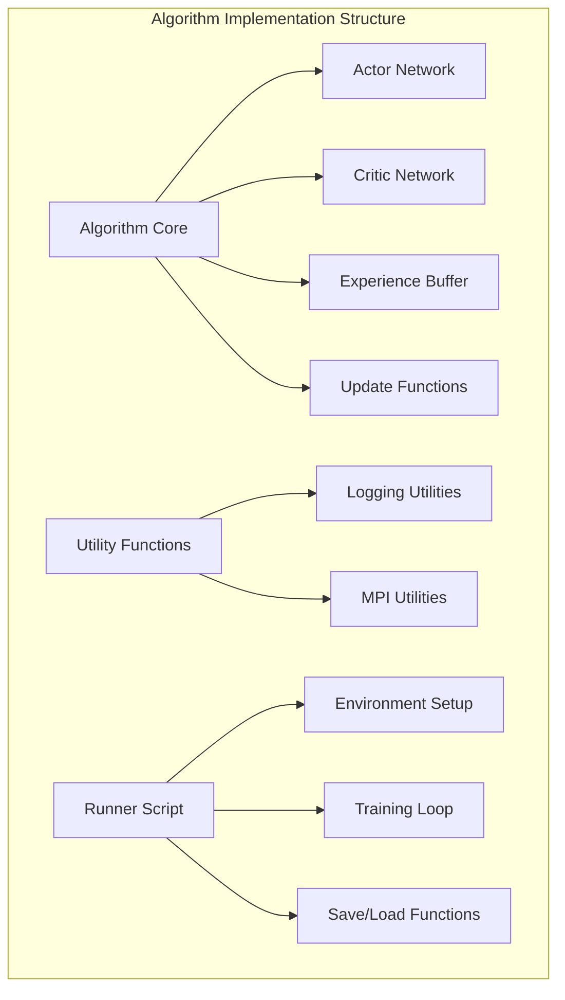
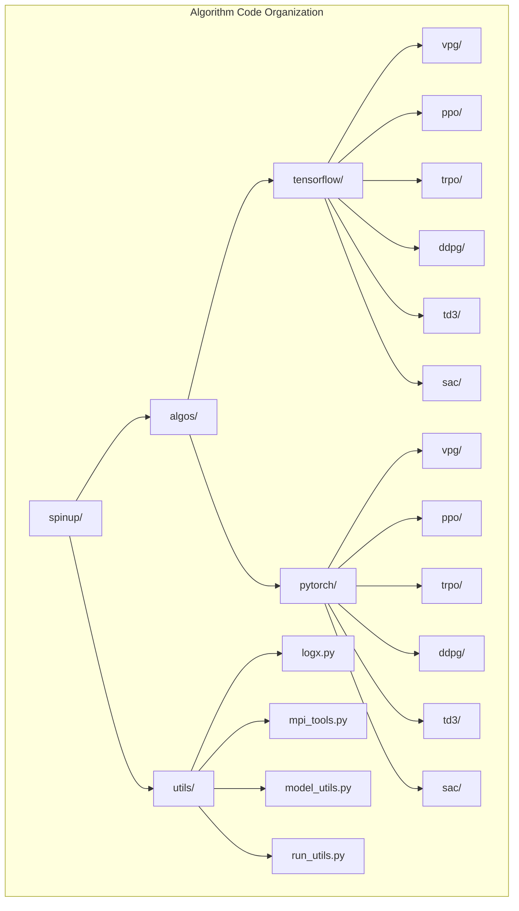
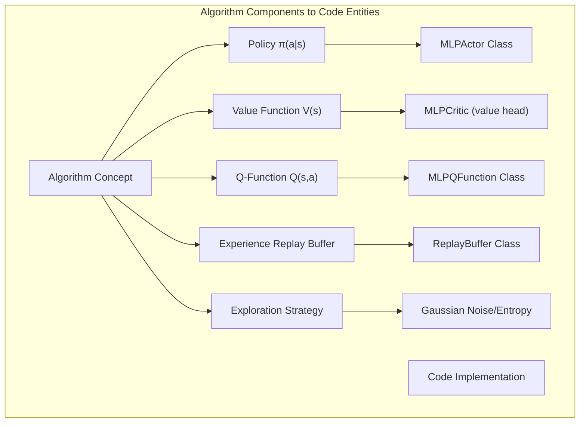
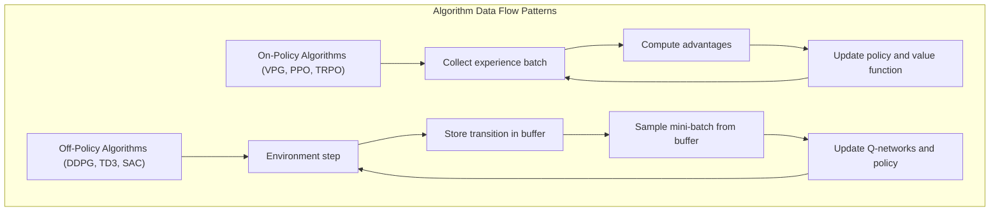
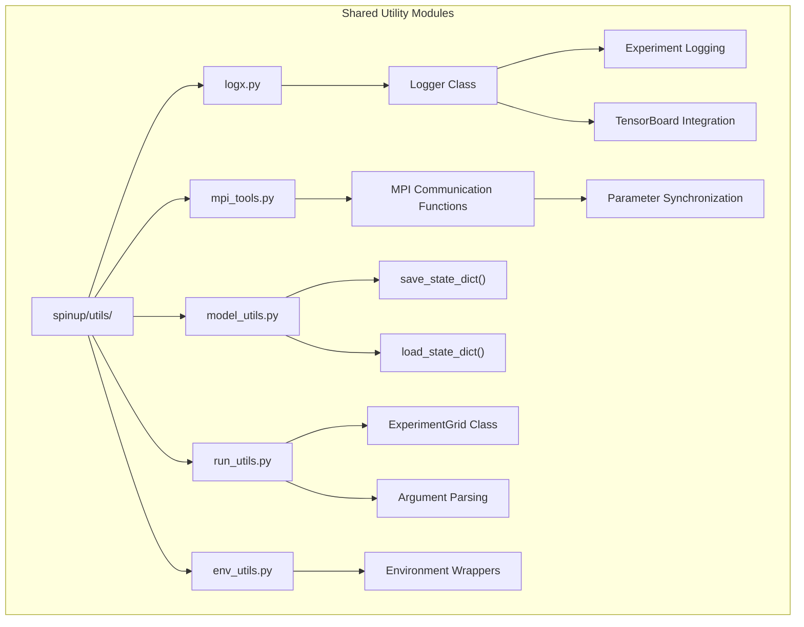
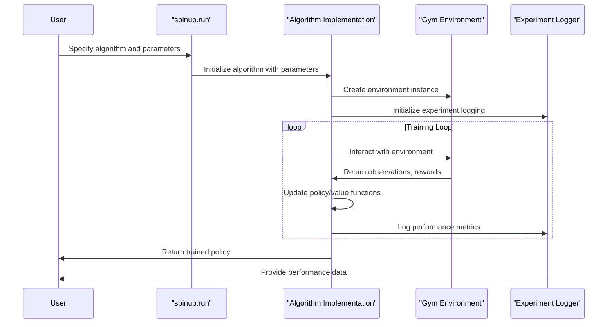

<!-- source: DeepWiki mcp.deepwiki.com · repo openai/spinningup · page 5 Algorithm Implementations · fetched 2026-10-26 -->

# Algorithm Implementations

Relevant source files

The following files were used as context for generating this wiki page:

- [docs/spinningup/keypapers.rst](docs/spinningup/keypapers.rst)
- [docs/user/introduction.rst](docs/user/introduction.rst)

## Purpose and Scope

This document provides an overview of the reinforcement learning algorithm implementations in the Spinning Up codebase. The focus is on explaining the design philosophy, structure, and organization of the algorithms, as well as how they relate to each other. For information about the educational resources and theoretical background of these algorithms, see [Introduction](#1) and [Key Papers in Deep RL](#4.1).

Spinning Up implements several key reinforcement learning algorithms, with a focus on simplicity, clarity, and educational value rather than absolute performance optimization. These implementations serve as a bridge between the theoretical pseudocode of algorithms and their practical realization in code.

Sources: docs/user/introduction.rst

## Algorithm Overview and Organization

Spinning Up includes implementations of several important deep reinforcement learning algorithms, primarily focused on model-free methods. The algorithms are organized into two main families: policy gradient methods and actor-critic methods.

Sources: docs/spinningup/keypapers.rst, docs/user/introduction.rst

## Implementation Design Philosophy

The algorithm implementations in Spinning Up follow a specific design philosophy focused on education and clarity. This approach makes them especially valuable for learning reinforcement learning implementation details.

Each algorithm implementation in Spinning Up is deliberately designed to be as simple as possible while still achieving reasonable performance. This approach prioritizes readability and understandability over optimizations that might be present in research implementations.

Sources: docs/user/introduction.rst

## Common Structure of Algorithm Implementations

All algorithm implementations in Spinning Up follow a similar structure, making it easier to understand the relationship between different algorithms and to transition from learning one algorithm to another. Here's how a typical algorithm is structured:

This consistent structure allows learners to quickly locate key components across different algorithm implementations.

Sources: docs/user/introduction.rst

## Algorithm Code Organization

The reinforcement learning algorithms in Spinning Up are organized into two main frameworks: TensorFlow and PyTorch. Each algorithm has implementations in both frameworks, with consistent file organization.

Each algorithm directory typically contains:
- A main implementation file (usually named after the algorithm)
- A core module with key algorithm components
- Utility functions specific to that algorithm

Sources: docs/user/introduction.rst

## Key Differences Between Algorithms

While the implementations share a common structure, they differ in key aspects that reflect the fundamental differences between the algorithms themselves:

| Algorithm | Type | Action Space | Key Features |
|-----------|------|-------------|--------------|
| VPG | On-policy Policy Gradient | Discrete/Continuous | Simplest policy gradient method |
| PPO | On-policy Actor-Critic | Discrete/Continuous | Clipped surrogate objective function |
| TRPO | On-policy Actor-Critic | Discrete/Continuous | Trust region constraint |
| DDPG | Off-policy Actor-Critic | Continuous | Deterministic policy with Q-function |
| TD3 | Off-policy Actor-Critic | Continuous | Twin Q-functions, delayed policy updates |
| SAC | Off-policy Actor-Critic | Continuous | Maximum entropy objective |

Sources: docs/spinningup/keypapers.rst

## Algorithm-to-Code Mapping

The following diagram shows how theoretical algorithm components map to specific code entities in the Spinning Up implementations:

This mapping helps bridge the gap between the theoretical description of algorithms and their practical implementation in code.

Sources: docs/user/introduction.rst

## On-Policy vs Off-Policy Implementations

Spinning Up implementations can be categorized into on-policy and off-policy algorithms, which have significant differences in their structure and data flow:

On-policy algorithms (VPG, PPO, TRPO) collect batches of experience using the current policy, then perform updates based on that specific data. Off-policy algorithms (DDPG, TD3, SAC) can learn from experience collected by any policy, enabling the use of experience replay buffers.

Sources: docs/spinningup/keypapers.rst

## Shared Utilities Across Implementations

While the algorithm implementations are mostly self-contained, they do share some utility modules that provide common functionality:

These shared utilities handle common tasks such as logging experimental results, synchronizing parameters across multiple processes for parallel training, saving and loading models, and managing experiment configuration.

Sources: docs/user/introduction.rst

## Running Algorithm Implementations

Spinning Up provides a consistent interface for running all implemented algorithms. Each algorithm can be run directly as a Python module or through the unified `spinup.run` command:

This unified interface makes it easy to experiment with different algorithms while keeping the usage pattern consistent.

Sources: docs/user/introduction.rst

## Conclusion

The algorithm implementations in Spinning Up are designed with education and clarity as primary goals. By maintaining consistent structure across algorithms while preserving their distinctive characteristics, the implementations serve as excellent learning resources for understanding deep reinforcement learning algorithms.

The design choices prioritize simplicity over optimization tricks, making the code more accessible to newcomers but potentially sacrificing some performance compared to state-of-the-art implementations. This trade-off aligns with Spinning Up's overall mission as an educational resource for deep reinforcement learning.

Sources: docs/user/introduction.rst, docs/spinningup/keypapers.rst

---

