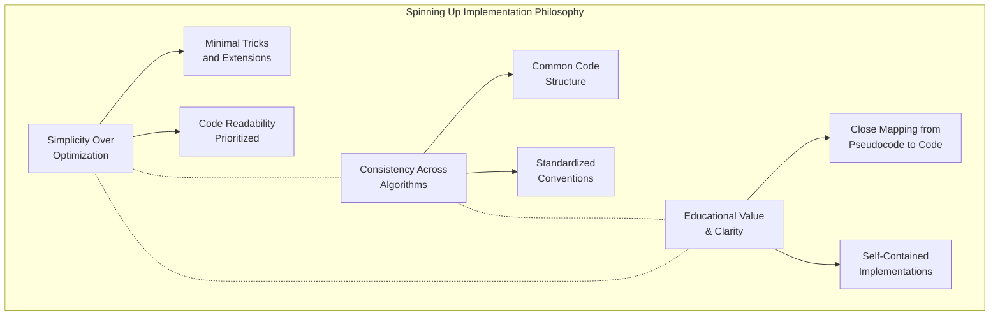
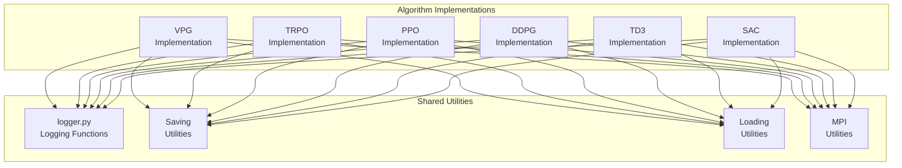
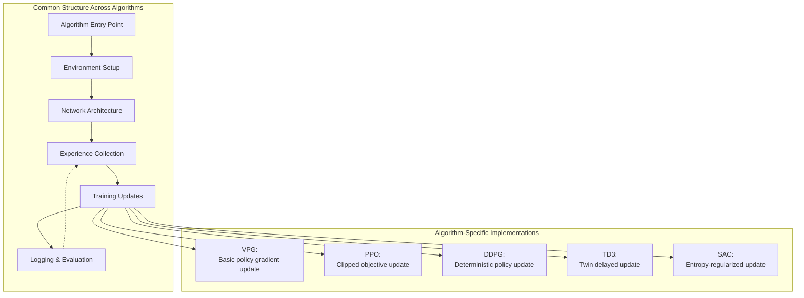
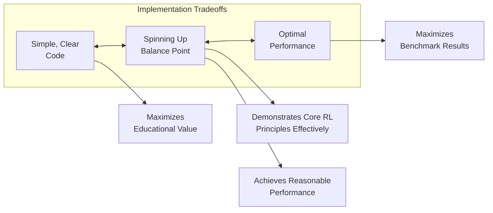
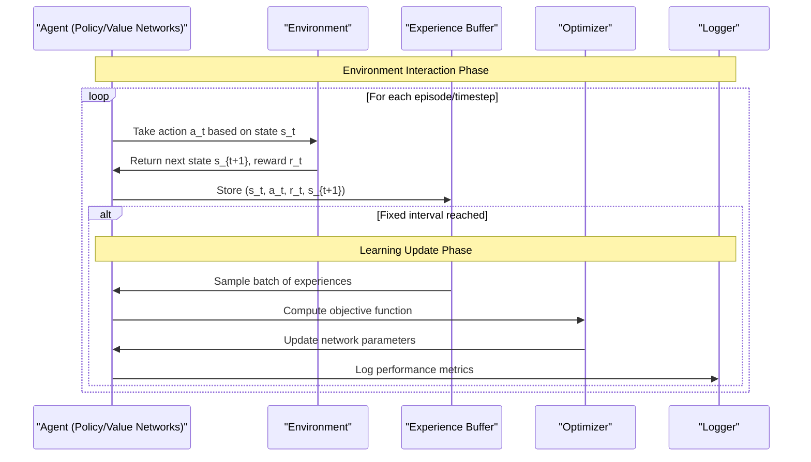

<!-- source: DeepWiki mcp.deepwiki.com · repo openai/spinningup · page 5.1 Implementation Philosophy · fetched 2026-10-26 -->

# Implementation Philosophy

Relevant source files

The following files were used as context for generating this wiki page:

- [docs/user/introduction.rst](docs/user/introduction.rst)

## Purpose and Scope

This document explains the design principles and architectural decisions behind the algorithm implementations in Spinning Up. It focuses on how the code is structured to maximize readability and learning, rather than optimizing for performance or production use. These principles guided the development of all reinforcement learning algorithm implementations in the repository.

For information about the specific algorithms implemented, see [Algorithm Implementations](#5). For details on the package structure, see [Package Structure](#6).

## Core Design Principles

The Spinning Up algorithm implementations follow three fundamental design principles:

1. **Simplicity**: Make code as simple as possible while maintaining reasonable performance
2. **Consistency**: Maintain high consistency across algorithms to highlight fundamental similarities
3. **Educational Value**: Minimize the gap between theory (pseudocode) and implementation

Sources: [docs/user/introduction.rst:64-67]()

## Self-Contained Implementation Approach

Unlike many reinforcement learning frameworks that build algorithms into complex architectures with many dependencies, Spinning Up implementations are intentionally self-contained. This means:

- Each algorithm can be studied independently
- Minimal code is shared between algorithm implementations
- Only essential utilities (logging, saving, loading, and MPI) are shared

This approach enables learners to focus on understanding one algorithm at a time without navigating through an extensive codebase.

Sources: [docs/user/introduction.rst:68-69]()

## Pseudocode-Like Structure

The code implementations in Spinning Up are patterned to closely resemble pseudocode found in academic papers. This design choice:

- Minimizes the gap between theory and implementation
- Makes it easier to understand how mathematical concepts translate to code
- Helps learners connect algorithm descriptions in papers to actual working code

Each implementation follows the logical flow of the algorithm as described in literature, making it easier to trace and understand the reinforcement learning concepts at work.

### From Paper to Implementation

| Pseudocode Element | Implementation Approach |
|-------------------|-------------------------|
| Algorithm outline | Main function structure follows the same steps |
| Mathematical operations | Implemented using clear, direct code with minimal abstraction |
| Network updates | Network updates are explicitly coded to match update equations |
| Hyperparameters | Named to match paper terminology |
| Learning process | Environment interactions and learning updates follow the same pattern as described in papers |

Sources: [docs/user/introduction.rst:69-70]()

## Consistency Across Algorithms

A key feature of Spinning Up is the high consistency maintained across different algorithm implementations. This approach makes it significantly easier to:

- Transfer understanding from one algorithm to another
- Compare and contrast algorithm designs
- Identify fundamental similarities and differences between approaches

Sources: [docs/user/introduction.rst:70-71]()

## Minimizing Tricks and Differences

The implementations deliberately omit many optimization tricks that are often found in official or popular implementations. This design choice:

- Keeps the code as simple and clear as possible
- Makes it easier to identify the core algorithm mechanics
- Reduces cognitive load for learners
- Facilitates direct comparison between algorithms

Examples of removed tricks:
- Regularization terms from the original Soft-Actor Critic implementation
- Observation normalization from all algorithms
- Algorithm-specific optimizations that don't contribute to core understanding

For algorithms with similar structures (like DDPG, TD3, and SAC), the implementations use consistent conventions. For example, they all use the same approach for running gradient descent updates after fixed intervals of environment interaction.

Sources: [docs/user/introduction.rst:72-75]()

## Performance Considerations

The implementations strike a balance between simplicity and performance:

- Algorithms achieve "reasonably good" performance
- They demonstrate the intended algorithmic behavior
- They may not match state-of-the-art results reported in literature

This means that while the implemented algorithms work as expected and demonstrate the principles effectively, they aren't optimized for benchmark performance. Users should be cautious when using these implementations for scientific benchmarking.

Sources: [docs/user/introduction.rst:75-77]()

## Standardized Learning Process

The implementations follow a standardized approach to reinforcement learning, which makes it easier to understand the fundamental structure of RL algorithms:

This standardized approach helps learners identify the common patterns in reinforcement learning algorithms while still understanding the algorithm-specific differences in update rules and objective functions.

Sources: [docs/user/introduction.rst:72-73]()

## Educational Value and Learning Progression

The implementation philosophy serves the primary goal of Spinning Up: making deep reinforcement learning more accessible to learners. The codebase is designed to support a natural learning progression:

1. **Understanding a single algorithm**: Each implementation is self-contained and clear enough to be understood in isolation
2. **Comparing algorithms**: Consistent structure makes it easy to compare different approaches
3. **Modifying algorithms**: Simple implementation invites experimentation and modification
4. **Developing new algorithms**: Understanding gained provides foundation for research

This progressive approach helps bridge the gap between theory and practice in reinforcement learning, making it an effective educational resource.

Sources: [docs/user/introduction.rst:27-44]()

## Conclusion

The implementation philosophy of Spinning Up prioritizes educational value through simplicity, consistency, and clarity. By designing algorithm implementations that closely match pseudocode, removing extraneous tricks, and maintaining consistent structure across algorithms, the codebase makes deep reinforcement learning more approachable for learners and researchers.

This approach serves the dual purposes of helping newcomers understand reinforcement learning algorithms and providing a foundation for those who wish to contribute to the field, aligning with OpenAI's mission to ensure the safe development of AI and broad distribution of benefits.

---

