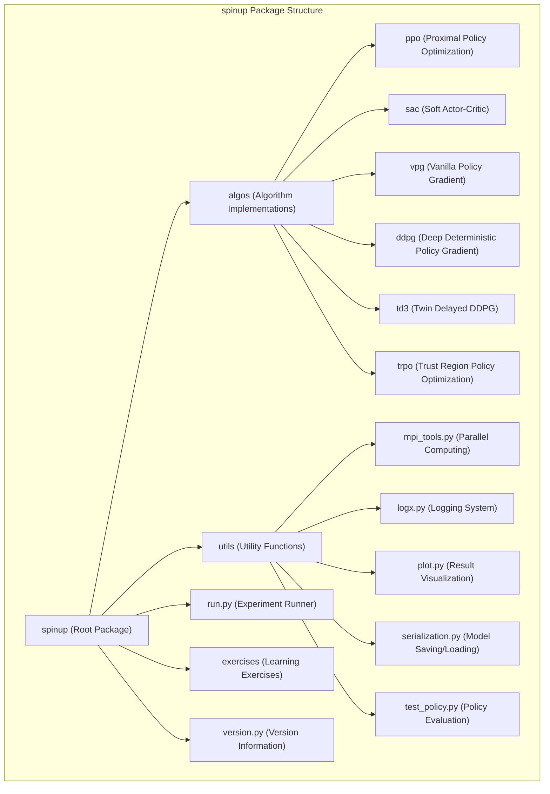
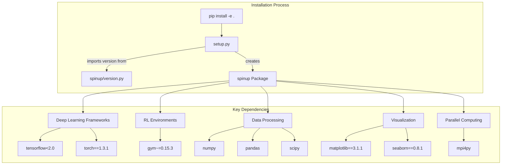
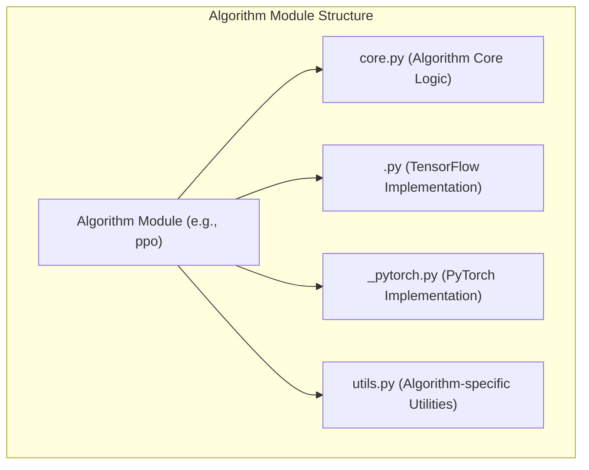
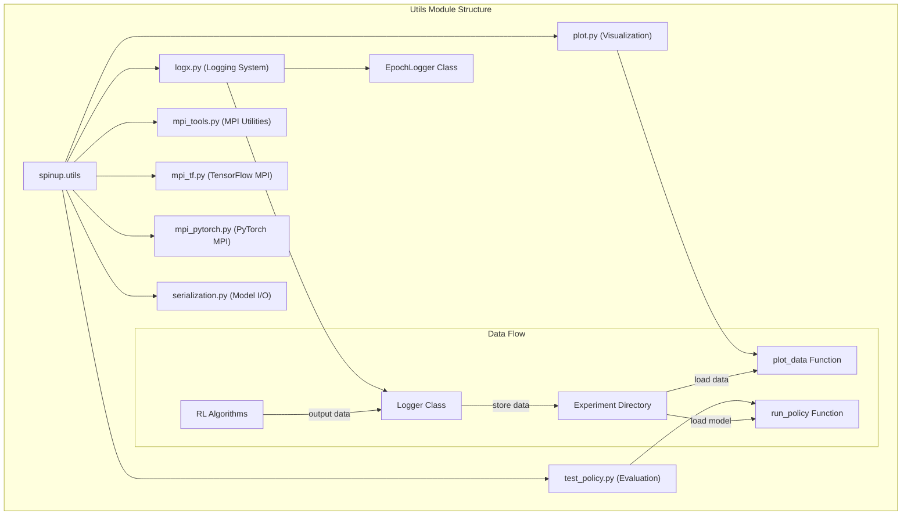
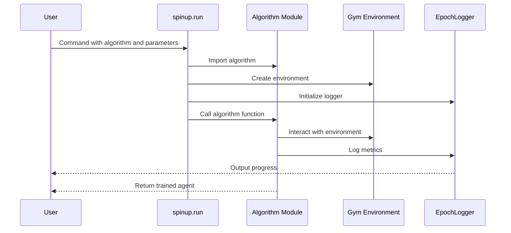
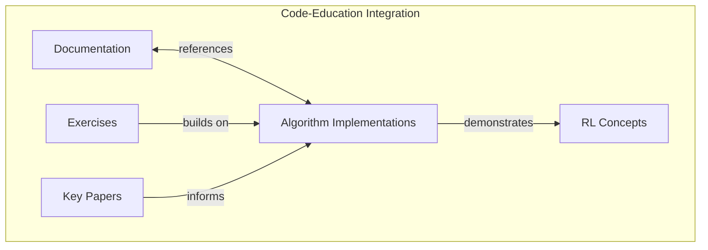

<!-- source: DeepWiki mcp.deepwiki.com · repo openai/spinningup · page 6 Package Structure · fetched 2026-10-26 -->

# Package Structure

<details>
<summary>Relevant source files</summary>

The following files were used as context for generating this wiki page:

- [.gitignore](.gitignore)
- [setup.py](setup.py)
- [spinup/version.py](spinup/version.py)

</details>


This document provides a detailed explanation of the Spinning Up package organization, including module hierarchy, file organization, and how the various components relate to each other. It focuses on the structure of the code as a Python package, covering how the package is installed, organized, and can be extended. For information about the algorithm implementations themselves, see [Algorithm Implementations](#5).

## Package Overview

Spinning Up is organized as a Python package named `spinup` that is installed via pip. The package structure is designed to:

1. Provide clear, educational implementations of key reinforcement learning algorithms
2. Offer utilities for running experiments and analyzing results
3. Include verification tools to ensure proper installation
4. Support both PyTorch and TensorFlow implementations



Sources: [setup.py:12-35](), [spinup/version.py:1-9]()

## Package Installation

Spinning Up is installed as a Python package with dependencies specified in `setup.py`. The package requires Python 3.6 or higher and builds on several key libraries.



Sources: [setup.py:1-35]()

## Core Package Components

### Module Organization

The Spinning Up package is organized into several main modules that serve distinct purposes:

| Module | Purpose | Key Components |
|--------|---------|----------------|
| `algos` | Algorithm implementations | PPO, SAC, VPG, DDPG, TD3, TRPO |
| `utils` | Utility functions | Logging, plotting, MPI tools, policy testing |
| `run` | Experiment runner | Command-line interface for training |
| `exercises` | Learning exercises | Educational tasks for users |

Sources: [setup.py:12-35]()

### Algorithm Organization

Each algorithm in the `algos` directory follows a consistent organization pattern:



Sources: Based on system overview diagrams

### Versioning System

Spinning Up uses a straightforward versioning system defined in `spinup/version.py`. The version follows semantic versioning with major, minor, and patch numbers.

```python
# From spinup/version.py
version_info = (0, 2, 0)  # (major, minor, patch)
```

Sources: [spinup/version.py:1-9]()

## Utilities and Tools

The `utils` module contains several key components that support the algorithms and provide functionality for experiment analysis:



Sources: Based on system overview diagrams

## Experiment Runner System

The `run.py` module serves as the main entry point for training RL agents with different algorithms:



Sources: Based on system overview diagrams

## Extending the Package

### Adding a New Algorithm

To extend Spinning Up with a new algorithm, you would typically:

1. Create a new subdirectory in the `algos` directory
2. Create at minimum:
   - `core.py` for core algorithm logic
   - `<algo>.py` for TensorFlow implementation
   - `<algo>_pytorch.py` for PyTorch implementation
3. Follow the design pattern established by other algorithms
4. Update the run script to include the new algorithm

### Customizing Environments

Spinning Up relies on OpenAI Gym for environments, so customization typically involves:

1. Creating a custom Gym environment class
2. Registering it with Gym
3. Using the registered environment name with the existing runners

## Package Dependencies

Spinning Up depends on several key libraries as specified in `setup.py`:

| Category | Dependencies |
|----------|-------------|
| Deep Learning | tensorflow<2.0, torch==1.3.1 |
| RL Environments | gym[atari,box2d,classic_control]~=0.15.3 |
| Data Processing | numpy, pandas, scipy, joblib |
| Visualization | matplotlib==3.1.1, seaborn==0.8.1 |
| Parallel Computing | mpi4py |
| Utilities | cloudpickle==1.2.1, tqdm, psutil, ipython |
| Testing | pytest |

Sources: [setup.py:16-31]()

## File Organization and .gitignore Patterns

The repository's `.gitignore` file provides insights into the file patterns generated during typical usage:

```
data/           # Generated experiment data directories
*.pkl           # Pickle files (often saved models or results)
__pycache__/    # Python cache directories
**/*.egg-info   # Package installation files
```

These patterns indicate that when running Spinning Up, experiments create data directories and pickle files that are not tracked in version control.

Sources: [.gitignore:1-11]()

## Integration with Education Resources

The package structure is designed to integrate with the educational materials, connecting implementations with the theoretical content. Exercises in the `exercises` directory align with the algorithms implemented in the `algos` directory, providing a practical learning path.



Sources: Based on system overview diagrams