# Page: Spinning Up Overview

# Spinning Up Overview

<details>
<summary>Relevant source files</summary>

The following files were used as context for generating this wiki page:

- [.gitignore](.gitignore)
- [docs/user/introduction.rst](docs/user/introduction.rst)

</details>


## Purpose and Scope

This document provides a comprehensive overview of Spinning Up in Deep RL, an educational resource developed by OpenAI that makes it easier to learn about deep reinforcement learning. The purpose of Spinning Up is to serve as a bridge between reinforcement learning theory and practical implementation, lowering the barrier to entry for those interested in the field. This overview covers the system's main components, their relationships, and the overall design philosophy.

For detailed installation instructions, see [Installation Guide](#2). For information about the documentation system itself, see [Documentation System](#3).

Sources: [docs/user/introduction.rst:7-21]()

## What is Spinning Up?

Spinning Up is an educational resource aimed at making deep reinforcement learning (RL) more accessible. It combines carefully designed documentation, clean algorithm implementations, and a curated collection of educational resources to help users understand both the theory and practice of deep RL.

The project was created to address the challenge that while deep learning has many resources to help beginners ramp up quickly, deep RL has traditionally had a higher barrier to entry due to:
- The need for background in math, coding, and deep learning
- The scarcity of high-level views of the field
- Difficulty in translating algorithm theory into working code

Spinning Up is designed to serve as the "missing middle step" for those who want to learn deep RL but don't know where to start.

Sources: [docs/user/introduction.rst:7-44]()

## System Architecture

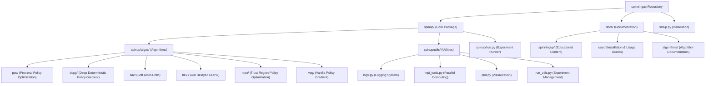

**Diagram 1: High-Level Architecture of Spinning Up Repository**

Sources: [docs/user/introduction.rst:15-20]()

## Core Components

### Educational Resources

Spinning Up provides a comprehensive set of educational materials designed to help users understand reinforcement learning concepts and implementation details:

1. **Introduction to RL**: Covers terminology, algorithm types, and basic theory
2. **Essay on RL Research**: Guidance on how to grow into an RL research role
3. **Curated Paper List**: Important papers organized by topic areas
4. **Algorithm Documentation**: Detailed explanations of implemented algorithms
5. **Exercises**: Warm-up tasks to practice implementing RL concepts

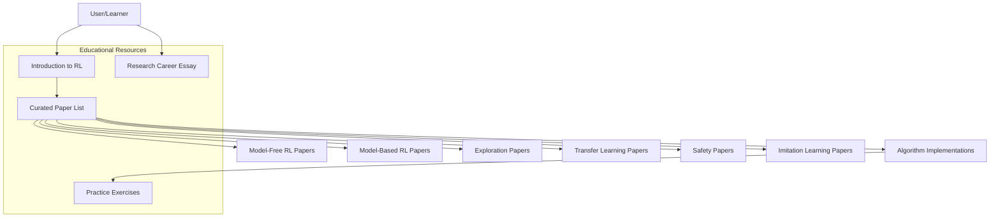

**Diagram 2: Educational Resource Structure and Learning Path**

Sources: [docs/user/introduction.rst:15-20](), [docs/user/introduction.rst:104-109]()

### Algorithm Implementations

Spinning Up includes standalone implementations of key reinforcement learning algorithms. The implementations follow a consistent structure to highlight similarities between algorithms while keeping each implementation self-contained for easier study.

The algorithms are implemented in both TensorFlow and PyTorch, following the January 2020 update.

Key implemented algorithms include:

| Algorithm | Description | Type |
|-----------|-------------|------|
| VPG | Vanilla Policy Gradient | Policy Gradient |
| TRPO | Trust Region Policy Optimization | Trust Region Method |
| PPO | Proximal Policy Optimization | Trust Region Method |
| DDPG | Deep Deterministic Policy Gradient | Actor-Critic |
| TD3 | Twin Delayed DDPG | Actor-Critic |
| SAC | Soft Actor-Critic | Actor-Critic |

All implementations prioritize clarity and pedagogical value over maximizing performance or including every optimization trick. This design choice makes the code more accessible to learners.

Sources: [docs/user/introduction.rst:64-75]()

### Documentation System

The documentation system is built using Sphinx and provides comprehensive information about:

1. Installation and setup
2. Educational resources on reinforcement learning
3. Algorithm implementations and explanations
4. Benchmarks and performance metrics
5. Usage guides for running experiments

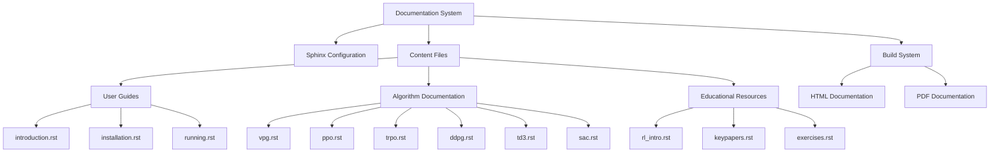

**Diagram 3: Documentation System Structure**

Sources: [docs/user/introduction.rst:15-20]()

### Utility Modules

Spinning Up includes several utility modules that support the algorithm implementations:

1. **Logging System** (logx.py): Handles experiment data recording and output management
2. **Visualization Tools** (plot.py): For plotting learning curves and other performance metrics
3. **MPI Utilities** (mpi_tools.py): Supports parallel computing for faster training
4. **Experiment Management** (run_utils.py): Handles configuration and execution of training runs

These utilities are shared across algorithm implementations but kept minimal to maintain the self-contained nature of each algorithm.

Sources: [docs/user/introduction.rst:69]()

## Code Design Philosophy

The Spinning Up codebase follows specific design principles that guide how the algorithms are implemented:

1. **Simplicity First**: Implementations are as simple as possible while maintaining reasonable performance
2. **High Consistency**: Algorithms follow similar patterns to highlight fundamental similarities
3. **Self-Contained Code**: Minimal shared code between implementations to allow studying each algorithm independently
4. **Pseudocode Proximity**: Code structure mirrors algorithm pseudocode to minimize the theory-to-code gap
5. **Consistent Structure**: All implementations follow the same structure, making it easy to transition between algorithms

The implementations deliberately omit certain optimization tricks and regularization terms found in the original papers to maintain clarity. All algorithms are "reasonably good" in terms of performance but may not match state-of-the-art benchmarks.

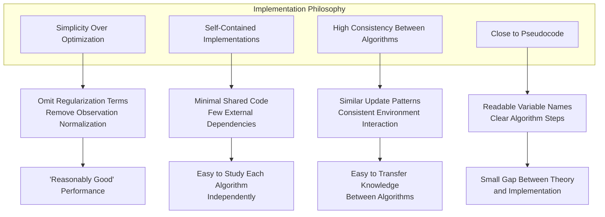

**Diagram 4: Code Design Philosophy**

Sources: [docs/user/introduction.rst:64-76]()

## Support and History

Spinning Up was initially released in November 2018, followed by a three-week period of high-bandwidth support. After a community feedback review in April 2019, a PyTorch update was released in January 2020.

Currently, Spinning Up is in maintenance mode, meaning that critical bugs will be fixed to ensure the resource remains usable, but no major feature updates are planned.

The project has been integrated into OpenAI's Scholars and Fellows programs curricula, furthering its educational mission.

Sources: [docs/user/introduction.rst:78-101]()

## Relation to OpenAI's Mission

Spinning Up aligns with OpenAI's mission to ensure the safe development of AGI and the broad distribution of AI benefits by:

1. Helping people understand AI and how it works, empowering critical thinking about AI issues
2. Building expertise in deep RL, which is considered important for AI safety work
3. Lowering barriers to entry for those interested in contributing to AI safety research

The project exemplifies OpenAI's approach to education and talent development in the AI field.

Sources: [docs/user/introduction.rst:50-57]()

---

# Page: Repository Structure

# Repository Structure

<details>
<summary>Relevant source files</summary>

The following files were used as context for generating this wiki page:

- [.gitignore](.gitignore)
- [docs/Makefile](docs/Makefile)
- [docs/index.rst](docs/index.rst)

</details>


This document provides a high-level overview of the Spinning Up repository organization, including main directories and file organization. For information about installation, see [Installation Guide](#2), and for details about the package functionality, see [Package Structure](#6).

## Overview

The Spinning Up repository is structured as a Python package focused on reinforcement learning education and implementation. The codebase organizes algorithms, utilities, and documentation in a modular fashion to support both learning and experimentation.

## Main Components

The repository consists of three primary components:

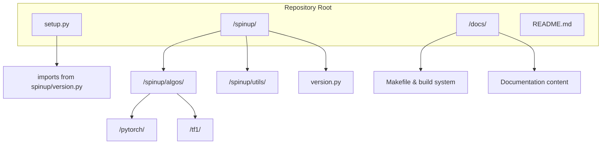

Sources: [.gitignore:1-10]()

### Core Package (`/spinup`)

This directory contains the actual implementation code including:
- Algorithm implementations (organized by framework)
- Utility modules for logging, visualization, and experimentation
- Version tracking

### Documentation (`/docs`)

This directory contains all educational content and documentation:
- Installation and usage guides
- Introduction to reinforcement learning
- Algorithm documentation
- Utility module references

### Package Definition (`setup.py`)

The root directory contains the package installation definition and related files:
- `setup.py`: Defines the package and its dependencies
- `README.md`: Overview and quick-start guide

## Documentation Structure

The documentation is organized into several key sections as revealed by the `index.rst` file:

```mermaid
graph TD
    subgraph "Documentation Organization"
        index["index.rst"]
        
        user["User Documentation"]
        intro["Introduction to RL"]
        resources["Resources"]
        algo_docs["Algorithms Docs"]
        util_docs["Utilities Docs"]
    end
    
    index --> user
    index --> intro
    index --> resources
    index --> algo_docs
    index --> util_docs
    
    user --> introduction["introduction.rst"]
    user --> installation["installation.rst"]
    user --> algo_usage["algorithms.rst"]
    user --> running["running.rst"]
    user --> saving["saving_and_loading.rst"]
    user --> plotting["plotting.rst"]
    
    intro --> rl_intro["rl_intro1-3.rst"]
    
    resources --> keypapers["keypapers.rst"]
    resources --> exercises["exercises.rst"]
    resources --> bench["bench.rst"]
    
    algo_docs --> vpg["vpg.rst"]
    algo_docs --> trpo["trpo.rst"]
    algo_docs --> ppo["ppo.rst"]
    algo_docs --> ddpg["ddpg.rst"]
    algo_docs --> td3["td3.rst"]
    algo_docs --> sac["sac.rst"]
    
    util_docs --> logger["logger.rst"]
    util_docs --> plotter["plotter.rst"]
    util_docs --> mpi["mpi.rst"]
    util_docs --> run_utils["run_utils.rst"]
```

Sources: [docs/index.rst:11-57]()

The documentation is built using Sphinx, with a standard Makefile for generating HTML and other output formats.

Sources: [docs/Makefile:1-20]()

## Algorithm Organization

The algorithms are organized by framework (PyTorch and TensorFlow) and follow a consistent structure:

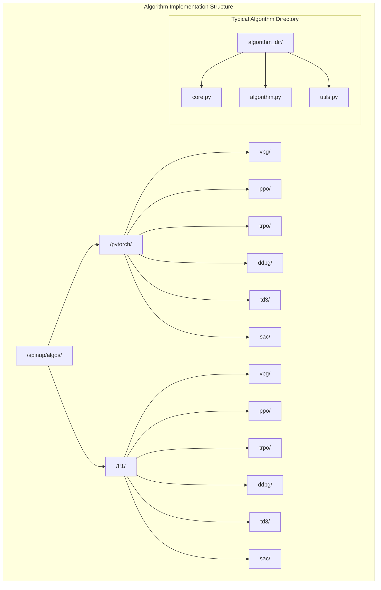

Sources: [docs/index.rst:43-48]()

The repository implements six state-of-the-art reinforcement learning algorithms:
- **VPG** (Vanilla Policy Gradient)
- **TRPO** (Trust Region Policy Optimization)
- **PPO** (Proximal Policy Optimization)
- **DDPG** (Deep Deterministic Policy Gradient)
- **TD3** (Twin Delayed DDPG)
- **SAC** (Soft Actor-Critic)

Each implementation exists in both PyTorch and TensorFlow variants, following a consistent design pattern to facilitate comparison and learning.

## Utility Module Structure

The utility modules provide supporting functionality for algorithm implementation, experimentation, and visualization:

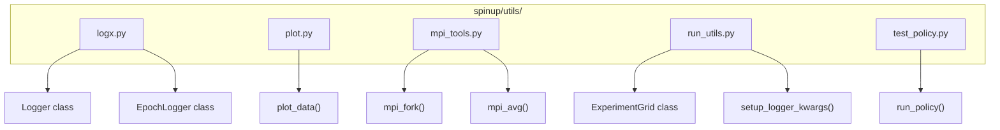

Sources: [docs/index.rst:54-57]()

Key utility components include:
- **Logger**: Records and saves experiment statistics
- **Plotter**: Visualizes training results
- **MPI Tools**: Facilitates parallel computing for faster training
- **Run Utilities**: Manages experiment configuration and execution
- **Test Policy**: Tools for evaluating trained policies

## Generated and Ignored Files

The `.gitignore` file provides insight into files generated during repository usage:

| Pattern | Description |
|---------|-------------|
| `*.*~` | Temporary files |
| `__pycache__/` | Python bytecode cache |
| `*.pkl` | Serialized data (models, results) |
| `data/` | Directory for experiment output |
| `**/*.egg-info` | Package installation artifacts |
| `_build/` | Documentation build outputs |

Sources: [.gitignore:1-10]()

These patterns indicate that the repository generates several types of files during normal operation, including trained models, experiment results, and build artifacts that are not tracked in version control.

## Code-Documentation Relationship

The repository structure is deliberately mirrored in the documentation organization:

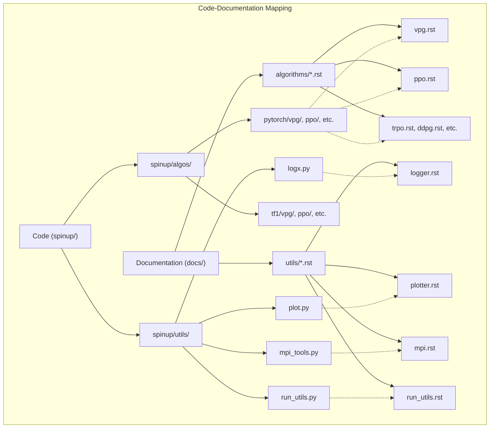

Sources: [docs/index.rst:11-57]()

This parallel structure ensures that every code component has corresponding documentation, creating a comprehensive educational resource that explains both concepts and implementation details.

---

# Page: Installation Guide

# Installation Guide

<details>
<summary>Relevant source files</summary>

The following files were used as context for generating this wiki page:

- [docs/user/installation.rst](docs/user/installation.rst)
- [setup.py](setup.py)
- [spinup/version.py](spinup/version.py)

</details>


This document provides comprehensive instructions for installing OpenAI's Spinning Up reinforcement learning library on your system. You'll learn how to set up all prerequisites, install the core package, and verify that your installation works correctly. For details about specific package dependencies, see [Dependencies and Requirements](#2.1).

## System Requirements

Spinning Up has the following requirements:

- **Operating Systems**: Linux and macOS (primary support)
  - Windows is not officially supported but may work with workarounds
- **Python**: Version 3.6 or higher (enforced by setup script)
- **OpenMPI**: Required for parallel algorithm implementations
- **OpenAI Gym**: Required for reinforcement learning environments

The Python version requirement is checked during installation:

```python
assert sys.version_info.major == 3 and sys.version_info.minor >= 6, \
    "The Spinning Up repo is designed to work with Python 3.6 and greater." \
    + "Please install it before proceeding."
```

Sources: [setup.py:5-7]()

## Installation Workflow

The installation process follows a structured workflow:

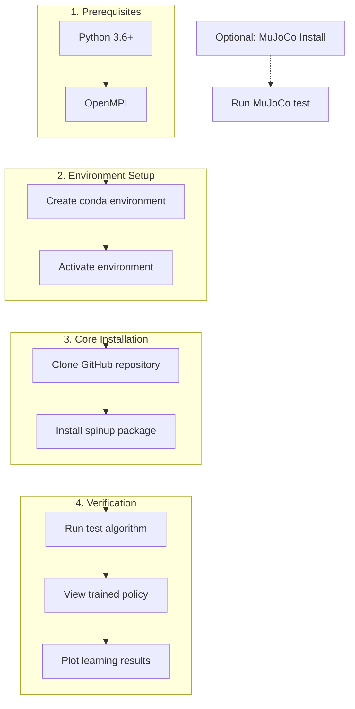

Sources: [docs/user/installation.rst:8-10](), [docs/user/installation.rst:77-85]()

## Python Environment Setup

Anaconda is recommended for managing Python environments and packages:

1. Download and install Anaconda from their official website
2. Create a dedicated environment for Spinning Up:
   ```bash
   conda create -n spinningup python=3.6
   ```
3. Activate the environment:
   ```bash
   conda activate spinningup
   ```

Sources: [docs/user/installation.rst:25-40]()

## Installing OpenMPI

OpenMPI is required for parallel algorithm implementations. Installation depends on your operating system:

### Ubuntu/Debian
```bash
sudo apt-get update && sudo apt-get install libopenmpi-dev
```

### macOS
Using Homebrew:
```bash
brew install openmpi
```

Sources: [docs/user/installation.rst:56-74]()

## Installing Spinning Up

After setting up Python and OpenMPI:

1. Clone the repository:
   ```bash
   git clone https://github.com/openai/spinningup.git
   ```

2. Navigate to the repository directory:
   ```bash
   cd spinningup
   ```

3. Install the package:
   ```bash
   pip install -e .
   ```

This command installs Spinning Up and all its dependencies as specified in `setup.py`.

Sources: [docs/user/installation.rst:77-84]()

## Dependencies Overview

Spinning Up installs the following core dependencies:

```mermaid
graph TD
    subgraph "spinup Package"
        SpinningUp["spinup v0.2.0"]
    end
    
    subgraph "Machine Learning"
        tensorflow["tensorflow>=1.8.0,<2.0"]
        torch["torch==1.3.1"]
    end
    
    subgraph "RL Environments"
        gym["gym[atari,box2d,classic_control]"]
    end
    
    subgraph "Data Processing"
        numpy["numpy"]
        pandas["pandas"]
        scipy["scipy"]
        joblib["joblib"]
        cloudpickle["cloudpickle==1.2.1"]
    end
    
    subgraph "Visualization"
        matplotlib["matplotlib==3.1.1"]
        seaborn["seaborn==0.8.1"]
    end
    
    subgraph "Utilities"
        mpi4py["mpi4py"]
        tqdm["tqdm"]
        ipython["ipython"]
        psutil["psutil"]
        pytest["pytest"]
    end
    
    SpinningUp --> tensorflow
    SpinningUp --> torch
    SpinningUp --> gym
    SpinningUp --> numpy
    SpinningUp --> pandas
    SpinningUp --> scipy
    SpinningUp --> matplotlib
    SpinningUp --> seaborn
    SpinningUp --> mpi4py
    SpinningUp --> tqdm
    SpinningUp --> ipython
    SpinningUp --> joblib
    SpinningUp --> cloudpickle
    SpinningUp --> psutil
    SpinningUp --> pytest
```

Sources: [setup.py:16-31](), [spinup/version.py:1-9]()

## Verifying Your Installation

After installing Spinning Up, verify that everything works correctly:

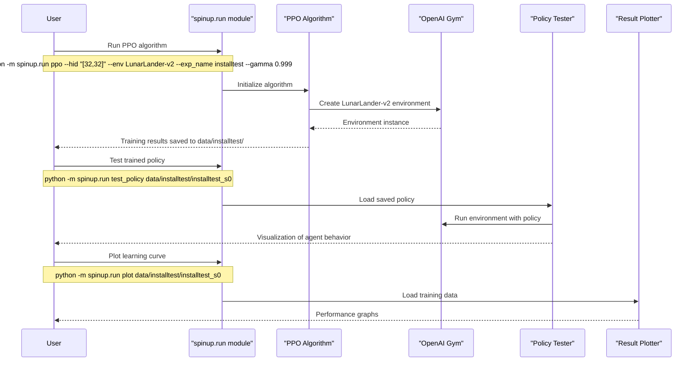

### Step 1: Run a Training Algorithm

Run the PPO algorithm on the LunarLander-v2 environment:

```bash
python -m spinup.run ppo --hid "[32,32]" --env LunarLander-v2 --exp_name installtest --gamma 0.999
```

This will run for about 10 minutes and save results to the `data/installtest/` directory.

### Step 2: Watch the Trained Agent

To see your trained agent in action:

```bash
python -m spinup.run test_policy data/installtest/installtest_s0
```

### Step 3: Plot Training Results

To visualize learning progress:

```bash
python -m spinup.run plot data/installtest/installtest_s0
```

Sources: [docs/user/installation.rst:92-114]()

## Installing MuJoCo (Optional)

MuJoCo is a proprietary physics engine commonly used as a benchmark environment in reinforcement learning research. While not required, it's recommended for running many standard RL benchmarks:

1. Obtain a MuJoCo license:
   - Free 30-day trial licenses are available to anyone
   - Free 1-year licenses are available to full-time students

2. Follow the installation instructions on the mujoco-py GitHub page

3. Install the Gym MuJoCo environments:
   ```bash
   pip install gym[mujoco,robotics]
   ```

4. Verify MuJoCo installation:
   ```bash
   python -m spinup.run ppo --hid "[32,32]" --env Walker2d-v2 --exp_name mujocotest
   ```

Sources: [docs/user/installation.rst:116-139]()

## Troubleshooting

### Common Issues

1. **Package Not Found**:
   - Ensure your conda environment is activated
   - Check that you ran `pip install -e .` from the repository root directory

2. **MPI-related Errors**:
   - Verify OpenMPI is installed correctly
   - Ensure the `mpi4py` Python package installed successfully

3. **Gym Environment Errors**:
   - For issues with specific environments, consult the OpenAI Gym documentation

4. **Python Version Errors**:
   - Make sure you're using Python 3.6 or higher within your conda environment
   - Check that your environment is properly activated

If you encounter issues not covered here, refer to the official GitHub repository for additional help or consult [Algorithm Implementations](#5) for specific algorithm-related problems.

Sources: [docs/user/installation.rst:10-23](), [setup.py:5-7]()

---

# Page: Dependencies and Requirements

# Dependencies and Requirements

<details>
<summary>Relevant source files</summary>

The following files were used as context for generating this wiki page:

- [docs/user/installation.rst](docs/user/installation.rst)
- [setup.py](setup.py)
- [spinup/version.py](spinup/version.py)

</details>


This document provides a detailed explanation of all dependencies required to run OpenAI's Spinning Up. It covers Python version requirements, core libraries, environment dependencies, and optional components. For installation instructions, see [Installation Guide](#2).

## Core Requirements

Spinning Up has three fundamental requirements:

- Python 3.6 or higher
- OpenMPI (for parallel algorithm implementations)
- Deep learning frameworks (TensorFlow 1.x and PyTorch)

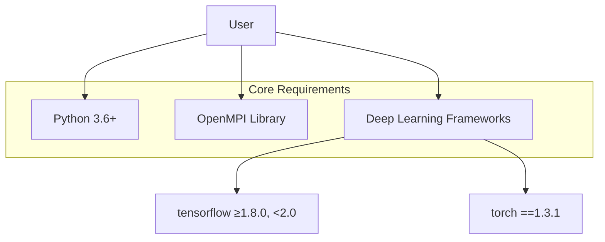

Sources: [setup.py:5-7](), [setup.py:29-30](), [docs/user/installation.rst:8]()

## Python Package Dependencies

Spinning Up depends on several Python packages that handle different aspects of the reinforcement learning workflow:

| Category | Package | Version | Purpose |
|----------|---------|---------|---------|
| **Environments** | gym | ~=0.15.3 | RL environment interface with atari, box2d, and classic_control |
| **Deep Learning** | tensorflow | >=1.8.0,<2.0 | Deep learning framework (original implementation) |
| | torch | ==1.3.1 | Deep learning framework (alternative implementation) |
| **Data Processing** | numpy | latest | Numerical computation |
| | pandas | latest | Data analysis and manipulation |
| | scipy | latest | Scientific computing |
| | cloudpickle | ==1.2.1 | Serialization of Python objects |
| **Visualization** | matplotlib | ==3.1.1 | Plotting library |
| | seaborn | ==0.8.1 | Statistical data visualization |
| **Utilities** | mpi4py | latest | MPI for Python (parallel computing) |
| | joblib | latest | Lightweight pipelining |
| | tqdm | latest | Progress bars |
| | psutil | latest | Process utilities |
| | ipython | latest | Interactive Python interface |
| **Testing** | pytest | latest | Python testing framework |

Sources: [setup.py:16-31]()

## Dependency Relationships

The following diagram illustrates how the various dependencies relate to each other in the Spinning Up ecosystem:

```mermaid
flowchart TD
    SpinUpPackage["spinup Package"]
    
    SpinUpPackage --> CoreModules["Core Modules"]
    SpinUpPackage --> Algorithms["Algorithm Implementations"]
    SpinUpPackage --> Utils["Utilities"]
    
    CoreModules --> Version["version.py"]
    
    Algorithms --> PolicyGradient["Policy Gradient Methods"]
    Algorithms --> ActorCritic["Actor-Critic Methods"]
    
    PolicyGradient --> VPG["VPG"]
    ActorCritic --> PPO["PPO"]
    ActorCritic --> TRPO["TRPO"]
    ActorCritic --> DDPG["DDPG"]
    ActorCritic --> TD3["TD3"]
    ActorCritic --> SAC["SAC"]
    
    Utils --> Loggers["Logging System"]
    Utils --> RunUtils["Experiment Management"]
    Utils --> PlotUtils["Visualization Tools"]
    Utils --> MpiTools["MPI Utilities"]
    
    subgraph "External Dependencies"
        DL["Deep Learning Libraries"]
        EnvFramework["Environment Framework"]
        DataTools["Data Processing Tools"]
        VisTools["Visualization Tools"]
        ParallelTools["Parallel Computing"]
        UtilityLibs["Utility Libraries"]
    end
    
    DL --> TF["tensorflow"]
    DL --> PyTorch["torch"]
    
    EnvFramework --> Gym["gym"]
    Gym --> GymEnvs["gym[atari,box2d,classic_control]"]
    Gym -.-> MuJoCo["gym[mujoco,robotics] (Optional)"]
    
    DataTools --> Numpy["numpy"]
    DataTools --> Pandas["pandas"]
    DataTools --> Scipy["scipy"]
    DataTools --> CloudPickle["cloudpickle"]
    
    VisTools --> Matplotlib["matplotlib"]
    VisTools --> Seaborn["seaborn"]
    
    ParallelTools --> MPI4Py["mpi4py"]
    ParallelTools --> Joblib["joblib"]
    
    UtilityLibs --> TQDM["tqdm"]
    UtilityLibs --> PSUtil["psutil"]
    UtilityLibs --> IPython["ipython"]
    UtilityLibs --> PyTest["pytest"]
    
    Algorithms --> DL
    Algorithms --> EnvFramework
    Algorithms --> DataTools
    Algorithms --> ParallelTools
    
    Utils --> VisTools
    Utils --> DataTools
    Utils --> UtilityLibs
```

Sources: [setup.py:16-31](), [docs/user/installation.rst:8-9]()

## OpenAI Gym Environments

Spinning Up uses OpenAI Gym for reinforcement learning environments. The following environments are included by default:

- **Atari**: Classic Atari 2600 game environments
- **Box2D**: 2D physics environments (including LunarLander)
- **Classic Control**: Simple control theory environments like CartPole

MuJoCo environments are optional but recommended for benchmarking purposes:

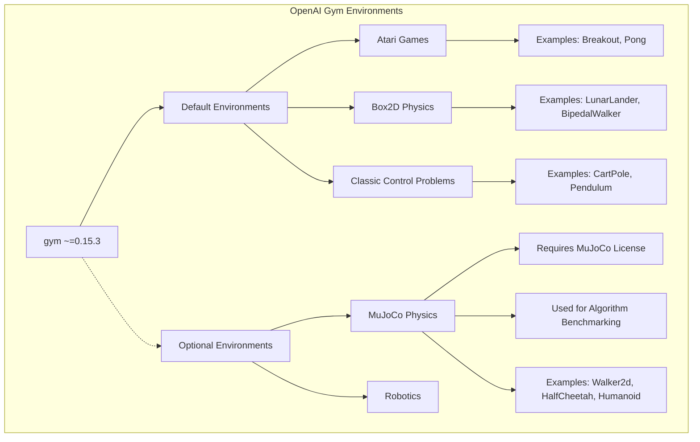

Sources: [setup.py:18](), [docs/user/installation.rst:14-16](), [docs/user/installation.rst:116-136]()

## Operating System Compatibility

Spinning Up has specific operating system requirements and recommendations:

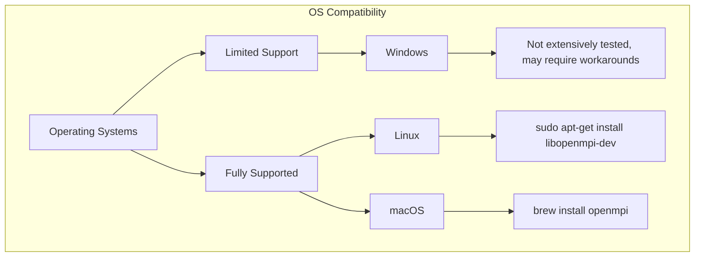

Sources: [docs/user/installation.rst:10-11](), [docs/user/installation.rst:59-74]()

## Deep Learning Framework Requirements

Spinning Up includes implementations in both TensorFlow and PyTorch with specific version requirements:

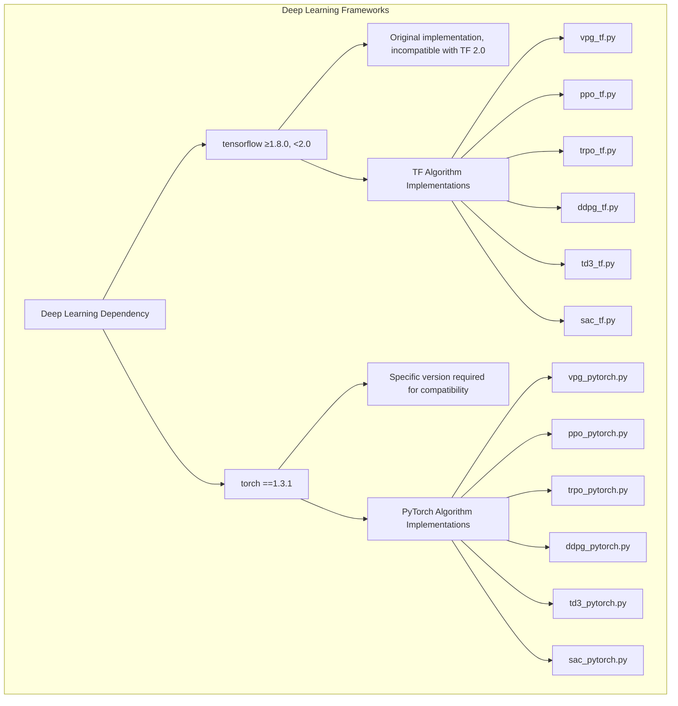

Sources: [setup.py:29-30]()

## Optional Components

The MuJoCo environments are optional but recommended for standard benchmarking purposes:

| Component | Purpose | Installation Method | Notes |
|-----------|---------|---------------------|-------|
| MuJoCo | Physics simulation engine | Install from [mujoco-py](https://github.com/openai/mujoco-py) | Requires license (free for students) |
| MuJoCo Gym Environments | RL environments using MuJoCo | `pip install gym[mujoco,robotics]` | Installed after MuJoCo |

Sources: [docs/user/installation.rst:116-139]()

## Version Information

Spinning Up's version information is maintained in a dedicated file:

```
version_info = (0, 2, 0)
# format:
# ('spinup_major', 'spinup_minor', 'spinup_patch')
```

This information is used by `setup.py` during installation to properly version the package.

Sources: [spinup/version.py:1-9](), [setup.py:9-10](), [setup.py:15]()

## Hardware Recommendations

While Spinning Up doesn't have strict hardware requirements, the following are recommended for optimal performance:

- **CPU**: Multi-core processor (for parallel algorithm implementations using MPI)
- **RAM**: At least 8GB
- **GPU**: CUDA-compatible GPU recommended for faster training (especially for complex environments)
- **Storage**: At least 1GB of free disk space

Note that MuJoCo environments and deep learning frameworks benefit significantly from GPU acceleration, though all algorithms can run on CPU-only systems.

## Dependency Management

It is recommended to use conda environments to manage Spinning Up dependencies:

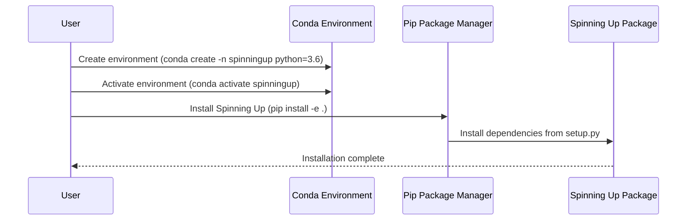

Sources: [docs/user/installation.rst:32-34](), [docs/user/installation.rst:36-40]()

## Verification Process

After installation, users can verify their setup with the following steps:

1. Run a test experiment with PPO on LunarLander-v2
2. Watch a video of the trained policy
3. Plot the learning results

This verifies that all dependencies are correctly installed and working together.

Sources: [docs/user/installation.rst:92-113]()

---

# Page: Documentation System

# Documentation System

<details>
<summary>Relevant source files</summary>

The following files were used as context for generating this wiki page:

- [docs/Makefile](docs/Makefile)
- [docs/conf.py](docs/conf.py)
- [docs/docs_requirements.txt](docs/docs_requirements.txt)
- [docs/index.rst](docs/index.rst)

</details>


## Purpose and Scope

This document explains the documentation system used in the Spinning Up project. It covers the structure of the documentation, technologies used for building it, configuration settings, and build processes. The documentation system serves both as a technical reference for the codebase and as an educational resource for learning reinforcement learning concepts. For information about the actual educational content contained within the documentation, see [Educational Resources](#4).

## Documentation System Overview

The Spinning Up documentation is built using Sphinx, a powerful documentation generator commonly used for Python projects. The system consists of configuration files, content files in ReStructuredText and Markdown formats, and a build system that generates HTML and PDF outputs.

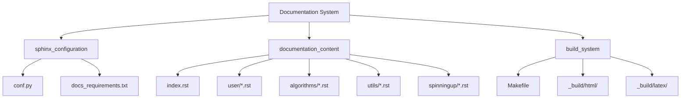

Sources: [docs/conf.py:1-241](), [docs/index.rst:1-72](), [docs/Makefile:1-20]()

## Documentation Structure

The documentation is organized into a hierarchical structure defined in the `index.rst` file, which serves as the root of the documentation tree. The structure is divided into several main sections, each targeting different aspects of the project.

```mermaid
graph TD
    RootToctree["index.rst (root toctree)"]
    
    RootToctree --> UserDocs["User Documentation"]
    RootToctree --> RLIntro["Introduction to RL"]
    RootToctree --> Resources["Resources"]
    RootToctree --> AlgoDocs["Algorithms Docs"]
    RootToctree --> UtilsDocs["Utilities Docs"]
    
    UserDocs --> Introduction["user/introduction.rst"]
    UserDocs --> Installation["user/installation.rst"]
    UserDocs --> Algorithms["user/algorithms.rst"]
    UserDocs --> Running["user/running.rst"]
    UserDocs --> SavingLoading["user/saving_and_loading.rst"]
    UserDocs --> Plotting["user/plotting.rst"]
    
    RLIntro --> RLIntro1["spinningup/rl_intro.rst"]
    RLIntro --> RLIntro2["spinningup/rl_intro2.rst"]
    RLIntro --> RLIntro3["spinningup/rl_intro3.rst"]
    
    Resources --> SpinningUpGuide["spinningup/spinningup.rst"]
    Resources --> KeyPapers["spinningup/keypapers.rst"]
    Resources --> Exercises["spinningup/exercises.rst"]
    Resources --> Benchmarks["spinningup/bench.rst"]
    
    AlgoDocs --> VPG["algorithms/vpg.rst"]
    AlgoDocs --> TRPO["algorithms/trpo.rst"]
    AlgoDocs --> PPO["algorithms/ppo.rst"]
    AlgoDocs --> DDPG["algorithms/ddpg.rst"]
    AlgoDocs --> TD3["algorithms/td3.rst"]
    AlgoDocs --> SAC["algorithms/sac.rst"]
    
    UtilsDocs --> Logger["utils/logger.rst"]
    UtilsDocs --> Plotter["utils/plotter.rst"]
    UtilsDocs --> MPI["utils/mpi.rst"]
    UtilsDocs --> RunUtils["utils/run_utils.rst"]
```

Sources: [docs/index.rst:11-64]()

The table below summarizes the main documentation sections and their purposes:

| Section | Purpose | Files |
|---------|---------|-------|
| User Documentation | Practical guides for installation, running experiments, etc. | `user/*.rst` |
| Introduction to RL | Educational content explaining RL concepts | `spinningup/rl_intro*.rst` |
| Resources | Additional materials including key papers, exercises | `spinningup/{spinningup,keypapers,exercises,bench}.rst` |
| Algorithms Docs | Technical documentation for each implemented algorithm | `algorithms/{vpg,trpo,ppo,ddpg,td3,sac}.rst` |
| Utilities Docs | Documentation for utility modules | `utils/{logger,plotter,mpi,run_utils}.rst` |

Sources: [docs/index.rst:11-64]()

## Sphinx Configuration

The documentation system is configured through the `conf.py` file, which specifies various Sphinx settings and extensions to enhance the functionality of the documentation.

### Key Configuration Components

```mermaid
graph TD
    ConfPy["conf.py"]
    
    ConfPy --> PathConfig["sys.path.insert<br>Module accessibility"]
    ConfPy --> MockModules["mock_modules<br>RTD compatibility"]
    ConfPy --> Parsers["source_parsers<br>MD support"]
    ConfPy --> Extensions["extensions<br>Sphinx plugins"]
    ConfPy --> Templates["templates_path<br>Custom templates"]
    ConfPy --> SourceConfig["source_suffix<br>File types"]
    ConfPy --> ProjectInfo["project_metadata<br>Name, author, etc."]
    ConfPy --> ThemeConfig["html_theme<br>Visual appearance"]
    ConfPy --> MathConfig["imgmath_config<br>Math rendering"]
    ConfPy --> CustomCSS["setup(app)<br>Custom styling"]
    
    MockModules --> MPIMockModule["'mpi4py'"]
    MockModules --> TorchMockModules["'torch' and submodules"]
    
    Extensions --> ImgMath["'sphinx.ext.imgmath'"]
    Extensions --> ViewCode["'sphinx.ext.viewcode'"]
    Extensions --> AutoDoc["'sphinx.ext.autodoc'"]
    Extensions --> Napoleon["'sphinx.ext.napoleon'"]
    
    ThemeConfig --> RTDTheme["sphinx_rtd_theme"]
    ThemeConfig --> Logo["html_logo"]
    ThemeConfig --> Favicon["html_favicon"]
    
    MathConfig --> ImgFormat["imgmath_image_format='svg'"]
    MathConfig --> FontSize["imgmath_font_size=14"]
    MathConfig --> LatexPreamble["imgmath_latex_preamble"]
```

Sources: [docs/conf.py:20-241]()

### Extensions

The documentation uses several Sphinx extensions to enhance its capabilities:

```python
extensions = ['sphinx.ext.imgmath',
    'sphinx.ext.viewcode',
    'sphinx.ext.autodoc',
    'sphinx.ext.napoleon']
```

| Extension | Purpose |
|-----------|---------|
| `sphinx.ext.imgmath` | Renders mathematical equations as images |
| `sphinx.ext.viewcode` | Adds links to source code for documented Python objects |
| `sphinx.ext.autodoc` | Automatically extracts documentation from docstrings |
| `sphinx.ext.napoleon` | Supports Google and NumPy style docstrings |

Sources: [docs/conf.py:66-69]()

### Mock Modules for Read the Docs

To handle dependencies that might not be available during documentation building (especially on Read the Docs), the configuration mocks certain modules:

```python
MOCK_MODULES = ['mpi4py', 
                'torch', 
                'torch.optim', 
                'torch.nn',
                'torch.distributions',
                'torch.distributions.normal',
                'torch.distributions.categorical',
                'torch.nn.functional',
                ]
```

This allows the documentation to build even when these dependencies are not installed.

Sources: [docs/conf.py:36-44]()

### Theme Configuration

The documentation uses the Read the Docs theme with customizations:

```python
html_theme = "sphinx_rtd_theme"
html_logo = 'images/spinning-up-logo2.png'
html_theme_options = {
    'logo_only': True
}
html_favicon = 'openai_icon.ico'
```

Sources: [docs/conf.py:127-146]()

### Mathematical Notation

The documentation includes special configuration for mathematical notation, which is particularly important for reinforcement learning documentation:

```python
imgmath_latex_preamble = r'''
\usepackage{algorithm}
\usepackage{algorithmic}
\usepackage{amsmath}
\usepackage{cancel}

\usepackage[verbose=true,letterpaper]{geometry}
\geometry{
    textheight=12in,
    textwidth=6.5in,
    top=1in,
    headheight=12pt,
    headsep=25pt,
    footskip=30pt
    }

\newcommand{\E}{{\mathrm E}}

\newcommand{\underE}[2]{\underset{\begin{subarray}{c}#1 \end{subarray}}{\E}\left[ #2 \right]}

\newcommand{\Epi}[1]{\underset{\begin{subarray}{c}\tau \sim \pi \end{subarray}}{\E}\left[ #1 \right]}
'''
```

Sources: [docs/conf.py:156-177]()

## Documentation Dependencies

The documentation system has specific dependencies listed in the `docs_requirements.txt` file, which must be installed to build the documentation:

| Package | Version | Purpose |
|---------|---------|---------|
| `sphinx` | 1.5.6 | Core documentation generator |
| `sphinx-autobuild` | 0.7.1 | Automatic rebuilding of docs on changes |
| `sphinx-rtd-theme` | 0.4.1 | Read the Docs theme |
| `cloudpickle` | ~=1.2.1 | Serialization for code examples |
| `gym` | ~=0.15.3 | OpenAI Gym for RL environments |
| `tensorflow` | >=1.8.0,<2.0 | Machine learning framework |
| `matplotlib`, `numpy`, `pandas`, `seaborn` | varies | Data visualization and analysis |

Sources: [docs/docs_requirements.txt:1-16]()

## Build Process

The documentation is built using a standard Sphinx Makefile, which provides various build targets.

### Build Flow

```mermaid
sequenceDiagram
    participant User
    participant Makefile as "Makefile"
    participant Sphinx as "sphinx-build"
    participant SourceFiles as "RST/MD Source Files"
    participant BuildDir as "_build Directory"
    
    User->>Makefile: make html
    Makefile->>Sphinx: Run sphinx-build with HTML target
    Sphinx->>SourceFiles: Parse documentation files
    Sphinx->>Sphinx: Generate HTML
    Sphinx->>BuildDir: Write to _build/html/
    BuildDir->>User: Serve HTML documentation
    
    User->>Makefile: make latexpdf
    Makefile->>Sphinx: Run sphinx-build with LaTeX target
    Sphinx->>SourceFiles: Parse documentation files
    Sphinx->>BuildDir: Generate LaTeX files in _build/latex/
    BuildDir->>BuildDir: Run pdflatex
    BuildDir->>User: Generate PDF documentation
```

Sources: [docs/Makefile:1-20]()

### Common Build Commands

The Makefile provides several targets for building the documentation:

| Command | Purpose |
|---------|---------|
| `make html` | Build HTML documentation in `_build/html/` |
| `make latexpdf` | Build PDF documentation using LaTeX |
| `make clean` | Remove all build artifacts |
| `make help` | Show available make targets |

Sources: [docs/Makefile:1-20]()

## Extending the Documentation

To extend or modify the Spinning Up documentation, you would typically follow these steps:

1. Add or modify `.rst` or `.md` files in the appropriate directory
2. Update `index.rst` if adding new top-level pages
3. Run `make html` to build and preview changes
4. If adding a new algorithm, create a new file in the `algorithms/` directory and add it to the "Algorithms Docs" section in `index.rst`

```mermaid
graph TD
    ExtendProcess["Documentation Extension Process"]
    
    ExtendProcess --> ModifyFiles["Modify/Add .rst or .md Files"]
    ExtendProcess --> UpdateIndex["Update index.rst (if needed)"]
    ExtendProcess --> BuildPreview["Run 'make html'"]
    ExtendProcess --> ReviewOutput["Review in Browser"]
    
    ModifyFiles --> UserDocs["user/*.rst<br>User guides"]
    ModifyFiles --> AlgoDocs["algorithms/*.rst<br>Algorithm docs"]
    ModifyFiles --> UtilsDocs["utils/*.rst<br>Utility docs"]
    ModifyFiles --> EDUDocs["spinningup/*.rst<br>Educational content"]
    
    UpdateIndex --> AddToctree["Add to appropriate toctree directive"]
    
    BuildPreview --> CheckErrors["Check for build errors/warnings"]
    BuildPreview --> OutputGenerated["HTML generated in _build/html/"]
    
    ReviewOutput --> BrowserView["Open _build/html/index.html"]
```

Sources: [docs/index.rst:11-64](), [docs/Makefile:1-20]()

## Custom Styling

The documentation includes custom CSS modifications through a setup function in `conf.py`:

```python
def setup(app):
    app.add_stylesheet('css/modify.css')
```

This adds a custom stylesheet to modify the appearance of the generated documentation beyond the default theme settings.

Sources: [docs/conf.py:240-241]()

## Integration with Codebase

The documentation system is designed to integrate closely with the actual codebase. The `autodoc` extension pulls documentation directly from docstrings in the Python code, ensuring that API documentation stays synchronized with the implementation.

To make this possible, the `conf.py` file adds the root directory to the Python path:

```python
# Make sure spinup is accessible without going through setup.py
dirname = os.path.dirname
sys.path.insert(0, dirname(dirname(__file__)))
```

Sources: [docs/conf.py:23-25]()

This allows Sphinx to import the `spinup` package during the documentation build process and extract documentation from docstrings.

---

# Page: Sphinx Configuration

# Sphinx Configuration

<details>
<summary>Relevant source files</summary>

The following files were used as context for generating this wiki page:

- [docs/conf.py](docs/conf.py)
- [docs/docs_requirements.txt](docs/docs_requirements.txt)

</details>


## Purpose and Scope

This document details the Sphinx configuration used in the Spinning Up documentation system. It covers the structure of the configuration file, extensions, theme settings, math rendering settings, and other customizations that enable the generation of the Spinning Up educational content. For information about the documentation build process itself, see [Documentation Build Process](#3.2).

## Documentation System Overview

The Sphinx documentation system is a core component of Spinning Up's educational resources, rendering complex reinforcement learning concepts in an accessible format.

```mermaid
graph TD
    subgraph "Sphinx Documentation System"
        conf["conf.py"]
        extensions["Sphinx Extensions"]
        templates["Templates"]
        static["Static Content"]
        sourceFiles["Source Files"]
        buildSystem["Build System"]
        
        conf -->|configures| extensions
        conf -->|references| templates
        conf -->|includes| static
        sourceFiles -->|processed by| buildSystem
        conf -->|defines| buildSystem
        extensions -->|enhance| buildSystem
    end
    
    subgraph "Source Files"
        rst["ReStructuredText (.rst)"]
        md["Markdown (.md)"]
        docstrings["Python Docstrings"]
        
        sourceFiles --- rst
        sourceFiles --- md
        sourceFiles --- docstrings
    end
    
    subgraph "Output Formats"
        html["HTML Documentation"]
        latex["PDF/LaTeX"]
        texinfo["Texinfo"]
        manpages["Man Pages"]
        
        buildSystem -->|generates| html
        buildSystem -->|generates| latex
        buildSystem -->|generates| texinfo
        buildSystem -->|generates| manpages
    end
    
    dependencies["docs_requirements.txt"] -->|provides packages for| buildSystem
```

Sources: [docs/conf.py:1-241](), [docs/docs_requirements.txt:1-16]()

## Configuration File Structure

The Sphinx configuration for Spinning Up is defined in `conf.py`, which is organized into several logical sections:

```mermaid
graph TD
    subgraph "conf.py Structure"
        paths["Path Configuration<br>(lines 19-25)"]
        mocks["Mock Module System<br>(lines 27-45)"]
        parsers["Parser Configuration<br>(lines 48-54)"]
        extensions["Extension Setup<br>(lines 63-69)"]
        project["Project Information<br>(lines 87-92)"]
        output["Output Configuration<br>(lines 126-237)"]
        custom["Custom Setup<br>(lines 240-241)"]
    end
    
    paths -->|"Adds repository to sys.path"| spinup["spinup Package Access"]
    mocks -->|"Mocks dependencies"| rtd["Read the Docs Compatibility"]
    parsers -->|"Configures parsers"| mdSupport["Markdown Support"]
    extensions -->|"Enables features"| docFeatures["Documentation Features"]
    project -->|"Sets metadata"| docInfo["Project Metadata"]
    output -->|"Configures output"| formats["Output Formats"]
    custom -->|"Adds customization"| styles["Custom Styling"]
```

Sources: [docs/conf.py:1-241]()

### Path Configuration

The configuration begins by ensuring the Spinning Up package is accessible without requiring installation:

```
import os
import sys

# Make sure spinup is accessible without going through setup.py
dirname = os.path.dirname
sys.path.insert(0, dirname(dirname(__file__)))
```

This allows the documentation to reference and extract information from the actual code modules during the build process.

Sources: [docs/conf.py:19-25]()

## Mock Module System

To address the limitations of Read the Docs (RTD) build environment, Spinning Up uses Python's `unittest.mock` to create mock objects for dependencies that would be difficult to install on the RTD servers:

```mermaid
graph TD
    subgraph "Mock Module System"
        mockClass["Mock Class<br>(lines 31-34)"]
        mockModules["MOCK_MODULES List<br>(lines 36-44)"]
        sysUpdate["sys.modules Update<br>(line 45)"]
    end
    
    mockClass -->|"defines behavior for"| mockObjects["Mock Objects"]
    mockModules -->|"specifies"| targetModules["Modules to Mock"]
    sysUpdate -->|"replaces with mocks"| pythonModules["Python Module Registry"]
    
    subgraph "Mocked Dependencies"
        mpi4py["mpi4py"]
        torch["torch and submodules"]
    end
    
    targetModules --- mpi4py
    targetModules --- torch
    
    rtdServer["Read the Docs Server"] -->|"cannot install"| mpi4py
    rtdServer -->|"too large to download"| torch
```

Sources: [docs/conf.py:27-45]()

The mock system replaces the following modules with mock objects:
- `mpi4py` (installation issues on RTD)
- `torch` and its submodules (too large for RTD)

This allows the documentation to be built successfully without these dependencies.

## Parser and Source Configuration

Spinning Up's documentation supports both reStructuredText (`.rst`) and Markdown (`.md`) formats:

```python
source_parsers = {
    '.md': CommonMarkParser,
}

source_suffix = ['.rst', '.md']
```

This flexibility allows documentation contributors to use their preferred format while maintaining a consistent output style.

Sources: [docs/conf.py:48-54](), [docs/conf.py:81-84]()

## Sphinx Extensions

The documentation system uses several Sphinx extensions to enhance functionality:

| Extension | Purpose |
|-----------|---------|
| `sphinx.ext.imgmath` | Renders mathematical expressions as images |
| `sphinx.ext.viewcode` | Links documentation to source code |
| `sphinx.ext.autodoc` | Generates API documentation from docstrings |
| `sphinx.ext.napoleon` | Supports Google and NumPy style docstrings |

Sources: [docs/conf.py:63-69]()

### Math Rendering Configuration

Given the mathematics-heavy nature of reinforcement learning, Spinning Up configures detailed math rendering settings:

```python
# imgmath settings
imgmath_image_format = 'svg'
imgmath_font_size = 14
```

Additionally, the configuration includes an extensive LaTeX preamble with custom commands for reinforcement learning notation:

```python
imgmath_latex_preamble = r'''
\usepackage{algorithm}
\usepackage{algorithmic}
\usepackage{amsmath}
\usepackage{cancel}

\usepackage[verbose=true,letterpaper]{geometry}
\geometry{
    textheight=12in,
    textwidth=6.5in,
    top=1in,
    headheight=12pt,
    headsep=25pt,
    footskip=30pt
    }

\newcommand{\E}{{\mathrm E}}
\newcommand{\underE}[2]{\underset{\begin{subarray}{c}#1 \end{subarray}}{\E}\left[ #2 \right]}
\newcommand{\Epi}[1]{\underset{\begin{subarray}{c}\tau \sim \pi \end{subarray}}{\E}\left[ #1 \right]}
'''
```

These custom commands allow for consistent mathematical notation throughout the documentation, particularly for expectation operators commonly used in reinforcement learning equations.

Sources: [docs/conf.py:73-75](), [docs/conf.py:156-177]()

## Theme and Styling

Spinning Up uses the Read the Docs theme for its clean, responsive design:

```mermaid
graph TD
    subgraph "Theme Configuration"
        theme["html_theme = 'sphinx_rtd_theme'"]
        logo["html_logo = 'images/spinning-up-logo2.png'"]
        favicon["html_favicon = 'openai_icon.ico'"]
        options["html_theme_options = {'logo_only': True}"]
        stylesheet["Custom Stylesheet: css/modify.css"]
    end
    
    theme -->|"defines base appearance"| appearance["Base Theme Appearance"]
    logo -->|"adds branding"| branding["Visual Branding"]
    favicon -->|"sets browser icon"| browserIcon["Browser Icon"]
    options -->|"configures theme"| themeOptions["Theme Options"]
    stylesheet -->|"customizes styles"| customStyles["Custom Styling"]
    
    appearance --- branding
    appearance --- themeOptions
    appearance --- customStyles
```

Sources: [docs/conf.py:126-146](), [docs/conf.py:240-241]()

The theme configuration includes:
- Setting the theme to Read the Docs (`sphinx_rtd_theme`)
- Adding the Spinning Up logo
- Setting a custom favicon
- Configuring theme options for logo display
- Adding a custom stylesheet for additional styling

## Output Format Configuration

The configuration supports multiple output formats:

| Format | Configuration Section | Lines |
|--------|------------------------|-------|
| HTML | HTML output | 126-146 |
| LaTeX/PDF | LaTeX output | 153-215 |
| Man Pages | Manual page output | 219-225 |
| Texinfo | Texinfo output | 229-237 |

Each format has specific configuration options to ensure proper formatting and appearance.

Sources: [docs/conf.py:126-237]()

## Build Dependencies

The documentation build system requires several Python packages, specified in `docs_requirements.txt`:

```mermaid
graph TD
    subgraph "Documentation Dependencies"
        sphinx["sphinx==1.5.6"]
        autobuild["sphinx-autobuild==0.7.1"]
        theme["sphinx-rtd-theme==0.4.1"]
        supportPackages["Support Packages"]
    end
    
    subgraph "Support Packages"
        numpy["numpy"]
        matplotlib["matplotlib"]
        tensorflow["tensorflow>=1.8.0,<2.0"]
        seaborn["seaborn==0.8.1"]
        other["Other utility packages"]
    end
    
    sphinx -->|"core documentation engine"| docSystem["Documentation System"]
    autobuild -->|"automatic rebuilding"| devWorkflow["Development Workflow"]
    theme -->|"visual appearance"| appearance["Visual Appearance"]
    supportPackages -->|"enables examples/code snippets"| codeExamples["Code Examples"]
```

Sources: [docs/docs_requirements.txt:1-16]()

Key dependencies include:
- `sphinx==1.5.6`: The core documentation generation engine
- `sphinx-autobuild==0.7.1`: For automatic rebuilding during development
- `sphinx-rtd-theme==0.4.1`: The Read the Docs theme package
- Support packages like `numpy`, `matplotlib`, and `tensorflow` to ensure code examples work properly

## Integration with Spinning Up Package

The Sphinx configuration integrates closely with the Spinning Up package structure:

```mermaid
graph TD
    subgraph "Documentation-Code Integration"
        conf["conf.py"]
        autodoc["sphinx.ext.autodoc"]
        napoleon["sphinx.ext.napoleon"]
        viewcode["sphinx.ext.viewcode"]
        
        spinupPackage["spinup Package"]
        spinupModules["spinup Modules"]
        docstrings["Module Docstrings"]
        
        apiDocs["API Documentation"]
        tutorial["Tutorials"]
        algorithms["Algorithm Documentation"]
    end
    
    conf -->|"configures"| autodoc
    conf -->|"configures"| napoleon
    conf -->|"configures"| viewcode
    
    spinupPackage -->|"contains"| spinupModules
    spinupModules -->|"contain"| docstrings
    
    autodoc -->|"extracts"| docstrings
    napoleon -->|"formats"| docstrings
    viewcode -->|"links to source"| spinupModules
    
    docstrings -->|"generates"| apiDocs
    apiDocs --- tutorial
    apiDocs --- algorithms
```

Sources: [docs/conf.py:19-25](), [docs/conf.py:63-69]()

This integration allows the documentation to automatically stay in sync with the codebase, as API documentation is generated directly from docstrings in the Python modules.

## Conclusion

The Sphinx configuration in Spinning Up creates a comprehensive documentation system that effectively communicates complex reinforcement learning concepts. Through careful extension selection, theme configuration, and custom styling, it produces documentation that is both informative and accessible to learners at various levels.

The configuration balances the need for technical accuracy (through features like precise math rendering) with educational clarity (through a clean, responsive theme), supporting Spinning Up's primary goal as an educational resource.

---

# Page: Documentation Build Process

# Documentation Build Process

<details>
<summary>Relevant source files</summary>

The following files were used as context for generating this wiki page:

- [docs/Makefile](docs/Makefile)
- [docs/conf.py](docs/conf.py)
- [docs/docs_requirements.txt](docs/docs_requirements.txt)
- [docs/index.rst](docs/index.rst)

</details>


This document explains the process for building the Spinning Up documentation, including prerequisites, build commands, customization options, and troubleshooting. It focuses specifically on how to generate the HTML and PDF documentation from the source files. For information about the Sphinx configuration itself, see [Sphinx Configuration](#3.1).

## Overview of the Documentation System

The Spinning Up documentation is built using Sphinx, a powerful documentation generator widely used in the Python ecosystem. The documentation system consists of several key components that work together to produce the final documentation.

```mermaid
flowchart TD
    subgraph "Documentation System"
        SourceFiles["Source Files"]
        SphinxConf["conf.py"]
        MakeFile["Makefile"]
        Requirements["docs_requirements.txt"]
        
        SourceFiles --> |"processed by"| SphinxBuild["Sphinx Build Process"]
        SphinxConf --> |"configures"| SphinxBuild
        Requirements --> |"provides dependencies for"| SphinxBuild
        MakeFile --> |"defines targets for"| SphinxBuild
        
        SphinxBuild --> HTMLOutput["HTML Output"]
        SphinxBuild --> PDFOutput["PDF Output (via LaTeX)"]
    end
```

Sources: [docs/conf.py](), [docs/Makefile](), [docs/docs_requirements.txt](), [docs/index.rst]()

## Prerequisites

Before building the Spinning Up documentation, you need to install the required dependencies. These are specified in the `docs_requirements.txt` file.

### Required Dependencies

The following table shows the key dependencies required for building the documentation:

| Dependency | Version | Purpose |
|------------|---------|---------|
| sphinx | 1.5.6 | Core documentation generator |
| sphinx-autobuild | 0.7.1 | Live reload for development |
| sphinx-rtd-theme | 0.4.1 | ReadTheDocs theme for HTML output |
| tensorflow | >=1.8.0,<2.0 | Required for code examples |
| matplotlib | - | For generating plots |
| numpy | - | For numerical operations |
| seaborn | 0.8.1 | For enhanced visualizations |

Sources: [docs/docs_requirements.txt:1-16]()

### Installing Dependencies

To install all required dependencies for building the documentation:

```bash
# Navigate to the docs directory
cd docs
# Install all required packages
pip install -r docs_requirements.txt
```

## Build Process

The documentation build process is managed through the `Makefile` in the `docs` directory. This section explains how to use the Makefile to build the documentation in different formats.

```mermaid
sequenceDiagram
    participant User
    participant Makefile as "Makefile"
    participant Sphinx as "sphinx-build"
    participant SourceFiles as "Source Files (.rst, .md)"
    participant Output as "Output Files"
    
    User->>Makefile: make html
    Makefile->>Sphinx: sphinx-build -M html . _build
    Sphinx->>SourceFiles: Read source files
    Sphinx->>Output: Generate HTML files in _build/html
    
    User->>Makefile: make latexpdf
    Makefile->>Sphinx: sphinx-build -M latexpdf . _build
    Sphinx->>SourceFiles: Read source files
    Sphinx->>Output: Generate PDF via LaTeX in _build/latex
```

Sources: [docs/Makefile:1-20]()

### Building HTML Documentation

To build the HTML documentation:

```bash
# Navigate to the docs directory
cd docs
# Build HTML documentation
make html
```

The HTML output will be generated in the `_build/html` directory. You can open `_build/html/index.html` in a web browser to view the documentation.

### Building PDF Documentation

To build the PDF documentation (requires LaTeX):

```bash
# Navigate to the docs directory
cd docs
# Build PDF documentation
make latexpdf
```

The PDF output will be generated as `_build/latex/SpinningUp.pdf`.

### Other Build Formats

The Makefile supports several other build formats:

| Target | Description | Output Location |
|--------|-------------|-----------------|
| `html` | HTML documentation | `_build/html/` |
| `latexpdf` | PDF via LaTeX | `_build/latex/SpinningUp.pdf` |
| `epub` | EPUB e-book | `_build/epub/SpinningUp.epub` |
| `text` | Plain text | `_build/text/` |
| `clean` | Remove build directory | - |

To see all available targets:

```bash
make help
```

Sources: [docs/Makefile:1-20]()

## Understanding the Build Configuration

The Sphinx build process is configured through the `conf.py` file, which defines various settings that control the output of the documentation.

```mermaid
flowchart TD
    subgraph "conf.py Components"
        Extensions["Extensions"]
        Templates["Templates"]
        SourceSettings["Source Settings"]
        HTMLSettings["HTML Settings"]
        LaTeXSettings["LaTeX Settings"]
        MockModules["Mock Modules"]
        
        Extensions --> SphinxBuild["Sphinx Build Process"]
        Templates --> SphinxBuild
        SourceSettings --> SphinxBuild
        HTMLSettings --> SphinxBuild
        LaTeXSettings --> SphinxBuild
        MockModules --> SphinxBuild
    end
    
    SphinxBuild --> Output["Documentation Output"]
```

Sources: [docs/conf.py:57-237]()

### Key Configuration Elements

#### Extensions

Sphinx extensions that provide additional functionality:

```python
extensions = ['sphinx.ext.imgmath',
    'sphinx.ext.viewcode',
    'sphinx.ext.autodoc',
    'sphinx.ext.napoleon']
```

- `imgmath`: Renders math as images
- `viewcode`: Adds links to source code
- `autodoc`: Extracts documentation from Python docstrings
- `napoleon`: Supports Google/NumPy style docstrings

Sources: [docs/conf.py:66-69]()

#### Source Settings

Configuration for source files:

```python
source_suffix = ['.rst', '.md']
master_doc = 'index'
```

This allows both reStructuredText (.rst) and Markdown (.md) files to be used as source documents.

Sources: [docs/conf.py:83-87]()

#### HTML Theme Settings

The documentation uses the ReadTheDocs theme:

```python
html_theme = "sphinx_rtd_theme"
html_logo = 'images/spinning-up-logo2.png'
html_theme_options = {
    'logo_only': True
}
```

Sources: [docs/conf.py:127-144]()

#### Mock Modules

To handle dependencies that are difficult to install or not necessary for documentation building (like PyTorch and MPI), the configuration uses mocking:

```python
MOCK_MODULES = ['mpi4py', 
                'torch', 
                'torch.optim', 
                'torch.nn',
                'torch.distributions',
                'torch.distributions.normal',
                'torch.distributions.categorical',
                'torch.nn.functional',
                ]
sys.modules.update((mod_name, Mock()) for mod_name in MOCK_MODULES)
```

This allows the documentation to build successfully on platforms like ReadTheDocs without requiring all dependencies to be installed.

Sources: [docs/conf.py:27-45]()

## Customizing the Documentation

You can customize the documentation by modifying various files in the documentation system.

### Adding New Pages

To add a new page to the documentation:

1. Create a new `.rst` or `.md` file in the appropriate directory
2. Add the file to the appropriate `toctree` directive in `index.rst` or another parent document

For example, to add a new algorithm documentation:

```rst
.. toctree::
   :maxdepth: 2
   :caption: Algorithms Docs

   algorithms/vpg
   algorithms/trpo
   algorithms/ppo
   algorithms/ddpg
   algorithms/td3
   algorithms/sac
   algorithms/your_new_algorithm
```

Sources: [docs/index.rst:40-48]()

### Modifying the Theme

You can customize the appearance by:

1. Modifying the `html_theme_options` in `conf.py`
2. Adding custom CSS in the `_static/css/` directory and referencing it in the `setup` function

```python
def setup(app):
    app.add_stylesheet('css/modify.css')
```

Sources: [docs/conf.py:240-241]()

## Troubleshooting

Here are solutions to common issues that may arise during the documentation build process:

### Missing Dependencies

If you see errors about missing packages:

```
ImportError: No module named 'sphinx_rtd_theme'
```

Solution: Install the required dependencies using the `docs_requirements.txt` file:

```bash
pip install -r docs_requirements.txt
```

### MPI4Py or PyTorch Import Errors

The build is configured to mock certain modules like `mpi4py` and `torch` to avoid having to install them. However, if you're still seeing import errors:

1. Check if the module is included in the `MOCK_MODULES` list in `conf.py`
2. If not, add it to the list

Sources: [docs/conf.py:27-45]()

### Math Rendering Issues

If math equations aren't rendering correctly:

1. Check that `imgmath` extension is enabled in `conf.py`
2. Verify LaTeX is properly installed if building PDF documentation
3. Adjust the `imgmath_image_format` and `imgmath_font_size` settings if needed

Sources: [docs/conf.py:73-75]()

### ReadTheDocs Build Failures

If your documentation fails to build on ReadTheDocs:

1. Ensure all required modules are properly mocked in `conf.py`
2. Check for large dependencies that might exceed ReadTheDocs limits
3. Verify your `.readthedocs.yml` configuration if you're using it

## Conclusion

The Spinning Up documentation build process is managed through a standard Sphinx setup with customizations for handling mathematical content and code examples. By using the `Makefile` and understanding the configuration in `conf.py`, you can build, customize, and troubleshoot the documentation effectively.

For more information about the Sphinx configuration itself and how it's structured, see [Sphinx Configuration](#3.1).

---

# Page: Educational Resources

# Educational Resources

<details>
<summary>Relevant source files</summary>

The following files were used as context for generating this wiki page:

- [docs/spinningup/keypapers.rst](docs/spinningup/keypapers.rst)
- [docs/user/introduction.rst](docs/user/introduction.rst)

</details>


## Purpose and Scope

This document provides an overview of the educational content in the Spinning Up repository, explaining the resources available to help users learn about deep reinforcement learning (RL). The educational components include an introduction to RL terminology and theory, a curated list of key papers, learning exercises, and connections to practical implementations. These resources are designed to bridge the gap between theoretical understanding and code implementation in deep RL.

For information about the specific algorithm implementations, see [Algorithm Implementations](#5).

## Educational Content Structure

Spinning Up serves as an educational ecosystem, with carefully structured components that work together to make deep reinforcement learning accessible.

### Educational Components Overview

```mermaid
graph TD
    SpinUpEdu["Spinning Up Educational Resources"]
    
    SpinUpEdu --> RLIntro["Introduction to RL"]
    SpinUpEdu --> ResearchEssay["Research Career Essay"]
    SpinUpEdu --> KeyPapers["Curated Papers List"]
    SpinUpEdu --> Exercises["Learning Exercises"]
    SpinUpEdu --> AlgoImpl["Algorithm Implementations"]
    
    RLIntro --> Terminology["RL Terminology"]
    RLIntro --> AlgoTypes["Algorithm Types"]
    RLIntro --> Theory["Basic Theory"]
    
    KeyPapers --> ModelFreeRL["Model-Free RL"]
    KeyPapers --> Exploration["Exploration"]
    KeyPapers --> TransferRL["Transfer & Multitask RL"]
    KeyPapers --> Hierarchy["Hierarchy"]
    KeyPapers --> Memory["Memory"]
    KeyPapers --> ModelBasedRL["Model-Based RL"]
    KeyPapers --> MetaRL["Meta-RL"]
    KeyPapers --> ScalingRL["Scaling RL"]
    KeyPapers --> Safety["Safety"]
    KeyPapers --> ImitationLearning["Imitation Learning"]
    
    AlgoImpl --> VPG["Vanilla Policy Gradient (VPG)"]
    AlgoImpl --> PPO["Proximal Policy Optimization (PPO)"]
    AlgoImpl --> TRPO["Trust Region Policy Optimization (TRPO)"]
    AlgoImpl --> DDPG["Deep Deterministic Policy Gradient (DDPG)"]
    AlgoImpl --> TD3["Twin Delayed DDPG (TD3)"]
    AlgoImpl --> SAC["Soft Actor-Critic (SAC)"]
```

Sources: [docs/user/introduction.rst:10-20](), [docs/spinningup/keypapers.rst:1-295]()

The educational content in Spinning Up consists of five main components:

1. **Introduction to RL**: A concise primer on reinforcement learning concepts, terminology, and theory
2. **Research Career Essay**: Guidance on how to develop a career in RL research 
3. **Curated Papers List**: A comprehensive collection of important papers in deep RL
4. **Learning Exercises**: Practical exercises to apply theoretical concepts
5. **Algorithm Implementations**: Clean, readable implementations of key RL algorithms

## Introduction to RL

The Introduction to RL component provides foundational knowledge about reinforcement learning concepts, terminology, and basic theory. It serves as an entry point for newcomers to the field and helps establish the vocabulary needed to understand the more advanced materials.

Key aspects covered in the introduction include:
- Fundamental RL terminology (states, actions, rewards, policies, value functions)
- Types of RL algorithms and their characteristics
- Basic theoretical principles underlying RL methods

This resource is designed to be accessible while providing sufficient depth to prepare users for engaging with the algorithm implementations and research papers.

Sources: [docs/user/introduction.rst:16]()

## Key Papers in Deep RL

One of the most valuable educational resources in Spinning Up is the curated list of key papers in deep reinforcement learning. This list serves as a roadmap to the field, organizing important research papers by topic area to help users navigate the vast RL literature.

### Organization of Key Papers

```mermaid
flowchart TD
    KeyPapers["Key Papers in Deep RL"]
    
    KeyPapers --> ModelFree["1. Model-Free RL"]
    KeyPapers --> Exploration["2. Exploration"]
    KeyPapers --> Transfer["3. Transfer and Multitask RL"]
    KeyPapers --> Hierarchy["4. Hierarchy"]
    KeyPapers --> Memory["5. Memory"]
    KeyPapers --> ModelBased["6. Model-Based RL"]
    KeyPapers --> MetaRL["7. Meta-RL"]
    KeyPapers --> Scaling["8. Scaling RL"]
    KeyPapers --> RealWorld["9. RL in the Real World"]
    KeyPapers --> Safety["10. Safety"]
    KeyPapers --> Imitation["11. Imitation Learning and IRL"]
    KeyPapers --> Reproducibility["12. Reproducibility and Analysis"]
    KeyPapers --> Classic["13. Classic Papers"]
    
    ModelFree --> DQL["a. Deep Q-Learning"]
    ModelFree --> PG["b. Policy Gradients"]
    ModelFree --> DPG["c. Deterministic Policy Gradients"]
    ModelFree --> DistRL["d. Distributional RL"]
    ModelFree --> ADBL["e. Action-Dependent Baselines"]
    ModelFree --> PCL["f. Path-Consistency Learning"]
    ModelFree --> Hybrid["g. Policy-Learning and Q-Learning"]
    ModelFree --> EA["h. Evolutionary Algorithms"]
```

Sources: [docs/spinningup/keypapers.rst:7-297]()

The papers are organized into 13 major categories with subcategories for specific research directions. Each paper entry includes:
- Full citation with link to the original paper
- Author names and publication year
- Algorithm name or key contribution
- Sometimes brief notes about the significance

For example, in the Policy Gradients subcategory, key papers include:
- Trust Region Policy Optimization (Schulman et al, 2015)
- Proximal Policy Optimization Algorithms (Schulman et al, 2017)
- Generalized Advantage Estimation (Schulman et al, 2015)

This organization helps users identify relevant papers based on their interests and provides a structured way to explore the field's development.

### Mapping Papers to Implementations

A particularly valuable aspect of Spinning Up's educational approach is the connection between theoretical papers and their practical implementations in the codebase:

```mermaid
graph TD
    papers["Key RL Papers"]
    implementations["Algorithm Implementations"]
    
    papers --> PPOpaper["PPO Paper (Schulman et al, 2017)"]
    papers --> TRPOpaper["TRPO Paper (Schulman et al, 2015)"]
    papers --> DDPGpaper["DDPG Paper (Lillicrap et al, 2015)"]
    papers --> TD3paper["TD3 Paper (Fujimoto et al, 2018)"]
    papers --> SACpaper["SAC Paper (Haarnoja et al, 2018)"]
    
    implementations --> PPOcode["spinup.algos.ppo"]
    implementations --> TRPOcode["spinup.algos.trpo"]
    implementations --> DDPGcode["spinup.algos.ddpg"]
    implementations --> TD3code["spinup.algos.td3"]
    implementations --> SACcode["spinup.algos.sac"]
    
    PPOpaper <--> PPOcode
    TRPOpaper <--> TRPOcode
    DDPGpaper <--> DDPGcode
    TD3paper <--> TD3code
    SACpaper <--> SACcode
```

Sources: [docs/spinningup/keypapers.rst:38-42](), [docs/spinningup/keypapers.rst:55-60](), [docs/spinningup/keypapers.rst:49-50]()

This bidirectional mapping allows users to:
1. Read a paper to understand the theoretical foundations
2. Study the corresponding implementation to see how theory translates to code
3. Run experiments to observe algorithm behavior and performance

## Learning Philosophy and Exercises

Spinning Up adopts a distinctive learning philosophy focused on making deep RL accessible and understandable. This is reflected in both the organization of educational resources and the design of the exercises.

### Learning Philosophy

The educational approach in Spinning Up is guided by several principles:

| Principle | Description |
|-----------|-------------|
| **Simplicity First** | Resources prioritize clarity and simplicity over comprehensive coverage |
| **Theory-Practice Connection** | Strong emphasis on connecting theoretical concepts to practical implementations |
| **Consistency** | Similar structure across resources to facilitate comparison and transfer of knowledge |
| **Self-Contained Learning** | Resources designed to be understood with minimal external references |
| **Progressive Complexity** | Materials arranged to allow progressive learning from basics to advanced topics |

Sources: [docs/user/introduction.rst:61-73]()

### Exercises

Spinning Up includes exercises that serve as warm-up activities for working with RL algorithms. These exercises are designed to help users:
- Solidify their understanding of RL concepts
- Practice implementing key components of RL algorithms
- Gain experience with debugging and optimizing RL systems
- Develop intuition about algorithm behavior and performance

The exercises complement the other educational resources by providing hands-on practice with the concepts covered in the introduction and papers list.

Sources: [docs/user/introduction.rst:20]()

## Code Design Philosophy

The algorithm implementations in Spinning Up follow a specific design philosophy that enhances their educational value:

```mermaid
graph TD
    CodeDesign["Code Design Philosophy"]
    
    CodeDesign --> Simplicity["Simplicity Over Optimization"]
    CodeDesign --> Consistency["Consistency Across Algorithms"]
    CodeDesign --> SelfContained["Self-Contained Implementations"]
    CodeDesign --> PseudocodeStyle["Pseudocode-Like Style"]
    
    Simplicity --> MinimalTricks["Minimal Implementation Tricks"]
    Simplicity --> ReadableCode["Prioritize Readability"]
    
    Consistency --> CommonStructure["Common Implementation Structure"]
    Consistency --> UniformInterfaces["Uniform Interfaces"]
    
    SelfContained --> FewDependencies["Minimal Shared Code"]
    SelfContained --> StandaloneStudy["Enable Focused Study"]
    
    PseudocodeStyle --> TheoryToCode["Minimal Theory-Code Gap"]
    PseudocodeStyle --> PaperAlignment["Close Alignment with Papers"]
```

Sources: [docs/user/introduction.rst:61-73]()

Key aspects of this design philosophy include:

1. **Simplicity Over Optimization**: Implementations prioritize clarity and readability over performance optimizations. Some optimization tricks found in original algorithm implementations are intentionally omitted to maintain clarity.

2. **Consistency Across Algorithms**: All implementations follow a similar structure, making it easier to compare different algorithms and understand their relationships.

3. **Self-Contained Code**: Each algorithm implementation is almost entirely self-contained, with minimal dependencies on shared code. This allows users to study each algorithm in isolation.

4. **Pseudocode-Like Style**: The implementations are structured to closely resemble pseudocode, minimizing the gap between theoretical descriptions in papers and actual code.

This design philosophy directly supports the educational goals of Spinning Up by making algorithm implementations approachable and understandable.

## Framework Support

Spinning Up provides implementations in two major deep learning frameworks:

1. **TensorFlow v1**: The original implementations
2. **PyTorch**: Added in January 2020 based on community feedback

This dual-framework approach allows users to learn with their preferred framework while maintaining the same educational principles across implementations.

Sources: [docs/user/introduction.rst:97]()

## Educational Integration with OpenAI Programs

The Spinning Up educational resources have been integrated into OpenAI's educational programs, including:

- **OpenAI Scholars**: A program supporting individuals from underrepresented groups in AI research
- **OpenAI Fellows**: A program supporting promising AI researchers

This integration demonstrates the effectiveness of these resources in structured educational settings and their role in developing technical talent for AI safety research.

Sources: [docs/user/introduction.rst:101-102]()

## Conclusion

The educational resources in Spinning Up form a comprehensive learning ecosystem designed to make deep reinforcement learning accessible to a wide audience. By combining theoretical explanations, curated research papers, practical exercises, and clear algorithm implementations, Spinning Up provides a structured path for learning deep RL from fundamentals to cutting-edge research.

The careful design of these resources reflects OpenAI's mission to ensure the safe development of AI and the broad distribution of AI benefits by empowering more people to understand and contribute to the field.

Sources: [docs/user/introduction.rst:27-47](), [docs/user/introduction.rst:50-58]()

---

# Page: Key Papers in Deep RL

# Key Papers in Deep RL

<details>
<summary>Relevant source files</summary>

The following files were used as context for generating this wiki page:

- [docs/spinningup/keypapers.rst](docs/spinningup/keypapers.rst)

</details>


## Purpose and Scope

This document provides an explanation of the curated list of significant research papers in Deep Reinforcement Learning (Deep RL) included as part of the Spinning Up educational resource. This collection serves as:

1. A structured guide to important papers in Deep RL, organized by research areas
2. A reference for the theoretical foundations of algorithms implemented in Spinning Up
3. A starting point for researchers and practitioners looking to explore the field

While not exhaustive, this collection covers major developments in Deep RL, with emphasis on papers that have introduced influential algorithms or concepts. For implementation details of specific algorithms, see [Algorithm Implementations](#5).

## Organization of the Paper Collection

The paper collection is organized into 13 categories representing different research areas in Deep RL. This structure helps understand how different algorithms relate to each other and how the field has evolved over time.

### Paper Categories Structure

```mermaid
graph TD
    Root["Key Papers in Deep RL"]
    
    Root --> MF["1. Model-Free RL"]
    Root --> EX["2. Exploration"]
    Root --> TM["3. Transfer and Multitask RL"]
    Root --> HI["4. Hierarchy"]
    Root --> ME["5. Memory"]
    Root --> MB["6. Model-Based RL"]
    Root --> META["7. Meta-RL"]
    Root --> SC["8. Scaling RL"]
    Root --> RW["9. RL in the Real World"]
    Root --> SA["10. Safety"]
    Root --> IM["11. Imitation Learning and IRL"]
    Root --> REP["12. Reproducibility and Analysis"]
    Root --> CL["13. Classic Papers in RL Theory"]
```

Sources: [docs/spinningup/keypapers.rst:5-13]

## Model-Free RL Category

The Model-Free RL category is particularly significant as it contains papers introducing all the algorithms implemented in Spinning Up. This category is further divided into subcategories:

### Model-Free RL Subcategories

```mermaid
graph TD
    MF["1. Model-Free RL"]
    
    MF --> DQ["a. Deep Q-Learning"]
    MF --> PG["b. Policy Gradients"]
    MF --> DPG["c. Deterministic Policy Gradients"]
    MF --> DR["d. Distributional RL"]
    MF --> PAD["e. Policy Gradients with Action-Dependent Baselines"]
    MF --> PCL["f. Path-Consistency Learning"]
    MF --> OD["g. Other Combined Approaches"]
    MF --> EA["h. Evolutionary Algorithms"]
    
    PG --> VPG_Paper["Sutton et al, 2000 - Policy Gradient Methods"]
    PG --> TRPO_Paper["Schulman et al, 2015 - TRPO"]
    PG --> PPO_Paper["Schulman et al, 2017 - PPO"]
    PG --> SAC_Paper["Haarnoja et al, 2018 - SAC"]
    
    DPG --> DDPG_Paper["Lillicrap et al, 2015 - DDPG"]
    DPG --> TD3_Paper["Fujimoto et al, 2018 - TD3"]
```

Sources: [docs/spinningup/keypapers.rst:11-107]

## Implemented Algorithms and Their Source Papers

Spinning Up implements six key algorithms from the Model-Free RL category. The following table summarizes these algorithms and the papers that introduced them:

| Algorithm | Paper | Category | Key Innovation |
|-----------|-------|----------|----------------|
| VPG | "Policy Gradient Methods for Reinforcement Learning with Function Approximation" (Sutton et al., 2000) | Policy Gradients | Established policy gradient theorem and showed convergence |
| TRPO | "Trust Region Policy Optimization" (Schulman et al., 2015) | Policy Gradients | Constrained policy updates for stability |
| PPO | "Proximal Policy Optimization Algorithms" (Schulman et al., 2017) | Policy Gradients | Simplified TRPO with clipped objective function |
| SAC | "Soft Actor-Critic" (Haarnoja et al., 2018) | Policy Gradients | Added entropy maximization for better exploration |
| DDPG | "Continuous Control With Deep Reinforcement Learning" (Lillicrap et al., 2015) | Deterministic Policy Gradients | Applied DQN concepts to continuous action spaces |
| TD3 | "Addressing Function Approximation Error in Actor-Critic Methods" (Fujimoto et al., 2018) | Deterministic Policy Gradients | Improved DDPG with twin critics and delayed updates |

Sources: [docs/spinningup/keypapers.rst:35-59]

### Algorithm Implementation in Spinning Up Codebase

The following diagram illustrates how the papers relate to the algorithm implementations in the Spinning Up codebase:

```mermaid
graph TD
    subgraph "Key Papers"
        P1["Sutton et al, 2000: Policy Gradient Methods"]
        P2["Schulman et al, 2015: TRPO"]
        P3["Schulman et al, 2017: PPO"]
        P4["Haarnoja et al, 2018: SAC"]
        P5["Lillicrap et al, 2015: DDPG"]
        P6["Fujimoto et al, 2018: TD3"]
    end
    
    subgraph "spinup.algos"
        TF1["tf1 (TensorFlow 1.x)"]
        PT["pytorch"]
        
        TF1 --> VPG_TF["vpg"]
        TF1 --> TRPO_TF["trpo"]
        TF1 --> PPO_TF["ppo"]
        TF1 --> SAC_TF["sac"]
        TF1 --> DDPG_TF["ddpg"]
        TF1 --> TD3_TF["td3"]
        
        PT --> VPG_PT["vpg"]
        PT --> PPO_PT["ppo"]
        PT --> SAC_PT["sac"]
        PT --> DDPG_PT["ddpg"]
        PT --> TD3_PT["td3"]
    end
    
    P1 --> VPG_TF
    P1 --> VPG_PT
    P2 --> TRPO_TF
    P3 --> PPO_TF
    P3 --> PPO_PT
    P4 --> SAC_TF
    P4 --> SAC_PT
    P5 --> DDPG_TF
    P5 --> DDPG_PT
    P6 --> TD3_TF
    P6 --> TD3_PT
```

Sources: [docs/spinningup/keypapers.rst:35-59]

## Evolution of Algorithm Development

The algorithms implemented in Spinning Up represent different evolutionary paths in the development of deep reinforcement learning. The following diagram illustrates some of the key relationships and improvements between these algorithms:

```mermaid
graph TD
    PG["Policy Gradient Methods (Sutton et al, 2000)"]
    
    PG --> VPG["Vanilla Policy Gradient (VPG)"]
    
    VPG --> TRPO["Trust Region Policy Optimization (TRPO)
            Added: Constrained policy updates"]
    
    TRPO --> PPO["Proximal Policy Optimization (PPO)
            Added: Clipped objective function"]
    
    DQN["Deep Q-Network (Mnih et al, 2013)"]
    
    DQN --> DDPG["Deep Deterministic Policy Gradient (DDPG)
            Added: Deterministic policy for continuous actions"]
    
    DDPG --> TD3["Twin Delayed DDPG (TD3)
            Added: Twin critics, delayed policy updates"]
    
    AC["Actor-Critic Methods"] --> SAC["Soft Actor-Critic (SAC)
            Added: Entropy maximization"]
```

Sources: [docs/spinningup/keypapers.rst:35-59]

## Model-Free RL Subcategories

### a. Deep Q-Learning

This subcategory focuses on value-based methods derived from the original DQN paper. These methods learn to approximate the optimal action-value function.

Key papers include:
- "Playing Atari with Deep Reinforcement Learning" (Mnih et al, 2013)
- "Deep Recurrent Q-Learning for Partially Observable MDPs" (Hausknecht and Stone, 2015)
- "Dueling Network Architectures for Deep Reinforcement Learning" (Wang et al, 2015)
- "Deep Reinforcement Learning with Double Q-learning" (Hasselt et al, 2015)
- "Prioritized Experience Replay" (Schaul et al, 2015)
- "Rainbow: Combining Improvements in Deep Reinforcement Learning" (Hessel et al, 2017)

Sources: [docs/spinningup/keypapers.rst:14-28]

### b. Policy Gradients

This subcategory includes methods that directly optimize policy functions by gradient ascent. Four of the six algorithms implemented in Spinning Up (VPG, TRPO, PPO, and SAC) come from this subcategory.

Key papers include:
- "Asynchronous Methods for Deep Reinforcement Learning" (Mnih et al, 2016)
- "Trust Region Policy Optimization" (Schulman et al, 2015)
- "High-Dimensional Continuous Control Using Generalized Advantage Estimation" (Schulman et al, 2015)
- "Proximal Policy Optimization Algorithms" (Schulman et al, 2017)
- "Soft Actor-Critic" (Haarnoja et al, 2018)

Sources: [docs/spinningup/keypapers.rst:31-49]

### c. Deterministic Policy Gradients

This subcategory covers methods that learn deterministic policies rather than stochastic ones. Two of the six algorithms implemented in Spinning Up (DDPG and TD3) come from this subcategory.

Key papers include:
- "Deterministic Policy Gradient Algorithms" (Silver et al, 2014)
- "Continuous Control With Deep Reinforcement Learning" (Lillicrap et al, 2015)
- "Addressing Function Approximation Error in Actor-Critic Methods" (Fujimoto et al, 2018)

Sources: [docs/spinningup/keypapers.rst:51-59]

## Other Important Categories

While the Model-Free RL category contains the papers most directly relevant to Spinning Up implementations, the other categories cover important areas such as:

### 2. Exploration

Papers focusing on strategies for efficient exploration of the environment, including intrinsic motivation approaches and unsupervised RL methods.

Sources: [docs/spinningup/keypapers.rst:109-139]

### 3. Transfer and Multitask RL

Papers on approaches for transferring knowledge between tasks and learning to perform multiple tasks.

Sources: [docs/spinningup/keypapers.rst:142-160]

### 6. Model-Based RL

Papers on methods that learn and use models of the environment, divided into approaches where the model is learned from data and where the model is given.

Sources: [docs/spinningup/keypapers.rst:184-210]

### 10. Safety

Papers addressing safety concerns in reinforcement learning, including constrained optimization and human oversight.

Sources: [docs/spinningup/keypapers.rst:248-261]

### 11. Imitation Learning and Inverse RL

Papers on learning from demonstrations and inferring reward functions from observed behavior.

Sources: [docs/spinningup/keypapers.rst:264-277]

## Relationship between Key Papers and Spinning Up Implementation

The Key Papers list serves as both a theoretical foundation for the algorithms implemented in Spinning Up and a broader educational resource for the field of Deep RL. The papers directly related to Spinning Up implementations (VPG, TRPO, PPO, SAC, DDPG, and TD3) are highlighted in the Model-Free RL category, while the other categories provide context and directions for further exploration.

This organization reflects the educational purpose of Spinning Up: to provide accessible implementations of core Deep RL algorithms while also offering guidance for deeper study of the field.

Sources: [docs/spinningup/keypapers.rst:5-10]

---

# Page: Algorithm Implementations

# Algorithm Implementations

<details>
<summary>Relevant source files</summary>

The following files were used as context for generating this wiki page:

- [docs/spinningup/keypapers.rst](docs/spinningup/keypapers.rst)
- [docs/user/introduction.rst](docs/user/introduction.rst)

</details>


## Purpose and Scope

This document provides an overview of the reinforcement learning algorithm implementations in the Spinning Up codebase. The focus is on explaining the design philosophy, structure, and organization of the algorithms, as well as how they relate to each other. For information about the educational resources and theoretical background of these algorithms, see [Introduction](#1) and [Key Papers in Deep RL](#4.1).

Spinning Up implements several key reinforcement learning algorithms, with a focus on simplicity, clarity, and educational value rather than absolute performance optimization. These implementations serve as a bridge between the theoretical pseudocode of algorithms and their practical realization in code.

Sources: docs/user/introduction.rst

## Algorithm Overview and Organization

Spinning Up includes implementations of several important deep reinforcement learning algorithms, primarily focused on model-free methods. The algorithms are organized into two main families: policy gradient methods and actor-critic methods.

```mermaid
flowchart TD
    subgraph "SpinningUp Algorithms"
        ModelFree["Model-Free RL Algorithms"]
        
        ModelFree --> PolicyGradient["Policy Gradient Methods"]
        ModelFree --> ActorCritic["Actor-Critic Methods"]
        
        PolicyGradient --> VanillaPG["Vanilla Policy Gradient (VPG)"]
        
        ActorCritic --> PPO["Proximal Policy Optimization (PPO)"]
        ActorCritic --> TRPO["Trust Region Policy Optimization (TRPO)"]
        ActorCritic --> DDPG["Deep Deterministic Policy Gradient (DDPG)"]
        ActorCritic --> TD3["Twin Delayed DDPG (TD3)"]
        ActorCritic --> SAC["Soft Actor-Critic (SAC)"]
    end
```

Sources: docs/spinningup/keypapers.rst, docs/user/introduction.rst

## Implementation Design Philosophy

The algorithm implementations in Spinning Up follow a specific design philosophy focused on education and clarity. This approach makes them especially valuable for learning reinforcement learning implementation details.

```mermaid
graph TD
    subgraph "Implementation Design Principles"
        Simple["Simplicity-First Design"]
        Consistent["Consistency Across Algorithms"]
        Standalone["Self-Contained Implementation"]
        Pseudocode["Close to Pseudocode"]
        MinimalTricks["Minimal Implementation Tricks"]
    end
    
    Simple --> Features["Reasonably good performance without unnecessary complexity"]
    Consistent --> Structure["Similar structure across all algorithms"]
    Standalone --> Dependencies["Minimal shared code between algorithms"]
    Dependencies --> SharedCode["Only logging, saving, loading, and MPI utilities shared"]
    Pseudocode --> TheoryToPractice["Minimizes gap between algorithm theory and code"]
    MinimalTricks --> Removed["Removed regularization terms and observation normalization"]
```

Each algorithm implementation in Spinning Up is deliberately designed to be as simple as possible while still achieving reasonable performance. This approach prioritizes readability and understandability over optimizations that might be present in research implementations.

Sources: docs/user/introduction.rst

## Common Structure of Algorithm Implementations

All algorithm implementations in Spinning Up follow a similar structure, making it easier to understand the relationship between different algorithms and to transition from learning one algorithm to another. Here's how a typical algorithm is structured:

```mermaid
flowchart TD
    subgraph "Algorithm Implementation Structure"
        Core["Algorithm Core"]
        Utils["Utility Functions"]
        Runner["Runner Script"]
        
        Core --> Actor["Actor Network"]
        Core --> Critic["Critic Network"]
        Core --> Buffer["Experience Buffer"]
        Core --> Update["Update Functions"]
        
        Utils --> Logger["Logging Utilities"]
        Utils --> MPI["MPI Utilities"]
        
        Runner --> Env["Environment Setup"]
        Runner --> Training["Training Loop"]
        Runner --> SaveLoad["Save/Load Functions"]
    end
```

This consistent structure allows learners to quickly locate key components across different algorithm implementations.

Sources: docs/user/introduction.rst

## Algorithm Code Organization

The reinforcement learning algorithms in Spinning Up are organized into two main frameworks: TensorFlow and PyTorch. Each algorithm has implementations in both frameworks, with consistent file organization.

```mermaid
graph TB
    subgraph "Algorithm Code Organization"
        SpinUp["spinup/"]
        
        SpinUp --> Algos["algos/"]
        SpinUp --> Utils["utils/"]
        
        Algos --> TF["tensorflow/"]
        Algos --> Torch["pytorch/"]
        
        TF --> TF_VPG["vpg/"]
        TF --> TF_PPO["ppo/"]
        TF --> TF_TRPO["trpo/"]
        TF --> TF_DDPG["ddpg/"]
        TF --> TF_TD3["td3/"]
        TF --> TF_SAC["sac/"]
        
        Torch --> PT_VPG["vpg/"]
        Torch --> PT_PPO["ppo/"]
        Torch --> PT_TRPO["trpo/"]
        Torch --> PT_DDPG["ddpg/"]
        Torch --> PT_TD3["td3/"]
        Torch --> PT_SAC["sac/"]
        
        Utils --> LoggingUtils["logx.py"]
        Utils --> MPIUtils["mpi_tools.py"]
        Utils --> ModelUtils["model_utils.py"]
        Utils --> RunUtils["run_utils.py"]
    end
```

Each algorithm directory typically contains:
- A main implementation file (usually named after the algorithm)
- A core module with key algorithm components
- Utility functions specific to that algorithm

Sources: docs/user/introduction.rst

## Key Differences Between Algorithms

While the implementations share a common structure, they differ in key aspects that reflect the fundamental differences between the algorithms themselves:

| Algorithm | Type | Action Space | Key Features |
|-----------|------|-------------|--------------|
| VPG | On-policy Policy Gradient | Discrete/Continuous | Simplest policy gradient method |
| PPO | On-policy Actor-Critic | Discrete/Continuous | Clipped surrogate objective function |
| TRPO | On-policy Actor-Critic | Discrete/Continuous | Trust region constraint |
| DDPG | Off-policy Actor-Critic | Continuous | Deterministic policy with Q-function |
| TD3 | Off-policy Actor-Critic | Continuous | Twin Q-functions, delayed policy updates |
| SAC | Off-policy Actor-Critic | Continuous | Maximum entropy objective |

Sources: docs/spinningup/keypapers.rst

## Algorithm-to-Code Mapping

The following diagram shows how theoretical algorithm components map to specific code entities in the Spinning Up implementations:

```mermaid
graph TD
    subgraph "Algorithm Components to Code Entities"
        Algorithm["Algorithm Concept"] 
        Code["Code Implementation"]
        
        Algorithm --> Policy["Policy π(a|s)"]
        Algorithm --> ValueFunction["Value Function V(s)"]
        Algorithm --> QFunction["Q-Function Q(s,a)"]
        Algorithm --> ReplayBuffer["Experience Replay Buffer"]
        Algorithm --> Exploration["Exploration Strategy"]
        
        Policy --> MLPActor["MLPActor Class"]
        ValueFunction --> MLPCritic["MLPCritic (value head)"]
        QFunction --> MLPQFunction["MLPQFunction Class"]
        ReplayBuffer --> ReplayBufferClass["ReplayBuffer Class"]
        Exploration --> GaussianNoise["Gaussian Noise/Entropy"]
    end
```

This mapping helps bridge the gap between the theoretical description of algorithms and their practical implementation in code.

Sources: docs/user/introduction.rst

## On-Policy vs Off-Policy Implementations

Spinning Up implementations can be categorized into on-policy and off-policy algorithms, which have significant differences in their structure and data flow:

```mermaid
flowchart TD
    subgraph "Algorithm Data Flow Patterns"
        OnPolicy["On-Policy Algorithms (VPG, PPO, TRPO)"]
        OffPolicy["Off-Policy Algorithms (DDPG, TD3, SAC)"]
        
        OnPolicy --> Collect["Collect experience batch"]
        Collect --> CompAdvs["Compute advantages"]
        CompAdvs --> UpdatePolicy["Update policy and value function"]
        UpdatePolicy --> Collect
        
        OffPolicy --> Step["Environment step"]
        Step --> Store["Store transition in buffer"]
        Store --> Sample["Sample mini-batch from buffer"]
        Sample --> UpdateNetworks["Update Q-networks and policy"]
        UpdateNetworks --> Step
    end
```

On-policy algorithms (VPG, PPO, TRPO) collect batches of experience using the current policy, then perform updates based on that specific data. Off-policy algorithms (DDPG, TD3, SAC) can learn from experience collected by any policy, enabling the use of experience replay buffers.

Sources: docs/spinningup/keypapers.rst

## Shared Utilities Across Implementations

While the algorithm implementations are mostly self-contained, they do share some utility modules that provide common functionality:

```mermaid
graph TB
    subgraph "Shared Utility Modules"
        Utils["spinup/utils/"]
        
        Utils --> Logx["logx.py"]
        Utils --> MPITools["mpi_tools.py"]
        Utils --> ModelUtils["model_utils.py"]
        Utils --> RunUtils["run_utils.py"]
        Utils --> EnvUtils["env_utils.py"]
        
        Logx --> Logger["Logger Class"]
        Logger --> Logging["Experiment Logging"]
        Logger --> TensorBoard["TensorBoard Integration"]
        
        MPITools --> MPIFunctions["MPI Communication Functions"]
        MPIFunctions --> Synchronization["Parameter Synchronization"]
        
        ModelUtils --> ModelSave["save_state_dict()"]
        ModelUtils --> ModelLoad["load_state_dict()"]
        
        RunUtils --> ExperimentGrid["ExperimentGrid Class"]
        RunUtils --> Parsing["Argument Parsing"]
        
        EnvUtils --> EnvTypes["Environment Wrappers"]
    end
```

These shared utilities handle common tasks such as logging experimental results, synchronizing parameters across multiple processes for parallel training, saving and loading models, and managing experiment configuration.

Sources: docs/user/introduction.rst

## Running Algorithm Implementations

Spinning Up provides a consistent interface for running all implemented algorithms. Each algorithm can be run directly as a Python module or through the unified `spinup.run` command:

```mermaid
sequenceDiagram
    participant User
    participant RunCommand as "spinup.run"
    participant Algorithm as "Algorithm Implementation"
    participant Environment as "Gym Environment"
    participant Logger as "Experiment Logger"
    
    User->>RunCommand: Specify algorithm and parameters
    RunCommand->>Algorithm: Initialize algorithm with parameters
    Algorithm->>Environment: Create environment instance
    Algorithm->>Logger: Initialize experiment logging
    
    loop Training Loop
        Algorithm->>Environment: Interact with environment
        Environment->>Algorithm: Return observations, rewards
        Algorithm->>Algorithm: Update policy/value functions
        Algorithm->>Logger: Log performance metrics
    end
    
    Algorithm->>User: Return trained policy
    Logger->>User: Provide performance data
```

This unified interface makes it easy to experiment with different algorithms while keeping the usage pattern consistent.

Sources: docs/user/introduction.rst

## Conclusion

The algorithm implementations in Spinning Up are designed with education and clarity as primary goals. By maintaining consistent structure across algorithms while preserving their distinctive characteristics, the implementations serve as excellent learning resources for understanding deep reinforcement learning algorithms.

The design choices prioritize simplicity over optimization tricks, making the code more accessible to newcomers but potentially sacrificing some performance compared to state-of-the-art implementations. This trade-off aligns with Spinning Up's overall mission as an educational resource for deep reinforcement learning.

Sources: docs/user/introduction.rst, docs/spinningup/keypapers.rst

---

# Page: Implementation Philosophy

# Implementation Philosophy

<details>
<summary>Relevant source files</summary>

The following files were used as context for generating this wiki page:

- [docs/user/introduction.rst](docs/user/introduction.rst)

</details>


## Purpose and Scope

This document explains the design principles and architectural decisions behind the algorithm implementations in Spinning Up. It focuses on how the code is structured to maximize readability and learning, rather than optimizing for performance or production use. These principles guided the development of all reinforcement learning algorithm implementations in the repository.

For information about the specific algorithms implemented, see [Algorithm Implementations](#5). For details on the package structure, see [Package Structure](#6).

## Core Design Principles

The Spinning Up algorithm implementations follow three fundamental design principles:

1. **Simplicity**: Make code as simple as possible while maintaining reasonable performance
2. **Consistency**: Maintain high consistency across algorithms to highlight fundamental similarities
3. **Educational Value**: Minimize the gap between theory (pseudocode) and implementation

```mermaid
graph TD
    subgraph "Spinning Up Implementation Philosophy"
        Simplicity["Simplicity Over\nOptimization"]
        Consistency["Consistency Across\nAlgorithms"]
        Educational["Educational Value\n& Clarity"]
        
        Simplicity --> MinimalTricks["Minimal Tricks\nand Extensions"]
        Simplicity --> Readability["Code Readability\nPrioritized"]
        
        Consistency --> CommonStructure["Common Code\nStructure"]
        Consistency --> StandardConventions["Standardized\nConventions"]
        
        Educational --> PseudocodeToCode["Close Mapping from\nPseudocode to Code"]
        Educational --> SelfContained["Self-Contained\nImplementations"]
    end
    
    Simplicity -..- Consistency
    Consistency -..- Educational
    Educational -..- Simplicity
```

Sources: [docs/user/introduction.rst:64-67]()

## Self-Contained Implementation Approach

Unlike many reinforcement learning frameworks that build algorithms into complex architectures with many dependencies, Spinning Up implementations are intentionally self-contained. This means:

- Each algorithm can be studied independently
- Minimal code is shared between algorithm implementations
- Only essential utilities (logging, saving, loading, and MPI) are shared

This approach enables learners to focus on understanding one algorithm at a time without navigating through an extensive codebase.

```mermaid
graph TD
    subgraph "Algorithm Implementations"
        VPG["VPG\nImplementation"]
        TRPO["TRPO\nImplementation"]
        PPO["PPO\nImplementation"]
        DDPG["DDPG\nImplementation"]
        TD3["TD3\nImplementation"]
        SAC["SAC\nImplementation"]
    end
    
    subgraph "Shared Utilities"
        Logging["logger.py\nLogging Functions"]
        Saving["Saving\nUtilities"]
        Loading["Loading\nUtilities"]
        MPI["MPI\nUtilities"]
    end
    
    VPG --> Logging
    TRPO --> Logging
    PPO --> Logging
    DDPG --> Logging
    TD3 --> Logging
    SAC --> Logging
    
    VPG --> Saving
    TRPO --> Saving
    PPO --> Saving
    DDPG --> Saving
    TD3 --> Saving
    SAC --> Saving
    
    VPG --> Loading
    TRPO --> Loading
    PPO --> Loading
    DDPG --> Loading
    TD3 --> Loading
    SAC --> Loading
    
    VPG --> MPI
    TRPO --> MPI
    PPO --> MPI
    DDPG --> MPI
    TD3 --> MPI
    SAC --> MPI
```

Sources: [docs/user/introduction.rst:68-69]()

## Pseudocode-Like Structure

The code implementations in Spinning Up are patterned to closely resemble pseudocode found in academic papers. This design choice:

- Minimizes the gap between theory and implementation
- Makes it easier to understand how mathematical concepts translate to code
- Helps learners connect algorithm descriptions in papers to actual working code

Each implementation follows the logical flow of the algorithm as described in literature, making it easier to trace and understand the reinforcement learning concepts at work.

### From Paper to Implementation

| Pseudocode Element | Implementation Approach |
|-------------------|-------------------------|
| Algorithm outline | Main function structure follows the same steps |
| Mathematical operations | Implemented using clear, direct code with minimal abstraction |
| Network updates | Network updates are explicitly coded to match update equations |
| Hyperparameters | Named to match paper terminology |
| Learning process | Environment interactions and learning updates follow the same pattern as described in papers |

Sources: [docs/user/introduction.rst:69-70]()

## Consistency Across Algorithms

A key feature of Spinning Up is the high consistency maintained across different algorithm implementations. This approach makes it significantly easier to:

- Transfer understanding from one algorithm to another
- Compare and contrast algorithm designs
- Identify fundamental similarities and differences between approaches

```mermaid
flowchart TD
    subgraph "Common Structure Across Algorithms"
        A["Algorithm Entry Point"]
        B["Environment Setup"]
        C["Network Architecture"]
        D["Experience Collection"]
        E["Training Updates"]
        F["Logging & Evaluation"]
        
        A --> B
        B --> C
        C --> D
        D --> E
        E --> F
        F -.-> D
    end
    
    subgraph "Algorithm-Specific Implementations"
        VPG_Update["VPG:\nBasic policy gradient update"]
        PPO_Update["PPO:\nClipped objective update"]
        DDPG_Update["DDPG:\nDeterministic policy update"]
        TD3_Update["TD3:\nTwin delayed update"]
        SAC_Update["SAC:\nEntropy-regularized update"]
    end
    
    E --> VPG_Update
    E --> PPO_Update
    E --> DDPG_Update
    E --> TD3_Update
    E --> SAC_Update
```

Sources: [docs/user/introduction.rst:70-71]()

## Minimizing Tricks and Differences

The implementations deliberately omit many optimization tricks that are often found in official or popular implementations. This design choice:

- Keeps the code as simple and clear as possible
- Makes it easier to identify the core algorithm mechanics
- Reduces cognitive load for learners
- Facilitates direct comparison between algorithms

Examples of removed tricks:
- Regularization terms from the original Soft-Actor Critic implementation
- Observation normalization from all algorithms
- Algorithm-specific optimizations that don't contribute to core understanding

For algorithms with similar structures (like DDPG, TD3, and SAC), the implementations use consistent conventions. For example, they all use the same approach for running gradient descent updates after fixed intervals of environment interaction.

Sources: [docs/user/introduction.rst:72-75]()

## Performance Considerations

The implementations strike a balance between simplicity and performance:

- Algorithms achieve "reasonably good" performance
- They demonstrate the intended algorithmic behavior
- They may not match state-of-the-art results reported in literature

This means that while the implemented algorithms work as expected and demonstrate the principles effectively, they aren't optimized for benchmark performance. Users should be cautious when using these implementations for scientific benchmarking.

```mermaid
graph LR
    subgraph "Implementation Tradeoffs"
        SimpleCode["Simple, Clear\nCode"]
        OptimalPerf["Optimal\nPerformance"]
        
        SimpleCode <--> Balance["Spinning Up\nBalance Point"]
        Balance <--> OptimalPerf
    end
    
    SimpleCode --> Education["Maximizes\nEducational Value"]
    OptimalPerf --> Benchmarking["Maximizes\nBenchmark Results"]
    
    Balance --> RL["Demonstrates Core RL\nPrinciples Effectively"]
    Balance --> Results["Achieves Reasonable\nPerformance"]
```

Sources: [docs/user/introduction.rst:75-77]()

## Standardized Learning Process

The implementations follow a standardized approach to reinforcement learning, which makes it easier to understand the fundamental structure of RL algorithms:

```mermaid
sequenceDiagram
    participant Agent as "Agent (Policy/Value Networks)"
    participant Env as "Environment"
    participant Memory as "Experience Buffer"
    participant Optimizer as "Optimizer"
    participant Logger as "Logger"
    
    Note over Agent,Logger: Environment Interaction Phase
    loop For each episode/timestep
        Agent->>Env: Take action a_t based on state s_t
        Env->>Agent: Return next state s_{t+1}, reward r_t
        Agent->>Memory: Store (s_t, a_t, r_t, s_{t+1})
        
        alt Fixed interval reached
            Note over Agent,Logger: Learning Update Phase
            Memory->>Agent: Sample batch of experiences
            Agent->>Optimizer: Compute objective function
            Optimizer->>Agent: Update network parameters
            Agent->>Logger: Log performance metrics
        end
    end
```

This standardized approach helps learners identify the common patterns in reinforcement learning algorithms while still understanding the algorithm-specific differences in update rules and objective functions.

Sources: [docs/user/introduction.rst:72-73]()

## Educational Value and Learning Progression

The implementation philosophy serves the primary goal of Spinning Up: making deep reinforcement learning more accessible to learners. The codebase is designed to support a natural learning progression:

1. **Understanding a single algorithm**: Each implementation is self-contained and clear enough to be understood in isolation
2. **Comparing algorithms**: Consistent structure makes it easy to compare different approaches
3. **Modifying algorithms**: Simple implementation invites experimentation and modification
4. **Developing new algorithms**: Understanding gained provides foundation for research

This progressive approach helps bridge the gap between theory and practice in reinforcement learning, making it an effective educational resource.

Sources: [docs/user/introduction.rst:27-44]()

## Conclusion

The implementation philosophy of Spinning Up prioritizes educational value through simplicity, consistency, and clarity. By designing algorithm implementations that closely match pseudocode, removing extraneous tricks, and maintaining consistent structure across algorithms, the codebase makes deep reinforcement learning more approachable for learners and researchers.

This approach serves the dual purposes of helping newcomers understand reinforcement learning algorithms and providing a foundation for those who wish to contribute to the field, aligning with OpenAI's mission to ensure the safe development of AI and broad distribution of benefits.

---

# Page: Package Structure

# Package Structure

<details>
<summary>Relevant source files</summary>

The following files were used as context for generating this wiki page:

- [.gitignore](.gitignore)
- [setup.py](setup.py)
- [spinup/version.py](spinup/version.py)

</details>


This document provides a detailed explanation of the Spinning Up package organization, including module hierarchy, file organization, and how the various components relate to each other. It focuses on the structure of the code as a Python package, covering how the package is installed, organized, and can be extended. For information about the algorithm implementations themselves, see [Algorithm Implementations](#5).

## Package Overview

Spinning Up is organized as a Python package named `spinup` that is installed via pip. The package structure is designed to:

1. Provide clear, educational implementations of key reinforcement learning algorithms
2. Offer utilities for running experiments and analyzing results
3. Include verification tools to ensure proper installation
4. Support both PyTorch and TensorFlow implementations

```mermaid
graph TD
    subgraph "spinup Package Structure"
        spinup["spinup (Root Package)"]
        spinup --> algos["algos (Algorithm Implementations)"]
        spinup --> utils["utils (Utility Functions)"]
        spinup --> run["run.py (Experiment Runner)"]
        spinup --> exercises["exercises (Learning Exercises)"]
        spinup --> version["version.py (Version Information)"]
        
        algos --> ppo["ppo (Proximal Policy Optimization)"]
        algos --> sac["sac (Soft Actor-Critic)"]
        algos --> vpg["vpg (Vanilla Policy Gradient)"]
        algos --> ddpg["ddpg (Deep Deterministic Policy Gradient)"]
        algos --> td3["td3 (Twin Delayed DDPG)"]
        algos --> trpo["trpo (Trust Region Policy Optimization)"]
        
        utils --> mpi_tools["mpi_tools.py (Parallel Computing)"]
        utils --> logx["logx.py (Logging System)"]
        utils --> plot["plot.py (Result Visualization)"]
        utils --> serialization["serialization.py (Model Saving/Loading)"]
        utils --> test_policy["test_policy.py (Policy Evaluation)"]
    end
```

Sources: [setup.py:12-35](), [spinup/version.py:1-9]()

## Package Installation

Spinning Up is installed as a Python package with dependencies specified in `setup.py`. The package requires Python 3.6 or higher and builds on several key libraries.

```mermaid
flowchart TD
    subgraph "Installation Process"
        setup["setup.py"]
        version["spinup/version.py"]
        pip["pip install -e ."]
        
        pip --> setup
        setup -->|"imports version from"| version
        setup -->|"creates"| spinup_package["spinup Package"]
    end
    
    subgraph "Key Dependencies"
        dl["Deep Learning Frameworks"]
        rl_env["RL Environments"]
        data["Data Processing"]
        viz["Visualization"]
        parallel["Parallel Computing"]
        
        dl --> tensorflow["tensorflow<2.0"]
        dl --> pytorch["torch==1.3.1"]
        
        rl_env --> gym["gym~=0.15.3"]
        
        data --> numpy["numpy"]
        data --> pandas["pandas"]
        data --> scipy["scipy"]
        
        viz --> matplotlib["matplotlib==3.1.1"]
        viz --> seaborn["seaborn==0.8.1"]
        
        parallel --> mpi4py["mpi4py"]
    end
    
    spinup_package --> dl
    spinup_package --> rl_env
    spinup_package --> data
    spinup_package --> viz
    spinup_package --> parallel
```

Sources: [setup.py:1-35]()

## Core Package Components

### Module Organization

The Spinning Up package is organized into several main modules that serve distinct purposes:

| Module | Purpose | Key Components |
|--------|---------|----------------|
| `algos` | Algorithm implementations | PPO, SAC, VPG, DDPG, TD3, TRPO |
| `utils` | Utility functions | Logging, plotting, MPI tools, policy testing |
| `run` | Experiment runner | Command-line interface for training |
| `exercises` | Learning exercises | Educational tasks for users |

Sources: [setup.py:12-35]()

### Algorithm Organization

Each algorithm in the `algos` directory follows a consistent organization pattern:

```mermaid
graph TD
    subgraph "Algorithm Module Structure"
        algo_module["Algorithm Module (e.g., ppo)"]
        algo_module --> core["core.py (Algorithm Core Logic)"]
        algo_module --> main_tf["<algo>.py (TensorFlow Implementation)"]
        algo_module --> main_pt["<algo>_pytorch.py (PyTorch Implementation)"]
        algo_module --> utils["utils.py (Algorithm-specific Utilities)"]
    end
```

Sources: Based on system overview diagrams

### Versioning System

Spinning Up uses a straightforward versioning system defined in `spinup/version.py`. The version follows semantic versioning with major, minor, and patch numbers.

```python
# From spinup/version.py
version_info = (0, 2, 0)  # (major, minor, patch)
```

Sources: [spinup/version.py:1-9]()

## Utilities and Tools

The `utils` module contains several key components that support the algorithms and provide functionality for experiment analysis:

```mermaid
flowchart TD
    subgraph "Utils Module Structure"
        utils["spinup.utils"]
        
        utils --> logx["logx.py (Logging System)"]
        utils --> mpi_tools["mpi_tools.py (MPI Utilities)"]
        utils --> mpi_tf["mpi_tf.py (TensorFlow MPI)"]
        utils --> mpi_pytorch["mpi_pytorch.py (PyTorch MPI)"]
        utils --> plot["plot.py (Visualization)"]
        utils --> test_policy["test_policy.py (Evaluation)"]
        utils --> serialization["serialization.py (Model I/O)"]
        
        logx --> Logger["Logger Class"]
        logx --> EpochLogger["EpochLogger Class"]
        
        plot --> plot_data["plot_data Function"]
        
        test_policy --> run_policy["run_policy Function"]
        
        subgraph "Data Flow"
            Algorithms["RL Algorithms"] -->|"output data"| Logger
            Logger -->|"store data"| ExperimentDir["Experiment Directory"]
            ExperimentDir -->|"load data"| plot_data
            ExperimentDir -->|"load model"| run_policy
        end
    end
```

Sources: Based on system overview diagrams

## Experiment Runner System

The `run.py` module serves as the main entry point for training RL agents with different algorithms:

```mermaid
sequenceDiagram
    participant User
    participant RunScript as spinup.run
    participant AlgoModule as Algorithm Module
    participant Environment as Gym Environment
    participant Logger as EpochLogger
    
    User->>RunScript: Command with algorithm and parameters
    RunScript->>AlgoModule: Import algorithm
    RunScript->>Environment: Create environment
    RunScript->>Logger: Initialize logger
    RunScript->>AlgoModule: Call algorithm function
    
    AlgoModule->>Environment: Interact with environment
    AlgoModule->>Logger: Log metrics
    
    Logger-->>User: Output progress
    AlgoModule-->>User: Return trained agent
```

Sources: Based on system overview diagrams

## Extending the Package

### Adding a New Algorithm

To extend Spinning Up with a new algorithm, you would typically:

1. Create a new subdirectory in the `algos` directory
2. Create at minimum:
   - `core.py` for core algorithm logic
   - `<algo>.py` for TensorFlow implementation
   - `<algo>_pytorch.py` for PyTorch implementation
3. Follow the design pattern established by other algorithms
4. Update the run script to include the new algorithm

### Customizing Environments

Spinning Up relies on OpenAI Gym for environments, so customization typically involves:

1. Creating a custom Gym environment class
2. Registering it with Gym
3. Using the registered environment name with the existing runners

## Package Dependencies

Spinning Up depends on several key libraries as specified in `setup.py`:

| Category | Dependencies |
|----------|-------------|
| Deep Learning | tensorflow<2.0, torch==1.3.1 |
| RL Environments | gym[atari,box2d,classic_control]~=0.15.3 |
| Data Processing | numpy, pandas, scipy, joblib |
| Visualization | matplotlib==3.1.1, seaborn==0.8.1 |
| Parallel Computing | mpi4py |
| Utilities | cloudpickle==1.2.1, tqdm, psutil, ipython |
| Testing | pytest |

Sources: [setup.py:16-31]()

## File Organization and .gitignore Patterns

The repository's `.gitignore` file provides insights into the file patterns generated during typical usage:

```
data/           # Generated experiment data directories
*.pkl           # Pickle files (often saved models or results)
__pycache__/    # Python cache directories
**/*.egg-info   # Package installation files
```

These patterns indicate that when running Spinning Up, experiments create data directories and pickle files that are not tracked in version control.

Sources: [.gitignore:1-11]()

## Integration with Education Resources

The package structure is designed to integrate with the educational materials, connecting implementations with the theoretical content. Exercises in the `exercises` directory align with the algorithms implemented in the `algos` directory, providing a practical learning path.

```mermaid
flowchart TD
    subgraph "Code-Education Integration"
        docs["Documentation"] <-->|"references"| code["Algorithm Implementations"]
        exercises["Exercises"] -->|"builds on"| code
        papers["Key Papers"] -->|"informs"| code
        code -->|"demonstrates"| concepts["RL Concepts"]
    end
```

Sources: Based on system overview diagrams