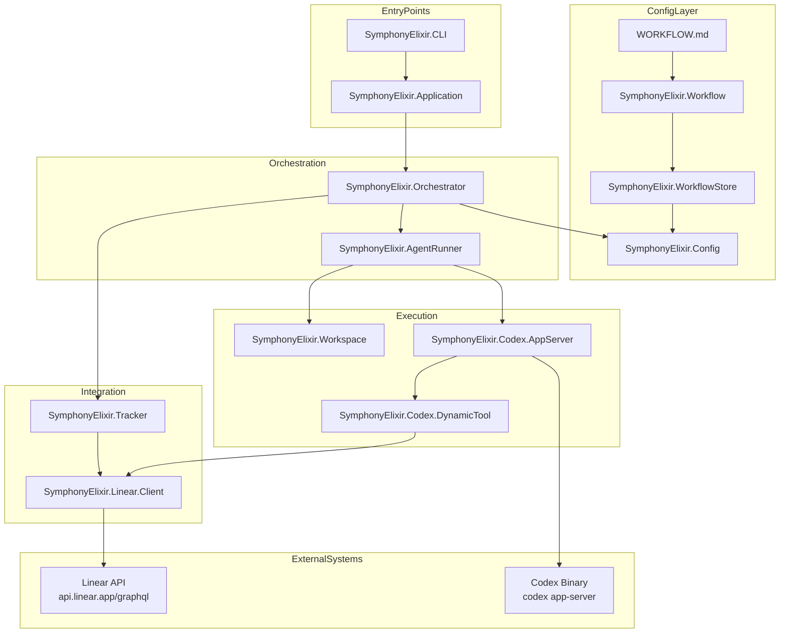
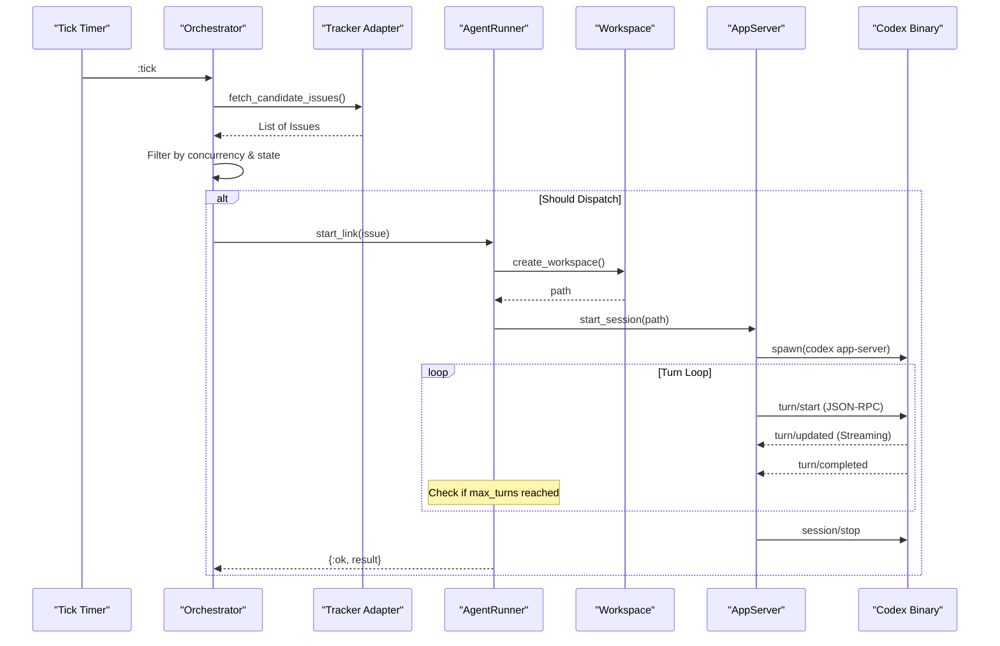
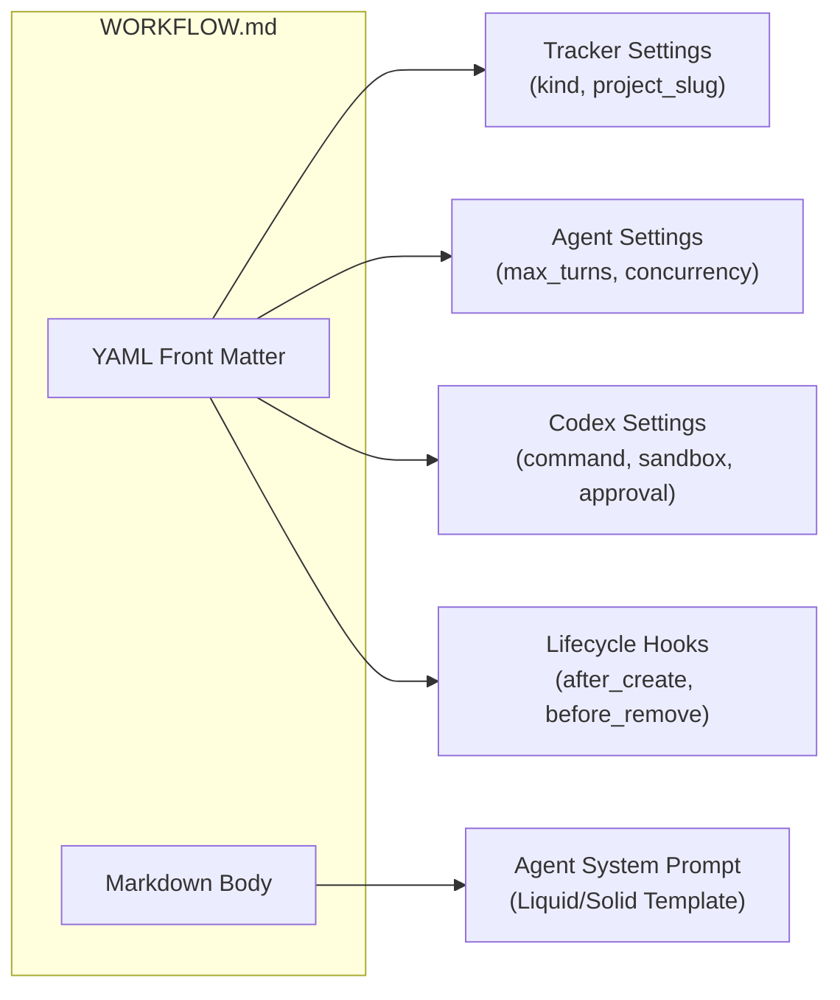

<!-- source: DeepWiki mcp.deepwiki.com · repo openai/symphony · page 1 Overview · fetched 2026-10-26 -->

# Overview

Relevant source files

The following files were used as context for generating this wiki page:

- [README.md](README.md)
- [SPEC.md](SPEC.md)
- [elixir/README.md](elixir/README.md)
- [elixir/WORKFLOW.md](elixir/WORKFLOW.md)
- [elixir/mix.exs](elixir/mix.exs)
- [elixir/test/support/test_support.exs](elixir/test/support/test_support.exs)

## Purpose and Scope

Symphony is a **daemon-based automation system** that continuously polls issue trackers for work, creates isolated per-issue workspaces, and executes Codex AI agents to perform autonomous development tasks. It acts as an orchestration layer between project management tools (like Linear) and autonomous coding agents.

**Sources:** [elixir/README.md:1-9](), [SPEC.md:1-21]()

---

## What Symphony Does

Symphony transforms tracker issues into agent execution sessions through a **poll-dispatch-execute loop**:

1.  **Polls** the configured tracker (Linear, GitHub, Jira, Asana, or GitLab) for candidate work [elixir/README.md:16-17]().
2.  **Creates** an isolated workspace per issue under a configured root directory [elixir/README.md:18-18]().
3.  **Launches** Codex in [App Server mode](https://developers.openai.com/codex/app-server/) inside the workspace [elixir/README.md:19-20]().
4.  **Sends** a workflow-defined prompt to Codex containing issue context [elixir/README.md:21-21]().
5.  **Keeps** Codex working until the issue reaches a terminal state, a turn cap is reached, or a handoff point occurs [elixir/README.md:22-22]().
6.  **Provides** provider-native tools (e.g., `linear_graphql`, `github_api`) so agents can interact with the tracker directly using host-side credentials [elixir/README.md:24-28]().

When an active issue moves to a terminal state (`Done`, `Closed`, `Cancelled`, or `Duplicate`), Symphony stops the active agent and cleans up matching workspaces [elixir/README.md:30-31]().

**Sources:** [elixir/README.md:14-37](), [SPEC.md:8-34]()

---

## System Boundaries

### What Symphony Is

*   **A scheduler and runner** that reads issues and dispatches agent sessions with bounded concurrency [SPEC.md:38-38](), [SPEC.md:50-50]().
*   **A workspace manager** that enforces per-issue isolation and runs lifecycle hooks (like `git clone`) [SPEC.md:99-103](), [elixir/README.md:128-130]().
*   **A configuration loader** that reads `WORKFLOW.md` for prompt templates and runtime settings [SPEC.md:73-81]().
*   **An observability provider** with real-time dashboards and JSON APIs [elixir/README.md:33-36]().

### What Symphony Is Not

*   **Not a multi-tenant platform** - designed to run as a single-daemon service per repository [SPEC.md:62-62]().
*   **Not a Linear writer** - agents perform the actual ticket writes via tools; Symphony only reads and orchestrates [SPEC.md:39-40]().
*   **Not a persistent database** - it uses a tracker-driven recovery model where the in-memory scheduler state is reconstructed from the tracker and filesystem [SPEC.md:57-58]().

**Sources:** [SPEC.md:36-70](), [elixir/README.md:151-161]()

---

## Core Architecture

The following diagram maps Symphony's high-level architecture to the actual Elixir modules and processes defined in the codebase.

### System Component Map

**Key Module Responsibilities:**

| Module | Type | Purpose |
| :--- | :--- | :--- |
| `SymphonyElixir.Orchestrator` | GenServer | Owns the poll tick, manages in-memory state, and decides when to dispatch [SPEC.md:93-97](). |
| `SymphonyElixir.AgentRunner` | Task | Manages the lifecycle of a single issue execution session [SPEC.md:105-109](). |
| `SymphonyElixir.Workspace` | Module | Maps issues to paths and ensures directories/hooks are executed [SPEC.md:99-103](). |
| `SymphonyElixir.Codex.AppServer` | Module | Handles JSON-RPC 2.0 communication with the Codex subprocess [elixir/mix.exs:28-28](). |
| `SymphonyElixir.Tracker` | Facade | Normalizes payloads from various tracker adapters (Linear, Jira, etc.) [SPEC.md:85-91](). |
| `SymphonyElixir.Config` | Module | Provides typed getters for configuration with environment variable support [SPEC.md:78-81](). |

**Sources:** [SPEC.md:71-118](), [elixir/mix.exs:15-46](), [elixir/test/support/test_support.exs:9-22]()

---

## Operational Model: Poll-Dispatch-Execute

Symphony runs as an OTP application. The primary driver of activity is the `Orchestrator` GenServer, which maintains a periodic timer.

### Issue Processing Flow

**Key Behaviors:**

*   **Reconciliation:** On every tick, the orchestrator reconciles running agents against the tracker. If an issue moves to a terminal state in Linear, Symphony stops the local agent [elixir/README.md:30-31]().
*   **Turn Capping:** The `agent.max_turns` setting prevents agents from running indefinitely in a single invocation [elixir/README.md:166-167]().
*   **Retry Logic:** Transient failures are handled with exponential backoff managed by the orchestrator [SPEC.md:54-54]().

**Sources:** [SPEC.md:89-109](), [elixir/README.md:14-37](), [elixir/WORKFLOW.md:31-32]()

---

## Configuration: WORKFLOW.md

Symphony is configured via a `WORKFLOW.md` file located in the target repository. This file uses YAML front matter for settings and a Markdown body for the agent's system prompt [elixir/README.md:115-116]().

### Configuration Structure

**Key Settings:**
*   `tracker.kind`: Selects the adapter (e.g., `linear`) [elixir/README.md:122-123]().
*   `codex.approval_policy`: Defines how Symphony handles Codex requests for approval or MCP elicitation [elixir/README.md:152-158]().
*   `hooks.after_create`: Shell commands to run when a workspace is first initialized (e.g., `git clone`) [elixir/README.md:128-130]().

**Sources:** [elixir/README.md:100-170](), [elixir/WORKFLOW.md:1-40]()

---

## Observability and Monitoring

Symphony provides multiple layers of observability to monitor autonomous agents:

1.  **Phoenix LiveView Dashboard:** If started with the `--port` flag, Symphony hosts a real-time dashboard showing active agents, token usage, and logs [elixir/README.md:113-113](), [elixir/mix.exs:34-34]().
2.  **REST API:** Provides JSON endpoints for querying the current state of the orchestrator and individual agent runs [elixir/mix.exs:39-39]().
3.  **Structured Logging:** Symphony writes detailed logs for each issue under the configured `--logs-root` [elixir/README.md:112-112]().

**Sources:** [elixir/README.md:110-114](), [SPEC.md:111-112](), [elixir/mix.exs:34-43]()

---

