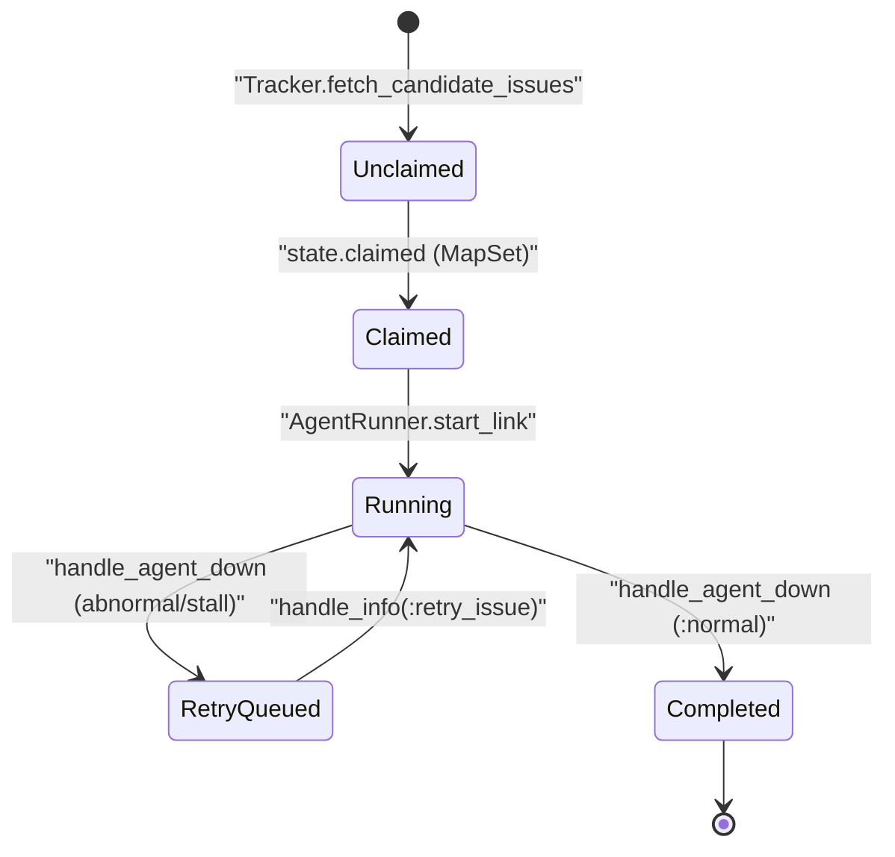
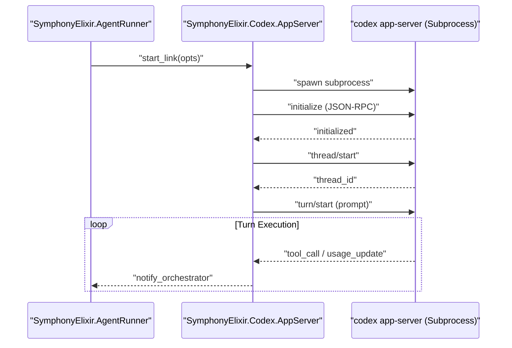

<!-- source: DeepWiki mcp.deepwiki.com · repo openai/symphony · page 3 Architecture · fetched 2026-10-26 -->

# Architecture

<details>
<summary>Relevant source files</summary>

The following files were used as context for generating this wiki page:

- [SPEC.md](SPEC.md)
- [elixir/lib/symphony_elixir/orchestrator.ex](elixir/lib/symphony_elixir/orchestrator.ex)
- [elixir/mix.exs](elixir/mix.exs)
- [elixir/test/support/test_support.exs](elixir/test/support/test_support.exs)

</details>


This page describes Symphony's end-to-end system architecture: the major components, how they interact, and the key design principles that govern the system.

---

## Purpose and Scope

Symphony is a long-running orchestration service that reads work from Linear, creates isolated per-issue workspaces, and drives a Codex coding-agent session for each issue. The architecture solves four operational problems:

1.  **Repeatability** — turns issue execution into a repeatable daemon workflow instead of manual scripts [SPEC.md:24-24]().
2.  **Isolation** — per-issue workspaces ensure agent commands run only inside their assigned directory [SPEC.md:25-26]().
3.  **Policy-as-code** — `WORKFLOW.md` keeps the agent prompt and runtime settings version-controlled alongside the codebase [SPEC.md:27-28]().
4.  **Observability** — structured logs and an optional Phoenix LiveView dashboard give operators visibility into concurrent agent runs [SPEC.md:29-29]().

Symphony is a **scheduler and tracker reader**. Tracker writes (state transitions, comments, PR links) are performed by the coding agent using tools defined in `WORKFLOW.md`, not by the orchestrator directly [SPEC.md:38-40]().

---

## Abstraction Layers

The system is organized into six layers. Each layer has a single responsibility and clear interfaces to its neighbors.

| Layer | Responsibility | Key Artifacts |
| :--- | :--- | :--- |
| **Policy** | Defines what the agent should do | `WORKFLOW.md` body (prompt template) |
| **Configuration** | Typed getters, defaults, env resolution | `SymphonyElixir.WorkflowStore`, `SymphonyElixir.Config` |
| **Coordination** | Polling loop, concurrency, retries, reconciliation | `SymphonyElixir.Orchestrator` |
| **Execution** | Workspace lifecycle, agent subprocess | `SymphonyElixir.AgentRunner`, `SymphonyElixir.Workspace` |
| **Integration** | Linear API adapter, normalization | `SymphonyElixir.Codex.AppServer` + `SymphonyElixir.Linear.Client` |
| **Observability** | Structured logs, Phoenix LiveView dashboard | `SymphonyElixir.StatusDashboard`, `SymphonyElixirWeb.DashboardLive` |

**Sources:** [SPEC.md:114-136](), [elixir/lib/symphony_elixir/orchestrator.ex:10-11](), [elixir/mix.exs:31-43]()

---

## Component Map

**Component overview — module names correspond directly to Elixir source files under `elixir/lib/`.**

```mermaid
graph TD
    ["SymphonyElixir.CLI"] -- "starts" --> ["SymphonyElixir.Orchestrator"]

    subgraph ConfigLayer ["Configuration Layer"]
        ["WORKFLOW.md"] --> ["SymphonyElixir.WorkflowStore"]
        ["SymphonyElixir.WorkflowStore"] --> ["SymphonyElixir.Config"]
    end

    subgraph CoordinationLayer ["Coordination Layer"]
        ["SymphonyElixir.Orchestrator"] -- "manages" --> ["SymphonyElixir.Orchestrator.State"]
    end

    subgraph ExecutionLayer ["Execution Layer"]
        ["SymphonyElixir.Orchestrator"] -- "spawns" --> ["SymphonyElixir.AgentRunner"]
        ["SymphonyElixir.AgentRunner"] -- "prepares" --> ["SymphonyElixir.Workspace"]
        ["SymphonyElixir.AgentRunner"] -- "manages" --> ["SymphonyElixir.Codex.AppServer"]
    end

    subgraph IntegrationLayer ["Integration Layer"]
        ["SymphonyElixir.Codex.AppServer"] -- "executes" --> ["codex app-server"]
        ["SymphonyElixir.Codex.AppServer"] -- "provides" --> ["SymphonyElixir.Codex.DynamicTool"]
        ["SymphonyElixir.Codex.DynamicTool"] -- "calls" --> ["SymphonyElixir.Linear.Client"]
    end

    subgraph ObservabilityLayer ["Observability Layer"]
        ["SymphonyElixir.Orchestrator"] -- "updates" --> ["SymphonyElixir.StatusDashboard"]
        ["SymphonyElixir.StatusDashboard"] -- "renders" --> ["SymphonyElixirWeb.DashboardLive"]
    end

    ["SymphonyElixir.Config"] --> ["SymphonyElixir.Orchestrator"]
```

**Sources:** [SPEC.md:71-113](), [elixir/lib/symphony_elixir/orchestrator.ex:10-45](), [elixir/mix.exs:100-100](), [elixir/lib/symphony_elixir/codex/app_server.ex:1-5]()

---

## Configuration: WORKFLOW.md as Policy Contract

`WORKFLOW.md` is the single source of truth for runtime behavior. It has two parts:

*   **YAML front matter** — parsed into a typed config map consumed by `SymphonyElixir.Config` [elixir/test/support/test_support.exs:169-178]().
*   **Markdown body** — used as the Liquid-compatible prompt template rendered per issue [elixir/test/support/test_support.exs:165-165]().

The file is watched at runtime; changes are re-applied without restart by `SymphonyElixir.WorkflowStore.force_reload/0` [elixir/test/support/test_support.exs:57-63]().

**WORKFLOW.md configuration categories:**

| Category | Purpose |
| :--- | :--- |
| `tracker` | Issue tracker kind, API key, project slug, active/terminal states [elixir/test/support/test_support.exs:170-182]() |
| `polling` | Poll interval (`poll_interval_ms`) [elixir/lib/symphony_elixir/orchestrator.ex:61-61]() |
| `workspace` | Workspace root path and lifecycle hooks [elixir/test/support/test_support.exs:103-103]() |
| `agent` | `max_concurrent_agents`, `max_turns`, and retry backoffs [elixir/lib/symphony_elixir/orchestrator.ex:62-62]() |
| `codex` | Subprocess command, approval policy, sandbox, and timeouts [elixir/test/support/test_support.exs:148-154]() |

For details, see [Configuration System](#3.2).

---

## Orchestrator State Machine

The `SymphonyElixir.Orchestrator` GenServer is the single authority over in-memory scheduling state [elixir/lib/symphony_elixir/orchestrator.ex:1-6]().

**Internal orchestration states:**



**Key orchestrator data structures** (defined in `SymphonyElixir.Orchestrator.State`):

| Field | Type | Purpose |
| :--- | :--- | :--- |
| `running` | `%{issue_id => entry}` | Active worker processes and their runtime metadata [elixir/lib/symphony_elixir/orchestrator.ex:37-37]() |
| `claimed` | `MapSet.t()` | Reserved IDs to prevent duplicate dispatch [elixir/lib/symphony_elixir/orchestrator.ex:39-39]() |
| `retry_attempts` | `%{issue_id => attempt}` | Scheduled retry timers and backoff state [elixir/lib/symphony_elixir/orchestrator.ex:41-41]() |
| `codex_totals` | `map()` | Aggregate token usage and execution time [elixir/lib/symphony_elixir/orchestrator.ex:42-42]() |

For details, see [Issue Lifecycle](#3.1).

---

## Poll Loop and Dispatch

Every `poll_interval_ms`, the orchestrator runs a tick to synchronize with the tracker [elixir/lib/symphony_elixir/orchestrator.ex:118-126]().

**Poll tick sequence:**

```mermaid
flowchart TD
    ["handle_info(:tick)"] --> ["refresh_runtime_config"]
    ["refresh_runtime_config"] --> ["maybe_dispatch"]
    ["maybe_dispatch"] --> ["Tracker.fetch_candidate_issues"]
    ["Tracker.fetch_candidate_issues"] --> ["AgentRunner.start_link"]
    ["AgentRunner.start_link"] --> ["schedule_tick"]
```

**Retry backoff logic:**

*   **Continuation retry:** `1,000 ms` delay for agents that finish normally but require further turns [elixir/lib/symphony_elixir/orchestrator.ex:13-13]().
*   **Failure retry:** Base `10,000 ms` with exponential backoff for crashes or timeouts [elixir/lib/symphony_elixir/orchestrator.ex:14-14]().

**Sources:** [elixir/lib/symphony_elixir/orchestrator.ex:13-126]()

---

## Agent Runner and Codex Protocol

`SymphonyElixir.AgentRunner` manages the Codex subprocess lifecycle, while `SymphonyElixir.Codex.AppServer` handles the JSON-RPC 2.0 communication [elixir/mix.exs:25-28]().

**Startup handshake sequence:**



For details, see [Worker Deployment Models](#3.3).

---

## Workspace Management and Safety

`SymphonyElixir.Workspace` handles the filesystem isolation for each issue [elixir/lib/symphony_elixir/orchestrator.ex:10-10]().

**Lifecycle hooks supported:**
*   `after_create`: Executed once when a workspace is initialized [elixir/test/support/test_support.exs:155-155]().
*   `before_run`: Executed before every agent session starts [elixir/test/support/test_support.exs:156-156]().
*   `after_run`: Executed after an agent session concludes [elixir/test/support/test_support.exs:157-157]().
*   `before_remove`: Executed before workspace cleanup [elixir/test/support/test_support.exs:158-158]().

---

## Linear Integration

Symphony interacts with Linear through a normalized `Tracker` interface [elixir/lib/symphony_elixir/orchestrator.ex:10-11]().

| Component | Responsibility |
| :--- | :--- |
| `SymphonyElixir.Linear.Client` | Low-level GraphQL API calls to Linear [elixir/mix.exs:21-21]() |
| `SymphonyElixir.Tracker.Issue` | Normalized struct for work items [elixir/lib/symphony_elixir/orchestrator.ex:11-11]() |
| `linear_graphql` tool | Dynamic tool allowing Codex agents to perform mutations [elixir/lib/symphony_elixir/codex/dynamic_tool.ex:29-29]() |

**Sources:** [elixir/lib/symphony_elixir/orchestrator.ex:10-11](), [elixir/mix.exs:21-21]()

---

