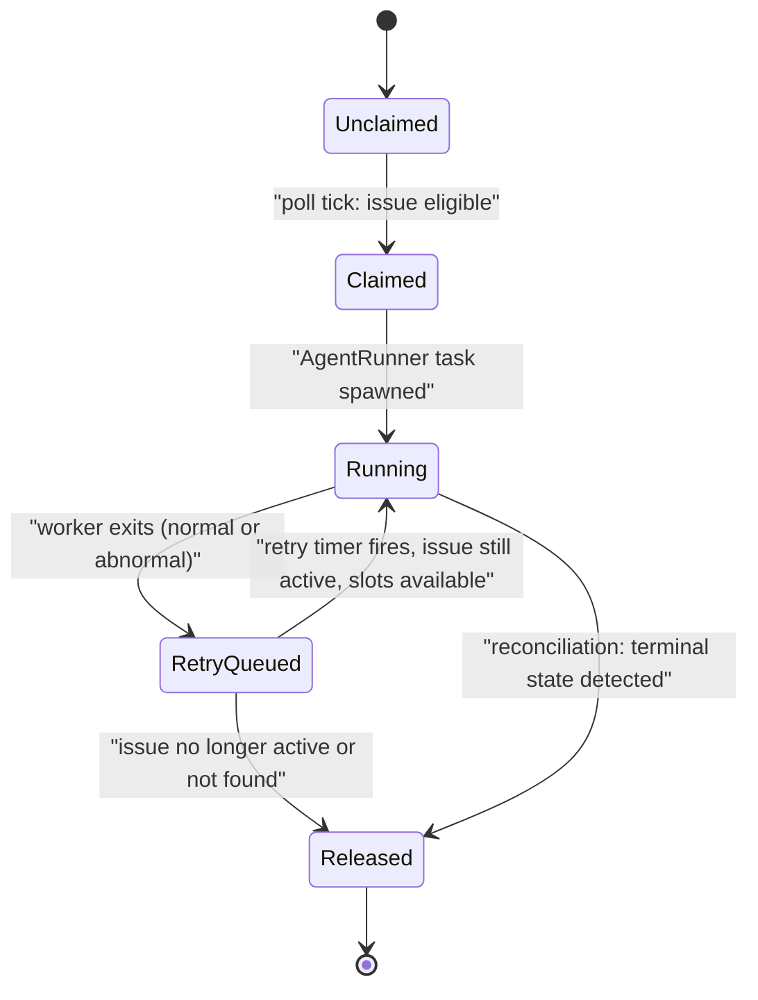
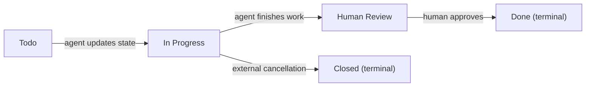
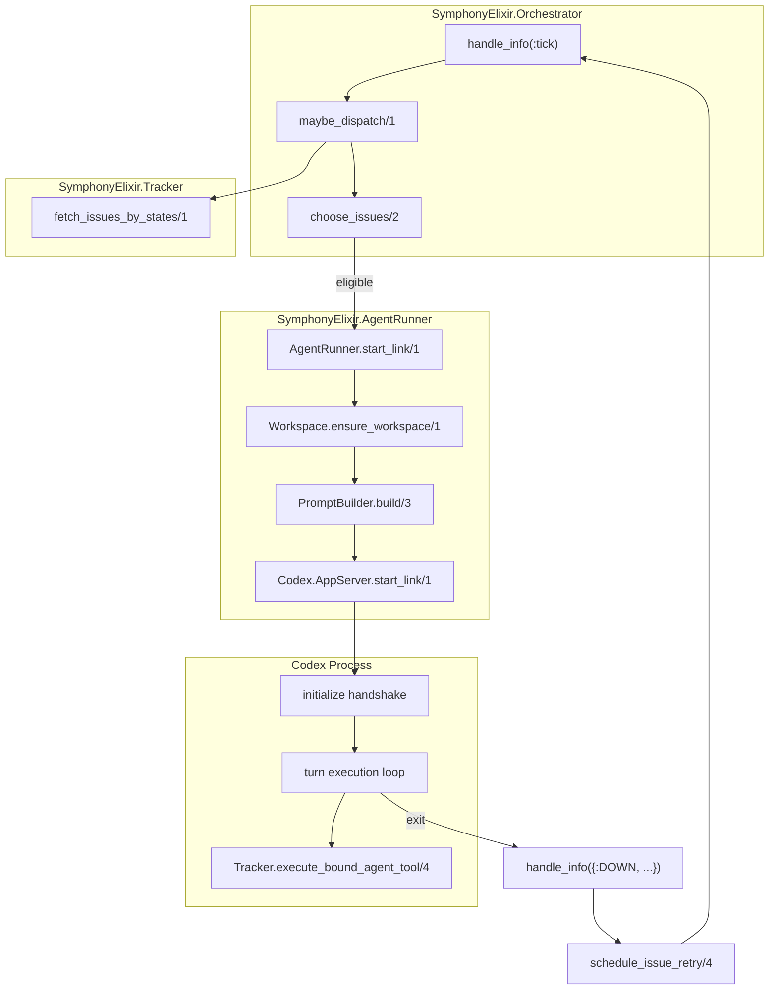

<!-- source: DeepWiki mcp.deepwiki.com · repo openai/symphony · page 3.1 Issue Lifecycle · fetched 2026-10-26 -->

# Issue Lifecycle

Relevant source files

The following files were used as context for generating this wiki page:

- [SPEC.md](SPEC.md)
- [elixir/lib/symphony_elixir/orchestrator.ex](elixir/lib/symphony_elixir/orchestrator.ex)
- [elixir/lib/symphony_elixir/tracker.ex](elixir/lib/symphony_elixir/tracker.ex)
- [elixir/lib/symphony_elixir/tracker/issue.ex](elixir/lib/symphony_elixir/tracker/issue.ex)
- [elixir/test/support/test_support.exs](elixir/test/support/test_support.exs)
- [elixir/test/symphony_elixir/core_test.exs](elixir/test/symphony_elixir/core_test.exs)

This page traces the complete journey of a single issue through Symphony: from the first poll that discovers it, through workspace creation, Codex session execution, state transitions, retry handling, and final workspace cleanup.

---

## Two State Spaces

The lifecycle involves two parallel state spaces that must not be confused:

| State Space | Owner | Visibility |
|---|---|---|
| **Orchestrator internal states** | `SymphonyElixir.Orchestrator` (in-memory) | Symphony only |
| **Issue tracker states** | Tracker (e.g., Linear), mutated by the Codex agent | Team-visible |

The Orchestrator internal states govern dispatch, concurrency, and retry logic. The tracker issue states (e.g., "Todo", "Done") govern what work the agent performs and when Symphony stops or cleans up.

---

## Orchestrator Internal States

These in-memory states are defined in [SPEC.md:591-614]() and implemented in `SymphonyElixir.Orchestrator.State` [elixir/lib/symphony_elixir/orchestrator.ex:24-45](). Symphony reconstructs this state on restart via tracker queries [SPEC.md:57-58]().

| State | Meaning |
|---|---|
| `Unclaimed` | Issue is not running and has no retry timer. |
| `Claimed` | Reserved to prevent duplicate dispatch; stored in `claimed` [elixir/lib/symphony_elixir/orchestrator.ex:39](). |
| `Running` | Worker task is active; entry exists in the `running` map [elixir/lib/symphony_elixir/orchestrator.ex:37](). |
| `RetryQueued` | No active worker; a timer exists in `retry_attempts` [elixir/lib/symphony_elixir/orchestrator.ex:41](). |
| `Released` | Claim removed; issue is terminal, non-active, or retry loop ended. |

**Orchestrator Internal State Machine**

Sources: [SPEC.md:581-668](), [elixir/lib/symphony_elixir/orchestrator.ex:24-45]()

---

## Poll and Discovery

`SymphonyElixir.Orchestrator` runs a poll tick every `polling.interval_ms` [elixir/lib/symphony_elixir/orchestrator.ex:61](). Default is 30,000 ms [elixir/test/symphony_elixir/core_test.exs:16]().

**Tick sequence** [elixir/lib/symphony_elixir/orchestrator.ex:118-126]():

1. **Refresh** runtime config from `WorkflowStore` [elixir/lib/symphony_elixir/orchestrator.ex:119]().
2. **Dispatch** eligible issues via `maybe_dispatch/1` [elixir/lib/symphony_elixir/orchestrator.ex:120]().
3. **Schedule** next tick [elixir/lib/symphony_elixir/orchestrator.ex:121]().
4. **Notify** dashboard [elixir/lib/symphony_elixir/orchestrator.ex:124]().

### Candidate Selection Rules

All of the following must be true for an issue to be dispatched [SPEC.md:702-711]():

- Has `id`, `identifier`, `title`, and `state` [elixir/lib/symphony_elixir/tracker/issue.ex:12-28]().
- State is in `active_states` and not in `terminal_states` [elixir/test/symphony_elixir/core_test.exs:17-18]().
- Not already in `running` or `claimed` [elixir/lib/symphony_elixir/orchestrator.ex:37-39]().
- Global slots available: `max_concurrent_agents` [elixir/lib/symphony_elixir/orchestrator.ex:62]().

**Dispatch sort order** (stable, applied in order) [SPEC.md:715-725]():

| Priority | Field | Direction |
|---|---|---|
| 1 | `priority` | Ascending (1 = highest) |
| 2 | `created_at` | Oldest first |
| 3 | `identifier` | Lexicographic tie-break |

Sources: [SPEC.md:679-715](), [elixir/lib/symphony_elixir/orchestrator.ex:118-126](), [elixir/test/symphony_elixir/core_test.exs:14-20](), [elixir/lib/symphony_elixir/tracker/issue.ex:1-28]()

---

## Claim and Workspace Creation

When an issue passes eligibility, the Orchestrator adds it to the `claimed` set [elixir/lib/symphony_elixir/orchestrator.ex:39](). This prevents duplicate dispatch across concurrent ticks [SPEC.md:671-676]().

`SymphonyElixir.AgentRunner` then prepares the workspace.

**Workspace lifecycle** [SPEC.md:815-824]():

1. Sanitize `issue.identifier` to a unique workspace key.
2. Ensure directory exists at `<workspace_root>/<identifier>`.
3. Run the `after_create` hook if newly created [elixir/test/symphony_elixir/core_test.exs:125-127]().

**Hook failure semantics** [SPEC.md:863-868]():

| Hook | Trigger | Failure behavior |
|---|---|---|
| `after_create` | New workspace only | Fatal to workspace creation |
| `before_run` | Before each agent attempt | Fatal to current attempt |
| `after_run` | After each attempt | Logged, ignored |
| `before_remove` | Before workspace deletion | Logged, ignored [elixir/test/symphony_elixir/core_test.exs:128-129]|

Sources: [SPEC.md:793-868](), [elixir/test/symphony_elixir/core_test.exs:123-129]()

---

## Prompt Construction and Session Launch

`SymphonyElixir.AgentRunner` builds the prompt using the `WORKFLOW.md` template [elixir/test/symphony_elixir/core_test.exs:113]().

**Prompt inputs** [SPEC.md:1223-1253]():

- **Template**: the Markdown body of `WORKFLOW.md`.
- **`issue`**: the full normalized `SymphonyElixir.Tracker.Issue` object [elixir/lib/symphony_elixir/tracker/issue.ex:12-28]().
- **`attempt`**: integer tracking retry/continuation count.

The agent subprocess is launched via the `codex_command` [elixir/test/symphony_elixir/core_test.exs:76]().

**Handshake sequence** [SPEC.md:927-970]():

1. Send `initialize` request.
2. Send `initialized` notification.
3. Send `thread/start` with sandbox policy.
4. Send `turn/start` with rendered prompt.

Sources: [SPEC.md:922-970](), [elixir/test/symphony_elixir/core_test.exs:113-133](), [elixir/lib/symphony_elixir/tracker/issue.ex:1-28]()

---

## Codex Turns and Interaction

The Orchestrator listens for events from the worker via `handle_info({:codex_worker_update, ...}, ...)` [elixir/lib/symphony_elixir/orchestrator.ex:167-186]().

**Turn completion outcomes** [SPEC.md:976-982]():

| Event | Result |
|---|---|
| `turn/completed` | Success; proceed to next turn or finish. |
| `turn/failed` | Failure; trigger retry logic. |
| `turn/cancelled` | Failure; trigger retry logic. |

Symphony tracks tokens and rate limits from these updates [elixir/lib/symphony_elixir/orchestrator.ex:178-181]().

Sources: [SPEC.md:976-982](), [elixir/lib/symphony_elixir/orchestrator.ex:167-186]()

---

## Tracker Integration and Transitions

Symphony does not write to the tracker directly in the main loop. State transitions are performed by the Codex agent using provider-native tools defined in `SymphonyElixir.Tracker` [elixir/lib/symphony_elixir/tracker.ex:24-25]().

**Issue State Progression (Agent-Driven)**

The `SymphonyElixir.Tracker` module provides the abstraction for fetching issues [elixir/lib/symphony_elixir/tracker.ex:34-41]() and executing tools [elixir/lib/symphony_elixir/tracker.ex:61-75]().

Sources: [elixir/lib/symphony_elixir/tracker.ex:1-141](), [elixir/lib/symphony_elixir/tracker/issue.ex:1-67]()

---

## Retry and Stall Handling

### Worker Exit
The Orchestrator handles process termination in `handle_info({:DOWN, ...}, ...)` [elixir/lib/symphony_elixir/orchestrator.ex:128-148]().
- **Normal exit**: Schedules a **continuation check** via `schedule_issue_retry/4` [elixir/lib/symphony_elixir/orchestrator.ex:216-222]().
- **Abnormal exit**: Applies exponential backoff starting at `failure_retry_base_ms` [elixir/lib/symphony_elixir/orchestrator.ex:14]().

### Stall Detection
Symphony detects stalled agents (no output within `codex_stall_timeout_ms`) during the poll tick. Stalled workers are terminated and retried [SPEC.md:768-773]().

Sources: [elixir/lib/symphony_elixir/orchestrator.ex:13-14](), [elixir/lib/symphony_elixir/orchestrator.ex:128-148](), [elixir/lib/symphony_elixir/orchestrator.ex:208-232](), [SPEC.md:739-773]()

---

## Full Lifecycle — Module Map

The following diagram bridges the high-level lifecycle to the specific Elixir modules responsible for each phase.

**Full Issue Lifecycle with Code Entity Mapping**

Sources: [elixir/lib/symphony_elixir/orchestrator.ex:1-235](), [elixir/lib/symphony_elixir/tracker.ex:1-60](), [elixir/lib/symphony_elixir/tracker/issue.ex:1-67]()

---

