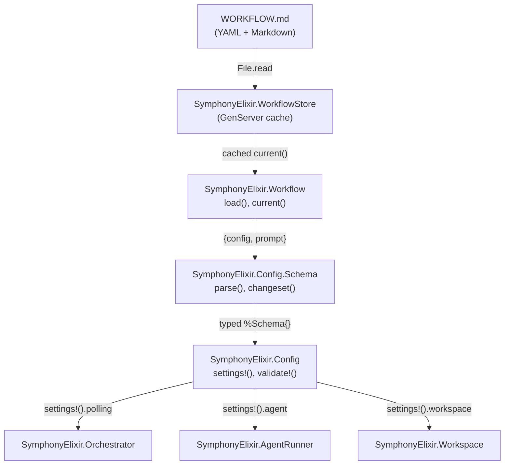
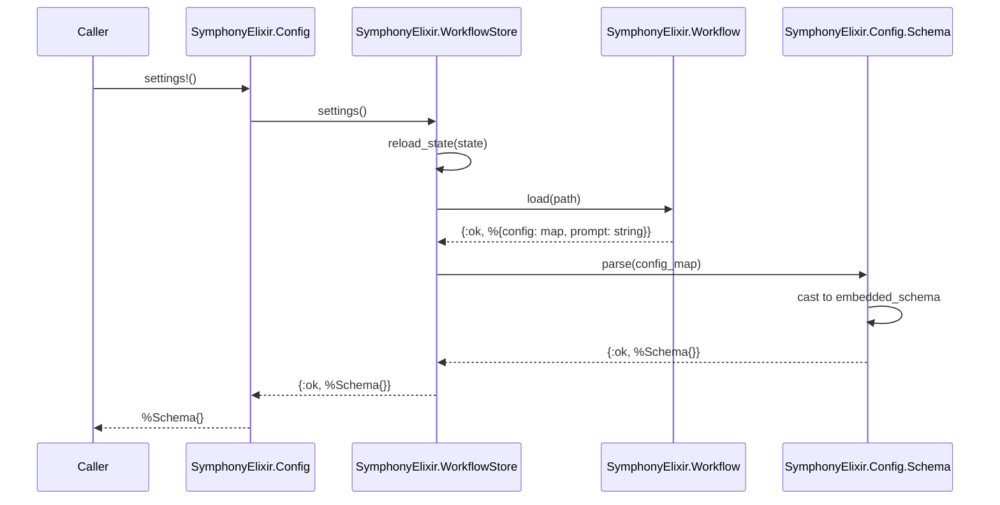

<!-- source: DeepWiki mcp.deepwiki.com · repo openai/symphony · page 3.2 Configuration System · fetched 2026-10-26 -->

# Configuration System

Relevant source files

The following files were used as context for generating this wiki page:

- [elixir/config/config.exs](elixir/config/config.exs)
- [elixir/lib/symphony_elixir/agent_runner.ex](elixir/lib/symphony_elixir/agent_runner.ex)
- [elixir/lib/symphony_elixir/config.ex](elixir/lib/symphony_elixir/config.ex)
- [elixir/lib/symphony_elixir/config/schema.ex](elixir/lib/symphony_elixir/config/schema.ex)
- [elixir/lib/symphony_elixir/linear/client.ex](elixir/lib/symphony_elixir/linear/client.ex)
- [elixir/lib/symphony_elixir/workflow.ex](elixir/lib/symphony_elixir/workflow.ex)
- [elixir/lib/symphony_elixir/workflow_store.ex](elixir/lib/symphony_elixir/workflow_store.ex)
- [elixir/test/fixtures/startup_workflow.md](elixir/test/fixtures/startup_workflow.md)
- [elixir/test/symphony_elixir/workspace_and_config_test.exs](elixir/test/symphony_elixir/workspace_and_config_test.exs)

Symphony's configuration system loads runtime settings from `WORKFLOW.md`, a repository-owned file that combines YAML front matter (settings) with a Markdown body (prompt template). The configuration layer provides typed access to these settings throughout the system and enforces validation rules at startup and during runtime reloads.

**Key responsibilities:**
- Parse `WORKFLOW.md` into structured configuration and prompt template.
- Apply defaults for omitted fields via `Ecto.Schema` definitions.
- Validate required fields before dispatch.
- Distribute settings to Orchestrator, AgentRunner, Workspace, and other components.
- Support dynamic reload without restart via a polling cache.

## Configuration Architecture

The configuration system consists of modules that work together to load, parse, and distribute settings. The system uses `Ecto.Schema` to define the structure and `YamlElixir` for front-matter parsing.

**Natural Language to Code Entity Space: Loading Flow**

**Module responsibilities:**

| Module | Purpose | Key Functions |
|--------|---------|---------------|
| `SymphonyElixir.Workflow` | File loading and front matter/prompt splitting. | `load/1`, `current/0`, `workflow_file_path/0` [elixir/lib/symphony_elixir/workflow.ex:10-53]() |
| `SymphonyElixir.WorkflowStore` | GenServer that caches the last known good workflow and polls for changes. | `start_link/1`, `current/0`, `force_reload/0` [elixir/lib/symphony_elixir/workflow_store.ex:21-52]() |
| `SymphonyElixir.Config.Schema` | YAML to typed structs using Ecto; defines defaults and field types. | `parse/1`, `changeset/2`, `resolve_runtime_turn_sandbox_policy/2` [elixir/lib/symphony_elixir/config/schema.ex:1-240]() |
| `SymphonyElixir.Config` | Public API for settings access and runtime derivation. | `settings!/0`, `validate!/0`, `codex_runtime_settings/2` [elixir/lib/symphony_elixir/config.ex:29-115]() |

Sources: [elixir/lib/symphony_elixir/config.ex:1-144](), [elixir/lib/symphony_elixir/workflow.ex:1-124](), [elixir/lib/symphony_elixir/workflow_store.ex:1-181]()

---

## File Format and Discovery

`WORKFLOW.md` is a Markdown file with optional YAML front matter.

**Parsing rules:**
1. The file is split by `---` delimiters [elixir/lib/symphony_elixir/workflow.ex:85-100]().
2. Lines between delimiters are parsed as YAML into a map [elixir/lib/symphony_elixir/workflow.ex:102-114]().
3. Remaining lines become the `prompt_template` [elixir/lib/symphony_elixir/workflow.ex:68-75]().
4. If front matter is absent, the entire file is treated as prompt body.

**File discovery precedence:**
1. Explicit path set via `SymphonyElixir.Workflow.set_workflow_file_path/1` [elixir/lib/symphony_elixir/workflow.ex:16-21]().
2. Environment configuration: `:symphony_elixir, :workflow_file_path` [elixir/lib/symphony_elixir/workflow.ex:12-13]().
3. Default: `WORKFLOW.md` in the current working directory [elixir/lib/symphony_elixir/workflow.ex:14]().

Sources: [elixir/lib/symphony_elixir/workflow.ex:8-124](), [elixir/config/config.exs:18-21]()

---

## Configuration Loading and Resolution

**Code Entity Space: Resolution Sequence**

**Resolution precedence:**
1. **YAML values** — parsed from `WORKFLOW.md`.
2. **Built-in defaults** — defined in `SymphonyElixir.Config.Schema` modules (e.g., `Polling` default `30_000` [elixir/lib/symphony_elixir/config/schema.ex:96]()).
3. **Environment overrides** — specific fields like `server_port` check `Application.get_env` [elixir/lib/symphony_elixir/config.ex:81-86]().

Sources: [elixir/lib/symphony_elixir/config.ex:35-43](), [elixir/lib/symphony_elixir/config/schema.ex:89-228](), [elixir/lib/symphony_elixir/workflow_store.ex:157-167]()

---

## Validation

Validation occurs in two phases: structural (via Ecto changesets) and semantic (via business logic).

**Validation implementation:**
- **Structural:** `SymphonyElixir.Config.Schema` uses `Ecto.Changeset` to validate types and ranges, such as `interval_ms` being greater than 0 [elixir/lib/symphony_elixir/config/schema.ex:103]().
- **Semantic:** `SymphonyElixir.Config.validate_settings/1` checks business rules [elixir/lib/symphony_elixir/config.ex:118-124]():
    - `tracker.kind` must not be nil [elixir/lib/symphony_elixir/config.ex:119]().
    - The `Tracker` implementation must validate its own specific config [elixir/lib/symphony_elixir/config.ex:122]().

**Error taxonomy:**
| Error Reason | Source | Effect |
|--------------|--------|--------|
| `{:missing_workflow_file, path, reason}` | `Workflow.load/1` | `settings!/0` raises ArgumentError [elixir/lib/symphony_elixir/config.ex:131-132]() |
| `{:workflow_parse_error, reason}` | `Workflow.parse/1` | `settings!/0` raises ArgumentError [elixir/lib/symphony_elixir/config.ex:134-135]() |
| `{:invalid_workflow_config, message}` | `Schema.parse/1` | `settings!/0` raises ArgumentError [elixir/lib/symphony_elixir/config.ex:128-129]() |

Sources: [elixir/lib/symphony_elixir/config.ex:126-143](), [elixir/lib/symphony_elixir/config/schema.ex:1-240]()

---

## Dynamic Reload

The `SymphonyElixir.WorkflowStore` GenServer implements dynamic reloading.

1. **Polling:** It polls the `WORKFLOW.md` file every 1,000ms [elixir/lib/symphony_elixir/workflow_store.ex:13]().
2. **Staleness Check:** It compares the file's `mtime`, `size`, and a hash of its content (`phash2`) against the cached version [elixir/lib/symphony_elixir/workflow_store.ex:169-176]().
3. **Graceful Failure:** If a reload fails (e.g., due to a syntax error), it logs the error and continues serving the last known good configuration [elixir/lib/symphony_elixir/workflow_store.ex:178-180]().

Sources: [elixir/lib/symphony_elixir/workflow_store.ex:109-181]()

---

## Settings Reference

### `tracker` Settings
Defines the issue tracker connection [elixir/lib/symphony_elixir/config/schema.ex:50-61]().
- `kind`: "linear", "memory", etc.
- `endpoint`: API endpoint (e.g., Linear GraphQL).
- `active_states`: List of states considered "active" for polling.
- `required_labels`: Labels required for an issue to be picked up.

### `agent` Settings
Controls concurrency and turn limits [elixir/lib/symphony_elixir/config/schema.ex:151-156]().
- `max_concurrent_agents`: Default 10.
- `max_turns`: Default 20.
- `max_concurrent_agents_by_state`: Map for per-state limits.

### `codex` Settings
Subprocess and sandbox configuration [elixir/lib/symphony_elixir/config/schema.ex:180-198]().
- `command`: Default `"codex app-server"`.
- `approval_policy`: Defines when Codex requires human approval.
- `thread_sandbox`: Default `"workspace-write"`.
- `stall_timeout_ms`: Timeout for detecting stalled agent turns.

### `hooks` Settings
Shell scripts for workspace lifecycle [elixir/lib/symphony_elixir/config/schema.ex:236-242]().
- `after_create`: Run once after workspace initialization.
- `before_run`: Run before each agent run attempt [elixir/lib/symphony_elixir/agent_runner.ex:46]().
- `after_run`: Run after the agent run finishes [elixir/lib/symphony_elixir/agent_runner.ex:50]().

Sources: [elixir/lib/symphony_elixir/config/schema.ex:43-245](), [elixir/lib/symphony_elixir/agent_runner.ex:21-56]()

---

