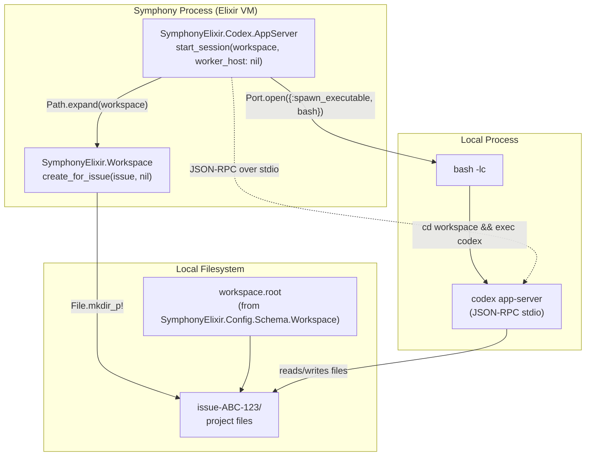
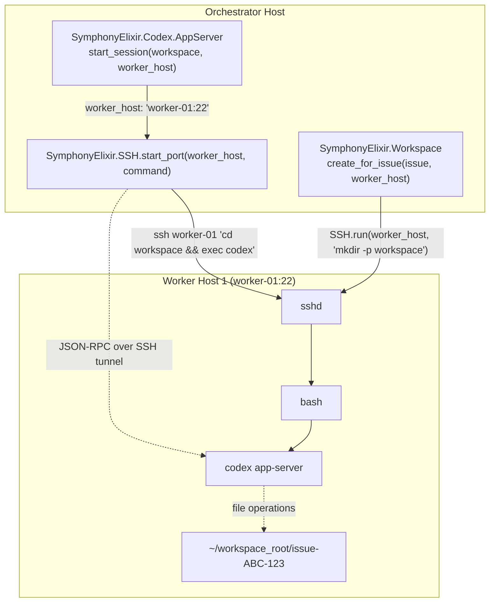
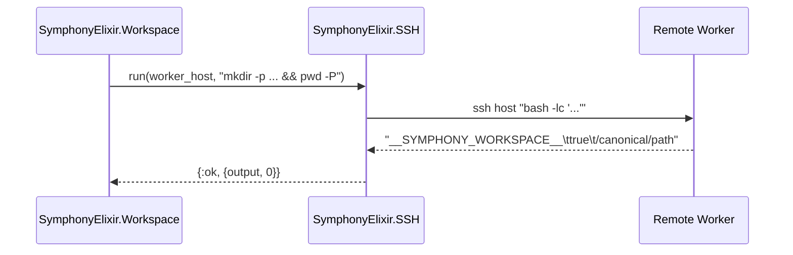
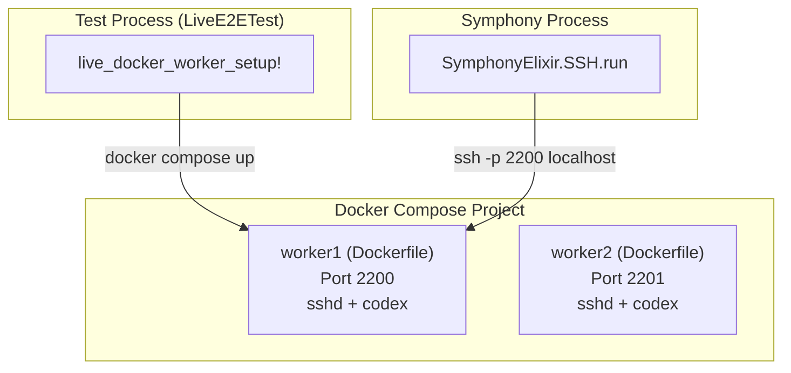

<!-- source: DeepWiki mcp.deepwiki.com · repo openai/symphony · page 3.3 Worker Deployment Models · fetched 2026-10-26 -->

# Worker Deployment Models

<details>
<summary>Relevant source files</summary>

The following files were used as context for generating this wiki page:

- [SPEC.md](SPEC.md)
- [elixir/lib/symphony_elixir/ssh.ex](elixir/lib/symphony_elixir/ssh.ex)
- [elixir/test/support/live_e2e_docker/Dockerfile](elixir/test/support/live_e2e_docker/Dockerfile)
- [elixir/test/support/live_e2e_docker/docker-compose.yml](elixir/test/support/live_e2e_docker/docker-compose.yml)
- [elixir/test/support/live_e2e_docker/live_worker_entrypoint.sh](elixir/test/support/live_e2e_docker/live_worker_entrypoint.sh)
- [elixir/test/support/test_support.exs](elixir/test/support/test_support.exs)
- [elixir/test/symphony_elixir/ssh_test.exs](elixir/test/symphony_elixir/ssh_test.exs)

</details>


This document describes the three deployment architectures Symphony supports for executing Codex agents: local execution, SSH workers, and Docker workers. Each model provides different tradeoffs between simplicity, isolation, and scalability.

For information about workspace lifecycle management within these deployment models, see [Workspace Management](4.3). For details on the Codex communication protocol itself, see [AppServer Protocol](5.1).

---

## Overview

Symphony supports three distinct worker deployment models, controlled by the `worker_host` parameter passed to `SymphonyElixir.Codex.AppServer.start_session/2` [elixir/lib/symphony_elixir/codex/app_server.ex:22-26]().

| Deployment Model | `worker_host` Value | Use Case | Workspace Location |
|-----------------|---------------------|----------|-------------------|
| **Local Execution** | `nil` | Development, single-machine deployments | Local filesystem under `workspace.root` |
| **SSH Workers** | `"hostname:port"` or `"hostname"` | Production, distributed execution | Remote filesystem on worker host |
| **Docker Workers** | `"localhost:port"` | CI/CD testing, integration tests | Containerized remote filesystem |

The deployment model determines:
- Where the Codex process executes.
- How workspace operations (creation, cleanup) are performed [elixir/lib/symphony_elixir/workspace.ex:34-79]().
- How the `codex app-server` command is invoked.
- What validation and path safety checks are applied [elixir/lib/symphony_elixir/workspace.ex:358-384]().

**Sources:** [elixir/lib/symphony_elixir/codex/app_server.ex:16-26](), [elixir/lib/symphony_elixir/workspace.ex:1-11]()

---

## Local Execution Mode

### Architecture



**Diagram: Local execution spawns Codex directly as a child process**

In local execution mode, Symphony spawns the Codex process directly on the same machine using Erlang's `Port.open/2` [elixir/lib/symphony_elixir/codex/app_server.ex:193-200](). The workspace is created in the local filesystem and validated against the configured `workspace.root` to prevent path traversal attacks [elixir/lib/symphony_elixir/workspace.ex:358-372]().

**Sources:** [elixir/lib/symphony_elixir/codex/app_server.ex:189-209](), [elixir/lib/symphony_elixir/workspace.ex:34-46]()

### Port Creation

The `SymphonyElixir.Codex.AppServer.start_port/2` function handles local process spawning:

```elixir
# elixir/lib/symphony_elixir/codex/app_server.ex:189-209
defp start_port(workspace, nil) do
  with {:ok, bash} <- find_bash() do
    # ...
    port = Port.open({:spawn_executable, bash}, [
      :binary,
      :exit_status,
      :stderr_to_stdout,
      args: ["-lc", Config.settings!().codex.command],
      cd: workspace,
      line: 1_048_576
    ])
    {:ok, port}
  end
end
```

The `-lc` flags ensure a login shell (loading user environment) and command execution mode. The `line: 1_048_576` option enables line-oriented I/O for JSON-RPC messages, with a maximum line size of 1MB [elixir/lib/symphony_elixir/codex/app_server.ex:200]().

**Sources:** [elixir/lib/symphony_elixir/codex/app_server.ex:189-209]()

### Workspace Validation

Local workspaces undergo strict path safety validation to prevent symlink attacks and directory traversal. Symphony uses `SymphonyElixir.PathSafety.canonicalize/1` to resolve absolute paths and verify they reside within the configured root [elixir/lib/symphony_elixir/workspace.ex:358-384]().

**Sources:** [elixir/lib/symphony_elixir/workspace.ex:358-384](), [elixir/test/symphony_elixir/workspace_and_config_test.exs:109-112]()

---

## SSH Worker Deployment

### Architecture



**Diagram: SSH workers execute Codex on remote hosts via SSH connections**

SSH worker deployment enables distributed execution across multiple hosts. Symphony communicates with remote Codex instances over SSH tunnels, forwarding JSON-RPC messages over stdin/stdout [elixir/lib/symphony_elixir/ssh.ex:11-27]().

**Sources:** [elixir/lib/symphony_elixir/codex/app_server.ex:212-223](), [elixir/lib/symphony_elixir/workspace.ex:48-79](), [elixir/lib/symphony_elixir/ssh.c:11-27]()

### Remote Port Creation

For SSH workers, `SymphonyElixir.Codex.AppServer.start_port/2` delegates to the `SymphonyElixir.SSH` module:

```elixir
# elixir/lib/symphony_elixir/codex/app_server.ex:212-223
defp start_port(workspace, worker_host) when is_binary(worker_host) do
  command = remote_launch_command(workspace)
  SSH.start_port(worker_host, command, line: 1_048_576)
end
```

The `SymphonyElixir.SSH.start_port/3` function uses `System.find_executable("ssh")` and `Port.open/2` with `:spawn_executable` to establish the tunnel [elixir/lib/symphony_elixir/ssh.c:13-27](). It supports `SYMPHONY_SSH_CONFIG` for custom SSH configurations [elixir/lib/symphony_elixir/ssh.ex:54-62]().

**Sources:** [elixir/lib/symphony_elixir/ssh.ex:11-27](), [elixir/lib/symphony_elixir/ssh.ex:54-62]()

### Remote Workspace Creation

Remote workspace operations are performed via SSH command execution. The `SymphonyElixir.Workspace` module executes a shell script on the remote host to create the directory and return its canonical path using `pwd -P` [elixir/lib/symphony_elixir/workspace.ex:59-66]().



The marker `__SYMPHONY_WORKSPACE__` allows Symphony to parse the canonical workspace path from potentially noisy SSH output [elixir/lib/symphony_elixir/workspace.ex:412-433]().

**Sources:** [elixir/lib/symphony_elixir/workspace.ex:48-79](), [elixir/lib/symphony_elixir/workspace.ex:412-433](), [elixir/lib/symphony_elixir/ssh.ex:29-32]()

---

## Docker Worker Deployment

### Architecture

Docker workers provide ephemeral environments for testing. The system uses `docker compose` to spin up containers running `sshd` [elixir/test/support/live_e2e_docker/docker-compose.yml:1-21]().



**Sources:** [elixir/test/support/live_e2e_docker/docker-compose.yml:1-21](), [elixir/test/support/live_e2e_docker/Dockerfile:1-22]()

### Worker Environment

The Docker worker image is based on `node:20-bookworm-slim` and includes:
- `openssh-server` for remote access [elixir/test/support/live_e2e_docker/Dockerfile:7]().
- `@openai/codex` global installation [elixir/test/support/live_e2e_docker/Dockerfile:14]().
- A custom entrypoint `symphony-live-worker` that initializes SSH authorized keys [elixir/test/support/live_e2e_docker/live_worker_entrypoint.sh:11-13]().

### SSH Target Parsing

The `SymphonyElixir.SSH` module includes logic to parse `host:port` strings, which is essential for connecting to Docker containers mapped to local ports [elixir/lib/symphony_elixir/ssh.ex:67-84]().

```elixir
# elixir/lib/symphony_elixir/ssh.ex:67-84
defp parse_target(target) do
  # Splits "localhost:2222" into destination and port
  # ...
end
```

**Sources:** [elixir/lib/symphony_elixir/ssh.ex:67-84](), [elixir/test/symphony_elixir/ssh_test.exs:46-68]()

---

## Worker Selection and Load Balancing

Symphony balances load across multiple `worker_ssh_hosts` configured in `WORKFLOW.md` [elixir/test/support/test_support.exs:104]().

### Metadata and Tracking

Sessions track which worker host executed them via port metadata. This is used for observability and to ensure that workspace cleanup targets the correct host [elixir/lib/symphony_elixir/codex/app_server.ex:225-239]().

```elixir
# elixir/lib/symphony_elixir/codex/app_server.ex:225-239
defp port_metadata(port, worker_host) do
  # ...
  if worker_host, do: Map.put(metadata, :worker_host, worker_host), else: metadata
end
```

### Workspace Cleanup

When an issue is finished, Symphony cleans up the workspace. If `worker_ssh_hosts` are used, it iterates through all hosts to ensure no stale directories remain [elixir/lib/symphony_elixir/workspace.ex:130-164]().

```elixir
# elixir/lib/symphony_elixir/workspace.ex:130-164
def remove_issue_workspaces(identifier, nil) do
  # ...
  case Config.settings!().worker.ssh_hosts do
    [] -> remove_local_workspace(identifier)
    hosts -> Enum.each(hosts, &remove_remote_workspace(&1, identifier))
  end
end
```

**Sources:** [elixir/lib/symphony_elixir/workspace.ex:130-164](), [elixir/lib/symphony_elixir/codex/app_server.ex:225-239](), [elixir/test/support/test_support.exs:104-105]()

---

