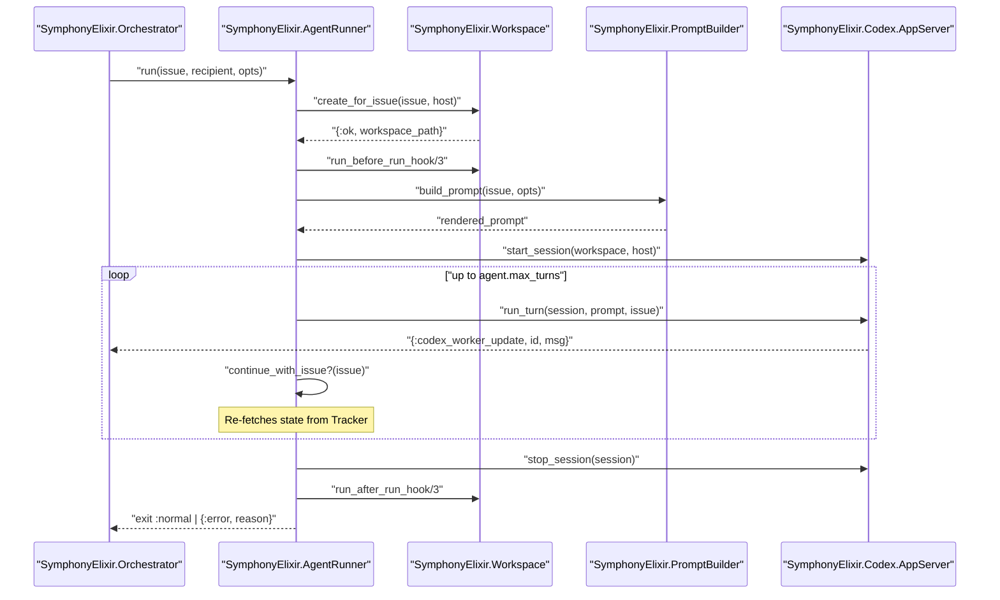

<!-- source: DeepWiki mcp.deepwiki.com · repo openai/symphony · page 4 Core Components · fetched 2026-10-26 -->

# Core Components

<details>
<summary>Relevant source files</summary>

The following files were used as context for generating this wiki page:

- [.github/workflows/burrito-release.yml](.github/workflows/burrito-release.yml)
- [elixir/.gitignore](elixir/.gitignore)
- [elixir/lib/symphony_elixir.ex](elixir/lib/symphony_elixir.ex)
- [elixir/lib/symphony_elixir/cli.ex](elixir/lib/symphony_elixir/cli.ex)
- [elixir/mix.exs](elixir/mix.exs)

</details>


This page documents the primary Elixir modules that implement Symphony's execution engine. These modules handle the continuous poll-dispatch-execute cycle that transforms Linear issues into autonomous agent sessions.

For details on how individual Codex sessions are managed, see [AppServer Protocol](#5.1). For HTTP endpoints and monitoring, see [REST API](#6.2). For configuration loading and validation, see [Configuration System](#3.2).

---

## Component Overview

Symphony's core execution layer consists of four primary modules and their supporting infrastructure. The system is initialized via the `SymphonyElixir.Application` OTP entry point, which starts the `SymphonyElixir.AgentRuntimeSupervisor` [elixir/lib/symphony_elixir.ex:15-51]().

**Component** | **Module** | **Type** | **Responsibility**
--- | --- | --- | ---
Orchestrator | `SymphonyElixir.Orchestrator` | GenServer | Poll cycle, dispatch, reconciliation, retry scheduling
Agent Runner | `SymphonyElixir.AgentRunner` | Module | Per-issue execution, workspace lifecycle, Codex session management
Workspace Manager | `SymphonyElixir.Workspace` | Module | Directory creation, hook execution, path validation
Tracker Facade | `SymphonyElixir.Tracker` | Module | Issue fetching abstraction layer

Supporting modules provide specialized functionality:

**Module** | **Purpose**
--- | ---
`SymphonyElixir.Config` | Typed configuration accessors, validation
`SymphonyElixir.PromptBuilder` | Liquid template rendering for issue prompts
`SymphonyElixir.Linear.Issue` | Data structure for normalized issue state
`SymphonyElixir.Codex.AppServer` | JSON-RPC bridge to Codex agents
`SymphonyElixir.CLI` | Escript entrypoint for running with specific `WORKFLOW.md` [elixir/lib/symphony_elixir/cli.ex:1-4]()

Sources: [elixir/lib/symphony_elixir.ex:15-51](), [elixir/lib/symphony_elixir/cli.ex:1-4]()

---

## Orchestrator State Machine

The `SymphonyElixir.Orchestrator` GenServer is the central coordinator that owns all scheduling state. It runs a continuous tick-based loop, maintains the set of running agents, and makes all dispatch and retry decisions.

### Orchestrator State Structure

The `SymphonyElixir.Orchestrator.State` struct tracks runtime information including token usage, rate limits, and the set of claimed issues.

```elixir
%SymphonyElixir.Orchestrator.State{
  poll_interval_ms: integer(),
  max_concurrent_agents: integer(),
  running: %{issue_id => running_entry},
  claimed: MapSet.t(issue_id),
  retry_attempts: %{issue_id => retry_entry},
  completed: MapSet.t(issue_id),
  codex_totals: %{input_tokens, output_tokens, total_tokens, seconds_running},
  codex_rate_limits: map() | nil,
  next_poll_due_at_ms: integer(),
  poll_check_in_progress: boolean(),
  tick_timer_ref: reference() | nil,
  tick_token: reference()
}
```

### Orchestrator Tick Cycle

```mermaid
stateDiagram-v2
    [*] --> "init/1"
    "init/1" --> "schedule_tick/2"
    "schedule_tick/2" --> "handle_info(:tick)"
    "handle_info(:tick)" --> "schedule_poll_cycle_start/0"
    "schedule_poll_cycle_start/0" --> "handle_info(:run_poll_cycle)"
    
    state "handle_info(:run_poll_cycle)" as PollCycle {
        direction TB
        "maybe_dispatch/1" --> "reconcile_running_issues/1"
        "reconcile_running_issues/1" --> "Config.validate!/"
        "Config.validate!/" --> "Tracker.fetch_candidate_issues/0"
        "Tracker.fetch_candidate_issues/0" --> "choose_issues/2"
        "choose_issues/2" --> "spawn AgentRunner.run/3"
    }
    
    PollCycle --> "schedule_tick/2" : "loop"
```

The Orchestrator processes each tick in a fixed sequence:

1.  **Reconciliation**: Check running agents against current tracker state.
2.  **Validation**: Ensure workflow configuration is valid.
3.  **Candidate Fetch**: Query tracker for issues in active states via `Tracker.fetch_candidate_issues/0`.
4.  **Dispatch**: Launch `AgentRunner.run/3` tasks for eligible issues while available slots remain.

For details, see [Orchestrator](#4.1).

---

## Agent Runner Lifecycle

The `SymphonyElixir.AgentRunner` module manages the execution of a single issue from workspace preparation through Codex session completion. Each runner executes in a separate Task supervised by the Orchestrator.

### Execution Phases



The `AgentRunner` follows a turn-based execution model:
1.  **Workspace Setup**: Creates the directory for the issue.
2.  **Turn Loop**: Executes turns via `AppServer.run_turn/4` until the issue is no longer in an active state or `max_turns` is reached.
3.  **Continuation**: Re-fetches the issue state after each turn to decide whether to continue.

For details, see [Agent Runner](#4.2).

---

## Workspace Management

The `SymphonyElixir.Workspace` module handles filesystem operations for per-issue workspaces, including directory creation and hook execution.

### Remote Execution

When a `worker_host` is provided (e.g., an SSH host), workspace operations are performed on the remote machine. The Orchestrator manages the selection of these hosts from the configured `worker.ssh_hosts` list.

For details, see [Workspace Management](#4.3).

---

## Tracker Integration

The `SymphonyElixir.Tracker` module acts as a facade for issue trackers (primarily Linear). It is responsible for fetching candidate issues for the dispatch cycle and refreshing issue states during execution.

### State Normalization

Issue states are normalized to lowercase and trimmed to ensure consistent comparison against the `active_states` configuration.

For details, see [Tracker Integration](#4.4).

---

## Orchestrator Retry and Backoff

The Orchestrator handles failures and continuations by scheduling retries. 

-   **Continuations**: If a turn completes normally but the issue is still active, a continuation is scheduled with a short delay.
-   **Failures**: If a worker process crashes (abnormal exit), the Orchestrator calculates an exponential backoff.

---

## Distribution and Releases

Symphony is distributed as a self-contained executable using **Burrito**. The release process targets multiple architectures including Linux and macOS (x86_64 and arm64) [.github/workflows/burrito-release.yml:18-19]().

When running as a Burrito binary, the `SymphonyElixir.Application` detects the environment and routes execution through `SymphonyElixir.CLI` [elixir/lib/symphony_elixir.ex:26-31]().

Sources: [.github/workflows/burrito-release.yml:13-19](), [elixir/lib/symphony_elixir.ex:26-31](), [elixir/mix.exs:106-120]()

---

