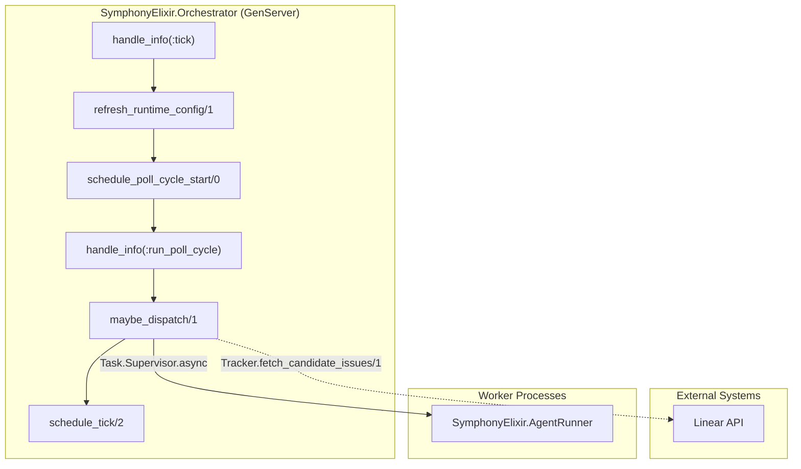
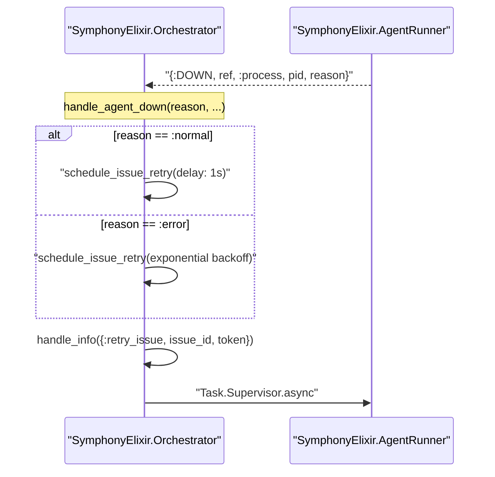

<!-- source: DeepWiki mcp.deepwiki.com · repo openai/symphony · page 4.1 Orchestrator · fetched 2026-10-26 -->

# Orchestrator

Relevant source files

The following files were used as context for generating this wiki page:

- [elixir/lib/symphony_elixir/orchestrator.ex](elixir/lib/symphony_elixir/orchestrator.ex)
- [elixir/test/symphony_elixir/core_test.exs](elixir/test/symphony_elixir/core_test.exs)
- [elixir/test/symphony_elixir/orchestrator_status_test.exs](elixir/test/symphony_elixir/orchestrator_status_test.exs)

The Orchestrator is the central control plane of Symphony. It is implemented as a `GenServer` responsible for the continuous lifecycle of issue automation: polling the issue tracker, reconciling the state of active agents, dispatching new work within concurrency limits, and managing retries for failed or stalled tasks.

## Orchestrator Responsibilities

`SymphonyElixir.Orchestrator` [elixir/lib/symphony_elixir/orchestrator.ex:1-4]() acts as the single authority for all scheduling decisions. It owns the polling tick, the in-memory runtime state, and all transitions into and out of that state.

### Runtime State Management

The orchestrator maintains an internal `%State{}` [elixir/lib/symphony_elixir/orchestrator.ex:24-45]() struct that tracks the following:

| Field | Purpose |
|---|---|
| `running` | A map of `issue_id` to worker metadata (PID, session IDs, token usage). [elixir/lib/symphony_elixir/orchestrator.ex:37]() |
| `completed` | A `MapSet` of issue IDs that have reached a terminal state. [elixir/lib/symphony_elixir/orchestrator.ex:38]() |
| `claimed` | A `MapSet` of issue IDs currently being processed to prevent duplicate dispatch. [elixir/lib/symphony_elixir/orchestrator.ex:39]() |
| `blocked` | A map of issues waiting on human input (e.g., `inputRequired` blockers). [elixir/lib/symphony_elixir/orchestrator.ex:40]() |
| `retry_attempts` | A map tracking scheduled retries and their backoff counters. [elixir/lib/symphony_elixir/orchestrator.ex:41]() |
| `codex_totals` | Global counters for input/output tokens and total runtime. [elixir/lib/symphony_elixir/orchestrator.ex:42]() |

Sources: [elixir/lib/symphony_elixir/orchestrator.ex:24-45](), [elixir/lib/symphony_elixir/orchestrator.ex:60-70]()

### The Poll Loop

The orchestrator operates on a "tick" mechanism. At each interval (defined by `polling.interval_ms` [elixir/lib/symphony_elixir/orchestrator.ex:61]()), it executes a reconciliation and dispatch cycle.

**Orchestrator Polling & Dispatch Logic**

Sources: [elixir/lib/symphony_elixir/orchestrator.ex:83-126](), [elixir/lib/symphony_elixir/orchestrator.ex:73-75]()

### Reconciliation and Stall Detection

The Orchestrator actively monitors running agents to ensure system health:

1.  **Issue State Reconciliation**: It monitors if a running issue has been moved to a terminal state (like "Done" or "Canceled") in the tracker [elixir/test/symphony_elixir/core_test.exs:18]().
2.  **Stall Detection**: It tracks the time since the last `{:codex_worker_update, ...}` message [elixir/lib/symphony_elixir/orchestrator.ex:167-186](). If an agent exceeds the stall timeout, the orchestrator terminates the process and schedules a retry.
3.  **Process Monitoring**: Using `:DOWN` messages, it detects if an `AgentRunner` process has crashed or finished [elixir/lib/symphony_elixir/orchestrator.ex:128-148]().

Sources: [elixir/lib/symphony_elixir/orchestrator.ex:128-186](), [elixir/test/symphony_elixir/orchestrator_status_test.exs:24-102]()

---

## Dispatch Logic

Dispatching occurs during the `:run_poll_cycle` [elixir/lib/symphony_elixir/orchestrator.ex:118]() if there are available slots (`max_concurrent_agents` [elixir/lib/symphony_elixir/orchestrator.ex:62]).

1.  **Concurrency Control**: The orchestrator checks the length of the `running` map against `max_concurrent_agents` [elixir/lib/symphony_elixir/orchestrator.ex:62]().
2.  **Candidate Selection**: It fetches issues that are in "active" states (e.g., "Todo", "In Progress") [elixir/test/symphony_elixir/core_test.exs:17]() and filters out those already in `claimed`, `running`, `blocked`, or `completed` sets.
3.  **Process Spawning**: It uses `Task.Supervisor.async` [elixir/lib/symphony_elixir/orchestrator.ex:36]() to start an `AgentRunner` for each selected issue, storing the resulting `ref` in the state to track the process.

### Per-Issue Orchestration States

These internal sets manage the lifecycle of an issue within the Orchestrator's memory:

| State | Description |
|---|---|
| **Claimed** | Reserved for dispatch; prevents duplicate work before the process starts. [elixir/lib/symphony_elixir/orchestrator.ex:39]() |
| **Running** | An `AgentRunner` process is actively executing. [elixir/lib/symphony_elixir/orchestrator.ex:37]() |
| **Blocked** | Execution is paused, typically awaiting human input (`inputRequired`). [elixir/lib/symphony_elixir/orchestrator.ex:40]() |
| **RetryQueued** | The worker exited, and a timer is running for the next attempt. [elixir/lib/symphony_elixir/orchestrator.ex:41]() |

Sources: [elixir/lib/symphony_elixir/orchestrator.ex:36-41]()

---

## Retry and Continuation Logic

The Orchestrator differentiates between successful turn completions and errors.

### 1. Continuation (Normal Exit)
When an agent finishes its work but the issue remains in an active state, the `AgentRunner` exits with `:normal`. The orchestrator treats this as a request for a "continuation check" and schedules a retry with a low delay (`@continuation_retry_delay_ms` = 1,000ms) [elixir/lib/symphony_elixir/orchestrator.ex:13](), [elixir/lib/symphony_elixir/orchestrator.ex:208-224]().

### 2. Failure-Driven Retry
If a worker crashes or encounters a transient error, the orchestrator applies an exponential backoff starting at `@failure_retry_base_ms` (10,000ms) [elixir/lib/symphony_elixir/orchestrator.ex:14]().

**Retry Sequence Diagram**

Sources: [elixir/lib/symphony_elixir/orchestrator.ex:128-148](), [elixir/lib/symphony_elixir/orchestrator.ex:190-202](), [elixir/lib/symphony_elixir/orchestrator.ex:208-232]()

---

## Observability and Token Tracking

The Orchestrator acts as the data aggregator for system observability.

### Status Snapshots
The `handle_call(:snapshot, ...)` implementation provides a full view of the system state, including per-issue details like `turn_count`, `last_codex_message`, and `session_id` [elixir/test/symphony_elixir/orchestrator_status_test.exs:24-103]().

### Token Aggregation
As agents run, they send `codex_worker_update` messages [elixir/lib/symphony_elixir/orchestrator.ex:167](). The orchestrator extracts token usage from these updates (specifically `thread/tokenUsage/updated` notifications) and updates both the specific `running` entry and global `codex_totals` [elixir/test/symphony_elixir/orchestrator_status_test.exs:185-201]().

**Code Entity Mapping**

| Code Symbol | Role |
|---|---|
| `SymphonyElixir.Orchestrator.State` | Runtime struct for the GenServer state. [elixir/lib/symphony_elixir/orchestrator.ex:24]() |
| `handle_info(:run_poll_cycle, ...)` | Main loop logic for fetching and dispatching work. [elixir/lib/symphony_elixir/orchestrator.ex:118]() |
| `integrate_codex_update/2` | Merges incoming agent metrics into the Orchestrator state. [elixir/lib/symphony_elixir/orchestrator.ex:176]() |
| `handle_agent_down/5` | Core logic for deciding between completion, continuation, or retry. [elixir/lib/symphony_elixir/orchestrator.ex:208]() |

Sources: [elixir/lib/symphony_elixir/orchestrator.ex:24-45](), [elixir/lib/symphony_elixir/orchestrator.ex:118-126](), [elixir/lib/symphony_elixir/orchestrator.ex:176-185](), [elixir/test/symphony_elixir/orchestrator_status_test.exs:185-201]()

---

