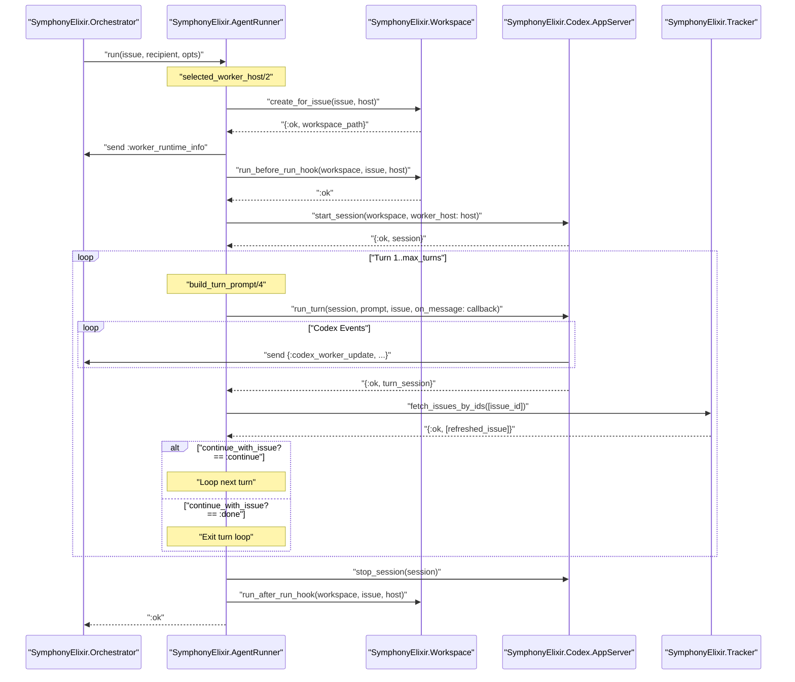
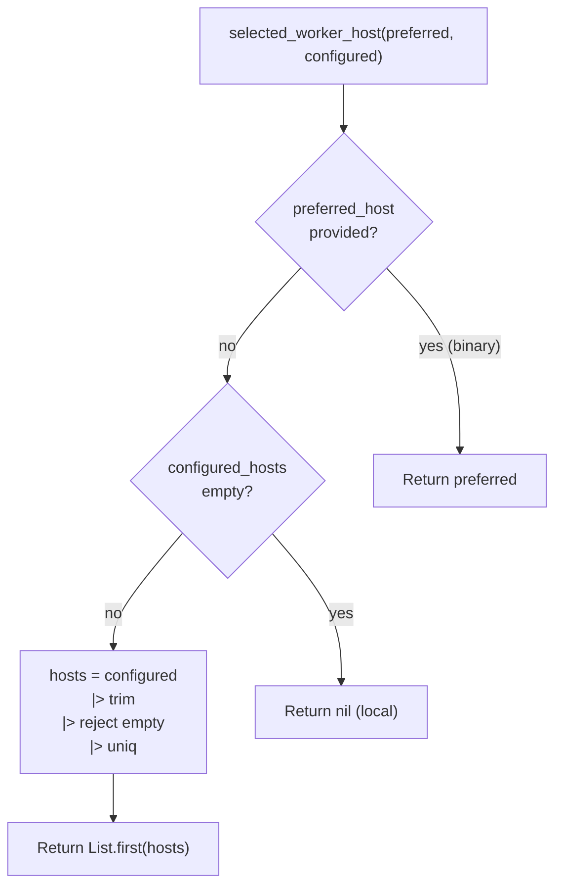
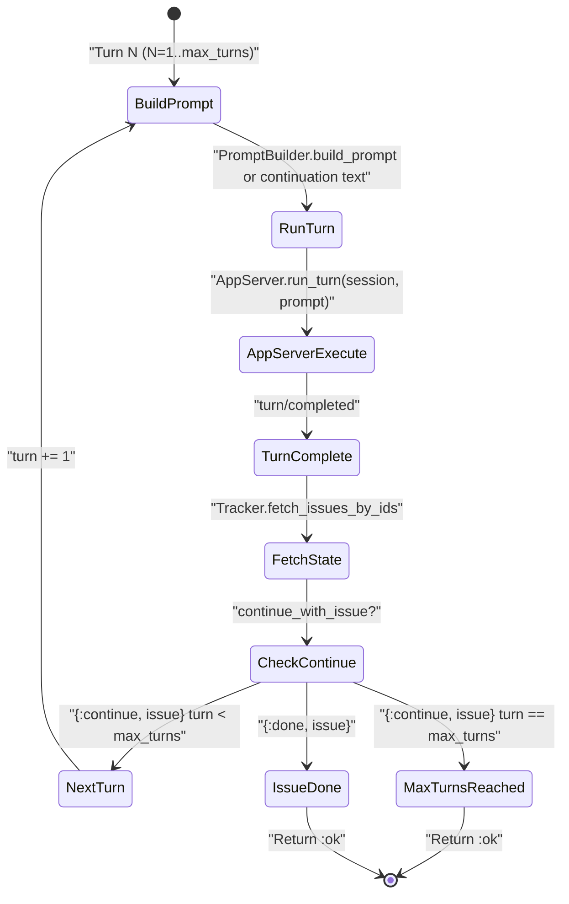
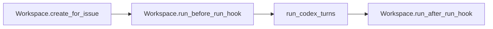

<!-- source: DeepWiki mcp.deepwiki.com · repo openai/symphony · page 4.2 Agent Runner · fetched 2026-10-26 -->

# Agent Runner

<details>
<summary>Relevant source files</summary>

The following files were used as context for generating this wiki page:

- [elixir/lib/symphony_elixir/agent_runner.ex](elixir/lib/symphony_elixir/agent_runner.ex)
- [elixir/lib/symphony_elixir/config/schema.ex](elixir/lib/symphony_elixir/config/schema.ex)
- [elixir/lib/symphony_elixir/linear/client.ex](elixir/lib/symphony_elixir/linear/client.ex)
- [elixir/lib/symphony_elixir/prompt_builder.ex](elixir/lib/symphony_elixir/prompt_builder.ex)
- [elixir/test/symphony_elixir/core_test.exs](elixir/test/symphony_elixir/core_test.exs)

</details>


## Purpose and Scope

The Agent Runner executes a single tracker work item (e.g., a Linear issue) within a dedicated workspace using Codex. It manages the complete lifecycle of an agent session, from workspace creation through multi-turn execution to cleanup. The Agent Runner is spawned by the Orchestrator for each issue being processed and coordinates with Workspace Management for file system operations and the Codex AppServer for turn execution.

For information about how issues are selected and dispatched, see [Orchestrator](4.1). For details on the JSON-RPC protocol used to communicate with Codex, see [AppServer Protocol](5.1).

---

## Responsibilities

The `SymphonyElixir.AgentRunner` module provides the logic to execute a tracker work item. Its core responsibilities include:

| Responsibility | Description |
|---------------|-------------|
| **Worker Host Selection** | Chooses an available worker host from configured options, with preference support and automatic fallback [elixir/lib/symphony_elixir/agent_runner.ex:24-24](). |
| **Workspace Lifecycle Management** | Creates workspaces and executes hooks (`before_run`, `after_run`) [elixir/lib/symphony_elixir/agent_runner.ex:41-51](). |
| **Turn-Based Execution** | Runs multiple Codex turns (up to `agent.max_turns`) with continuation logic based on issue state [elixir/lib/symphony_elixir/agent_runner.ex:89-140](). |
| **Issue State Monitoring** | Fetches current issue state between turns to detect external completion or reassignment [elixir/lib/symphony_elixir/agent_runner.ex:156-171](). |
| **Message Propagation** | Forwards Codex events and runtime information to the Orchestrator for observability [elixir/lib/symphony_elixir/agent_runner.ex:58-86](). |

**Sources:** [elixir/lib/symphony_elixir/agent_runner.ex:1-9]()

---

## Execution Flow

The Agent Runner follows a structured execution flow that integrates workspace management, Codex interaction, and issue state monitoring.

### Complete Execution Sequence



**Sources:** [elixir/lib/symphony_elixir/agent_runner.ex:22-56](), [elixir/lib/symphony_elixir/agent_runner.ex:88-140]()

---

## Worker Host Selection

The Agent Runner supports execution on a selected worker host. Worker hosts can be local (`nil`) or remote SSH hosts defined in configuration.

### Candidate Selection Logic



The `selected_worker_host/2` function resolves which host to use based on the `worker.ssh_hosts` configuration [elixir/lib/symphony_elixir/config/schema.ex:131-131]() and any preferred host passed via options.

**Sources:** [elixir/lib/symphony_elixir/agent_runner.ex:188-212]()

---

## Turn Management and Continuation Logic

The Agent Runner executes Codex in turns. After each turn, the runner refreshes the issue state to determine if it should continue.

### Turn Execution State Machine



### Continuation Decision Logic

The `continue_with_issue?/2` function determines whether to continue executing turns by verifying if the issue remains in an active state and is still routable (e.g., has required labels) [elixir/lib/symphony_elixir/agent_runner.ex:156-171]().

**Active state check:** Compares the issue's current state against `tracker.active_states` from configuration [elixir/lib/symphony_elixir/agent_runner.ex:175-180](). Default active states are "Todo" and "In Progress" [elixir/lib/symphony_elixir/config/schema.ex:12-12]().

**Sources:** [elixir/lib/symphony_elixir/agent_runner.ex:101-140](), [elixir/lib/symphony_elixir/agent_runner.ex:156-186]()

---

## Prompt Construction

The Agent Runner builds different prompts for the initial turn versus continuation turns.

### Prompt Types

| Turn Number | Prompt Source | Content |
|-------------|---------------|---------|
| **Turn 1** | `SymphonyElixir.PromptBuilder.build_prompt/2` | Rendered from `WORKFLOW.md` prompt template with issue context [elixir/lib/symphony_elixir/prompt_builder.ex:10-26](). |
| **Turn 2+** | `build_turn_prompt/4` | Continuation guidance explaining the turn is resuming from prior state [elixir/lib/symphony_elixir/agent_runner.ex:144-154](). |

**Continuation Prompt (Turn 2+):**
```text
Continuation guidance:

- The previous Codex turn completed normally, but the tracker work item is still in an active state.
- This is continuation turn #N of M for the current agent run.
- Resume from the current workspace and workpad state instead of restarting from scratch.
- The original task instructions and prior turn context are already present in this thread, so do not restate them before acting.
- Focus on the remaining ticket work and do not end the turn while the issue stays active unless you are truly blocked.
```

**Sources:** [elixir/lib/symphony_elixir/agent_runner.ex:142-154](), [elixir/lib/symphony_elixir/prompt_builder.ex:1-26]()

---

## Workspace Lifecycle Integration

The Agent Runner orchestrates workspace operations through the `SymphonyElixir.Workspace` module.

### Hook Execution Order



**Hook guarantees:**
- `Workspace.run_after_run_hook/3` executes in an `after` block, ensuring cleanup even if turn execution fails [elixir/lib/symphony_elixir/agent_runner.ex:45-51]().
- Hooks run on the worker host where the workspace was created [elixir/lib/symphony_elixir/agent_runner.ex:46-50]().

**Sources:** [elixir/lib/symphony_elixir/agent_runner.ex:38-56]()

---

## Message Protocol

The Agent Runner communicates with the recipient (usually the Orchestrator) via message passing.

### Message Types

**Worker Runtime Info:**
Sent after workspace creation to inform the system of the execution context [elixir/lib/symphony_elixir/agent_runner.ex:72-84]().

```elixir
{:worker_runtime_info, issue_id, %{
  worker_host: "worker-01" | nil,
  workspace_path: "/tmp/symphony_workspaces/issue-123"
}}
```

**Codex Worker Updates:**
Forwarded from `AppServer` during turn execution for real-time observability [elixir/lib/symphony_elixir/agent_runner.ex:64-68]().

```elixir
{:codex_worker_update, issue_id, message}
```

**Sources:** [elixir/lib/symphony_elixir/agent_runner.ex:58-86]()

---

## Configuration

The Agent Runner reads configuration from the `Config` module and accepts runtime options.

### Configuration Sources

| Parameter | Config Schema Path | Default |
|-----------|--------------------|---------|
| `max_turns` | `agent.max_turns` | `20` [elixir/lib/symphony_elixir/config/schema.ex:153-153]() |
| `active_states` | `tracker.active_states` | `["Todo", "In Progress"]` [elixir/lib/symphony_elixir/config/schema.ex:12-12]() |
| `ssh_hosts` | `worker.ssh_hosts` | `[]` [elixir/lib/symphony_elixir/config/schema.ex:131-131]() |

### Runtime Options (`opts`)

| Option | Type | Purpose |
|--------|------|---------|
| `:worker_host` | `String.t() \| nil` | Specific host to use for this run [elixir/lib/symphony_elixir/agent_runner.ex:24-24](). |
| `:max_turns` | `integer()` | Override for the turn limit [elixir/lib/symphony_elixir/agent_runner.ex:89-89](). |
| `:issue_state_fetcher` | `function()` | Function to refresh issue state (for testing) [elixir/lib/symphony_elixir/agent_runner.ex:90-90](). |

**Sources:** [elixir/lib/symphony_elixir/agent_runner.ex:22-24](), [elixir/lib/symphony_elixir/agent_runner.ex:88-90](), [elixir/lib/symphony_elixir/config/schema.ex:1-240]()

---

## Key Data Structures

### Issue State Normalization

State names are normalized to lowercase with whitespace trimmed for comparison against `active_states` [elixir/lib/symphony_elixir/agent_runner.ex:175-180]().

```elixir
defp normalize_issue_state(state_name) when is_binary(state_name) do
  state_name
  |> String.trim()
  |> String.downcase()
end
```

**Sources:** [elixir/lib/symphony_elixir/agent_runner.ex:221-225]()

### Logging Context

The `issue_context/1` helper provides consistent log context including issue ID and identifier [elixir/lib/symphony_elixir/agent_runner.ex:227-229]().

**Sources:** [elixir/lib/symphony_elixir/agent_runner.ex:227-229]()

---

