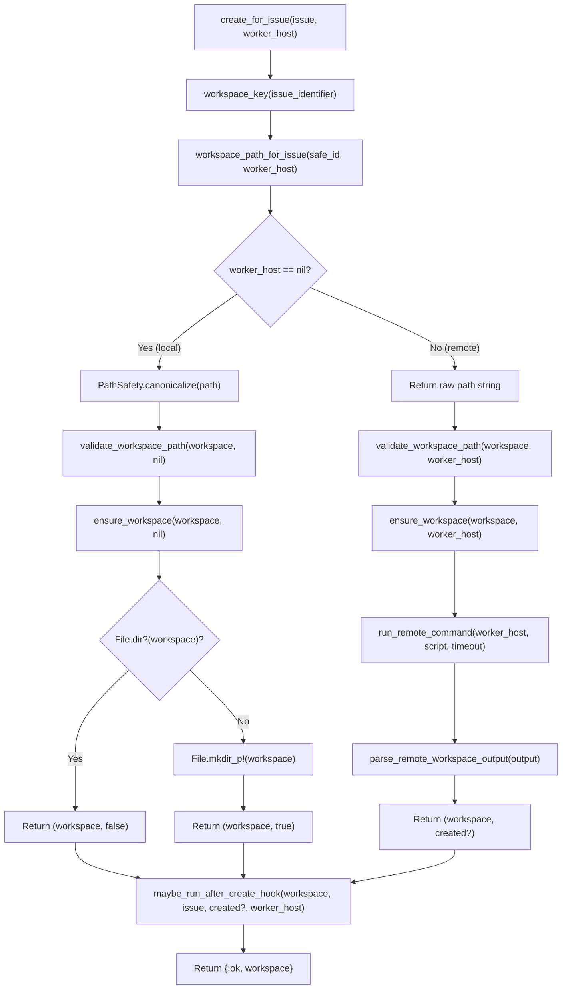
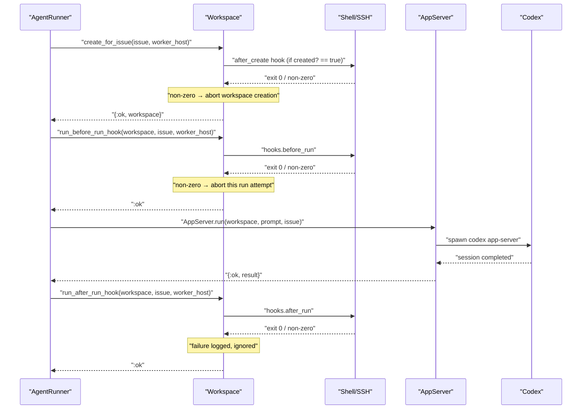
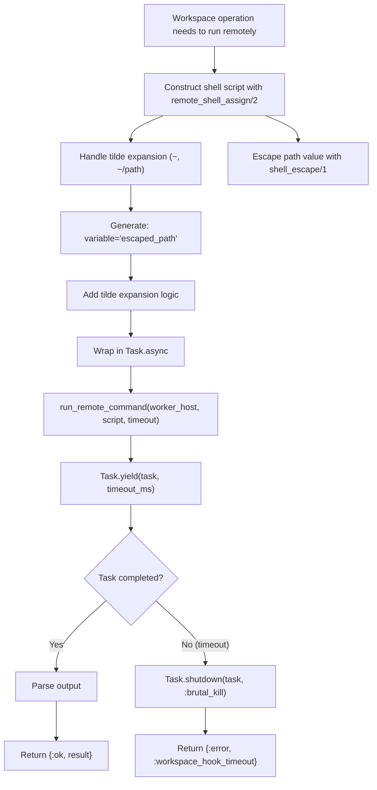
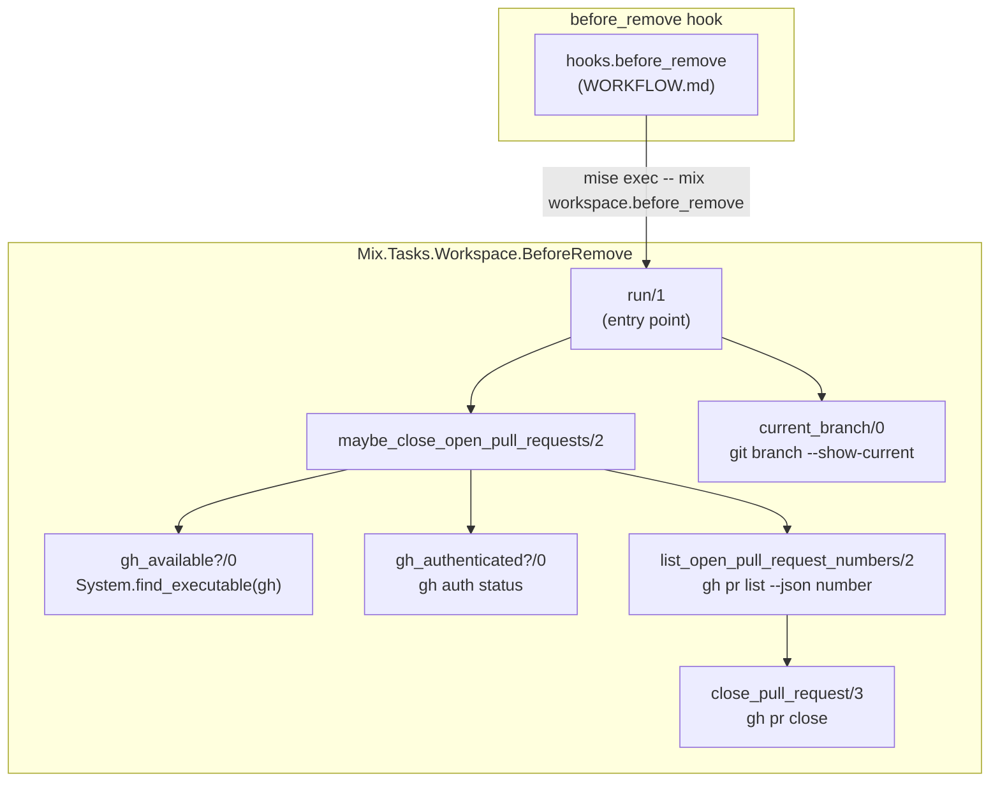
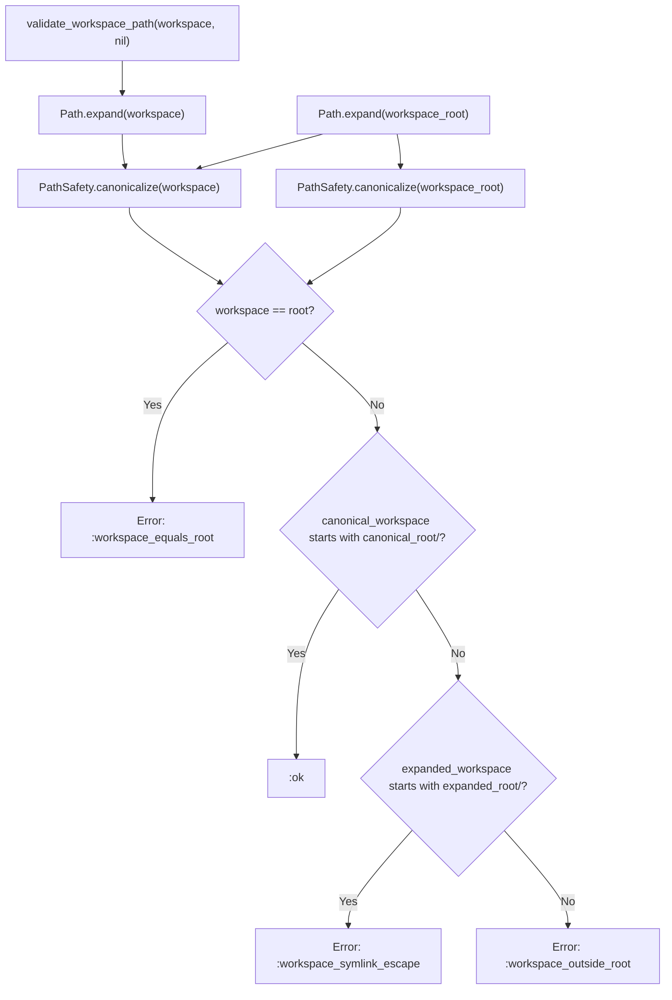

<!-- source: DeepWiki mcp.deepwiki.com · repo openai/symphony · page 4.3 Workspace Management · fetched 2026-10-26 -->

# Workspace Management

Relevant source files

The following files were used as context for generating this wiki page:

- [elixir/lib/mix/tasks/workspace.before_remove.ex](elixir/lib/mix/tasks/workspace.before_remove.ex)
- [elixir/lib/symphony_elixir/linear/adapter.ex](elixir/lib/symphony_elixir/linear/adapter.ex)
- [elixir/lib/symphony_elixir/path_safety.ex](elixir/lib/symphony_elixir/path_safety.ex)
- [elixir/lib/symphony_elixir/workspace.ex](elixir/lib/symphony_elixir/workspace.ex)
- [elixir/test/symphony_elixir/workspace_and_config_test.exs](elixir/test/symphony_elixir/workspace_and_config_test.exs)

This page documents the `SymphonyElixir.Workspace` module [elixir/lib/symphony_elixir/workspace.ex:1-4](), which manages isolated per-issue workspaces for Codex agents. The module handles both **local workspaces** (created on the orchestrator host) and **remote workspaces** (created on SSH worker hosts via the `SSH` module).

Key responsibilities:
- Derive workspace paths from issue identifiers using safe character sanitization [elixir/lib/symphony_elixir/workspace.ex:206-208]()
- Create and reuse workspace directories (local and remote) [elixir/lib/symphony_elixir/workspace.ex:15-85]()
- Execute lifecycle hooks (`after_create`, `before_run`, `after_run`, `before_remove`) [elixir/lib/symphony_elixir/workspace.ex:166-332]()
- Enforce safety invariants via `PathSafety` to prevent directory traversal attacks [elixir/lib/symphony_elixir/path_safety.ex:1-16]()
- Clean up workspaces when issues reach terminal states [elixir/lib/symphony_elixir/workspace.ex:164-215]()

The workspace system ensures that each Linear issue gets an isolated filesystem environment where the Codex agent operates, with no risk of corrupting the Symphony source repository or other issues' workspaces.

Sources: [elixir/lib/symphony_elixir/workspace.ex:1-483](), [elixir/lib/symphony_elixir/path_safety.ex:1-50]()

---

## Workspace Layout and Naming

Every Linear issue gets exactly one workspace directory. The directory name is derived deterministically from the issue's identifier using `workspace_key/1` [elixir/lib/symphony_elixir/workspace.ex:196-208](), which sanitizes the identifier to contain only safe filesystem characters.

| Concept | Value |
|---|---|
| **Workspace root** | `workspace_root` config value (default: `<system-temp>/symphony_workspaces`) |
| **Issue identifier** | Human-readable issue key from Linear (e.g. `MT-32`, `SYM-5`) |
| **Safe identifier** | Result of `String.replace(identifier, ~r/[^a-zA-Z0-9._-]/, "_")` |
| **Workspace path (local)** | `Path.join(workspace_root, safe_id)` with canonicalization via `PathSafety` |
| **Workspace path (remote)** | `Path.join(workspace_root, safe_id)` executed on SSH worker host |

**Example transformations:**

| Issue Identifier | Safe Identifier | Workspace Path (if root = `/var/symphony`) |
|---|---|---|
| `MT-32` | `MT-32` | `/var/symphony/MT-32` |
| `SYM#5` | `SYM_5` | `/var/symphony/SYM_5` |
| `PROJ/123` | `PROJ_123` | `/var/symphony/PROJ_123` |

**Workspace persistence:** Workspaces survive across agent runs for the same issue [elixir/test/symphony_elixir/workspace_and_config_test.exs:112-146](). A successful run does **not** delete the workspace. This allows the agent to accumulate git history, installed dependencies, and context across retries and continuation turns. Workspaces are only removed when an issue reaches a terminal state [elixir/lib/symphony_elixir/workspace.ex:164-215]().

Sources: [elixir/lib/symphony_elixir/workspace.ex:196-208](), [elixir/test/symphony_elixir/workspace_and_config_test.exs:43-58](), [elixir/test/symphony_elixir/workspace_and_config_test.exs:112-146]()

---

## Creation and Reuse Algorithm

The `create_for_issue/2` function is the entry point for workspace creation [elixir/lib/symphony_elixir/workspace.ex:13-38](). It handles both local (when `worker_host` is `nil`) and remote (when `worker_host` is a string) workspace creation.

**Workspace creation flow (code entities)**

**Local workspace creation** ([elixir/lib/symphony_elixir/workspace.ex:40-52]()):
1. Check if the directory exists with `File.dir?(workspace)` [elixir/lib/symphony_elixir/workspace.ex:42]().
2. If exists, return with `created? = false` [elixir/lib/symphony_elixir/workspace.ex:43]().
3. If doesn't exist or is a non-directory file, create it with `File.mkdir_p!` [elixir/lib/symphony_elixir/workspace.ex:45-50]().
4. Return with `created? = true` [elixir/lib/symphony_elixir/workspace.ex:90]().

**Remote workspace creation** ([elixir/lib/symphony_elixir/workspace.ex:54-85]()):
1. Construct a shell script that creates the directory and outputs a marker line [elixir/lib/symphony_elixir/workspace.ex:55-73]().
2. Execute the script via `run_remote_command/3` [elixir/lib/symphony_elixir/workspace.ex:75]().
3. Parse the output to extract the marker line `__SYMPHONY_WORKSPACE__\t<created>\t<path>` [elixir/lib/symphony_elixir/workspace.ex:70]().
4. The marker format ensures reliable parsing even if stdout contains other text [elixir/lib/symphony_elixir/workspace.ex:412-433]().

**The `created?` flag:** The `after_create` hook only runs when `created? == true`, meaning the directory was just created during this call [elixir/lib/symphony_elixir/workspace.ex:213-221](). This ensures that expensive operations like `git clone` only happen once per workspace [elixir/test/symphony_elixir/workspace_and_config_test.exs:8-41]().

Sources: [elixir/lib/symphony_elixir/workspace.ex:13-85](), [elixir/test/symphony_elixir/workspace_and_config_test.exs:8-41]()

---

## The Four Lifecycle Hooks

Hooks are shell commands defined in `WORKFLOW.md`. Each hook is executed with the workspace directory as the working directory. All hooks share a single timeout (`hooks.timeout_ms`) [elixir/lib/symphony_elixir/workspace.ex:75]().

**Lifecycle hook execution sequence**

Sources: [elixir/lib/symphony_elixir/workspace.ex:166-332]()

### Hook Reference Table

| Hook | Function | Trigger | Failure Behavior | Typical Use |
|---|---|---|---|---|
| `after_create` | `maybe_run_after_create_hook/4` | Once, when directory is first created | **Fatal** — returns `{:error, reason}` | Clone repo, install dependencies [elixir/lib/symphony_elixir/workspace.ex:210-226]() |
| `before_run` | `run_before_run_hook/3` | Before every agent run | **Fatal** — returns `{:error, reason}` | Sync state, pre-flight checks [elixir/lib/symphony_elixir/workspace.ex:166-179]() |
| `after_run` | `run_after_run_hook/3` | After every agent run | **Non-fatal** — failures ignored via `ignore_hook_failure/1` | Collect artifacts, cleanup [elixir/lib/symphony_elixir/workspace.ex:181-194]() |
| `before_remove` | `maybe_run_before_remove_hook/2` | Before workspace directory is deleted | **Non-fatal** — failures logged | Close open PRs, release locks [elixir/lib/symphony_elixir/workspace.ex:228-245]() |

**Hook timeout handling:** All hooks are subject to `hooks.timeout_ms`. When a hook times out:
- Local execution: The task is killed with `Task.shutdown(task, :brutal_kill)` [elixir/lib/symphony_elixir/workspace.ex:309]().
- Remote execution: The SSH connection is terminated [elixir/lib/symphony_elixir/workspace.ex:446]().

Sources: [elixir/lib/symphony_elixir/workspace.ex:166-344]()

---

## Remote Workspace Operations

When Symphony runs with SSH workers, workspace operations are executed remotely. The `Workspace` module handles the protocol for creating and managing workspaces on remote hosts.

**Remote shell scripting (code entities)**

**Shell escaping** ([elixir/lib/symphony_elixir/workspace.ex:452-454]()): The `shell_escape/1` function wraps values in single quotes and escapes embedded single quotes using `'"'"'` sequence to prevent command injection.

**Tilde expansion** ([elixir/lib/symphony_elixir/workspace.ex:400-410]()): The `remote_shell_assign/2` function generates POSIX shell script that handles `~` and `~/path` expansion by checking the variable content at runtime on the remote host.

Sources: [elixir/lib/symphony_elixir/workspace.ex:400-454]()

---

## The mix workspace.before_remove Task

`Mix.Tasks.Workspace.BeforeRemove` [elixir/lib/mix/tasks/workspace.before_remove.ex]() is the implementation invoked by the `before_remove` hook. It closes any open GitHub PRs for the workspace's current git branch before the directory is removed.

**Code entity map**

Sources: [elixir/lib/mix/tasks/workspace.before_remove.ex:1-140]()

**Behavior summary:**
1. Parses optional `--branch` and `--repo` CLI flags [elixir/lib/mix/tasks/workspace.before_remove.ex:23-40]().
2. Defaults repo to `"openai/symphony"` [elixir/lib/mix/tasks/workspace.before_remove.ex:18]().
3. Defaults branch to the output of `git branch --show-current` [elixir/lib/mix/tasks/workspace.before_remove.ex:115-126]().
4. Closes each PR with `gh pr close <number>` and a comment stating the issue entered a terminal state [elixir/lib/mix/tasks/workspace.before_remove.ex:88-110]().

---

## Safety Invariants

Workspace safety is enforced by `validate_workspace_path/2` before any operations occur [elixir/lib/symphony_elixir/workspace.ex:358-398]().

**Local workspace validation** ([elixir/lib/symphony_elixir/workspace.ex:358-384]()):

**Local validation rules:**
1. The workspace path cannot equal the workspace root [elixir/lib/symphony_elixir/workspace.ex:370-371]().
2. The canonicalized workspace path must be a child of the canonicalized root to prevent traversal attacks [elixir/lib/symphony_elixir/workspace.ex:373-383]().
3. `PathSafety.canonicalize/1` resolves all symlinks to their real paths to detect escapes [elixir/lib/symphony_elixir/path_safety.ex:4-16](), [elixir/test/symphony_elixir/workspace_and_config_test.exs:171-181]().

**Remote workspace validation** ([elixir/lib/symphony_elixir/workspace.ex:386-398]()):
- Rejects empty paths or paths with invalid characters like newlines or null bytes [elixir/lib/symphony_elixir/workspace.ex:388-393]().

Sources: [elixir/lib/symphony_elixir/workspace.ex:358-398](), [elixir/lib/symphony_elixir/path_safety.ex:1-50](), [elixir/test/symphony_elixir/workspace_and_config_test.exs:171-181]()

---

