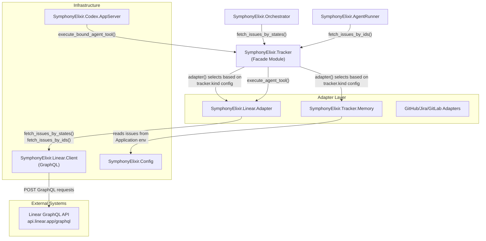
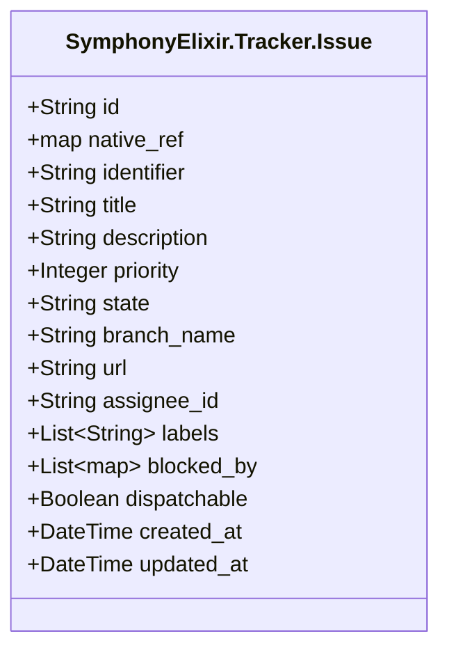
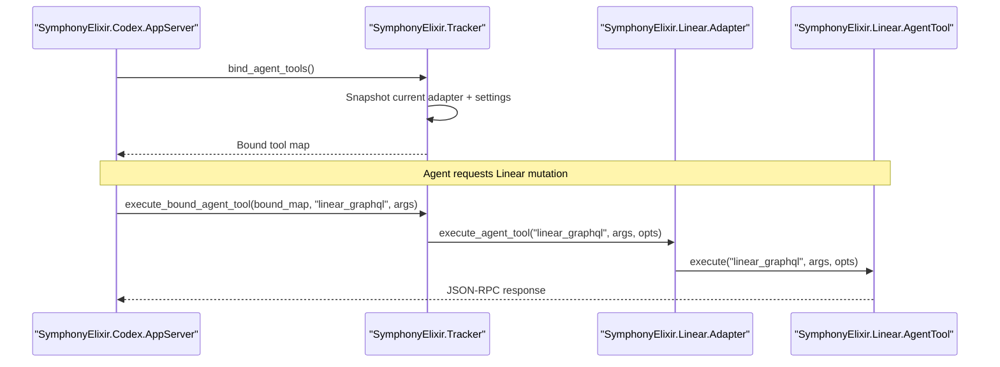

<!-- source: DeepWiki mcp.deepwiki.com · repo openai/symphony · page 4.4 Tracker Integration · fetched 2026-10-26 -->

# Tracker Integration

<details>
<summary>Relevant source files</summary>

The following files were used as context for generating this wiki page:

- [elixir/lib/mix/tasks/workspace.before_remove.ex](elixir/lib/mix/tasks/workspace.before_remove.ex)
- [elixir/lib/symphony_elixir/agent_runner.ex](elixir/lib/symphony_elixir/agent_runner.ex)
- [elixir/lib/symphony_elixir/config/schema.ex](elixir/lib/symphony_elixir/config/schema.ex)
- [elixir/lib/symphony_elixir/linear/adapter.ex](elixir/lib/symphony_elixir/linear/adapter.ex)
- [elixir/lib/symphony_elixir/linear/client.ex](elixir/lib/symphony_elixir/linear/client.ex)
- [elixir/lib/symphony_elixir/tracker.ex](elixir/lib/symphony_elixir/tracker.ex)
- [elixir/lib/symphony_elixir/tracker/issue.ex](elixir/lib/symphony_elixir/tracker/issue.ex)
- [elixir/lib/symphony_elixir/tracker/memory.ex](elixir/lib/symphony_elixir/tracker/memory.ex)

</details>


## Purpose and Scope

This document explains Symphony's tracker integration layer, which provides an abstraction for fetching and normalizing issues from external project management systems. The primary implementation integrates with Linear's GraphQL API, while a memory-based adapter supports testing and local development.

For information about how the Orchestrator uses tracker data to dispatch work, see [Orchestrator](4.1). For workspace lifecycle management tied to issue states, see [Workspace Management](4.3).

---

## Architecture Overview

Symphony uses the **Facade pattern** to decouple core orchestration logic from specific tracker implementations. This allows the system to operate against different issue sources without changing dispatch or reconciliation logic.

### Tracker Facade Architecture



**Sources:** [elixir/lib/symphony_elixir/tracker.ex:1-20](), [elixir/lib/symphony_elixir/agent_runner.ex:89-91](), [elixir/lib/symphony_elixir/linear/adapter.ex:31-35]()

The facade provides a stable interface defined by the `SymphonyElixir.Tracker` behavior:

| Method | Purpose | Return Type |
|--------|---------|-------------|
| `fetch_issues_by_states([states])` | Fetch issues matching specific state names for dispatch | `{:ok, [Issue.t()]} \| {:error, term()}` |
| `fetch_issues_by_ids([ids])` | Fetch current states for running issues (reconciliation) | `{:ok, [Issue.t()]} \| {:error, term()}` |
| `agent_tool_specs()` | Get JSON-RPC tool definitions for the Codex agent | `[map()]` |
| `execute_agent_tool(tool, args, opts)` | Execute a tracker mutation requested by the agent | `map()` |
| `validate_config(config)` | Validate tracker-specific settings during startup | `:ok \| {:error, term()}` |

**Sources:** [elixir/lib/symphony_elixir/tracker.ex:22-31]()

---

## Issue Data Model

Symphony normalizes tracker-specific payloads into a canonical `SymphonyElixir.Tracker.Issue` struct. This normalization ensures consistent behavior across orchestration, retry logic, and workspace management.

### Normalized Issue Structure



**Sources:** [elixir/lib/symphony_elixir/tracker/issue.ex:1-28]()

| Field | Description | Normalization Rules |
|-------|-------------|---------------------|
| `id` | Stable dispatch identity | Used for API calls and internal tracking [elixir/lib/symphony_elixir/tracker/issue.ex:5-6]() |
| `identifier` | Human-readable key (e.g., `SYM-123`) | Used for workspace naming and logs [elixir/lib/symphony_elixir/tracker/issue.ex:8-9]() |
| `native_ref` | Provider-native identifiers | Carries non-secret IDs for agent tools [elixir/lib/symphony_elixir/tracker/issue.ex:7-8]() |
| `state` | Current issue state | Normalized for comparison with `active_states` [elixir/lib/symphony_elixir/agent_runner.ex:175-180]() |
| `dispatchable` | Boolean flag | Must be `true` for the issue to be routed [elixir/lib/symphony_elixir/tracker/issue.ex:53-58]() |
| `labels` | List of issue labels | Used for requirement filtering in `routable?/2` [elixir/lib/symphony_elixir/tracker/issue.ex:53-58]() |

---

## Linear Adapter Implementation

The Linear adapter (`SymphonyElixir.Linear.Adapter`) translates facade calls into Linear-specific GraphQL operations via the `Client`.

### Configuration Validation

The adapter ensures that essential Linear credentials and filters are present before the system starts:

```elixir
def validate_config(tracker_settings) do
  cond do
    not present_string?(tracker_settings.endpoint) -> {:error, :invalid_linear_endpoint}
    not present_string?(tracker_settings.api_key) -> {:error, :missing_linear_api_token}
    # ...
  end
end
```

**Sources:** [elixir/lib/symphony_elixir/linear/adapter.ex:11-29]()

### Agent Tool Integration

A unique feature of the Tracker integration is the `bind_agent_tools/0` function. It captures the current adapter and settings to prevent "drift" if configuration reloads while an agent session is active.



**Sources:** [elixir/lib/symphony_elixir/tracker.ex:48-74](), [elixir/lib/symphony_elixir/linear/adapter.ex:37-43]()

---

## Linear GraphQL Client

The `SymphonyElixir.Linear.Client` module handles communication with Linear's API, including pagination and complex issue normalization.

### GraphQL Queries

The client defines specific GraphQL fragments for polling and ID-based fetching, ensuring it retrieves `inverseRelations` to detect blocking issues and `labels` for routing.

**Sources:** [elixir/lib/symphony_elixir/linear/client.ex:13-97]()

### Pagination and Merging

The client handles Linear's cursor-based pagination automatically, merging all pages before returning results to the adapter.

| Function | Role |
|----------|------|
| `do_fetch_by_states_page/5` | Recursively fetches pages using `after` cursor [elixir/lib/symphony_elixir/linear/client.ex:224-245]() |
| `prepend_page_issues/2` | Efficiently accumulates issues during pagination [elixir/lib/symphony_elixir/linear/client.ex:274-277]() |
| `finalize_paginated_issues/1` | Flattens and reverses the accumulated list [elixir/lib/symphony_elixir/linear/client.ex:279-282]() |

### Error Handling

To prevent log pollution, Linear API errors are captured and logged with context, including the status code and a truncated version of the error body.

**Sources:** [elixir/lib/symphony_elixir/linear/client.ex:150-165](), [elixir/lib/symphony_elixir/linear/client.ex:361-381]()

---

## Memory Adapter

The `SymphonyElixir.Tracker.Memory` adapter provides a lightweight in-memory tracker for testing. It retrieves issues from the Elixir application environment.

**Sources:** [elixir/lib/symphony_elixir/tracker/memory.ex:1-52]()

- **Fetch Logic:** Uses `MapSet` for efficient filtering of issues by state or ID [elixir/lib/symphony_elixir/tracker/memory.ex:10-31]().
- **State Normalization:** Trims and downcases state names to match Symphony's internal comparison logic [elixir/lib/symphony_elixir/tracker/memory.ex:44-50]().

---

## Configuration Schema

The tracker configuration is validated using an Ecto schema, which provides defaults for common Linear states.

| Field | Default | Description |
|-------|---------|-------------|
| `kind` | - | One of `asana`, `github`, `gitlab`, `jira`, `linear`, `memory` [elixir/lib/symphony_elixir/tracker.ex:13-20]() |
| `active_states` | `["Todo", "In Progress"]` | States that trigger agent dispatch [elixir/lib/symphony_elixir/config/schema.ex:12]() |
| `terminal_states` | `["Closed", "Done", ...]` | States that signify work completion [elixir/lib/symphony_elixir/config/schema.ex:13]() |
| `required_labels` | `[]` | Labels required for an issue to be routable [elixir/lib/symphony_elixir/config/schema.ex:58]() |

**Sources:** [elixir/lib/symphony_elixir/config/schema.ex:43-87]()

---

