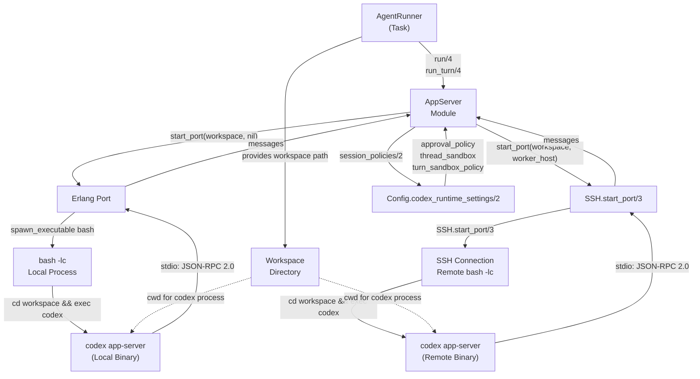
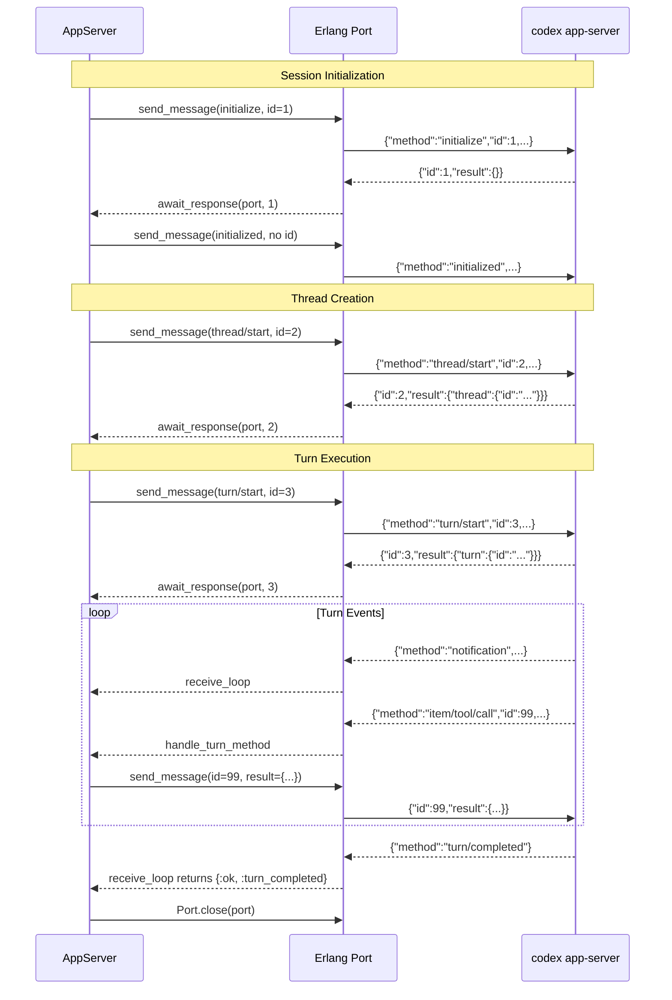
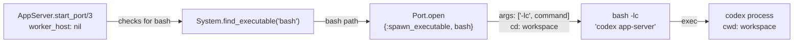

<!-- source: DeepWiki mcp.deepwiki.com · repo openai/symphony · page 5 Codex Integration · fetched 2026-10-26 -->

# Codex Integration

Relevant source files

The following files were used as context for generating this wiki page:

- [elixir/lib/symphony_elixir/codex/app_server.ex](elixir/lib/symphony_elixir/codex/app_server.ex)
- [elixir/lib/symphony_elixir/codex/dynamic_tool.ex](elixir/lib/symphony_elixir/codex/dynamic_tool.ex)
- [elixir/test/symphony_elixir/app_server_test.exs](elixir/test/symphony_elixir/app_server_test.exs)

This document explains how Symphony integrates with Codex, the AI agent binary that performs autonomous development work. It covers the `AppServer` module, which implements a JSON-RPC 2.0 client for communicating with Codex processes via stdio, and describes the execution models for both local and SSH-based workers.

For detailed information about the JSON-RPC protocol messages and handshake sequence, see [AppServer Protocol](#5.1). For session and turn lifecycle management, including continuation and stall detection, see [Session and Turn Management](#5.2). For the dynamic tool system that enables Codex to interact with Linear, see [Dynamic Tools](#5.3). For approval policies and sandbox configurations, see [Approval and Sandbox Policies](#5.4).

## Overview

Codex is an external binary that Symphony spawns to execute AI-driven development tasks. Each issue being worked on receives its own Codex process, which operates within an isolated workspace directory. Symphony communicates with Codex using a JSON-RPC 2.0 protocol over stdio, sending prompts and receiving events about the agent's progress.

The `SymphonyElixir.Codex.AppServer` module serves as Symphony's Codex integration layer. It manages the lifecycle of Codex processes, handles protocol communication, validates workspace paths for security, and supports both local process spawning and SSH-based remote execution.

**Sources:** [elixir/lib/symphony_elixir/codex/app_server.ex:1-10]()

## Integration Architecture

The following diagram shows how Symphony components interact with Codex processes:

**Sources:** [elixir/lib/symphony_elixir/codex/app_server.ex:28-67](), [elixir/lib/symphony_elixir/codex/app_server.ex:189-223]()

## JSON-RPC 2.0 Protocol

Symphony communicates with Codex using JSON-RPC 2.0 messages sent over stdio. Each message is a newline-delimited JSON object. The protocol follows a request-response pattern for initialization and session control, with notifications for streaming events during turn execution.

### Message Flow

The protocol uses three fixed request IDs defined as module constants: `@initialize_id = 1` [elixir/lib/symphony_elixir/codex/app_server.ex:9](), `@thread_start_id = 2` [elixir/lib/symphony_elixir/codex/app_server.ex:10](), and `@turn_start_id = 3` [elixir/lib/symphony_elixir/codex/app_server.ex:11](). All other messages use dynamic IDs for request-response correlation.

**Sources:** [elixir/lib/symphony_elixir/codex/app_server.ex:9-11](), [elixir/lib/symphony_elixir/codex/app_server.ex:241-302](), [elixir/lib/symphony_elixir/codex/app_server.ex:304-327]()

## Execution Modes

Symphony supports two execution modes for Codex processes, selected based on the `worker_host` parameter:

### Local Execution

When `worker_host` is `nil` [elixir/lib/symphony_elixir/codex/app_server.ex:192](), Codex runs as a local subprocess. The `start_port/3` function spawns bash with the command from `Config.settings!().codex.command`, using the workspace directory as the current working directory.

The Port is opened with:
- `:binary` mode for raw data [elixir/lib/symphony_elixir/codex/app_server.ex:202]()
- `:exit_status` to receive exit codes [elixir/lib/symphony_elixir/codex/app_server.ex:203]()
- `:stderr_to_stdout` to capture all output [elixir/lib/symphony_elixir/codex/app_server.ex:204]()
- `line: @port_line_bytes` (1,048,576 bytes) for line buffering [elixir/lib/symphony_elixir/codex/app_server.ex:12]()

**Sources:** [elixir/lib/symphony_elixir/codex/app_server.ex:192-209](), [elixir/lib/symphony_elixir/codex/app_server.ex:12]()

### SSH Remote Execution

When `worker_host` is a string [elixir/lib/symphony_elixir/codex/app_server.ex:212](), Codex runs on a remote host via SSH. The `SSH.start_port/3` function establishes the connection, and `remote_launch_command/1` constructs the command to change directory and execute Codex remotely.

```mermaid
graph LR
    AppServer["AppServer.start_port/3<br/>worker_host: 'host:port'"]
    RemoteCmd["remote_launch_command/1"]
    SSHStart["SSH.start_port/3"]
    SSHConn["SSH Connection<br/>-T -p port host"]
    RemoteBash["bash -lc 'cd workspace && exec codex'"]
    RemoteCodex["codex process<br/>cwd: remote workspace"]
    
    AppServer -->|"generates remote command"| RemoteCmd
    RemoteCmd -->|"'cd ... && exec ...'"| SSHStart
    SSHStart -->|"ssh -T -p 2200 worker-01"| SSHConn
    SSHConn -->|"executes bash -lc"| RemoteBash
    RemoteBash -->|"exec"| RemoteCodex
```

**Sources:** [elixir/lib/symphony_elixir/codex/app_server.ex:212-223]()

## Session Lifecycle

A Codex session progresses through the following stages:

| Stage | Function | Description |
|-------|----------|-------------|
| **Start Session** | `start_session/2` | Validates workspace, spawns port, initializes protocol, creates thread [elixir/lib/symphony_elixir/codex/app_server.ex:39-67]() |
| **Run Turn** | `run_turn/4` | Starts a turn with a prompt, processes events until completion [elixir/lib/symphony_elixir/codex/app_server.ex:71-143]() |
| **Stop Session** | `stop_session/1` | Closes the port and terminates the Codex process [elixir/lib/symphony_elixir/codex/app_server.ex:145-148]() |

The `run/4` function provides a convenience wrapper that starts a session, runs a single turn, and stops the session in a `try/after` block to ensure cleanup [elixir/lib/symphony_elixir/codex/app_server.ex:28-36]().

**Sources:** [elixir/lib/symphony_elixir/codex/app_server.ex:28-148]()

## Dynamic Tools

Codex agents can request the execution of "dynamic tools" on the client side. Symphony implements these in the `SymphonyElixir.Codex.DynamicTool` module. The primary dynamic tool provided is `linear_graphql`, which allows the agent to interact directly with the Linear API.

When a turn starts, Symphony binds these tools [elixir/lib/symphony_elixir/codex/app_server.ex:41](). When Codex issues a tool call, `AppServer` delegates execution to `DynamicTool.execute/4` [elixir/lib/symphony_elixir/codex/app_server.ex:91](), which in turn calls the tracker adapter [elixir/lib/symphony_elixir/codex/dynamic_tool.ex:10]().

For details, see [Dynamic Tools](#5.3).

**Sources:** [elixir/lib/symphony_elixir/codex/dynamic_tool.ex:1-17](), [elixir/lib/symphony_elixir/codex/app_server.ex:89-92]()

## Workspace Safety

AppServer validates workspace paths to prevent directory traversal attacks and ensure Codex processes only access subdirectories of the configured workspace root.

### Local Workspace Validation

For local execution, `validate_workspace_cwd/2` performs canonical path resolution [elixir/lib/symphony_elixir/codex/app_server.ex:155-156]() and ensures the workspace is under the configured workspace root [elixir/lib/symphony_elixir/codex/app_server.ex:163-170](). It specifically checks for symlink escape attempts [elixir/lib/symphony_elixir/codex/app_server.ex:166-167]().

**Sources:** [elixir/lib/symphony_elixir/codex/app_server.ex:150-176](), [elixir/test/symphony_elixir/app_server_test.exs:4-77]()

### Remote Workspace Validation

For remote execution, AppServer validates that the workspace path is not empty [elixir/lib/symphony_elixir/codex/app_server.ex:181-182]() and does not contain control characters [elixir/lib/symphony_elixir/codex/app_server.ex:184-185]().

**Sources:** [elixir/lib/symphony_elixir/codex/app_server.ex:178-190]()

## Event Handling

AppServer processes Codex events through an `on_message` callback [elixir/lib/symphony_elixir/codex/app_server.ex:87](). This includes handling turn completion, tool calls, and stall detection via timeouts. The `codex_turn_timeout_ms` setting allows the system to detect when an agent has stopped responding [elixir/test/symphony_elixir/app_server_test.exs:79-166]().

For details on how turns are managed, see [Session and Turn Management](#5.2).

**Sources:** [elixir/lib/symphony_elixir/codex/app_server.ex:110-136](), [elixir/test/symphony_elixir/app_server_test.exs:79-166]()

---

