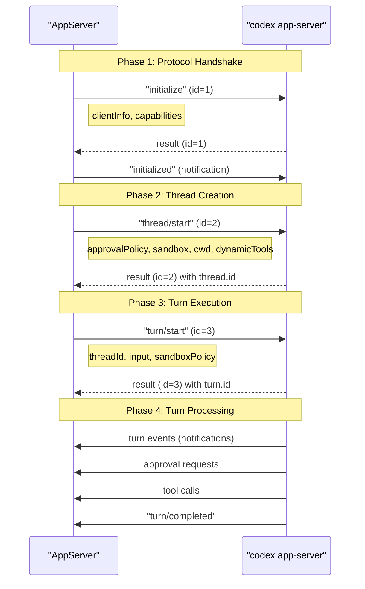
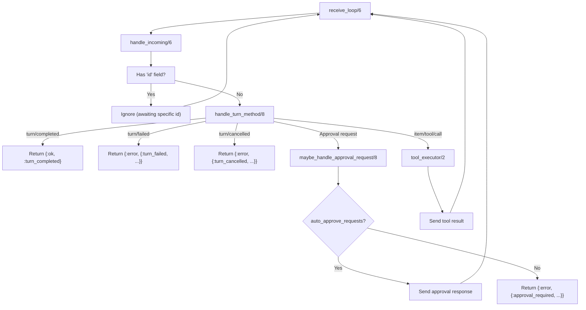
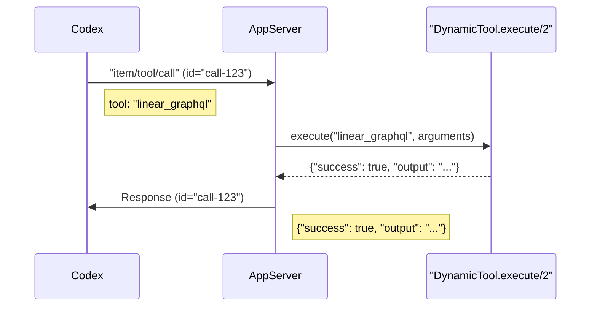

<!-- source: DeepWiki mcp.deepwiki.com · repo openai/symphony · page 5.1 AppServer Protocol · fetched 2026-10-26 -->

# AppServer Protocol

<details>
<summary>Relevant source files</summary>

The following files were used as context for generating this wiki page:

- [SPEC.md](SPEC.md)
- [elixir/lib/symphony_elixir/codex/app_server.ex](elixir/lib/symphony_elixir/codex/app_server.ex)
- [elixir/test/support/test_support.exs](elixir/test/support/test_support.exs)
- [elixir/test/symphony_elixir/app_server_test.exs](elixir/test/symphony_elixir/app_server_test.exs)

</details>


This document describes the JSON-RPC 2.0 protocol used by Symphony's `AppServer` module to communicate with the Codex AI agent binary. It covers message format, initialization sequences, turn lifecycle events, approval handling, and dynamic tool execution.

For information about session lifecycle management, continuation logic, and stall detection, see [Session and Turn Management](5.2). For details on specific dynamic tool implementations like `linear_graphql`, see [Dynamic Tools](5.3). For approval policies and sandbox configurations, see [Approval and Sandbox Policies](5.4).

---

## Protocol Overview

The `AppServer` implements a **JSON-RPC 2.0** client that communicates with the `codex app-server` process over **newline-delimited JSON on stdio** [elixir/lib/symphony_elixir/codex/app_server.ex:1-4](). The protocol is bidirectional:

- **Symphony → Codex**: Requests with `id` field (expecting responses), initialization messages [elixir/lib/symphony_elixir/codex/app_server.ex:241-327]().
- **Codex → Symphony**: Responses with matching `id`, notifications without `id` (approval requests, tool calls, turn events) [elixir/lib/symphony_elixir/codex/app_server.ex:364-439]().

All messages are UTF-8 JSON objects terminated by newlines (`\n`). The protocol does not support batching—each line is a single JSON-RPC message [elixir/lib/symphony_elixir/codex/app_server.ex:12]().

**Sources:** [elixir/lib/symphony_elixir/codex/app_server.ex:1-4](), [elixir/lib/symphony_elixir/codex/app_server.ex:12](), [elixir/lib/symphony_elixir/codex/app_server.ex:241-327](), [elixir/lib/symphony_elixir/codex/app_server.ex:364-439]()

---

## Transport Layer

### Port Communication

The protocol runs over an **Erlang port** connected to the Codex process. The port configuration depends on the deployment mode [elixir/lib/symphony_elixir/codex/app_server.ex:192-223]():

| Deployment Mode | Port Type | Command |
|-----------------|-----------|---------|
| Local execution | `spawn_executable` bash | `Config.settings!().codex.command` in workspace directory |
| Remote SSH worker | `SSH.start_port/3` | `cd {workspace} && exec {codex_command}` via SSH |

**Port Options:**
- `:binary` mode for UTF-8 handling [elixir/lib/symphony_elixir/codex/app_server.ex:202]().
- `:exit_status` monitoring for process termination [elixir/lib/symphony_elixir/codex/app_server.ex:203]().
- `:stderr_to_stdout` to capture all output [elixir/lib/symphony_elixir/codex/app_server.ex:204]().
- `line: 1_048_576` for line buffering with 1MB max per line [elixir/lib/symphony_elixir/codex/app_server.ex:12]().

**Sources:** [elixir/lib/symphony_elixir/codex/app_server.ex:12](), [elixir/lib/symphony_elixir/codex/app_server.ex:192-223]()

### Message Framing

Messages are **newline-delimited**. The receive loop accumulates partial chunks until a complete line is received [elixir/lib/symphony_elixir/codex/app_server.ex:340-362]():

- `{:data, {:eol, chunk}}` → Complete line, parse immediately.
- `{:data, {:noeol, chunk}}` → Partial line, buffer and continue.
- `{:exit_status, status}` → Port terminated.

Non-JSON lines are logged but do not terminate the session unless they indicate errors. Lines starting with `{` that fail JSON parsing emit a `:malformed` event [elixir/lib/symphony_elixir/codex/app_server.ex:424-437]().

**Sources:** [elixir/lib/symphony_elixir/codex/app_server.ex:340-362](), [elixir/lib/symphony_elixir/codex/app_server.ex:424-437]()

---

## Initialization Sequence

The session begins with a four-step initialization before the first turn can start [elixir/lib/symphony_elixir/codex/app_server.ex:225-239]().

**Diagram: Initialization Sequence and Thread Management**



**Sources:** [elixir/lib/symphony_elixir/codex/app_server.ex:225-327]()

### Step 1: Initialize Request

Symphony sends the `initialize` request with `id: 1` to establish protocol capabilities [elixir/lib/symphony_elixir/codex/app_server.ex:241-263]().

**Request Payload:**
```json
{
  "method": "initialize",
  "id": 1,
  "params": {
    "capabilities": {
      "experimentalApi": true
    },
    "clientInfo": {
      "name": "symphony-orchestrator",
      "title": "Symphony Orchestrator",
      "version": "0.1.0"
    }
  }
}
```

After receiving the response, Symphony immediately sends the `initialized` notification [elixir/lib/symphony_elixir/codex/app_server.ex:265-271]().

**Sources:** [elixir/lib/symphony_elixir/codex/app_server.ex:241-271]()

### Step 2: Thread Start Request

Symphony sends `thread/start` with `id: 2` to create a conversation thread [elixir/lib/symphony_elixir/codex/app_server.ex:280-302]().

**Request Payload:**
```json
{
  "method": "thread/start",
  "id": 2,
  "params": {
    "approvalPolicy": "never",
    "sandbox": "workspace-write",
    "cwd": "/path/to/workspace",
    "dynamicTools": [...]
  }
}
```

The `thread.id` is extracted and stored in the `session` for subsequent turns [elixir/lib/symphony_elixir/codex/app_server.ex:48-58]().

**Sources:** [elixir/lib/symphony_elixir/codex/app_server.ex:48-58](), [elixir/lib/symphony_elixir/codex/app_server.ex:280-302]()

### Step 3: Turn Start Request

Symphony sends `turn/start` with `id: 3` to begin agent execution [elixir/lib/symphony_elixir/codex/app_server.ex:304-327]().

**Request Payload:**
```json
{
  "method": "turn/start",
  "id": 3,
  "params": {
    "threadId": "thread-abc123",
    "input": [...],
    "cwd": "/path/to/workspace",
    "approvalPolicy": "never",
    "sandboxPolicy": { ... }
  }
}
```

**Sources:** [elixir/lib/symphony_elixir/codex/app_server.ex:304-327]()

---

## Turn Execution Phase

During turn execution, Codex sends various notifications and requests. Symphony processes these in a `receive_loop/6` with timeout [elixir/lib/symphony_elixir/codex/app_server.ex:329-362]().

**Diagram: AppServer Message Dispatch Logic**



**Sources:** [elixir/lib/symphony_elixir/codex/app_server.ex:329-524]()

### Turn Completion Events

- **Turn Completed**: `method: "turn/completed"` returns `{:ok, :turn_completed}` [elixir/lib/symphony_elixir/codex/app_server.ex:368-372]().
- **Turn Failed**: `method: "turn/failed"` returns `{:error, {:turn_failed, params}}` [elixir/lib/symphony_elixir/codex/app_server.ex:374-380]().
- **Turn Cancelled**: `method: "turn/cancelled"` returns `{:error, {:turn_cancelled, params}}` [elixir/lib/symphony_elixir/codex/app_server.ex:382-388]().

**Sources:** [elixir/lib/symphony_elixir/codex/app_server.ex:368-388]()

---

## Approval Request Handling

Codex sends approval requests when it wants to execute commands or modify files. Symphony's handling depends on the `auto_approve_requests` flag [elixir/lib/symphony_elixir/codex/app_server.ex:526-538]().

### Approval Request Types

| Method | Decision Value (auto-approve) | Use Case |
|--------|------------------------------|----------|
| `item/commandExecution/requestApproval` | `"acceptForSession"` | Command execution [elixir/lib/symphony_elixir/codex/app_server.ex:595-608]() |
| `execCommandApproval` | `"approved_for_session"` | Legacy command execution [elixir/lib/symphony_elixir/codex/app_server.ex:610-621]() |
| `item/fileChange/requestApproval` | `"acceptForSession"` | File modifications [elixir/lib/symphony_elixir/codex/app_server.ex:623-635]() |
| `applyPatchApproval` | `"approved_for_session"` | Legacy patch application [elixir/lib/symphony_elixir/codex/app_server.ex:637-647]() |

**Sources:** [elixir/lib/symphony_elixir/codex/app_server.ex:595-647]()

---

## Dynamic Tool Execution

When Codex calls a dynamic tool, Symphony executes it via the `tool_executor` and returns the result [elixir/lib/symphony_elixir/codex/app_server.ex:548-581]().

**Sequence: Dynamic Tool Flow**


**Sources:** [elixir/lib/symphony_elixir/codex/app_server.ex:548-581](), [elixir/lib/symphony_elixir/codex/app_server.ex:684-721]()

---

## Error Handling and Timeouts

### Protocol Error Handling

- **Malformed JSON**: Lines starting with `{` that fail parsing emit a `:malformed` event [elixir/lib/symphony_elixir/codex/app_server.ex:424-437]().
- **Turn Timeout**: If no messages are received within `codex_turn_timeout_ms`, the turn fails [elixir/lib/symphony_elixir/codex/app_server.ex:353-356](), [elixir/test/symphony_elixir/app_server_test.exs:79-166]().
- **Input Required**: If `auto_approve_requests` is false and an approval is requested, it returns `{:error, {:approval_required, ...}}` [elixir/lib/symphony_elixir/codex/app_server.ex:536]().

**Sources:** [elixir/lib/symphony_elixir/codex/app_server.ex:353-356](), [elixir/lib/symphony_elixir/codex/app_server.ex:424-437](), [elixir/lib/symphony_elixir/codex/app_server.ex:536](), [elixir/test/symphony_elixir/app_server_test.exs:79-166]()

### Validation: Workspace Guard

The `AppServer` validates the workspace path using `PathSafety.canonicalize/1` to ensure it is within the `Config.local_workspace_root()` and prevents symlink escapes [elixir/lib/symphony_elixir/codex/app_server.ex:150-176](), [elixir/test/symphony_elixir/app_server_test.exs:4-77]().

**Sources:** [elixir/lib/symphony_elixir/codex/app_server.ex:150-176](), [elixir/test/symphony_elixir/app_server_test.exs:4-77]()

---

## Code Entities Reference

### Core Functions

- `AppServer.start_session/2`: Initializes the port and thread [elixir/lib/symphony_elixir/codex/app_server.ex:38-69]().
- `AppServer.run_turn/4`: Manages the turn lifecycle and message loop [elixir/lib/symphony_elixir/codex/app_server.ex:71-143]().
- `AppServer.stop_session/1`: Terminates the port [elixir/lib/symphony_elixir/codex/app_server.ex:145-148]().
- `receive_loop/6`: Core Erlang `receive` loop for port data [elixir/lib/symphony_elixir/codex/app_server.ex:329-362]().
- `handle_incoming/6`: JSON parsing and RPC dispatch logic [elixir/lib/symphony_elixir/codex/app_server.ex:364-439]().

**Sources:** [elixir/lib/symphony_elixir/codex/app_server.ex:38-439]()

---

