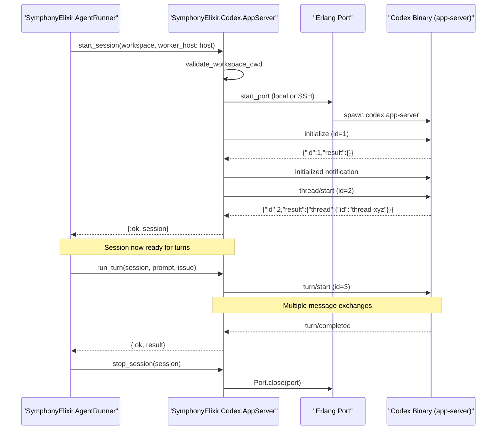
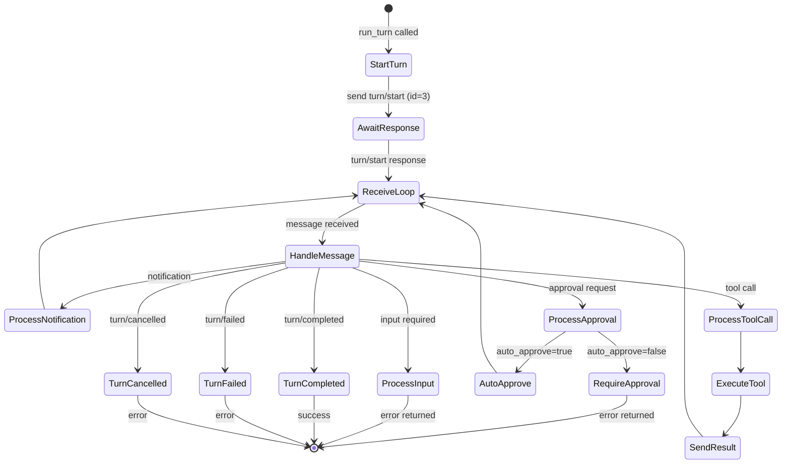
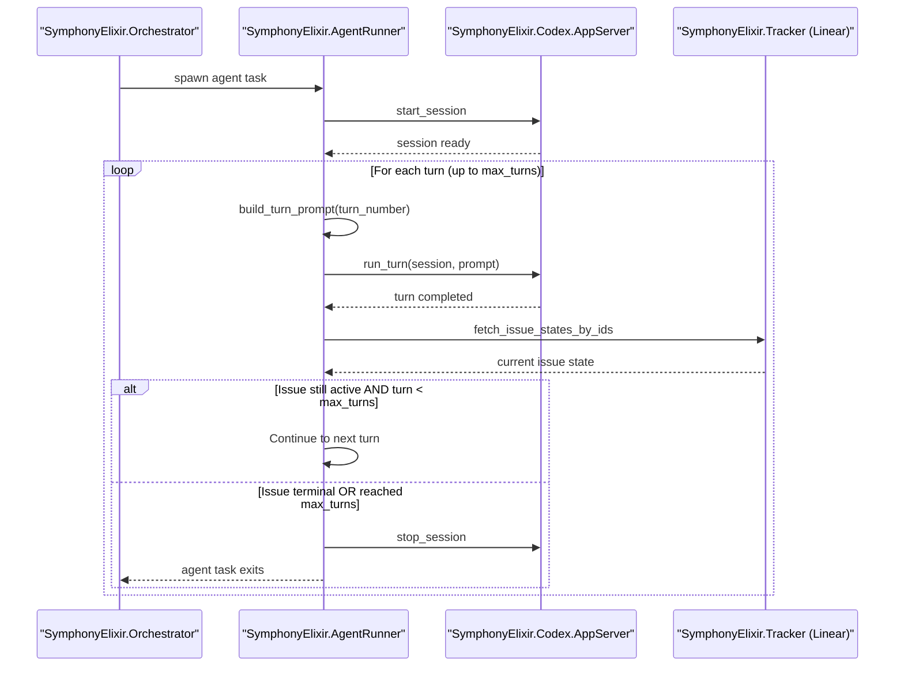
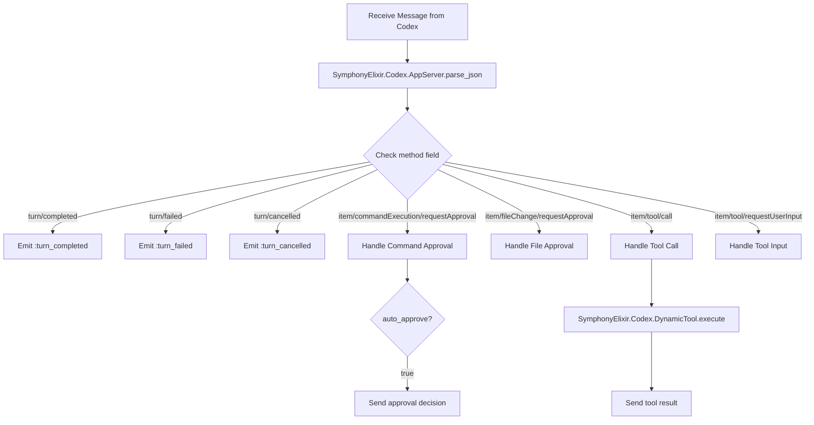

<!-- source: DeepWiki mcp.deepwiki.com · repo openai/symphony · page 5.2 Session and Turn Management · fetched 2026-10-26 -->

# Session and Turn Management

<details>
<summary>Relevant source files</summary>

The following files were used as context for generating this wiki page:

- [elixir/lib/symphony_elixir/codex/app_server.ex](elixir/lib/symphony_elixir/codex/app_server.ex)
- [elixir/lib/symphony_elixir/orchestrator.ex](elixir/lib/symphony_elixir/orchestrator.ex)
- [elixir/test/symphony_elixir/app_server_test.exs](elixir/test/symphony_elixir/app_server_test.exs)
- [elixir/test/symphony_elixir/core_test.exs](elixir/test/symphony_elixir/core_test.exs)

</details>


This document explains how Symphony manages Codex agent sessions and turn-based execution. A **session** represents a single Codex `app-server` process with a persistent thread, while a **turn** is an individual interaction within that session where the agent receives a prompt and produces a response. Sessions can span multiple turns, enabling agents to maintain context and continue work across iterations.

For details on the JSON-RPC protocol messages exchanged during sessions, see [AppServer Protocol](5.1). For information on dynamic tool execution and approval workflows, see [Dynamic Tools](5.3) and [Approval and Sandbox Policies](5.4).

---

## Session Lifecycle

A Codex session begins when Symphony spawns a `codex app-server` process (either locally or over SSH) and performs a handshake to establish a persistent thread. The session remains active across multiple turns until the agent completes its work or encounters a terminal condition.

### Session Creation Flow



**Sources:** [elixir/lib/symphony_elixir/codex/app_server.ex:39-67](), [elixir/lib/symphony_elixir/codex/app_server.ex:192-210](), [elixir/lib/symphony_elixir/codex/app_server.ex:241-263]()

### Session State Structure

A session is represented as a map containing all necessary context for turn execution:

| Field | Type | Description |
|-------|------|-------------|
| `port` | `port()` | Erlang port connected to Codex process |
| `metadata` | `map()` | Process metadata (PID, worker_host) |
| `approval_policy` | `String.t()` \| `map()` | Approval policy from config |
| `auto_approve_requests` | `boolean()` | True if policy is "never" |
| `thread_sandbox` | `String.t()` | Thread-level sandbox policy |
| `turn_sandbox_policy` | `map()` | Turn-level sandbox policy map |
| `thread_id` | `String.t()` | Persistent thread ID from Codex |
| `workspace` | `Path.t()` | Canonicalized workspace path |
| `worker_host` | `String.t()` \| `nil` | SSH host or nil for local |

**Sources:** [elixir/lib/symphony_elixir/codex/app_server.ex:14-25](), [elixir/lib/symphony_elixir/codex/app_server.ex:50-62]()

### Initialization Protocol

The initialization sequence follows the Codex app-server protocol:

1. **Initialize Request** (`id=1`): Send client capabilities and metadata [elixir/lib/symphony_elixir/codex/app_server.ex:241-263]()
2. **Initialize Response**: Await acknowledgment from Codex [elixir/lib/symphony_elixir/codex/app_server.ex:265-271]()
3. **Initialized Notification**: Confirm initialization complete [elixir/lib/symphony_elixir/codex/app_server.ex:273-278]()
4. **Thread Start** (`id=2`): Create persistent thread with sandbox and approval policies [elixir/lib/symphony_elixir/codex/app_server.ex:280-302]()
5. **Thread Response**: Receive `thread_id` for subsequent turns [elixir/lib/symphony_elixir/codex/app_server.ex:304-327]()

---

## Turn Lifecycle

A **turn** is a single prompt-response cycle within a session. Symphony starts a turn, processes streaming messages from Codex, and awaits a terminal event (`turn/completed`, `turn/failed`, or `turn/cancelled`).

### Turn Execution Flow



**Sources:** [elixir/lib/symphony_elixir/codex/app_server.ex:71-143](), [elixir/lib/symphony_elixir/codex/app_server.ex:340-362]()

### Turn Start Parameters

When starting a turn, Symphony sends the following parameters to Codex:

```json
{
  "jsonrpc": "2.0",
  "id": 3,
  "method": "turn/start",
  "params": {
    "threadId": "thread-xyz",
    "input": [{"type": "text", "text": "<prompt>"}],
    "cwd": "/path/to/workspace",
    "title": "ISSUE-123: Title",
    "approvalPolicy": "never",
    "sandboxPolicy": {"type": "workspaceWrite", "writableRoots": ["..."]}
  }
}
```

**Sources:** [elixir/lib/symphony_elixir/codex/app_server.ex:304-327]()

### Message Processing Loop

The turn awaits completion by processing streaming messages from Codex. The receive loop handles:

- **Line buffering**: Messages are newline-delimited; partial lines are buffered [elixir/lib/symphony_elixir/codex/app_server.ex:364-438]()
- **JSON decoding**: Each line is parsed as JSON [elixir/lib/symphony_elixir/codex/app_server.ex:376-383]()
- **Method routing**: Messages are routed by `method` field [elixir/lib/symphony_elixir/codex/app_server.ex:454-524]()
- **Timeout enforcement**: Managed via `receive` block timeouts [elixir/lib/symphony_elixir/codex/app_server.ex:358-361]()

---

## Multi-turn Execution

Symphony supports **multi-turn execution** where an agent can continue working on an issue across multiple turns within the same session. This enables long-running tasks that exceed the scope of a single turn.

### Multi-turn Coordination



**Sources:** [elixir/lib/symphony_elixir/orchestrator.ex:212-224](), [elixir/lib/symphony_elixir/orchestrator.ex:226-231]()

### Turn Prompts

The first turn receives the full task prompt built from `WORKFLOW.md`, while continuation turns receive a condensed guidance message. The `Orchestrator` schedules continuation checks when an agent task finishes normally if the issue is still in an active state [elixir/lib/symphony_elixir/orchestrator.ex:212-224]().

### Issue State Checking

The `Orchestrator` handles agent completion by checking if the issue requires continuation. If the issue remains in an active state, it schedules a continuation retry [elixir/lib/symphony_elixir/orchestrator.ex:215-223]().

---

## Message Handling During Turns

During turn execution, Symphony processes various message types from Codex, handling approvals, tool calls, and notifications in real-time.

### Message Type Routing



**Sources:** [elixir/lib/symphony_elixir/codex/app_server.ex:454-524](), [elixir/lib/symphony_elixir/codex/app_server.ex:548-581]()

### Approval Request Handling

When Codex requests approval for a command or file change, Symphony's behavior depends on the `auto_approve_requests` boolean derived from the configuration:

| Policy | Behavior |
|--------|----------|
| `"never"` | Auto-approve with `acceptForSession` decision [elixir/lib/symphony_elixir/codex/app_server.ex:55](), [elixir/lib/symphony_elixir/codex/app_server.ex:526-546]() |
| Other | Return `{:error, {:approval_required, payload}}` [elixir/lib/symphony_elixir/codex/app_server.ex:544]() |

### Tool Call Execution

Dynamic tool calls are handled synchronously:

1. Extract tool name and arguments from `item/tool/call` [elixir/lib/symphony_elixir/codex/app_server.ex:548-554]()
2. Execute tool via `tool_executor` (default: `DynamicTool.execute/2`) [elixir/lib/symphony_elixir/codex/app_server.ex:89-92]()
3. Send result back to Codex via JSON-RPC [elixir/lib/symphony_elixir/codex/app_server.ex:569-581]()

---

## Timeout and Stall Detection

Symphony employs multiple timeout mechanisms to detect and handle stalled Codex processes.

### Timeout Handling

The `await_turn_completion/4` function uses a `receive` block with a configurable timeout.

- **Port Exit Detection**: If the Codex process exits, the port sends an `{:exit_status, status}` message [elixir/lib/symphony_elixir/codex/app_server.ex:356-357]().
- **Turn Timeout**: If no messages are received within the timeout window, Symphony returns `{:error, :turn_timeout}` [elixir/lib/symphony_elixir/codex/app_server.ex:358-361](). This is validated in tests where silent turns trigger the timeout [elixir/test/symphony_elixir/app_server_test.exs:158-162]().

---

## Session Cleanup

Sessions are cleaned up deterministically using Elixir's `try...after` blocks to ensure resources are released even when errors occur.

### Cleanup Sequence

In `AppServer.run/4`, the session is started and then wrapped in a `try...after` to ensure `stop_session(session)` is always called [elixir/lib/symphony_elixir/codex/app_server.ex:28-35]().

### Port Cleanup

The `stop_session/1` function safely closes the Erlang port [elixir/lib/symphony_elixir/codex/app_server.ex:145-148](). This terminates the local process or the SSH connection used for the agent workspace.

---

## Event Emission

Throughout session and turn execution, Symphony emits structured events via the `on_message` callback, enabling observability and real-time monitoring.

### Event Types

- **`:session_started`**: Emitted when `run_turn` begins [elixir/lib/symphony_elixir/codex/app_server.ex:99-108]().
- **`:turn_ended_with_error`**: Emitted if the receive loop crashes or times out [elixir/lib/symphony_elixir/codex/app_server.ex:125-133]().
- **`:startup_failed`**: Emitted if the `turn/start` call itself fails [elixir/lib/symphony_elixir/codex/app_server.ex:140]().

**Sources:** [elixir/lib/symphony_elixir/codex/app_server.ex:94-143]()

---

