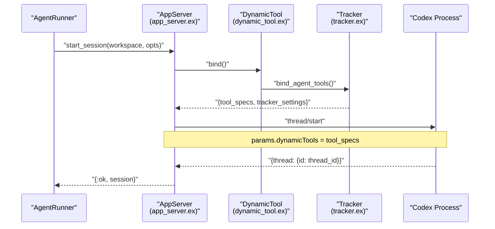
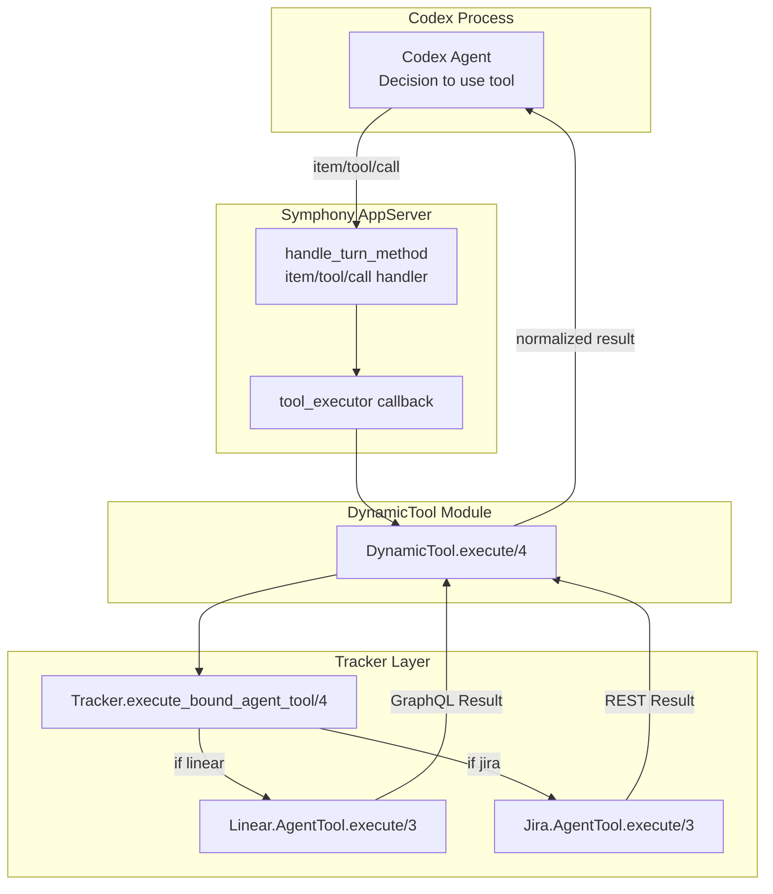

<!-- source: DeepWiki mcp.deepwiki.com · repo openai/symphony · page 5.3 Dynamic Tools · fetched 2026-10-26 -->

# Dynamic Tools

Relevant source files

The following files were used as context for generating this wiki page:

- [elixir/lib/symphony_elixir/codex/dynamic_tool.ex](elixir/lib/symphony_elixir/codex/dynamic_tool.ex)
- [elixir/lib/symphony_elixir/jira/adapter.ex](elixir/lib/symphony_elixir/jira/adapter.ex)
- [elixir/lib/symphony_elixir/jira/agent_tool.ex](elixir/lib/symphony_elixir/jira/agent_tool.ex)
- [elixir/lib/symphony_elixir/jira/client.ex](elixir/lib/symphony_elixir/jira/client.ex)
- [elixir/lib/symphony_elixir/linear/agent_tool.ex](elixir/lib/symphony_elixir/linear/agent_tool.ex)
- [elixir/test/symphony_elixir/dynamic_tool_test.exs](elixir/test/symphony_elixir/dynamic_tool_test.exs)
- [elixir/test/symphony_elixir/jira_adapter_test.exs](elixir/test/symphony_elixir/jira_adapter_test.exs)
- [elixir/test/symphony_elixir/jira_live_e2e_test.exs](elixir/test/symphony_elixir/jira_live_e2e_test.exs)

Dynamic tools enable Codex agents to execute client-side operations during their sessions. Symphony advertises available tools during session initialization, and Codex can invoke them through the `item/tool/call` JSON-RPC method. The system primarily supports `linear_graphql` and `jira_rest`, allowing agents to interact directly with issue trackers using Symphony's configured authentication.

---

## Tool Advertisement

During Codex session initialization, Symphony advertises available dynamic tools by including their specifications in the `thread/start` request parameters. The `Tracker.bind_agent_tools/0` function (invoked via [`DynamicTool.bind/0`](elixir/lib/symphony_elixir/codex/dynamic_tool.ex:14-16)) returns a binding that contains tool specifications conforming to the Codex tool schema.

Each tool specification includes:
- `name`: Unique tool identifier (e.g., `linear_graphql` or `jira_rest`).
- `description`: Human-readable explanation of the tool's purpose.
- `inputSchema`: JSON Schema defining the expected input format.

**Tool Advertisement in Session Startup**

The tool specifications are bound at session start to ensure they use the correct tracker configuration for the duration of the session [elixir/lib/symphony_elixir/codex/dynamic_tool.ex:13-16]().

**Sources:**
- [elixir/lib/symphony_elixir/codex/dynamic_tool.ex:13-16]()
- [elixir/lib/symphony_elixir/codex/dynamic_tool.ex:8-11]()
- [elixir/test/symphony_elixir/dynamic_tool_test.exs:46-76]()

---

## Tool Execution Flow

When Codex invokes a dynamic tool, it sends an `item/tool/call` request. Symphony's `AppServer` intercepts this request and delegates to [`DynamicTool.execute/4`](elixir/lib/symphony_elixir/codex/dynamic_tool.ex:8-11), which uses the session's bound tracker to perform the operation.

**Tool Invocation Data Flow**

The execution logic ensures that tool calls are routed to the specific adapter configured for the issue being worked on [elixir/lib/symphony_elixir/codex/dynamic_tool.ex:8-11]().

**Sources:**
- [elixir/lib/symphony_elixir/codex/dynamic_tool.ex:8-11]()
- [elixir/lib/symphony_elixir/linear/agent_tool.ex:30-43]()
- [elixir/lib/symphony_elixir/jira/agent_tool.ex:38-44]()

---

## The linear_graphql Tool

The `linear_graphql` tool enables Codex agents to execute arbitrary GraphQL operations against Linear. This allows agents to query issue details, create comments, or transition issues without Symphony needing a pre-defined API for every possible action.

**Tool Specification and Input**

The tool is defined in [`SymphonyElixir.Linear.AgentTool`](elixir/lib/symphony_elixir/linear/agent_tool.ex:8-27). It accepts:
1. **Object format**: `{"query": "...", "variables": {...}}`
2. **String format**: A raw GraphQL query string.

Input normalization in [`normalize_linear_graphql_arguments/1`](elixir/lib/symphony_elixir/linear/agent_tool.ex:69-92) ensures that even if the agent sends a simple string, it is treated as a valid query with empty variables.

**Execution Logic**

The tool execution follows these steps in [`execute_linear_graphql/2`](elixir/lib/symphony_elixir/linear/agent_tool.ex:56-67):
- **Normalization**: Validates that the query is a non-empty string [elixir/lib/symphony_elixir/linear/agent_tool.ex:94-105]().
- **Client Dispatch**: Calls `SymphonyElixir.Linear.Client.graphql/3` using the session's tracker settings [elixir/lib/symphony_elixir/linear/agent_tool.ex:57-61]().
- **Response Handling**: Returns `success: false` if the GraphQL response contains an `errors` key [elixir/lib/symphony_elixir/linear/agent_tool.ex:114-123]().

**Sources:**
- [elixir/lib/symphony_elixir/linear/agent_tool.ex:8-27]()
- [elixir/lib/symphony_elixir/linear/agent_tool.ex:56-67]()
- [elixir/lib/symphony_elixir/linear/agent_tool.ex:114-123]()
- [elixir/test/symphony_elixir/dynamic_tool_test.exs:78-99]()

---

## The jira_rest Tool

For projects using Jira, Symphony provides the `jira_rest` tool. This tool allows Codex to make authenticated requests to the Jira Cloud REST v3 API [elixir/lib/symphony_elixir/jira/agent_tool.ex:10-12]().

**Tool Specification**

The tool is defined in [`SymphonyElixir.Jira.AgentTool`](elixir/lib/symphony_elixir/jira/agent_tool.ex:8-36):
- **method**: Must be one of `GET`, `POST`, `PUT`, or `DELETE` [elixir/lib/symphony_elixir/jira/agent_tool.ex:82-88]().
- **path**: Must begin with `/rest/api/3/` [elixir/lib/symphony_elixir/jira/agent_tool.ex:89-100]().
- **query**: Optional JSON object for URL parameters.
- **body**: Optional JSON body for write operations.

**Execution and Validation**

The tool performs strict validation on the path and method before dispatching the request via [`SymphonyElixir.Jira.Client.request/5`](elixir/lib/symphony_elixir/jira/agent_tool.ex:58-63). Responses are marked as successful if the HTTP status code is in the `200..299` range [elixir/lib/symphony_elixir/jira/agent_tool.ex:106-108]().

**Sources:**
- [elixir/lib/symphony_elixir/jira/agent_tool.ex:8-36]()
- [elixir/lib/symphony_elixir/jira/agent_tool.ex:89-100]()
- [elixir/lib/symphony_elixir/jira/agent_tool.ex:106-108]()
- [elixir/test/symphony_elixir/jira_adapter_test.exs:62-69]()

---

## Response Format and Normalization

All dynamic tool responses follow a standard structure required by the Codex protocol. This is implemented in helper functions like [`dynamic_tool_response/2`](elixir/lib/symphony_elixir/linear/agent_tool.ex:128-140).

| Field | Type | Description |
| :--- | :--- | :--- |
| `success` | boolean | Indicates if the operation was logically successful (e.g., no GraphQL errors, 2xx HTTP status). |
| `output` | string | A JSON-encoded string containing the full response payload or error details. |
| `contentItems` | list | A list containing an `inputText` item with the output string for Codex to read. |

If an agent attempts to call a tool that is not supported by the current adapter, the system returns a failure response listing the available tools [elixir/lib/symphony_elixir/linear/agent_tool.ex:35-42]().

**Sources:**
- [elixir/lib/symphony_elixir/linear/agent_tool.ex:128-140]()
- [elixir/lib/symphony_elixir/jira/agent_tool.ex:112-118]()
- [elixir/lib/symphony_elixir/linear/agent_tool.ex:35-42]()

---

## Error Handling

Symphony categorizes tool errors to provide Codex with actionable feedback. Common error scenarios include:

1.  **Missing Authentication**: Returned if the `api_token` (Linear) or `api_token` (Jira) is missing from the configuration [elixir/lib/symphony_elixir/linear/agent_tool.ex:172-178](), [elixir/lib/symphony_elixir/jira/agent_tool.ex:152-158]().
2.  **Invalid Arguments**: Returned if the query is empty or variables are not an object [elixir/lib/symphony_elixir/linear/agent_tool.ex:148-170]().
3.  **Upstream Failures**: Captures HTTP status errors or network timeouts during API requests [elixir/lib/symphony_elixir/linear/agent_tool.ex:180-196]().

**Sources:**
- [elixir/lib/symphony_elixir/linear/agent_tool.ex:147-205]()
- [elixir/lib/symphony_elixir/jira/agent_tool.ex:136-171]()

---

