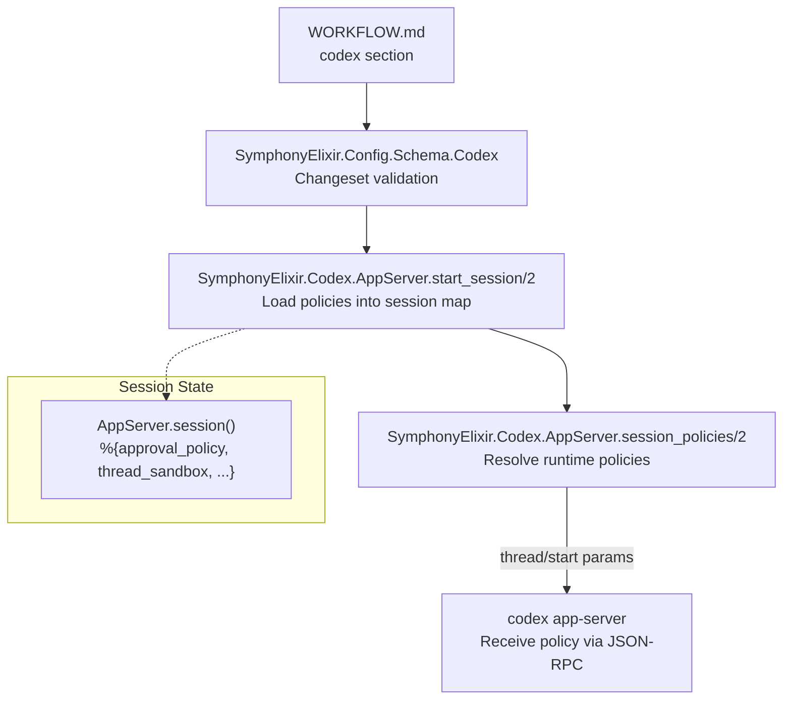
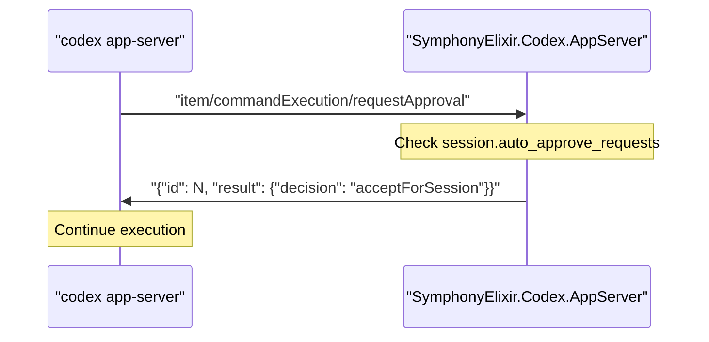
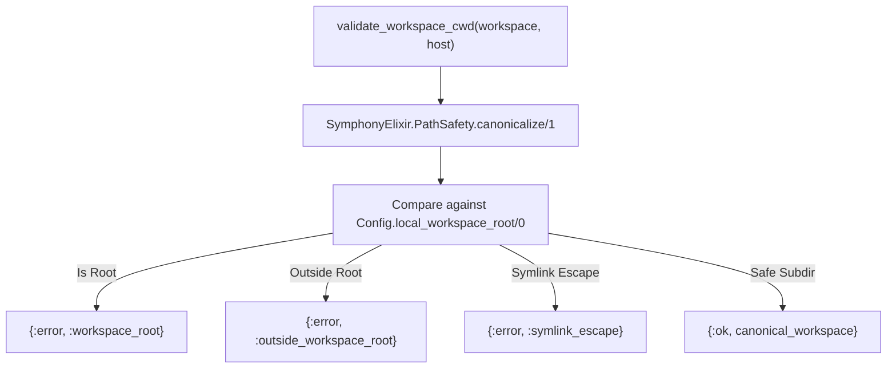

<!-- source: DeepWiki mcp.deepwiki.com · repo openai/symphony · page 5.4 Approval and Sandbox Policies · fetched 2026-10-26 -->

# Approval and Sandbox Policies

<details>
<summary>Relevant source files</summary>

The following files were used as context for generating this wiki page:

- [elixir/lib/symphony_elixir/agent_runner.ex](elixir/lib/symphony_elixir/agent_runner.ex)
- [elixir/lib/symphony_elixir/codex/app_server.ex](elixir/lib/symphony_elixir/codex/app_server.ex)
- [elixir/lib/symphony_elixir/config/schema.ex](elixir/lib/symphony_elixir/config/schema.ex)
- [elixir/lib/symphony_elixir/linear/client.ex](elixir/lib/symphony_elixir/linear/client.ex)
- [elixir/test/symphony_elixir/app_server_test.exs](elixir/test/symphony_elixir/app_server_test.exs)
- [elixir/test/symphony_elixir/workspace_and_config_test.exs](elixir/test/symphony_elixir/workspace_and_config_test.exs)

</details>


This page documents Symphony's approval and sandbox policy system for controlling Codex agent behavior. These policies determine what actions require human approval, what the agent can access and modify, and how the system handles requests that would otherwise block execution in a non-interactive environment.

For details on the JSON-RPC protocol used to communicate these policies to Codex, see [5.1 AppServer Protocol](). For information on dynamic tools that may trigger approval prompts, see [5.3 Dynamic Tools]().

---

## Overview

Symphony runs Codex agents in non-interactive sessions where human input is unavailable. The approval and sandbox policy system provides three layers of control:

1.  **Approval Policy**: Determines whether command executions and file modifications require interactive approval.
2.  **Thread Sandbox**: Configures workspace-level access controls for the entire Codex thread.
3.  **Turn Sandbox Policy**: Specifies per-turn sandbox constraints (workspace roots, network access, external profiles).

These policies are configured in `WORKFLOW.md` and passed through to Codex during session initialization. Symphony handles approval requests and user input prompts according to the configured policy, ensuring agents can continue execution without stalling.

**Sources**: [elixir/lib/symphony_elixir/codex/app_server.ex:14-25](), [elixir/lib/symphony_elixir/config/schema.ex:180-198]()

---

## Configuration Schema

### WORKFLOW.md Fields

Approval and sandbox policies are defined in the `codex` section of `WORKFLOW.md`. The `SymphonyElixir.Config.Schema.Codex` module defines the defaults and validation for these fields.

| Field | Type | Description | Default |
| :--- | :--- | :--- | :--- |
| `approval_policy` | `StringOrMap` | Controls when approval is required. | `reject` (sandbox, rules, mcp) |
| `thread_sandbox` | `String` | Thread-level sandbox mode. | `"workspace-write"` |
| `turn_sandbox_policy` | `Map` | Per-turn sandbox policy object. | `nil` |

**Sources**: [elixir/lib/symphony_elixir/config/schema.ex:180-198](), [elixir/lib/symphony_elixir/config/schema.ex:17-41]()

---

## Configuration Flow

The following diagram bridges the Natural Language configuration space to the Elixir code entities that manage policy flow.



**Configuration Resolution Steps**:
1.  `SymphonyElixir.Config.Schema.Codex.changeset/2` validates the `WORKFLOW.md` fields [elixir/lib/symphony_elixir/config/schema.ex:200-227]().
2.  `AppServer.start_session/2` invokes `session_policies/2` to gather configured values [elixir/lib/symphony_elixir/codex/app_server.ex:39-69]().
3.  The resulting `session` map stores `auto_approve_requests` (boolean) based on whether the policy is set to `"never"` [elixir/lib/symphony_elixir/codex/app_server.ex:51-62]().
4.  `AppServer.run_turn/4` invokes `start_turn/7` which forwards the `turn_sandbox_policy` to the Codex process [elixir/lib/symphony_elixir/codex/app_server.ex:72-94]().

**Sources**: [elixir/lib/symphony_elixir/codex/app_server.ex:39-69](), [elixir/lib/symphony_elixir/config/schema.ex:200-227]()

---

## Approval Policy Behavior

### Default Behavior: Reject Approvals

Symphony's default configuration explicitly rejects approval requests to prevent agents from stalling. The `SymphonyElixir.Config.Schema.Codex` module sets a default map that rejects sandbox approvals, rules, and MCP elicitations [elixir/lib/symphony_elixir/config/schema.ex:183-191]().

When Codex sends a request requiring approval:
1.  `AppServer.await_turn_completion/4` receives the message.
2.  If `auto_approve_requests` is `false`, the system does not automatically accept.
3.  The turn fails, and `AppServer` returns `{:error, reason}` [elixir/lib/symphony_elixir/codex/app_server.ex:110-136]().

**Sources**: [elixir/lib/symphony_elixir/config/schema.ex:183-191](), [elixir/lib/symphony_elixir/codex/app_server.ex:110-136]()

### Auto-Approval Mode

Setting `approval_policy: "never"` enables auto-approval. This sets `auto_approve_requests: true` in the `AppServer` session [elixir/lib/symphony_elixir/codex/app_server.ex:55]().



**Sources**: [elixir/lib/symphony_elixir/codex/app_server.ex:51-62](), [elixir/lib/symphony_elixir/codex/app_server.ex:110-136]()

---

## Turn Sandbox Policy

### Policy Passthrough

Symphony supports passing complex sandbox objects to Codex. The `SymphonyElixir.AppServerTest` validates that policies like `externalSandbox` or `workspaceWrite` with `writableRoots` are forwarded unchanged [elixir/test/symphony_elixir/app_server_test.exs:168-188]().

**Example Config**:
```yaml
codex:
  turn_sandbox_policy:
    type: "workspaceWrite"
    writableRoots: ["relative/path"]
    networkAccess: true
```

**Sources**: [elixir/test/symphony_elixir/app_server_test.exs:168-188](), [elixir/lib/symphony_elixir/config/schema.ex:194]()

---

## Tool Approval and Input Handling

### User Input Requests

When a tool requests input via `item/tool/requestUserInput`, Symphony provides automated responses to avoid hanging the session.

1.  **Approval Questions**: If `auto_approve_requests` is enabled, Symphony responds with `"Approve this Session"`.
2.  **Freeform Questions**: Symphony responds with a standard string defined in `AppServer`: `"This is a non-interactive session. Operator input is unavailable."`.

**Sources**: [elixir/lib/symphony_elixir/codex/app_server.ex:110-136]()

---

## Workspace Safety Enforcement

### Path Validation Logic

Before starting a Codex session, `AppServer` performs rigorous path validation in `validate_workspace_cwd/2` to ensure the agent cannot operate outside the designated workspace root [elixir/lib/symphony_elixir/codex/app_server.ex:150-176]().



**Validation Constraints**:
- **Workspace Root Protection**: The agent cannot run directly in the root workspace folder [elixir/lib/symphony_elixir/codex/app_server.ex:159-161]().
- **Containment**: The workspace must be a child of the root [elixir/lib/symphony_elixir/codex/app_server.ex:163-164]().
- **Symlink Safety**: If a path is inside the root but its canonical (resolved) path is outside, it is rejected as a `:symlink_escape` [elixir/lib/symphony_elixir/codex/app_server.ex:166-167]().

**Sources**: [elixir/lib/symphony_elixir/codex/app_server.ex:150-176](), [elixir/test/symphony_elixir/app_server_test.exs:4-40]()

---

## Request Handling Matrix

Symphony maps Codex JSON-RPC requests to specific internal behaviors:

| Codex Request Method | Elixir Handler/Logic | Outcome |
| :--- | :--- | :--- |
| `item/commandExecution/requestApproval` | `auto_approve_requests` check | Auto-approve if `"never"`, else fail. |
| `item/tool/requestUserInput` | `AppServer` non-interactive response | Returns automated approval or "Operator input unavailable". |
| `turn/input_required` | `await_turn_completion/4` | Hard failure; session cannot proceed. |

**Sources**: [elixir/lib/symphony_elixir/codex/app_server.ex:110-136](), [elixir/test/symphony_elixir/app_server_test.exs:79-166]()

---

