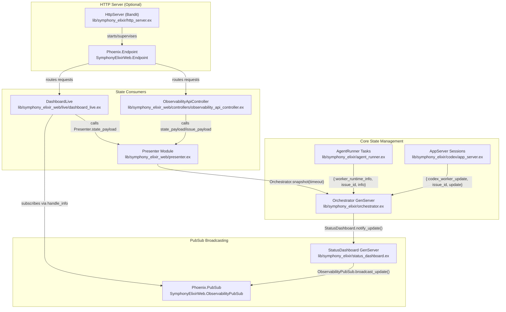
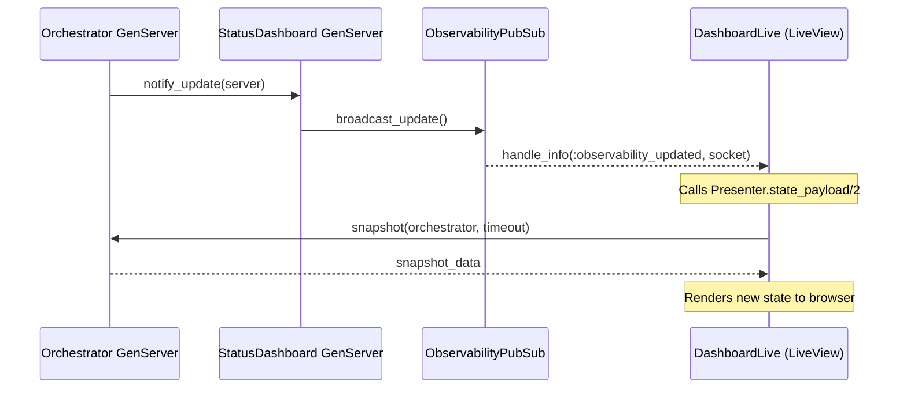

<!-- source: DeepWiki mcp.deepwiki.com · repo openai/symphony · page 6 Observability · fetched 2026-10-26 -->

# Observability

<details>
<summary>Relevant source files</summary>

The following files were used as context for generating this wiki page:

- [elixir/lib/symphony_elixir/status_dashboard.ex](elixir/lib/symphony_elixir/status_dashboard.ex)
- [elixir/lib/symphony_elixir_web/controllers/static_asset_controller.ex](elixir/lib/symphony_elixir_web/controllers/static_asset_controller.ex)
- [elixir/lib/symphony_elixir_web/live/dashboard_live.ex](elixir/lib/symphony_elixir_web/live/dashboard_live.ex)
- [elixir/lib/symphony_elixir_web/presenter.ex](elixir/lib/symphony_elixir_web/presenter.ex)
- [elixir/lib/symphony_elixir_web/router.ex](elixir/lib/symphony_elixir_web/router.ex)
- [elixir/priv/static/favicon.png](elixir/priv/static/favicon.png)

</details>


Symphony provides comprehensive real-time monitoring capabilities through an optional Phoenix HTTP server that exposes both a LiveView dashboard and REST API endpoints. The observability system tracks running agents, token usage, rate limits, retry attempts, and system state, broadcasting updates via Phoenix PubSub to connected clients.

For information about the core orchestration loop that generates the observable state, see [Orchestrator](#4.1). For details on Phoenix configuration and HTTP server setup, see [Phoenix LiveView Dashboard](#6.1) and [REST API](#6.2).

---

## Architecture Overview

Symphony's observability layer operates independently from the core orchestration logic, consuming state snapshots and broadcasting updates without blocking the main polling loop. All observability features are optional and can be disabled by omitting HTTP server configuration.



**Sources:** [elixir/lib/symphony_elixir/status_dashboard.ex:1-95](), [elixir/lib/symphony_elixir_web/presenter.ex:1-50](), [elixir/lib/symphony_elixir_web/live/dashboard_live.ex:1-38](), [elixir/lib/symphony_elixir_web/router.ex:31-41]()

---

## State Snapshot Model

The `Orchestrator` maintains authoritative runtime state and provides synchronous snapshots via the `snapshot/2` function. Snapshots capture the complete system state at a point in time without blocking the orchestration loop.

### Orchestrator State Structure

The `SymphonyElixirWeb.Presenter` transforms these snapshots into a structured payload for the UI and API.

| Field | Description |
|-------|-------------|
| `running` | List of active agent tasks with token usage and last event details [elixir/lib/symphony_elixir_web/presenter.ex:17-21]() |
| `retrying` | List of issues scheduled for retry with backoff timers [elixir/lib/symphony_elixir_web/presenter.ex:18-22]() |
| `blocked` | Issues paused for operator input or approval policies [elixir/lib/symphony_elixir_web/presenter.ex:19-23]() |
| `codex_totals` | Cumulative input, output, and total token usage [elixir/lib/symphony_elixir_web/presenter.ex:24]() |
| `rate_limits` | Most recent upstream rate-limit headers from Codex [elixir/lib/symphony_elixir_web/presenter.ex:25]() |

**Sources:** [elixir/lib/symphony_elixir_web/presenter.ex:8-34](), [elixir/lib/symphony_elixir_web/presenter.ex:102-122]()

### Running Entry Structure

Each entry in the `running` list contains detailed metadata about an active agent session, projected for consumption by the `Presenter`:

```elixir
%{
  issue_id: entry.issue_id,                    # Internal issue ID
  issue_identifier: entry.identifier,          # Human ID (e.g., "MT-123")
  state: entry.state,                          # Current orchestration state
  worker_host: entry.worker_host,              # SSH worker host or nil
  workspace_path: entry.workspace_path,        # Workspace directory
  session_id: entry.session_id,                # Codex thread ID
  turn_count: entry.turn_count,                # Turns executed
  last_event: entry.last_codex_event,          # Last event type symbol
  last_message: summarize_message(msg),        # Summarized message string
  started_at: iso8601(entry.started_at),       # ISO8601 start time
  tokens: %{
    input_tokens: entry.codex_input_tokens,
    output_tokens: entry.codex_output_tokens,
    total_tokens: entry.codex_total_tokens
  }
}
```

**Sources:** [elixir/lib/symphony_elixir_web/presenter.ex:102-122](), [elixir/lib/symphony_elixir_web/presenter.ex:154-171]()

---

## State Update Flow

State updates flow from the Codex integration through the `Orchestrator`, which aggregates them. The `StatusDashboard` module then broadcasts notifications to subscribers and manages terminal rendering.



**Sources:** [elixir/lib/symphony_elixir/status_dashboard.ex:83-95](), [elixir/lib/symphony_elixir_web/live/dashboard_live.ex:32-38](), [elixir/lib/symphony_elixir_web/presenter.ex:8-34]()

---

## Token Tracking and Rate Limits

Symphony extracts and aggregates token usage from Codex events, maintaining both per-session and global cumulative totals. This data is exposed through the `codex_totals` and `rate_limits` fields in the system snapshot. The `StatusDashboard` also calculates throughput metrics like Tokens Per Second (TPS).

For detailed information on how token deltas are calculated and how rate limit buckets are tracked, see [Token Tracking and Rate Limits](#6.3).

**Sources:** [elixir/lib/symphony_elixir_web/presenter.ex:24-25](), [elixir/lib/symphony_elixir/status_dashboard.ex:193-213]()

---

## Presenter State Transformations

The `SymphonyElixirWeb.Presenter` module provides shared projection logic for converting raw `Orchestrator` state into JSON-serializable maps used by both the dashboard and the REST API.

### Key Projections:
- **`state_payload/2`**: Returns a high-level overview of the entire system, including counts of running/retrying issues and token totals. [elixir/lib/symphony_elixir_web/presenter.ex:8-34]()
- **`issue_payload/3`**: Provides a deep-dive into a specific issue's lifecycle, including workspace paths, worker hosts, recent events, and errors. [elixir/lib/symphony_elixir_web/presenter.ex:36-53]()
- **`refresh_payload/1`**: Triggers a manual refresh of the orchestrator state and returns the request status. [elixir/lib/symphony_elixir_web/presenter.ex:55-64]()

---

## Dashboard and API Endpoints

Symphony provides two primary interfaces for observability:

### Phoenix LiveView Dashboard
An optional real-time web dashboard for monitoring active agents, viewing token throughput, and inspecting system logs. It is served at the root path `/` when the browser pipeline is used.
For details, see [Phoenix LiveView Dashboard](#6.1).

**Sources:** [elixir/lib/symphony_elixir_web/router.ex:25-29](), [elixir/lib/symphony_elixir_web/live/dashboard_live.ex:41-113]()

### REST API
A set of HTTP endpoints for programmatic access to system state, enabling integration with external monitoring tools or CLI utilities. Endpoints include `/api/v1/state` and `/api/v1/:issue_identifier`.
For details, see [REST API](#6.2).

**Sources:** [elixir/lib/symphony_elixir_web/router.ex:31-41]()

---

## Error Handling and Timeouts

The observability system is designed to be resilient to orchestration load. Snapshot requests to the `Orchestrator` include a timeout (defaulting to 15 seconds) to prevent the HTTP layer from hanging if the core engine is busy.

```elixir
case Orchestrator.snapshot(orchestrator, snapshot_timeout_ms) do
  %{} = snapshot -> # Success
  :timeout -> # Returns snapshot_timeout error payload
  :unavailable -> # Returns snapshot_unavailable error payload
end
```

**Sources:** [elixir/lib/symphony_elixir_web/presenter.ex:12-33]()

---

