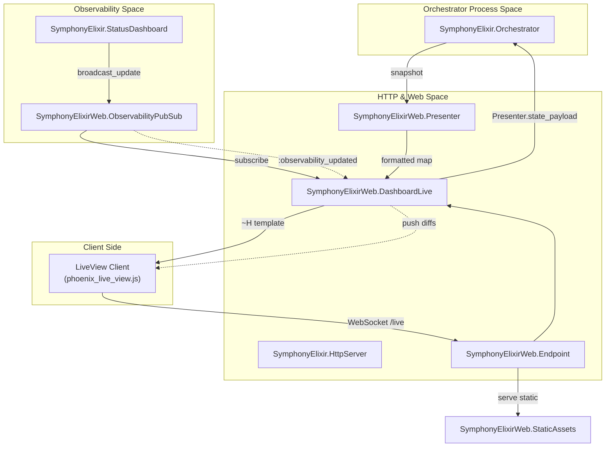
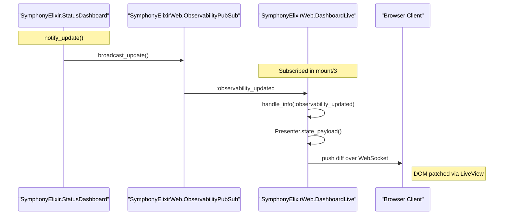

<!-- source: DeepWiki mcp.deepwiki.com · repo openai/symphony · page 6.1 Phoenix LiveView Dashboard · fetched 2026-10-26 -->

# Phoenix LiveView Dashboard

Relevant source files

The following files were used as context for generating this wiki page:

- [elixir/lib/symphony_elixir/status_dashboard.ex](elixir/lib/symphony_elixir/status_dashboard.ex)
- [elixir/lib/symphony_elixir_web/components/layouts.ex](elixir/lib/symphony_elixir_web/components/layouts.ex)
- [elixir/lib/symphony_elixir_web/live/dashboard_live.ex](elixir/lib/symphony_elixir_web/live/dashboard_live.ex)
- [elixir/lib/symphony_elixir_web/presenter.ex](elixir/lib/symphony_elixir_web/presenter.ex)
- [elixir/lib/symphony_elixir_web/static_assets.ex](elixir/lib/symphony_elixir_web/static_assets.ex)
- [elixir/priv/static/dashboard.css](elixir/priv/static/dashboard.css)
- [elixir/test/symphony_elixir/extensions_test.exs](elixir/test/symphony_elixir/extensions_test.exs)
- [elixir/test/symphony_elixir/status_dashboard_snapshot_test.exs](elixir/test/symphony_elixir/status_dashboard_snapshot_test.exs)

The Phoenix LiveView Dashboard provides optional real-time web-based monitoring of Symphony's orchestration state. When enabled, it displays currently running agents, retry queue status, token usage metrics, and rate limit information through a live-updating interface. The dashboard is disabled by default and requires explicit configuration to start.

For programmatic access to the same data, see [REST API](6.2). For detailed information about token tracking and rate limit data structures, see [Token Tracking and Rate Limits](6.3).

---

## Purpose and Scope

The dashboard serves as a human-readable observability interface for Symphony operators. It transforms the internal state maintained by the Orchestrator into a visual representation that updates in real-time as agents execute turns, issues transition states, and retry attempts are scheduled. The implementation uses Phoenix LiveView for server-rendered real-time updates without requiring a separate frontend build process.

**Sources:** [elixir/lib/symphony_elixir_web/live/dashboard_live.ex:1-4](), [elixir/lib/symphony_elixir/status_dashboard.ex:1-4]()

---

## Enabling the Dashboard

The dashboard is **disabled by default**. To enable it, the system checks for a valid port configuration. If the port is an integer `>= 0`, the `HttpServer` starts the Phoenix endpoint.

The configuration is resolved through `SymphonyElixir.Config.server_port/0` and the `observability.dashboard_enabled` setting in `WORKFLOW.md` [elixir/lib/symphony_elixir/status_dashboard.ex:102-106]().

When disabled, the `HttpServer` component returns `:ignore` from its `start_link/1` function, preventing any network listeners from starting.

The dashboard becomes accessible at the configured host and port. The same server instance also hosts the REST API endpoints.

**Sources:** [elixir/lib/symphony_elixir/status_dashboard.ex:102-106](), [elixir/lib/symphony_elixir/status_dashboard.ex:179-188]()

---

## Architecture Overview

**Diagram: Dashboard Component Architecture**

The dashboard architecture consists of four layers:

1.  **Orchestrator Process**: Maintains authoritative state about running agents, retry queue, and metrics.
2.  **HTTP Layer**: `SymphonyElixir.HttpServer` initializes the Phoenix `Endpoint` using the Bandit adapter.
3.  **Presentation Layer**: `SymphonyElixirWeb.DashboardLive` [elixir/lib/symphony_elixir_web/live/dashboard_live.ex:1-6]() manages the lifecycle of the dashboard view, utilizing `SymphonyElixirWeb.Presenter` [elixir/lib/symphony_elixir_web/presenter.ex:1-4]() to format data from the `Orchestrator.snapshot/2` call [elixir/lib/symphony_elixir_web/presenter.ex:12-33]().
4.  **Real-time Layer**: `SymphonyElixir.StatusDashboard` [elixir/lib/symphony_elixir/status_dashboard.ex:1]() acts as the coordinator, triggering updates via `SymphonyElixirWeb.ObservabilityPubSub` [elixir/lib/symphony_elixir/status_dashboard.ex:83-95]().

**Sources:** [elixir/lib/symphony_elixir/status_dashboard.ex:83-95](), [elixir/lib/symphony_elixir_web/live/dashboard_live.ex:11-40](), [elixir/lib/symphony_elixir_web/presenter.ex:8-34]()

---

## Dashboard UI Components

The `SymphonyElixirWeb.DashboardLive` module renders several key sections based on the payload received from the Orchestrator:

### Running Sessions Table
Displays active agent activity with the following data points:
*   **Issue Identifier**: The unique ID of the issue being processed [elixir/lib/symphony_elixir_web/live/dashboard_live.ex:159-164]().
*   **State**: Current execution state (e.g., `running`, `retrying`) [elixir/lib/symphony_elixir_web/live/dashboard_live.ex:165-169]().
*   **Session ID**: The Codex thread/session identifier [elixir/lib/symphony_elixir_web/live/dashboard_live.ex:170-186]().
*   **Runtime / Turns**: Cumulative time spent and turn count for the session [elixir/lib/symphony_elixir_web/live/dashboard_live.ex:187]().
*   **Codex Update**: The last message or event received from the agent [elixir/lib/symphony_elixir_web/live/dashboard_live.ex:188-193]().
*   **Tokens**: Breakdown of input, output, and total tokens used by the specific session [elixir/lib/symphony_elixir_web/live/dashboard_live.ex:194-197]().

### Aggregate Metrics
The "Metric Grid" provides high-level system health [elixir/lib/symphony_elixir_web/live/dashboard_live.ex:81-113]():
*   **Running/Retrying/Blocked Counts**: Total issues in active, backoff, or approval-blocked states [elixir/lib/symphony_elixir_web/live/dashboard_live.ex:82-98]().
*   **Total Tokens**: Global token consumption (Input vs Output) [elixir/lib/symphony_elixir_web/live/dashboard_live.ex:100-106]().
*   **Runtime**: Total Codex execution time across all sessions [elixir/lib/symphony_elixir_web/live/dashboard_live.ex:108-112]().

### Rate Limits and Health
*   **Rate Limits Panel**: A code-panel displaying the latest upstream rate-limit snapshot (GPT limits, credits balance, etc.) [elixir/lib/symphony_elixir_web/live/dashboard_live.ex:115-124]().
*   **Status Badges**: Visual indicators for "Live" (WebSocket connected) and "Offline" (WebSocket disconnected) [elixir/lib/symphony_elixir_web/live/dashboard_live.ex:58-67]().

**Sources:** [elixir/lib/symphony_elixir_web/live/dashboard_live.ex:41-198](), [elixir/lib/symphony_elixir_web/presenter.ex:102-122](), [elixir/test/symphony_elixir/status_dashboard_snapshot_test.exs:46-85]()

---

## Real-time Update Mechanism

**Diagram: Real-time Update Flow**

The dashboard uses Phoenix PubSub for event-driven updates:

1.  **Notification**: Components (like the Orchestrator or Agent Runners) call `StatusDashboard.notify_update/1` [elixir/lib/symphony_elixir/status_dashboard.ex:83-84]().
2.  **Broadcast**: `StatusDashboard` invokes `ObservabilityPubSub.broadcast_update/0` [elixir/lib/symphony_elixir/status_dashboard.ex:85]().
3.  **Subscription**: The LiveView process subscribes to this topic during `mount/3` [elixir/lib/symphony_elixir_web/live/dashboard_live.ex:18-21]().
4.  **Re-render**: Upon receiving `:observability_updated`, the LiveView re-fetches the state payload via `load_payload/0` and updates its assigns [elixir/lib/symphony_elixir_web/live/dashboard_live.ex:33-38](), triggering a push of HTML diffs to the client.

**Sources:** [elixir/lib/symphony_elixir/status_dashboard.ex:83-95](), [elixir/lib/symphony_elixir_web/live/dashboard_live.ex:11-40]()

---

## Static Asset Serving

The dashboard serves embedded static assets required for operation without external dependencies. These are managed by `SymphonyElixirWeb.StaticAssets` [elixir/lib/symphony_elixir_web/static_assets.ex:1-3]().

| Route | Content Source | Purpose |
| :--- | :--- | :--- |
| `/dashboard.css` | `priv/static/dashboard.css` | Custom styling and layout [elixir/lib/symphony_elixir_web/static_assets.ex:16](). |
| `/favicon.png` | `priv/static/favicon.png` | Dashboard icon [elixir/lib/symphony_elixir_web/static_assets.ex:20](). |
| `/vendor/phoenix/phoenix.js` | Phoenix dependency | Core WebSocket management [elixir/lib/symphony_elixir_web/static_assets.ex:25](). |
| `/vendor/phoenix_live_view/phoenix_live_view.js` | LiveView dependency | DOM patching [elixir/lib/symphony_elixir_web/static_assets.ex:26](). |

These assets are read into memory at compile time and served with content-type headers [elixir/lib/symphony_elixir_web/static_assets.ex:28-34]().

**Sources:** [elixir/lib/symphony_elixir_web/static_assets.ex:1-49](), [elixir/priv/static/dashboard.css:1-19]()

---

## Terminal UI Support

In addition to the web dashboard, `SymphonyElixir.StatusDashboard` provides a terminal-based UI. It uses ANSI escape codes to render a similar snapshot directly to the console [elixir/lib/symphony_elixir/status_dashboard.ex:29-39]().

*   **TPS Tracking**: Calculates tokens-per-second throughput by sampling token counts over time [elixir/lib/symphony_elixir/status_dashboard.ex:200-213]().
*   **Sparklines**: Renders token usage graphs using Unicode blocks (`▁` to `█`) [elixir/lib/symphony_elixir/status_dashboard.ex:17]().
*   **Throttled Rendering**: Uses a `flush_timer_ref` to ensure terminal updates do not exceed the `render_interval_ms` to prevent flicker [elixir/lib/symphony_elixir/status_dashboard.ex:158-175]().

**Sources:** [elixir/lib/symphony_elixir/status_dashboard.ex:1-127](), [elixir/test/symphony_elixir/status_dashboard_snapshot_test.exs:8-44]()

---

## Error Handling and Unavailable States

### Snapshot Unavailable
If the orchestrator state cannot be retrieved (e.g., timeout or crash), the `Presenter.state_payload/2` returns an error map [elixir/lib/symphony_elixir_web/presenter.ex:28-33](). The dashboard then renders an `error-card` with the specific error code [elixir/lib/symphony_elixir_web/live/dashboard_live.ex:71-79]().

### Offline Mode
If the Phoenix server is not running, the dashboard provides a fallback `render_offline_status/0` which outputs a simplified "app_status=offline" message to the terminal using `IO.ANSI.red()` [elixir/lib/symphony_elixir/status_dashboard.ex:129-145]().

**Sources:** [elixir/lib/symphony_elixir_web/live/dashboard_live.ex:71-79](), [elixir/lib/symphony_elixir/status_dashboard.ex:129-145](), [elixir/lib/symphony_elixir_web/presenter.ex:28-33]()

---

