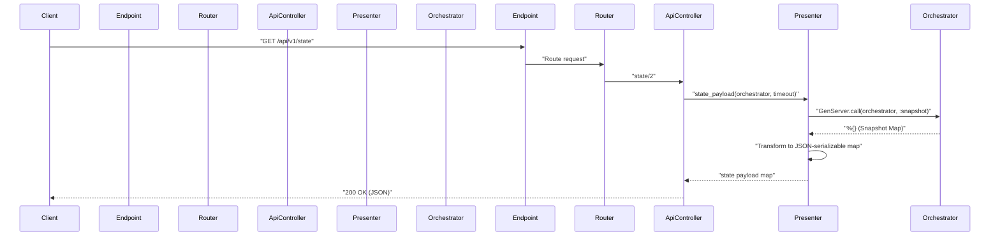
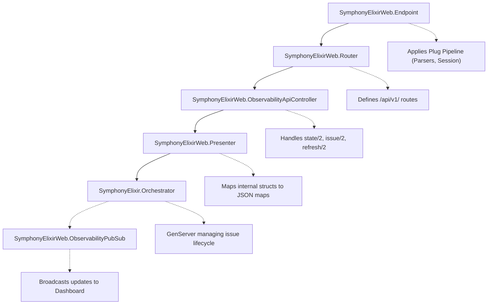

<!-- source: DeepWiki mcp.deepwiki.com · repo openai/symphony · page 6.2 REST API · fetched 2026-10-26 -->

# REST API

<details>
<summary>Relevant source files</summary>

The following files were used as context for generating this wiki page:

- [elixir/lib/symphony_elixir_web/controllers/observability_api_controller.ex](elixir/lib/symphony_elixir_web/controllers/observability_api_controller.ex)
- [elixir/lib/symphony_elixir_web/controllers/static_asset_controller.ex](elixir/lib/symphony_elixir_web/controllers/static_asset_controller.ex)
- [elixir/lib/symphony_elixir_web/endpoint.ex](elixir/lib/symphony_elixir_web/endpoint.ex)
- [elixir/lib/symphony_elixir_web/observability_pubsub.ex](elixir/lib/symphony_elixir_web/observability_pubsub.ex)
- [elixir/lib/symphony_elixir_web/router.ex](elixir/lib/symphony_elixir_web/router.ex)
- [elixir/priv/static/favicon.png](elixir/priv/static/favicon.png)
- [elixir/test/symphony_elixir/extensions_test.exs](elixir/test/symphony_elixir/extensions_test.exs)

</details>


The REST API provides HTTP endpoints for querying Symphony's operational state, retrieving issue-specific details, and triggering system operations. All endpoints return JSON responses and are served under the `/api/v1` path prefix.

For real-time monitoring through a web interface, see [Phoenix LiveView Dashboard](#6.1). For token usage and rate limit details, see [Token Tracking and Rate Limits](#6.3).

---

## Purpose and Scope

The REST API enables external systems and scripts to:

- Query the current state of running and retrying agents.
- Retrieve detailed information about specific issues being processed.
- Trigger immediate poll/reconcile operations.
- Access aggregated token usage and rate limit information.

The API is implemented through the Phoenix web framework and uses the `SymphonyElixirWeb.Presenter` module to transform internal orchestrator state into JSON-serializable payloads.

**Sources:** [elixir/lib/symphony_elixir_web/controllers/observability_api_controller.ex:1-4](), [elixir/lib/symphony_elixir_web/router.ex:31-41]()

---

## System Architecture

### API Request Flow

The diagram below illustrates the flow of a request from an external client through the Phoenix stack to the `Orchestrator` GenServer.



**Sources:** [elixir/lib/symphony_elixir_web/router.ex:32-38](), [elixir/lib/symphony_elixir_web/controllers/observability_api_controller.ex:11-14](), [elixir/lib/symphony_elixir_web/endpoint.ex:31-31]()

### Module Responsibilities

This diagram maps the natural language roles of the API components to their specific code entities.



**Sources:** [elixir/lib/symphony_elixir_web/endpoint.ex:1-32](), [elixir/lib/symphony_elixir_web/router.ex:1-42](), [elixir/lib/symphony_elixir_web/observability_pubsub.ex:1-25]()

---

## API Endpoints

The router defines the following scope for the REST API: [elixir/lib/symphony_elixir_web/router.ex:31-41]().

### GET /api/v1/state

Returns the current operational state of Symphony, including running agents, retrying issues, token totals, and rate limits.

#### Request
`GET /api/v1/state`

#### Response (200 OK)
Returns a payload generated by `Presenter.state_payload/2`. [elixir/lib/symphony_elixir_web/controllers/observability_api_controller.ex:11-14]().

| Field | Type | Description |
|-------|------|-------------|
| `generated_at` | string | ISO8601 timestamp when the snapshot was generated |
| `counts.running` | integer | Number of currently running agents |
| `counts.retrying` | integer | Number of issues in retry state |
| `running[]` | array | List of active agent objects |
| `retrying[]` | array | List of issues currently waiting for retry |
| `codex_totals` | object | Aggregated token usage across all agents |

### GET /api/v1/{issue_identifier}

Returns detailed information about a specific issue identified by its human-readable identifier (e.g., "ENG-123").

#### Request
`GET /api/v1/ENG-123`

#### Response (200 OK)
Returns a payload generated by `Presenter.issue_payload/3`. [elixir/lib/symphony_elixir_web/controllers/observability_api_controller.ex:16-25]().

| Field | Type | Description |
|-------|------|-------------|
| `status` | string | Either `"running"` or `"retrying"` |
| `workspace.path` | string | Workspace directory path |
| `attempts.restart_count` | integer | Number of restarts |
| `running` | object \| null | Detailed metrics if the agent is active |
| `retry` | object \| null | Error and scheduling info if retrying |

#### Response (404 Not Found)
Returned if the issue identifier is not found in the current orchestrator snapshot. [elixir/lib/symphony_elixir_web/controllers/observability_api_controller.ex:22-23]().

### POST /api/v1/refresh

Requests an immediate poll and reconcile operation, bypassing the normal polling interval.

#### Request
`POST /api/v1/refresh`

#### Response (202 Accepted)
Returns a payload generated by `Presenter.refresh_payload/1`. [elixir/lib/symphony_elixir_web/controllers/observability_api_controller.ex:27-38]().

| Field | Type | Description |
|-------|------|-------------|
| `queued` | boolean | Whether the refresh was successfully queued |
| `requested_at` | string | ISO8601 timestamp of the request |

---

## Implementation Details

### Controller Configuration

The `ObservabilityApiController` looks up the orchestrator and timeout settings from the endpoint configuration, defaulting to `SymphonyElixir.Orchestrator` and `15,000ms`. [elixir/lib/symphony_elixir_web/controllers/observability_api_controller.ex:56-62]().

```elixir
defp orchestrator do
  Endpoint.config(:orchestrator) || SymphonyElixir.Orchestrator
end

defp snapshot_timeout_ms do
  Endpoint.config(:snapshot_timeout_ms) || 15_000
end
```

### Static Assets

The API is served alongside the dashboard assets. The `StaticAssetController` handles serving the embedded CSS and JS required for the Phoenix LiveView dashboard.

- `GET /dashboard.css`: [elixir/lib/symphony_elixir_web/controllers/static_asset_controller.ex:12-12]()
- `GET /favicon.png`: [elixir/lib/symphony_elixir_web/controllers/static_asset_controller.ex:14-14]()
- `GET /vendor/phoenix/phoenix.js`: [elixir/lib/symphony_elixir_web/controllers/static_asset_controller.ex:21-21]()

**Sources:** [elixir/lib/symphony_elixir_web/router.ex:17-23](), [elixir/lib/symphony_elixir_web/controllers/static_asset_controller.ex:1-38]()

---

## Testing

The API and its supporting extensions are tested using `Phoenix.ConnTest`. The test suite uses specialized orchestrator modules to verify different response scenarios:

- **SlowOrchestrator**: Simulates a delay in `handle_call(:snapshot, ...)` to verify timeout handling. [elixir/test/symphony_elixir/extensions_test.exs:24-41]().
- **StaticOrchestrator**: Returns a fixed snapshot to verify the `Presenter` correctly maps state fields. [elixir/test/symphony_elixir/extensions_test.exs:43-60]().
- **FakeLinearClient**: Used to verify tracker delegation and issue fetching within the testing environment. [elixir/test/symphony_elixir/extensions_test.exs:12-22]().

**Sources:** [elixir/test/symphony_elixir/extensions_test.exs:1-100]()

---

