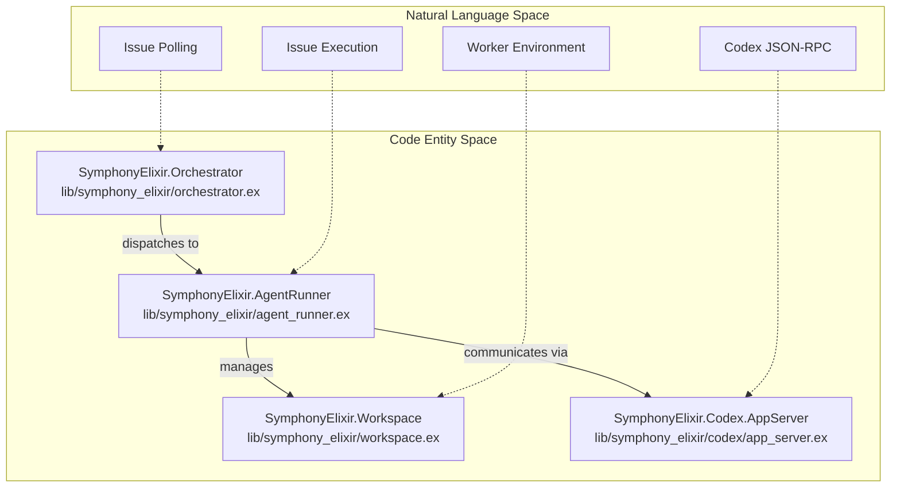
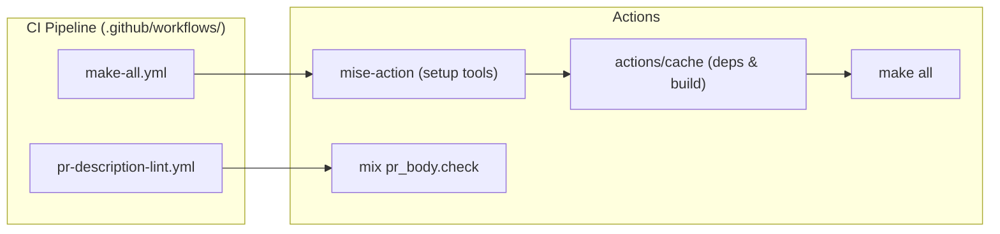

<!-- source: DeepWiki mcp.deepwiki.com · repo openai/symphony · page 7 Development Guide · fetched 2026-10-26 -->

# Development Guide

<details>
<summary>Relevant source files</summary>

The following files were used as context for generating this wiki page:

- [elixir/AGENTS.md](elixir/AGENTS.md)
- [elixir/mix.exs](elixir/mix.exs)

</details>


This guide provides an overview of developing on Symphony itself. It covers project structure, coding conventions, and the contribution workflow. Detailed setup instructions, testing strategies, and CI/CD pipeline documentation are in the child pages.

**Navigation:**
- **[Local Development Setup](#7.1)** — Environment dependencies, mise configuration, and running Symphony locally
- **[Testing Strategy](#7.2)** — Unit tests, integration tests, and test organization
- **[CI/CD Pipeline](#7.3)** — Makefile targets, automated quality checks, and CI workflows
- **[End-to-End Testing](#7.4)** — Live E2E tests with real Linear API calls and SSH/Docker workers
- **[Codex Skills](#7.5)** — Agent-facing skills in `.codex/skills/` used for Symphony development

---

## Quick Start

The Symphony Elixir implementation requires **Elixir 1.19.x on OTP 28**. For detailed setup instructions, see [Local Development Setup](#7.1).

```bash
git clone https://github.com/openai/symphony
cd symphony/elixir
mise trust
mise install
mix setup
make all
```

Sources: [elixir/AGENTS.md:7-9](), [elixir/mix.exs:8-8]()

---

## Project Structure

The repository is organized into implementation code, test coverage, and configuration:

```
symphony/
├── elixir/                   # Elixir OTP application
│   ├── lib/                  # Application code and Mix tasks
│   │   └── symphony_elixir/  # Core modules: Orchestrator, AgentRunner, etc.
│   ├── test/                 # ExUnit test suite
│   │   └── support/          # Test helpers and fixtures
│   ├── mix.exs               # Project dependencies and configuration
│   ├── AGENTS.md             # Coding conventions for contributors
│   ├── WORKFLOW.md           # In-repo workflow configuration
│   └── README.md             # Setup and usage instructions
├── .codex/
│   ├── skills/               # Codex skill definitions (commit, push, etc.)
│   └── worktree_init.sh      # Workspace bootstrap script
├── SPEC.md                   # Implementation-agnostic specification
└── WORKFLOW.md               # Root-level workflow contract
```

### Directory Organization

| Directory | Purpose |
|---|---|
| `lib/symphony_elixir/` | Core application modules (GenServers, business logic) |
| `lib/mix/tasks/` | Custom Mix tasks like `specs.check` and `pr_body.check` |
| `test/symphony_elixir/` | Unit and integration tests mirroring `lib/` structure |
| `test/support/` | Test helpers, case modules, and shared fixtures |

**Key conventions:**
- Application code belongs in `lib/symphony_elixir/` [elixir/AGENTS.md:53-53]().
- Workspace safety is critical: never run Codex with `cwd` set to the source repository [elixir/AGENTS.md:21-22]().
- Follow existing module/style patterns in `lib/symphony_elixir/*` [elixir/AGENTS.md:53-53]().

Sources: [elixir/AGENTS.md:1-26](), [elixir/mix.exs:47-50]()

### Module-to-File Mapping

The following diagram maps high-level system concepts to their specific Elixir implementations.



Sources: [elixir/mix.exs:23-33](), [elixir/AGENTS.md:21-24]()

---

## Coding Conventions

Symphony follows strict coding conventions defined in `elixir/AGENTS.md` to ensure code quality and consistency.

### Configuration Access

**Always route configuration reads through `SymphonyElixir.Config`.** Do not use ad-hoc `System.get_env/1` calls in application code. Runtime config is loaded from `WORKFLOW.md` front matter via `SymphonyElixir.Workflow` and `SymphonyElixir.Config` [elixir/AGENTS.md:14-14]().

Sources: [elixir/AGENTS.md:14-20]()

### Typespec Requirements

Every public function (`def`) in `lib/` **must** have an adjacent `@spec` [elixir/AGENTS.md:47-47](). Private functions (`defp`) are optional, and `@impl` implementations are exempt [elixir/AGENTS.md:48-49]().

Validate typespecs locally:
```bash
mix specs.check
```

Sources: [elixir/AGENTS.md:47-59](), [elixir/mix.exs:93-93]()

### Workspace Safety

Two critical invariants must be preserved:
1. **Never run Codex turn cwd in source repo.** [elixir/AGENTS.md:22-22]()
2. **Workspaces must stay under configured workspace root.** [elixir/AGENTS.md:23-23]()

---

## Contribution Workflow

The standard contribution flow ensures code quality through automated checks and manual review.

### Mix Aliases and Quality Gate

The `mix.exs` file defines aliases that serve as the primary quality gates.

| Alias | Command | Purpose |
|---|---|---|
| `setup` | `deps.get` | Fetches project dependencies [elixir/mix.exs:91-91]() |
| `build` | `escript.build` | Builds the `symphony` executable [elixir/mix.exs:92-92]() |
| `lint` | `specs.check`, `credo --strict` | Runs static analysis and typespec checks [elixir/mix.exs:93-93]() |

The `make all` command is the main quality gate, performing format checks, linting, coverage, and dialyzer [elixir/AGENTS.md:9-9]().

Sources: [elixir/mix.exs:89-95](), [elixir/AGENTS.md:41-43]()

### CI Pipeline

The CI system executes checks on every push and pull request.



Sources: [elixir/AGENTS.md:9-9](), [elixir/AGENTS.md:61-68]()

### PR Requirements

- PR body must follow `../.github/pull_request_template.md` exactly [elixir/AGENTS.md:63-63]().
- Validate PR body locally: `mix pr_body.check --file /path/to/pr_body.md` [elixir/AGENTS.md:67-67]().
- Update documentation in the same PR if behavior or config changes [elixir/AGENTS.md:70-77]().

---

## End-to-End Testing

Symphony includes a live E2E test suite that validates the entire system against real trackers and worker environments.

- **Trigger:** Use targeted tests or full gates [elixir/AGENTS.md:31-33]().
- **Coverage:** The project maintains a 100% coverage threshold for core modules, though many integration clients and GenServers are ignored in automated coverage summaries [elixir/mix.exs:11-46]().

For more details, see [End-to-End Testing](#7.4).

---

