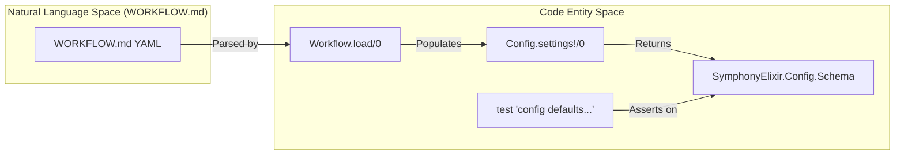
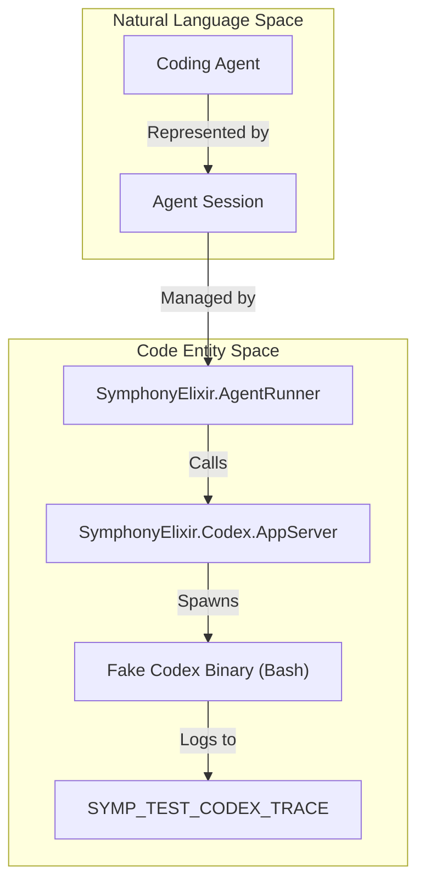

<!-- source: DeepWiki mcp.deepwiki.com · repo openai/symphony · page 7.2 Testing Strategy · fetched 2026-10-26 -->

# Testing Strategy

<details>
<summary>Relevant source files</summary>

The following files were used as context for generating this wiki page:

- [SPEC.md](SPEC.md)
- [elixir/test/support/test_support.exs](elixir/test/support/test_support.exs)
- [elixir/test/symphony_elixir/core_test.exs](elixir/test/symphony_elixir/core_test.exs)
- [elixir/test/symphony_elixir/extensions_test.exs](elixir/test/symphony_elixir/extensions_test.exs)
- [elixir/test/symphony_elixir/workspace_and_config_test.exs](elixir/test/symphony_elixir/workspace_and_config_test.exs)
- [elixir/test/test_helper.exs](elixir/test/test_helper.exs)

</details>


This document explains Symphony's testing approach, test organization, and the utilities available for writing new tests. It covers unit tests, integration tests, and the comprehensive test suite organization.

For information about the end-to-end testing infrastructure with live Linear API calls and SSH/Docker workers, see [7.4 End-to-End Testing](). For information about local development setup before running tests, see [7.1 Local Development Setup]().

---

## Test Organization

Symphony's test suite is organized into several primary test files, each focusing on a different layer of the system:

| Test File | Focus | Key Modules Tested |
|-----------|-------|-------------------|
| `app_server_test.exs` | AppServer protocol and Codex integration | `AppServer`, workspace validation, approval policies, tool execution |
| `core_test.exs` | Core orchestration and configuration | `Config`, `Workflow`, `Orchestrator`, `AgentRunner`, `PromptBuilder` |
| `workspace_and_config_test.exs` | Workspace lifecycle and path safety | `Workspace`, `PathSafety`, `Config.Schema` |
| `extensions_test.exs` | Phoenix web layer and integrations | `WorkflowStore`, `Tracker` adapters, HTTP API, LiveView dashboard |

All test files use `SymphonyElixir.TestSupport` as their base, which provides common test utilities and helpers [elixir/test/support/test_support.exs:1-51]().

**Sources:** [elixir/test/symphony_elixir/core_test.exs:1-2](), [elixir/test/symphony_elixir/workspace_and_config_test.exs:1-2](), [elixir/test/symphony_elixir/extensions_test.exs:1-2](), [elixir/test/test_helper.exs:1-4]()

---

## Test Types and Coverage

### Unit Tests

Unit tests validate individual modules in isolation, focusing on configuration validation, prompt rendering, and path safety.

#### Data Flow: Configuration Validation
The following diagram illustrates how `core_test.exs` validates the transition from raw `WORKFLOW.md` content to typed `Config.Schema` structs.



**Configuration validation tests** ensure that `WORKFLOW.md` settings are properly parsed and validated, including defaults, type checking, and required fields [elixir/test/symphony_elixir/core_test.exs:4-101](). It also verifies environment variable resolution for sensitive keys like `LINEAR_API_KEY` [elixir/test/symphony_elixir/core_test.exs:135-151]() and `LINEAR_ASSIGNEE` [elixir/test/symphony_elixir/core_test.exs:153-167]().

**Path safety tests** ensure the system rejects workspace paths that escape the configured workspace root, specifically testing symlink-based escapes [elixir/test/symphony_elixir/workspace_and_config_test.exs:171-175]().

**Sources:** [elixir/test/symphony_elixir/core_test.exs:4-101](), [elixir/test/symphony_elixir/core_test.exs:135-167](), [elixir/test/symphony_elixir/workspace_and_config_test.exs:171-175]()

### Integration Tests

Integration tests validate multi-component workflows using fake external dependencies.

#### Component Interaction: Codex AppServer Protocol
This diagram bridges the "Natural Language" concept of an Agent Session to the `AppServer` JSON-RPC implementation.



**Fake Codex Binary Pattern**: Tests create executable bash scripts that simulate the Codex app-server protocol by reading JSON-RPC requests from stdin and writing responses to stdout. These scripts log all interactions to a trace file for verification.

**Sources:** [elixir/test/support/test_support.exs:110-116](), [elixir/test/symphony_elixir/extensions_test.exs:24-60]()

### Workspace Lifecycle Tests

The `Workspace` module is tested for deterministic path generation and hook execution:

*   **Deterministic Paths**: Verifies that workspace paths are stable per issue identifier (e.g., `MT/Det` becomes `MT_Det--[hash]`) [elixir/test/symphony_elixir/workspace_and_config_test.exs:43-58]().
*   **Hook Execution**: Validates that `after_create` hooks (like `git clone`) correctly bootstrap the workspace [elixir/test/symphony_elixir/workspace_and_config_test.exs:8-41]().
*   **State Persistence**: Ensures that re-creating a workspace for an existing issue does not delete local changes or build artifacts [elixir/test/symphony_elixir/workspace_and_config_test.exs:112-146]().
*   **Collision Handling**: Ensures that identifiers which sanitize to the same string (e.g., `team/a-1` and `team_a-1`) are disambiguated into unique directories [elixir/test/symphony_elixir/workspace_and_config_test.exs:83-110]().

**Sources:** [elixir/test/symphony_elixir/workspace_and_config_test.exs:8-146]()

---

## Test Utilities and Helpers

### Core Test Helpers

Symphony provides several helper functions through the `TestSupport` module:

| Helper Function | Purpose | Implementation Detail |
|----------------|---------|-----------------------|
| `write_workflow_file!/2` | Create test workflow configuration | Generates a temporary `WORKFLOW.md` with YAML frontmatter [elixir/test/support/test_support.exs:53-66]() |
| `restore_env/2` | Clean up environment variables | Ensures system environment is returned to original state [elixir/test/support/test_support.exs:68-69]() |
| `stop_default_http_server/0` | Isolate web tests | Terminates the `HttpServer` child under the main supervisor [elixir/test/support/test_support.exs:71-88]() |

### Workflow Store Management

The `WorkflowStore` is a GenServer that monitors `WORKFLOW.md`. Tests in `extensions_test.exs` validate its ability to reload configuration on the fly and handle malformed files:

*   **Hot Reload**: Verifies that changing the `poll_interval_ms` in the file is reflected in the running system [elixir/test/symphony_elixir/extensions_test.exs:90-102]().
*   **Graceful Failure**: Ensures that if a broken YAML file is saved, the `WorkflowStore` keeps the last known "good" configuration [elixir/test/symphony_elixir/extensions_test.exs:104-117]().

**Sources:** [elixir/test/symphony_elixir/extensions_test.exs:86-142](), [elixir/test/support/test_support.exs:53-66]()

---

## Running Tests

### Basic Test Execution

Run the full test suite from the `elixir` directory:

```bash
cd elixir
mix test
```

### Environment Isolation

Tests use unique temporary directories for workspaces and configuration to prevent cross-test interference. This is handled automatically in the `setup` block of `SymphonyElixir.TestSupport`:

1.  A unique directory is created in `System.tmp_dir!()` [elixir/test/support/test_support.exs:29-34]().
2.  A default `WORKFLOW.md` is written to this directory [elixir/test/support/test_support.exs:35-36]().
3.  The `Workflow` module is pointed to this temporary file [elixir/test/support/test_support.exs:37]().
4.  An `on_exit` hook ensures the directory is deleted after the test finishes [elixir/test/support/test_support.exs:41-46]().

**Sources:** [elixir/test/support/test_support.exs:27-51]()

---

