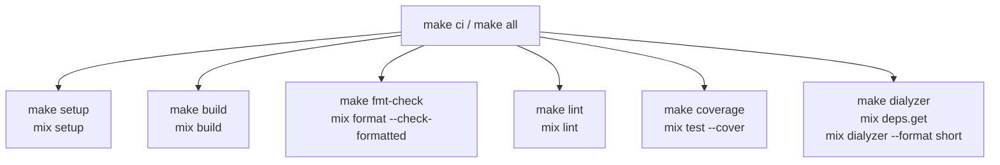
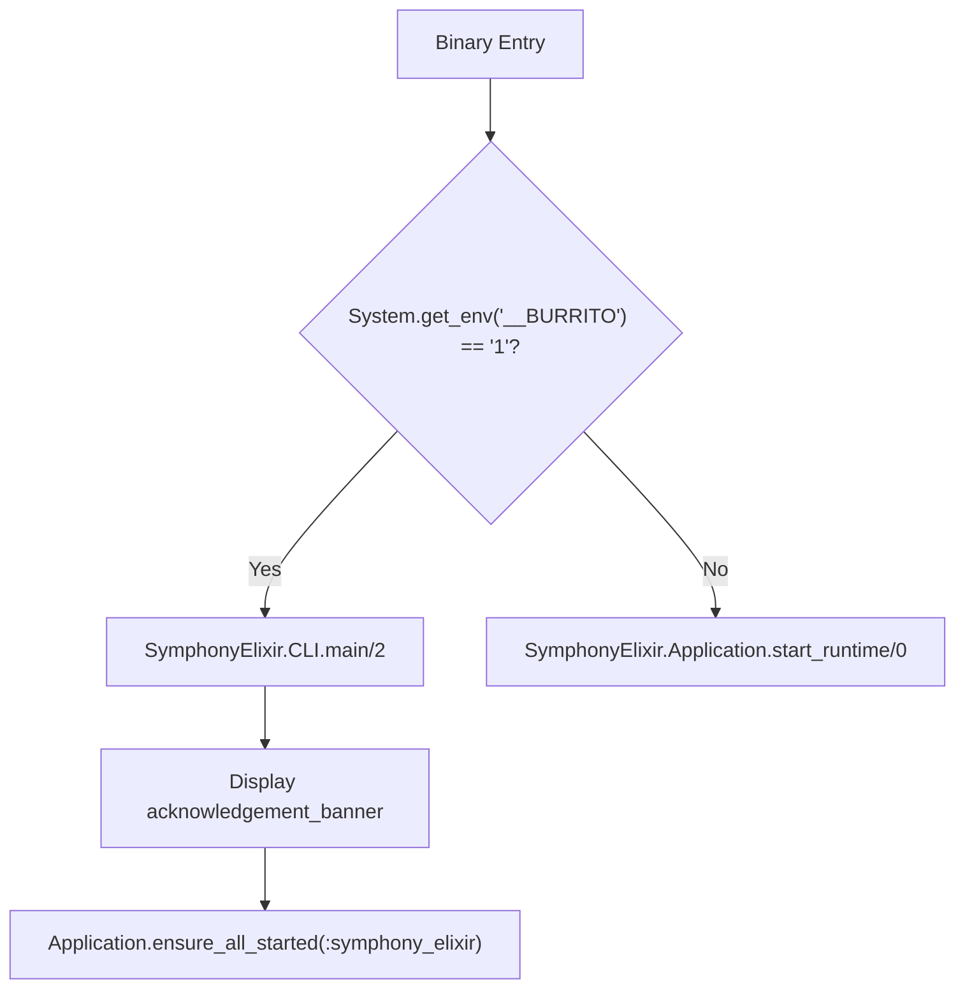
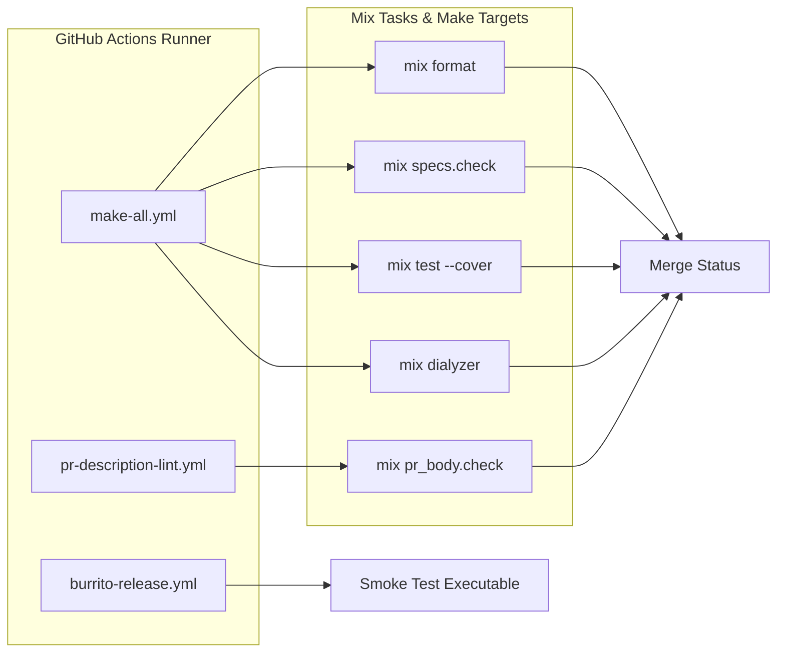

<!-- source: DeepWiki mcp.deepwiki.com · repo openai/symphony · page 7.3 CI/CD Pipeline · fetched 2026-10-26 -->

# CI/CD Pipeline

Relevant source files

The following files were used as context for generating this wiki page:

- [.github/workflows/burrito-release.yml](.github/workflows/burrito-release.yml)
- [.github/workflows/make-all.yml](.github/workflows/make-all.yml)
- [.github/workflows/pr-description-lint.yml](.github/workflows/pr-description-lint.yml)
- [elixir/.gitignore](elixir/.gitignore)
- [elixir/lib/mix/tasks/pr_body.check.ex](elixir/lib/mix/tasks/pr_body.check.ex)
- [elixir/lib/mix/tasks/specs.check.ex](elixir/lib/mix/tasks/specs.check.ex)
- [elixir/lib/symphony_elixir.ex](elixir/lib/symphony_elixir.ex)
- [elixir/lib/symphony_elixir/cli.ex](elixir/lib/symphony_elixir/cli.ex)
- [elixir/lib/symphony_elixir/specs_check.ex](elixir/lib/symphony_elixir/specs_check.ex)

This page documents the continuous integration pipeline implemented via the Makefile in the `elixir/` directory and GitHub Actions workflows. The pipeline consists of multiple quality gates, including code formatting, static analysis, type checking, automated PR description validation, and multi-platform release builds.

---

## Overview

The CI pipeline is orchestrated through make targets defined in `elixir/Makefile`. The primary entry point is `make ci` (aliased as `make all`), which runs a comprehensive suite of checks ensuring code quality, type safety, and test coverage.

**Figure 1: CI Target Dependency Flow**

Sources: [.github/workflows/make-all.yml:38](), [elixir/lib/mix/tasks/specs.check.ex:9]()

---

## GitHub Actions Workflows

The repository uses GitHub Actions to automate checks and releases.

### `make-all` Workflow
This workflow runs the standard Elixir quality suite on an `ubuntu-latest` runner [.github/workflows/make-all.yml:11](). It uses `jdx/mise-action` to manage the Elixir/Erlang toolchain [.github/workflows/make-all.yml:21-25]() and caches dependencies to speed up execution [.github/workflows/make-all.yml:27-36](). The final step executes the `make all` target [.github/workflows/make-all.yml:38]().

### `pr-description-lint` Workflow
This workflow ensures that pull requests follow the project's documentation standards [.github/workflows/pr-description-lint.yml:1-34](). It triggers on PR events including opening, editing, and synchronization [.github/workflows/pr-description-lint.yml:4-5](). It executes `mix pr_body.check` [.github/workflows/pr-description-lint.yml:38](), which validates the PR body against the repository's template.

### `burrito-release` Workflow
Triggered by tags (e.g., `v*`) or manual dispatch [.github/workflows/burrito-release.yml:3-7](), this workflow builds self-contained executables for four targets: `linux_x86_64`, `linux_arm64`, `macos_x86_64`, and `macos_arm64` [.github/workflows/burrito-release.yml:19]().

*   **Build**: Uses Zig 0.15.2 to cross-compile the BEAM runtime and Symphony application into a single binary [.github/workflows/burrito-release.yml:59]().
*   **Version Check**: Verifies that the git tag matches the version defined in `mix.exs` [.github/workflows/burrito-release.yml:47-56]().
*   **Smoke Test**: Downloads the built artifact and runs it to ensure it displays the mandatory engineering preview banner [.github/workflows/burrito-release.yml:114-119]().
*   **Release**: Uploads the binaries to a GitHub Release [.github/workflows/burrito-release.yml:137-146]().

Sources: [.github/workflows/make-all.yml:1-39](), [.github/workflows/pr-description-lint.yml:1-39](), [.github/workflows/burrito-release.yml:1-147]()

---

## Custom Quality Checks

Beyond standard Elixir tooling, Symphony includes custom Mix tasks to enforce specific architectural and documentation rules.

### PR Body Validator
The `Mix.Tasks.PrBody.Check` module validates that a PR description adheres to the structure defined in `.github/pull_request_template.md` [elixir/lib/mix/tasks/pr_body.check.ex:1-21]().

**Validation Rules:**
*   **Required Headings**: Verifies presence of markdown headings [elixir/lib/mix/tasks/pr_body.check.ex:109-112]().
*   **Heading Order**: Ensures headings appear in the same sequence as the template [elixir/lib/mix/tasks/pr_body.check.ex:114-121]().
*   **No Placeholders**: Fails if the body still contains HTML comment placeholders (e.g., `<!-- ... -->`) [elixir/lib/mix/tasks/pr_body.check.ex:123-129]().
*   **Content Requirements**: Checks that sections requiring bullets or checkboxes actually contain them [elixir/lib/mix/tasks/pr_body.check.ex:151-169]().

Sources: [elixir/lib/mix/tasks/pr_body.check.ex:1-216]()

### Public API Spec Enforcement
The `Mix.Tasks.Specs.Check` task ensures that all public functions in the `lib/` directory have an associated `@spec` declaration [elixir/lib/mix/tasks/specs.check.ex:1-13]().

**Implementation Details:**
*   **Scanning**: It uses `SymphonyElixir.SpecsCheck.missing_public_specs/2` to traverse the AST of Elixir files [elixir/lib/mix/tasks/specs.check.ex:27]().
*   **Exemptions**: Supports an exemptions file to bypass checks for specific modules [elixir/lib/mix/tasks/specs.check.ex:41-52]().
*   **Compliance**: A function is compliant if it has a preceding `@spec`, an `@impl true` attribute, or is listed in the exemptions [elixir/lib/symphony_elixir/specs_check.ex:140-146]().

Sources: [elixir/lib/mix/tasks/specs.check.ex:1-53](), [elixir/lib/symphony_elixir/specs_check.ex:1-175]()

---

## Release Artifacts (Burrito)

Symphony uses the Burrito framework to distribute the orchestrator as a standalone binary. When the binary is executed, it checks for the `__BURRITO` environment variable to determine if it should launch the CLI wrapper or the standard OTP runtime [elixir/lib/symphony_elixir.ex:26-31]().

**Figure 2: Binary Execution Flow**

Sources: [elixir/lib/symphony_elixir.ex:25-31](), [elixir/lib/symphony_elixir/cli.ex:27-36](), [elixir/lib/symphony_elixir/cli.ex:67-73]()

---

## Summary: Gate Coverage

**Figure 3: CI Pipeline Architecture**

| Check | Tool / Module | Blocks merge? |
|---|---|---|
| Code formatting | `mix format` | Yes |
| Type safety | `mix dialyzer` | Yes |
| Test coverage | `mix test --cover` | Yes |
| Public API specs | `Mix.Tasks.Specs.Check` | Yes |
| PR description | `Mix.Tasks.PrBody.Check` | Yes |
| Release Health | `burrito-release.yml` (Smoke Test) | Yes (for tags) |

Sources: [.github/workflows/make-all.yml:1-39](), [.github/workflows/pr-description-lint.yml:1-39](), [.github/workflows/burrito-release.yml:83-120](), [elixir/lib/mix/tasks/specs.check.ex:1-13](), [elixir/lib/mix/tasks/pr_body.check.ex:1-21]()

---

