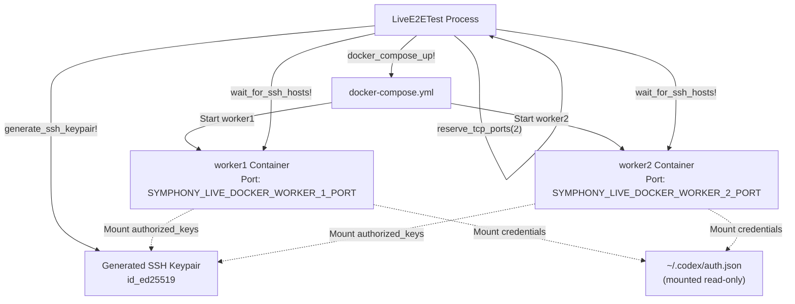
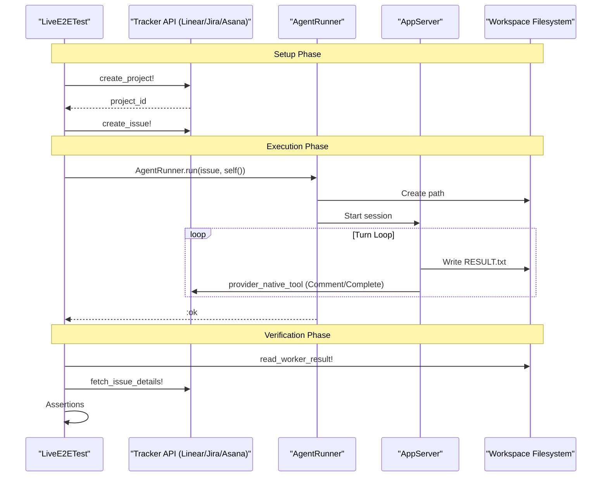

<!-- source: DeepWiki mcp.deepwiki.com · repo openai/symphony · page 7.4 End-to-End Testing · fetched 2026-10-26 -->

# End-to-End Testing

<details>
<summary>Relevant source files</summary>

The following files were used as context for generating this wiki page:

- [elixir/Makefile](elixir/Makefile)
- [elixir/lib/symphony_elixir/agent_runtime_supervisor.ex](elixir/lib/symphony_elixir/agent_runtime_supervisor.ex)
- [elixir/lib/symphony_elixir/asana/adapter.ex](elixir/lib/symphony_elixir/asana/adapter.ex)
- [elixir/lib/symphony_elixir/asana/agent_tool.ex](elixir/lib/symphony_elixir/asana/agent_tool.ex)
- [elixir/lib/symphony_elixir/asana/client.ex](elixir/lib/symphony_elixir/asana/client.ex)
- [elixir/lib/symphony_elixir/github/adapter.ex](elixir/lib/symphony_elixir/github/adapter.ex)
- [elixir/lib/symphony_elixir/github/agent_tool.ex](elixir/lib/symphony_elixir/github/agent_tool.ex)
- [elixir/lib/symphony_elixir/github/client.ex](elixir/lib/symphony_elixir/github/client.ex)
- [elixir/lib/symphony_elixir/jira/adapter.ex](elixir/lib/symphony_elixir/jira/adapter.ex)
- [elixir/lib/symphony_elixir/jira/agent_tool.ex](elixir/lib/symphony_elixir/jira/agent_tool.ex)
- [elixir/lib/symphony_elixir/jira/client.ex](elixir/lib/symphony_elixir/jira/client.ex)
- [elixir/test/support/live_e2e_docker/Dockerfile](elixir/test/support/live_e2e_docker/Dockerfile)
- [elixir/test/support/live_e2e_docker/docker-compose.yml](elixir/test/support/live_e2e_docker/docker-compose.yml)
- [elixir/test/symphony_elixir/asana_adapter_test.exs](elixir/test/symphony_elixir/asana_adapter_test.exs)
- [elixir/test/symphony_elixir/asana_live_e2e_test.exs](elixir/test/symphony_elixir/asana_live_e2e_test.exs)
- [elixir/test/symphony_elixir/github_adapter_test.exs](elixir/test/symphony_elixir/github_adapter_test.exs)
- [elixir/test/symphony_elixir/github_live_e2e_test.exs](elixir/test/symphony_elixir/github_live_e2e_test.exs)
- [elixir/test/symphony_elixir/jira_adapter_test.exs](elixir/test/symphony_elixir/jira_adapter_test.exs)
- [elixir/test/symphony_elixir/jira_live_e2e_test.exs](elixir/test/symphony_elixir/jira_live_e2e_test.exs)
- [elixir/test/symphony_elixir/live_e2e_test.exs](elixir/test/symphony_elixir/live_e2e_test.exs)

</details>


This document describes Symphony's live end-to-end (E2E) test suite that validates the complete system against real external services. The E2E tests exercise the full orchestration flow using actual API calls (Linear, Jira, Asana, GitHub), real Codex agents, and production-like worker configurations.

For general testing strategy and unit/integration tests, see [Testing Strategy](7.2). For local development setup, see [Local Development Setup](7.1). For CI/CD pipeline integration, see [CI/CD Pipeline](7.3).

---

## Overview

Symphony's E2E test suite validates the entire system by creating real issues and running actual Codex agents to complete them. Unlike unit or integration tests that mock external dependencies, E2E tests interact with:

- **Tracker APIs**: Creating projects, issues, comments, and state transitions via provider-specific clients [elixir/test/symphony_elixir/live_e2e_test.exs:20-121]().
- **Codex Binary**: Spawning real `codex app-server` processes with production settings [elixir/test/symphony_elixir/live_e2e_test.exs:315-316]().
- **Worker Environments**: Testing local execution, SSH-based distributed workers, and Docker-based workers [elixir/test/symphony_elixir/live_e2e_test.exs:124-131]().
- **File Systems**: Verifying workspace creation, file operations, and result persistence [elixir/test/symphony_elixir/live_e2e_test.exs:402-432]().

The primary E2E suite is located in `elixir/test/symphony_elixir/live_e2e_test.exs` [elixir/test/symphony_elixir/live_e2e_test.exs:1-5](). Provider-specific E2E tests exist for Jira [elixir/test/symphony_elixir/jira_live_e2e_test.exs:1]() and Asana [elixir/test/symphony_elixir/asana_live_e2e_test.exs:1](). These tests are disabled by default and must be explicitly enabled via environment variables to prevent accidental consumption of API quotas [elixir/test/symphony_elixir/live_e2e_test.exs:16-18]().

**Sources:** [elixir/test/symphony_elixir/live_e2e_test.exs:1-121](), [elixir/test/symphony_elixir/jira_live_e2e_test.exs:1-13](), [elixir/test/symphony_elixir/asana_live_e2e_test.exs:1-15]()

---

## Test Execution

### Running E2E Tests

The E2E tests are gated behind environment variables and can be executed using the `Makefile`:

```bash
make e2e
```

This expands to:

```bash
SYMPHONY_RUN_LIVE_E2E=1 $(MIX) test test/symphony_elixir/live_e2e_test.exs
```

**Requirements:**
- Valid API keys (e.g., `LINEAR_API_KEY`, `ASANA_PAT`, `JIRA_API_TOKEN`) [elixir/test/symphony_elixir/asana_live_e2e_test.exs:19](), [elixir/test/symphony_elixir/jira_live_e2e_test.exs:18]().
- `codex` binary available on `PATH` with valid authentication [elixir/test/support/live_e2e_docker/Dockerfile:14]().
- For SSH tests: Either `SYMPHONY_LIVE_SSH_WORKER_HOSTS` configured OR Docker available [elixir/test/symphony_elixir/live_e2e_test.exs:521-530]().
- Timeout: 300 seconds (5 minutes) per test [elixir/test/symphony_elixir/live_e2e_test.exs:8]().

**Sources:** [elixir/Makefile:36-37](), [elixir/test/symphony_elixir/live_e2e_test.exs:8-18](), [elixir/test/symphony_elixir/asana_live_e2e_test.exs:12-14]()

---

## Test Modes

The E2E suite validates different worker deployment models:

| Test Case | Worker Type | Description |
|-----------|-------------|-------------|
| `test "creates a real Linear project and issue with a local worker"` | Local | Codex spawned directly on test machine [elixir/test/symphony_elixir/live_e2e_test.exs:124-126]() |
| `test "creates a real Linear project and issue with an ssh worker"` | SSH | Codex spawned on remote SSH host(s) [elixir/test/symphony_elixir/live_e2e_test.exs:128-131]() |

### Local Worker Mode

In local mode, Symphony spawns Codex processes directly on the test machine using `run_live_issue_flow!(:local)` [elixir/test/symphony_elixir/live_e2e_test.exs:125](). Workspaces are created in temporary directories under `System.tmp_dir!()`.

### SSH Worker Mode

SSH mode tests distributed execution by spawning Codex on remote hosts. The test supports two SSH provisioning strategies:

1. **Pre-configured SSH Hosts**: If `SYMPHONY_LIVE_SSH_WORKER_HOSTS` is set, it uses existing hosts [elixir/test/symphony_elixir/live_e2e_test.exs:521-525]().
2. **Automatic Docker Provisioning**: If the environment variable is unset, it automatically provisions SSH workers using Docker Compose [elixir/test/symphony_elixir/live_e2e_test.exs:532-540]().

**Sources:** [elixir/test/symphony_elixir/live_e2e_test.exs:124-131](), [elixir/test/symphony_elixir/live_e2e_test.exs:521-566]()

---

## Docker Worker Provisioning

### Architecture



### Provisioning Process

When `SYMPHONY_LIVE_SSH_WORKER_HOSTS` is unset, the test automatically provisions SSH workers:

1. **TCP Port Reservation**: Allocates unique TCP ports using `reserve_tcp_ports/1` [elixir/test/symphony_elixir/live_e2e_test.exs:713-725]().
2. **SSH Key Generation**: Creates an ephemeral Ed25519 keypair using `ssh-keygen` via `generate_ssh_keypair!/1` [elixir/test/symphony_elixir/live_e2e_test.exs:727-731]().
3. **Docker Compose Up**: Starts containers using `docker_compose_up!/2` with environment variables mapping ports and credentials [elixir/test/symphony_elixir/live_e2e_test.exs:738-756]().
4. **Connection Verification**: Polls each worker with `wait_for_ssh_hosts!/1` until responsive [elixir/test/symphony_elixir/live_e2e_test.exs:701-711]().
5. **Cleanup**: Executes `docker_compose_down/2` to stop containers and remove volumes [elixir/test/symphony_elixir/live_e2e_test.exs:758-765]().

**Sources:** [elixir/test/symphony_elixir/live_e2e_test.exs:675-801](), [elixir/test/support/live_e2e_docker/docker-compose.yml:1-21]()

---

## Test Architecture

### Component Interaction



**Sources:** [elixir/test/symphony_elixir/live_e2e_test.exs:438-519](), [elixir/test/symphony_elixir/jira_live_e2e_test.exs:82-113](), [elixir/test/symphony_elixir/asana_live_e2e_test.exs:79-102]()

---

## Provider-Specific E2E Flows

### Jira Live E2E
The Jira E2E test validates the `jira_rest` tool [elixir/lib/symphony_elixir/jira/agent_tool.ex:8-12](). It creates a real issue, performs status transitions, and posts comments using Atlassian Document Format (ADF) [elixir/test/symphony_elixir/jira_live_e2e_test.exs:15-133]().

### Asana Live E2E
The Asana E2E test validates the `asana_api` tool [elixir/lib/symphony_elixir/asana/agent_tool.ex:8-12](). It creates tasks within a project section, moves them to a "Done" section, and adds stories (comments) [elixir/test/symphony_elixir/asana_live_e2e_test.exs:17-118]().

---

## Test Lifecycle

### Phase 1: Setup
The test creates a dedicated project and issue for isolation. For example, in Jira, it fetches transition IDs to ensure the agent can move the issue to the terminal state [elixir/test/symphony_elixir/jira_live_e2e_test.exs:50-52]().

### Phase 2: WORKFLOW.md Generation
The test writes a temporary `WORKFLOW.md` [elixir/test/symphony_elixir/live_e2e_test.exs:310-388](). The prompt template specifically instructs Codex to use provider-native tools (e.g., `jira_rest`, `asana_api`) for every operation [elixir/test/symphony_elixir/jira_live_e2e_test.exs:195-207](), [elixir/test/symphony_elixir/asana_live_e2e_test.exs:186-202]().

### Phase 3: Agent Execution
The test invokes `AgentRunner.run/3` [elixir/test/symphony_elixir/live_e2e_test.exs:501](). The runner manages the workspace, spawns the Codex process, and executes turns until the issue is terminal or `max_turns` is reached.

### Phase 4: Verification
Success criteria include:
1. **Local File Verification**: Reading a result file created by the agent in the workspace [elixir/test/symphony_elixir/live_e2e_test.exs:413-424]().
2. **Remote API Verification**: Fetching the issue from the tracker to confirm the comment exists and the state is terminal [elixir/test/symphony_elixir/live_e2e_test.exs:241-249]().
3. **Tool Call Auditing**: Inspecting `tool_calls` to ensure the correct REST methods and paths were used [elixir/test/symphony_elixir/jira_live_e2e_test.exs:98-113]().

### Phase 5: Cleanup
Tests perform best-effort cleanup by deleting created issues and projects [elixir/test/symphony_elixir/jira_live_e2e_test.exs:115-132](), [elixir/test/symphony_elixir/asana_live_e2e_test.exs:104-117]().

**Sources:** [elixir/test/symphony_elixir/live_e2e_test.exs:399-519](), [elixir/test/symphony_elixir/jira_live_e2e_test.exs:15-133](), [elixir/test/symphony_elixir/asana_live_e2e_test.exs:17-118]()

---

