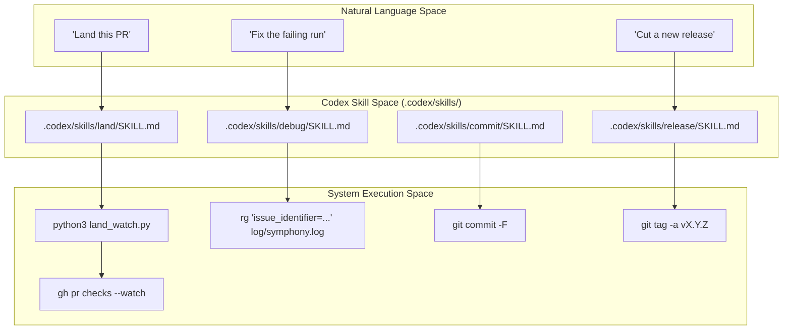
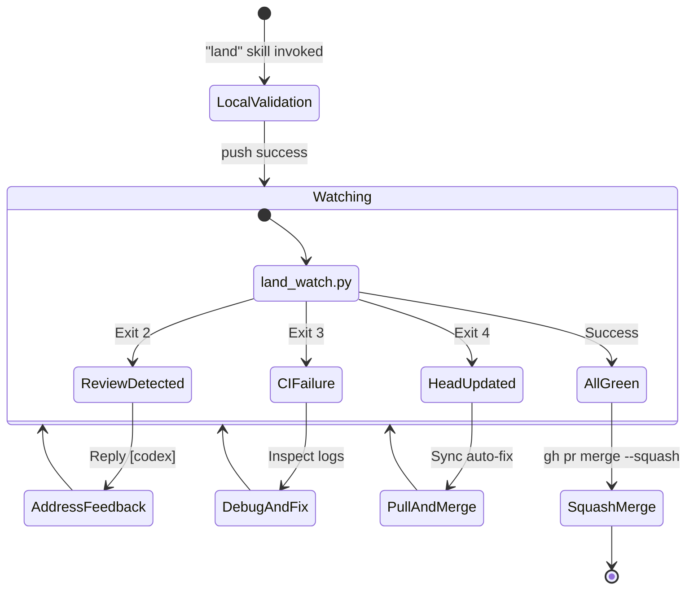
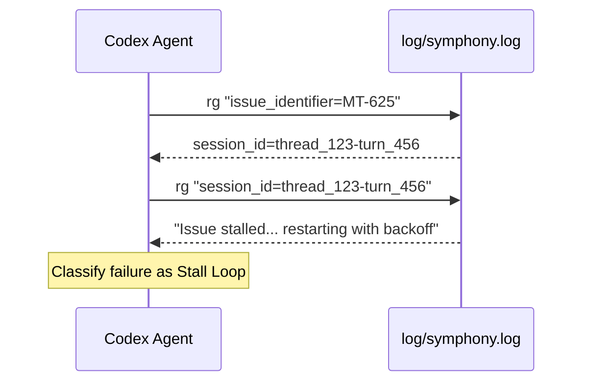

<!-- source: DeepWiki mcp.deepwiki.com · repo openai/symphony · page 7.5 Codex Skills · fetched 2026-10-26 -->

# Codex Skills

Relevant source files

The following files were used as context for generating this wiki page:

- [.codex/skills/commit/SKILL.md](.codex/skills/commit/SKILL.md)
- [.codex/skills/debug/SKILL.md](.codex/skills/debug/SKILL.md)
- [.codex/skills/land/SKILL.md](.codex/skills/land/SKILL.md)
- [.codex/skills/linear/SKILL.md](.codex/skills/linear/SKILL.md)
- [.codex/skills/pull/SKILL.md](.codex/skills/pull/SKILL.md)
- [.codex/skills/push/SKILL.md](.codex/skills/push/SKILL.md)
- [.codex/skills/release/SKILL.md](.codex/skills/release/SKILL.md)
- [.codex/worktree_init.sh](.codex/worktree_init.sh)

Codex Skills are a set of specialized, agent-facing capabilities defined in `.codex/skills/` that enable Codex agents to perform autonomous development tasks on the Symphony codebase itself. These skills encapsulate complex workflows—such as conflict resolution, PR management, release engineering, and log-based debugging—into structured procedures that ensure consistency with project conventions and safety standards.

[ .codex/skills/commit/SKILL.md:1-7 ]()
[ .codex/skills/debug/SKILL.md:1-7 ]()
[ .codex/skills/land/SKILL.md:1-7 ]()
[ .codex/skills/release/SKILL.md:1-4 ]()

## Skill Architecture and Implementation

Each skill is defined by a `SKILL.md` file containing metadata, goals, preconditions, and a sequence of execution steps. These skills often leverage standard CLI tools (`git`, `gh`, `rg`) or custom Python helpers to bridge the gap between high-level intent and low-level system operations.

### Data Flow: From Intent to Execution

The following diagram illustrates how a Codex agent transitions from a natural language request to executing a specific skill like `land`, `commit`, or `release`.

**Natural Language to Code Entity Mapping**

Sources: [ .codex/skills/land/SKILL.md:101-108 ](), [ .codex/skills/debug/SKILL.md:46-61 ](), [ .codex/skills/commit/SKILL.md:46-47 ](), [ .codex/skills/release/SKILL.md:17-22 ]()

## Core Development Skills

### Commit and Push
The `commit` and `push` skills enforce repository standards for history and PR quality.
*   **Commit**: Uses session history to derive rationale. It mandates conventional commit types (e.g., `feat`, `fix`) and appends `Co-authored-by: Codex <codex@openai.com>` trailers. [ .codex/skills/commit/SKILL.md:35-45 ]()
*   **Push**: Handles upstream tracking and PR lifecycle. It validates the PR body against `.github/pull_request_template.md` using the Elixir-based `mix pr_body.check` tool. [ .codex/skills/push/SKILL.md:47-55 ]()

### Pull and Conflict Resolution
The `pull` skill manages branch synchronization. It is specifically designed to handle non-fast-forward rejections encountered during `push`.
*   **Implementation**: Configures `git` with `zdiff3` conflict style and `rerere` (reuse recorded resolution) to automate repetitive resolutions. [ .codex/skills/pull/SKILL.md:15-29 ]()
*   **Heuristics**: Agents are instructed to resolve source files before generated artifacts and to use `git diff :1:file` through `git diff :3:file` to compare base, ours, and theirs versions. [ .codex/skills/pull/SKILL.md:43-71 ]()

### Land (PR Shepherding)
The `land` skill involves a continuous monitoring loop to shepherd a PR from green CI to squash-merge.
*   **Async Watcher**: Uses `land_watch.py`, an `asyncio` script that concurrently monitors GitHub Actions, review comments, and head updates. [ .codex/skills/land/SKILL.md:101-108 ]()
*   **Exit Codes**: The watcher communicates state via exit codes: `2` for new review comments, `3` for CI failure, and `4` for head updates (e.g., GitHub Actions auto-fixes). [ .codex/skills/land/SKILL.md:110-115 ]()

**PR Landing State Machine**

Sources: [ .codex/skills/land/SKILL.md:26-57 ](), [ .codex/skills/land/SKILL.md:110-115 ]()

## Specialized Integration Skills

### Linear GraphQL
The `linear` skill provides direct access to the Linear API via the `linear_graphql` tool. This is used for operations not covered by the standard tracker integration, such as:
*   **Comment Management**: `commentCreate` and `commentUpdate` mutations. [ .codex/skills/linear/SKILL.md:208-238 ]()
*   **State Transitions**: Moving issues between workflow states using `issueUpdate`. [ .codex/skills/linear/SKILL.md:240-258 ]()
*   **Schema Discovery**: Introspection queries to find available mutations or input shapes. [ .codex/skills/linear/SKILL.md:35-70 ]()

### Debugging
The `debug` skill enables agents to self-diagnose failures in the Symphony runtime by correlating identifiers across log files.
*   **Log Correlation**: Agents join data using `issue_identifier` (e.g., `MT-625`), `issue_id` (Linear UUID), and `session_id` (thread-turn pair). [ .codex/skills/debug/SKILL.md:25-32 ]()
*   **Tooling**: Primarily uses `rg` (ripgrep) for high-speed searching across `log/symphony.log` and rotated logs. [ .codex/skills/debug/SKILL.md:46-61 ]()

**Log Correlation Flow**

Sources: [ .codex/skills/debug/SKILL.md:34-42 ](), [ .codex/skills/debug/SKILL.md:63-77 ]()

### Release Management
The `release` skill automates the process of cutting a new version of Symphony.
*   **Version Bumping**: Updates `elixir/mix.exs` with the target version string. [ .codex/skills/release/SKILL.md:12-14 ]()
*   **Verification**: Runs `make -C elixir all` and monitors the `burrito-release` workflow after tagging the merged commit. [ .codex/skills/release/SKILL.md:15-25 ]()
*   **Tagging**: Creates an annotated tag (`git tag -a`) on the merged `main` commit. [ .codex/skills/release/SKILL.md:17-22 ]()

## Workspace Initialization
Before any skills can be executed in a new workspace, the `worktree_init.sh` script must be run. This script ensures that the environment is prepared by:
1.  Verifying `mise` is installed for tool version management. [ .codex/worktree_init.sh:8-11 ]()
2.  Trusting the local `.mise.toml` configuration. [ .codex/worktree_init.sh:14 ]()
3.  Executing `make setup` in the `elixir/` directory to install dependencies and compile the system. [ .codex/worktree_init.sh:16 ]()

Sources:
*   [ .codex/skills/commit/SKILL.md ]()
*   [ .codex/skills/debug/SKILL.md ]()
*   [ .codex/skills/land/SKILL.md ]()
*   [ .codex/skills/linear/SKILL.md ]()
*   [ .codex/skills/pull/SKILL.md ]()
*   [ .codex/skills/push/SKILL.md ]()
*   [ .codex/skills/release/SKILL.md ]()
*   [ .codex/worktree_init.sh ]()

---

