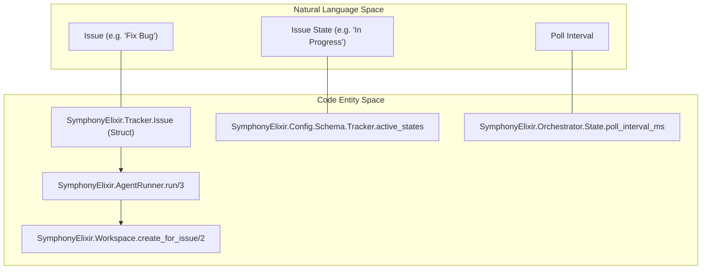
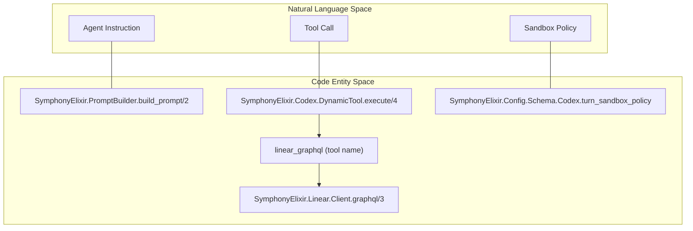
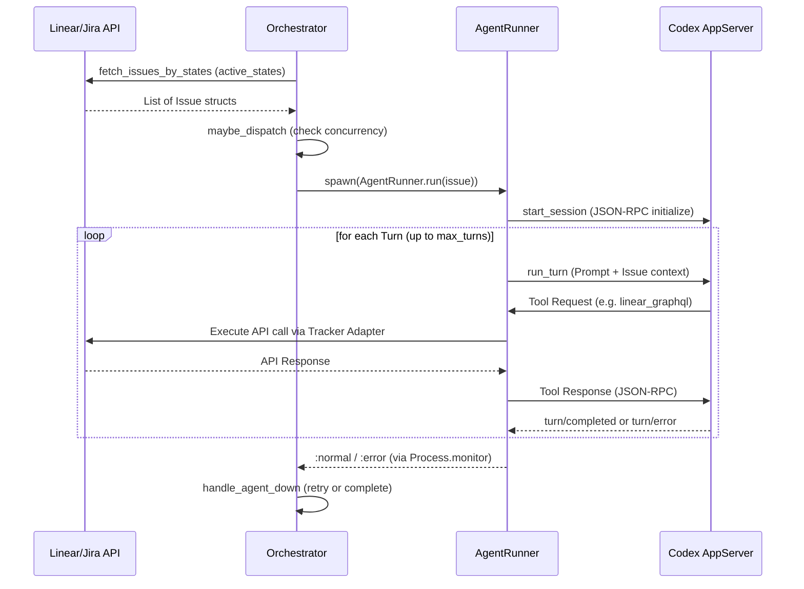

<!-- source: DeepWiki mcp.deepwiki.com · repo openai/symphony · page 8 Glossary · fetched 2026-10-26 -->

# Glossary

Relevant source files

The following files were used as context for generating this wiki page:

- [SPEC.md](SPEC.md)
- [elixir/README.md](elixir/README.md)
- [elixir/WORKFLOW.md](elixir/WORKFLOW.md)
- [elixir/lib/symphony_elixir/agent_runner.ex](elixir/lib/symphony_elixir/agent_runner.ex)
- [elixir/lib/symphony_elixir/codex/app_server.ex](elixir/lib/symphony_elixir/codex/app_server.ex)
- [elixir/lib/symphony_elixir/config/schema.ex](elixir/lib/symphony_elixir/config/schema.ex)
- [elixir/lib/symphony_elixir/jira/adapter.ex](elixir/lib/symphony_elixir/jira/adapter.ex)
- [elixir/lib/symphony_elixir/jira/agent_tool.ex](elixir/lib/symphony_elixir/jira/agent_tool.ex)
- [elixir/lib/symphony_elixir/jira/client.ex](elixir/lib/symphony_elixir/jira/client.ex)
- [elixir/lib/symphony_elixir/linear/client.ex](elixir/lib/symphony_elixir/linear/client.ex)
- [elixir/lib/symphony_elixir/orchestrator.ex](elixir/lib/symphony_elixir/orchestrator.ex)
- [elixir/lib/symphony_elixir/tracker.ex](elixir/lib/symphony_elixir/tracker.ex)
- [elixir/test/support/test_support.exs](elixir/test/support/test_support.exs)
- [elixir/test/symphony_elixir/app_server_test.exs](elixir/test/symphony_elixir/app_server_test.exs)
- [elixir/test/symphony_elixir/jira_adapter_test.exs](elixir/test/symphony_elixir/jira_adapter_test.exs)
- [elixir/test/symphony_elixir/jira_live_e2e_test.exs](elixir/test/symphony_elixir/jira_live_e2e_test.exs)

This page defines codebase-specific terms, jargon, and domain concepts used within Symphony. It maps natural language concepts to their specific implementations in the Elixir codebase.

## Core Concepts

### Orchestrator
The central GenServer responsible for the service's control loop. It manages the polling cadence, reconciliation of issue states, and dispatching of `AgentRunner` processes [elixir/lib/symphony_elixir/orchestrator.ex:1-4](). It maintains the in-memory state of active runs, retries, and blocked issues [elixir/lib/symphony_elixir/orchestrator.ex:24-45]().
*   **Code Pointer:** `SymphonyElixir.Orchestrator` [elixir/lib/symphony_elixir/orchestrator.ex:1-1]()

### Agent Runner
A transient process or logic block that manages the execution of a single issue. It coordinates the workspace preparation and the turn-based communication with the Codex App Server [elixir/lib/symphony_elixir/agent_runner.ex:1-4](). It handles the transition between turns and checks if an issue should continue running based on its state [elixir/lib/symphony_elixir/agent_runner.ex:113-139]().
*   **Code Pointer:** `SymphonyElixir.AgentRunner` [elixir/lib/symphony_elixir/agent_runner.ex:1-1]()

### Workspace
An isolated directory on a local or remote filesystem where the agent performs its work. Workspaces are deterministic based on the issue identifier (e.g., `PROJ-123` maps to a specific folder) and are managed by lifecycle hooks like `after_create` [elixir/README.md:18-18](). Symphony ensures path safety by validating that workspaces reside within a configured root [elixir/lib/symphony_elixir/codex/app_server.ex:150-176]().
*   **Code Pointer:** `SymphonyElixir.Workspace` [elixir/lib/symphony_elixir/agent_runner.ex:8-8]()

### Codex App Server
The underlying agent engine that Symphony communicates with via JSON-RPC 2.0 over stdio [elixir/lib/symphony_elixir/codex/app_server.ex:1-4](). It executes the "turns" where the model processes the prompt and uses tools. It supports sandbox policies for thread and turn execution [elixir/lib/symphony_elixir/codex/app_server.ex:14-25]().
*   **Code Pointer:** `SymphonyElixir.Codex.AppServer` [elixir/lib/symphony_elixir/codex/app_server.ex:1-1]()

### WORKFLOW.md
The repository-owned configuration file. It contains YAML front matter for system settings (concurrency, timeouts, hooks) and a Markdown body that serves as the base prompt for the agent [elixir/README.md:115-116]().
*   **Code Pointer:** `SymphonyElixir.Config` [elixir/lib/symphony_elixir/orchestrator.ex:10-10]()

---

## Domain Mapping: Natural Language to Code

The following diagrams bridge the gap between abstract system concepts and the specific Elixir modules and functions that implement them.

### Mapping: Issue Lifecycle and Dispatch
This diagram shows how tracker concepts (e.g., Linear, Jira) are translated into Symphony's execution entities.

**Sources:** [elixir/lib/symphony_elixir/orchestrator.ex:24-45](), [elixir/lib/symphony_elixir/agent_runner.ex:21-36](), [elixir/lib/symphony_elixir/config/schema.ex:43-87](), [SPEC.md:156-178]().

### Mapping: Agent Communication and Tooling
This diagram maps the interaction between the agent's intent and the system's capabilities.

**Sources:** [elixir/lib/symphony_elixir/codex/app_server.ex:89-94](), [elixir/lib/symphony_elixir/config/schema.ex:174-198](), [elixir/lib/symphony_elixir/linear/client.ex:139-141]().

---

## Technical Terms Table

| Term | Definition | Code Site |
| :--- | :--- | :--- |
| **Turn** | A single request-response cycle between Symphony and the Codex App Server. | `AppServer.run_turn/4` [elixir/lib/symphony_elixir/codex/app_server.ex:71-86]() |
| **Hook** | Shell commands executed at specific workspace lifecycle points (e.g., `after_create`, `before_run`). | `Workspace.run_before_run_hook/3` [elixir/lib/symphony_elixir/agent_runner.ex:46-46]() |
| **Tracker** | An abstraction for an issue source (Linear, Jira, GitHub, etc.). | `SymphonyElixir.Tracker` [elixir/lib/symphony_elixir/tracker.ex:1-8]() |
| **Worker Host** | An SSH destination where workspaces and agents are deployed. | `AgentRunner.selected_worker_host/2` [elixir/lib/symphony_elixir/agent_runner.ex:188-192]() |
| **Terminal State** | Issue statuses that signal work is complete or abandoned (e.g., `Done`, `Closed`). | `Config.Schema.Tracker.terminal_states` [elixir/lib/symphony_elixir/config/schema.ex:60-60]() |
| **Dynamic Tool** | A Symphony-provided capability exposed to Codex via JSON-RPC (e.g., `linear_graphql`). | `SymphonyElixir.Codex.DynamicTool` [elixir/lib/symphony_elixir/codex/app_server.ex:7-7]() |
| **App Server Protocol** | The JSON-RPC 2.0 protocol used to communicate with the `codex` binary. | `SymphonyElixir.Codex.AppServer` [elixir/lib/symphony_elixir/codex/app_server.ex:1-4]() |

---

## System State Flow

The Orchestrator maintains the "source of truth" for what is currently running. This diagram illustrates the data flow from the external tracker into the internal execution state.

**Sources:** [elixir/lib/symphony_elixir/orchestrator.ex:118-126](), [elixir/lib/symphony_elixir/orchestrator.ex:128-148](), [elixir/lib/symphony_elixir/agent_runner.ex:88-99](), [elixir/lib/symphony_elixir/agent_runner.ex:101-140](), [elixir/lib/symphony_elixir/codex/app_server.ex:110-136]().

---
**Sources:** [elixir/README.md:18-116](), [elixir/lib/symphony_elixir/orchestrator.ex:1-116](), [elixir/lib/symphony_elixir/agent_runner.ex:1-192](), [elixir/lib/symphony_elixir/codex/app_server.ex:1-190](), [elixir/lib/symphony_elixir/tracker.ex:1-20](), [elixir/lib/symphony_elixir/config/schema.ex:1-245](), [SPEC.md:89-178]().