# Page: Overview

# Overview

<details>
<summary>Relevant source files</summary>

The following files were used as context for generating this wiki page:

- [README.md](README.md)
- [SPEC.md](SPEC.md)
- [elixir/README.md](elixir/README.md)
- [elixir/WORKFLOW.md](elixir/WORKFLOW.md)
- [elixir/mix.exs](elixir/mix.exs)
- [elixir/test/support/test_support.exs](elixir/test/support/test_support.exs)

</details>


## Purpose and Scope

Symphony is a **daemon-based automation system** that continuously polls issue trackers for work, creates isolated per-issue workspaces, and executes Codex AI agents to perform autonomous development tasks. It acts as an orchestration layer between project management tools (like Linear) and autonomous coding agents.

**Sources:** [elixir/README.md:1-9](), [SPEC.md:1-21]()

---

## What Symphony Does

Symphony transforms tracker issues into agent execution sessions through a **poll-dispatch-execute loop**:

1.  **Polls** the configured tracker (Linear, GitHub, Jira, Asana, or GitLab) for candidate work [elixir/README.md:16-17]().
2.  **Creates** an isolated workspace per issue under a configured root directory [elixir/README.md:18-18]().
3.  **Launches** Codex in [App Server mode](https://developers.openai.com/codex/app-server/) inside the workspace [elixir/README.md:19-20]().
4.  **Sends** a workflow-defined prompt to Codex containing issue context [elixir/README.md:21-21]().
5.  **Keeps** Codex working until the issue reaches a terminal state, a turn cap is reached, or a handoff point occurs [elixir/README.md:22-22]().
6.  **Provides** provider-native tools (e.g., `linear_graphql`, `github_api`) so agents can interact with the tracker directly using host-side credentials [elixir/README.md:24-28]().

When an active issue moves to a terminal state (`Done`, `Closed`, `Cancelled`, or `Duplicate`), Symphony stops the active agent and cleans up matching workspaces [elixir/README.md:30-31]().

**Sources:** [elixir/README.md:14-37](), [SPEC.md:8-34]()

---

## System Boundaries

### What Symphony Is

*   **A scheduler and runner** that reads issues and dispatches agent sessions with bounded concurrency [SPEC.md:38-38](), [SPEC.md:50-50]().
*   **A workspace manager** that enforces per-issue isolation and runs lifecycle hooks (like `git clone`) [SPEC.md:99-103](), [elixir/README.md:128-130]().
*   **A configuration loader** that reads `WORKFLOW.md` for prompt templates and runtime settings [SPEC.md:73-81]().
*   **An observability provider** with real-time dashboards and JSON APIs [elixir/README.md:33-36]().

### What Symphony Is Not

*   **Not a multi-tenant platform** - designed to run as a single-daemon service per repository [SPEC.md:62-62]().
*   **Not a Linear writer** - agents perform the actual ticket writes via tools; Symphony only reads and orchestrates [SPEC.md:39-40]().
*   **Not a persistent database** - it uses a tracker-driven recovery model where the in-memory scheduler state is reconstructed from the tracker and filesystem [SPEC.md:57-58]().

**Sources:** [SPEC.md:36-70](), [elixir/README.md:151-161]()

---

## Core Architecture

The following diagram maps Symphony's high-level architecture to the actual Elixir modules and processes defined in the codebase.

### System Component Map

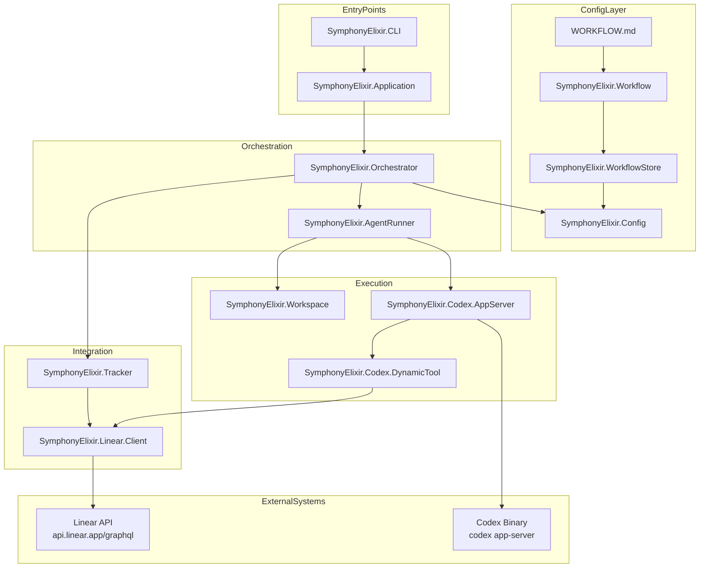

**Key Module Responsibilities:**

| Module | Type | Purpose |
| :--- | :--- | :--- |
| `SymphonyElixir.Orchestrator` | GenServer | Owns the poll tick, manages in-memory state, and decides when to dispatch [SPEC.md:93-97](). |
| `SymphonyElixir.AgentRunner` | Task | Manages the lifecycle of a single issue execution session [SPEC.md:105-109](). |
| `SymphonyElixir.Workspace` | Module | Maps issues to paths and ensures directories/hooks are executed [SPEC.md:99-103](). |
| `SymphonyElixir.Codex.AppServer` | Module | Handles JSON-RPC 2.0 communication with the Codex subprocess [elixir/mix.exs:28-28](). |
| `SymphonyElixir.Tracker` | Facade | Normalizes payloads from various tracker adapters (Linear, Jira, etc.) [SPEC.md:85-91](). |
| `SymphonyElixir.Config` | Module | Provides typed getters for configuration with environment variable support [SPEC.md:78-81](). |

**Sources:** [SPEC.md:71-118](), [elixir/mix.exs:15-46](), [elixir/test/support/test_support.exs:9-22]()

---

## Operational Model: Poll-Dispatch-Execute

Symphony runs as an OTP application. The primary driver of activity is the `Orchestrator` GenServer, which maintains a periodic timer.

### Issue Processing Flow

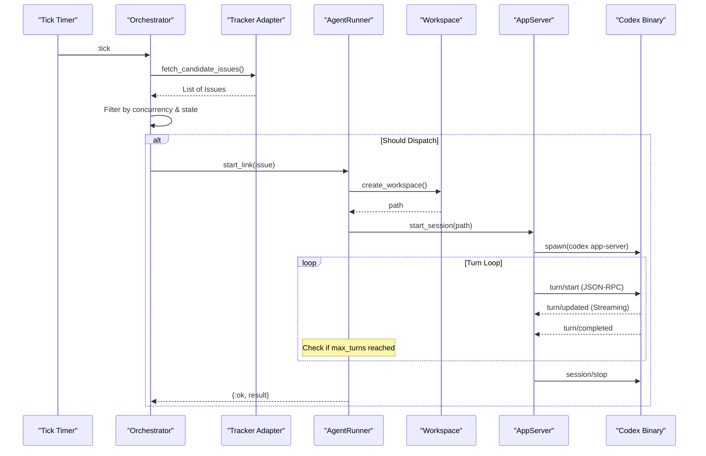

**Key Behaviors:**

*   **Reconciliation:** On every tick, the orchestrator reconciles running agents against the tracker. If an issue moves to a terminal state in Linear, Symphony stops the local agent [elixir/README.md:30-31]().
*   **Turn Capping:** The `agent.max_turns` setting prevents agents from running indefinitely in a single invocation [elixir/README.md:166-167]().
*   **Retry Logic:** Transient failures are handled with exponential backoff managed by the orchestrator [SPEC.md:54-54]().

**Sources:** [SPEC.md:89-109](), [elixir/README.md:14-37](), [elixir/WORKFLOW.md:31-32]()

---

## Configuration: WORKFLOW.md

Symphony is configured via a `WORKFLOW.md` file located in the target repository. This file uses YAML front matter for settings and a Markdown body for the agent's system prompt [elixir/README.md:115-116]().

### Configuration Structure

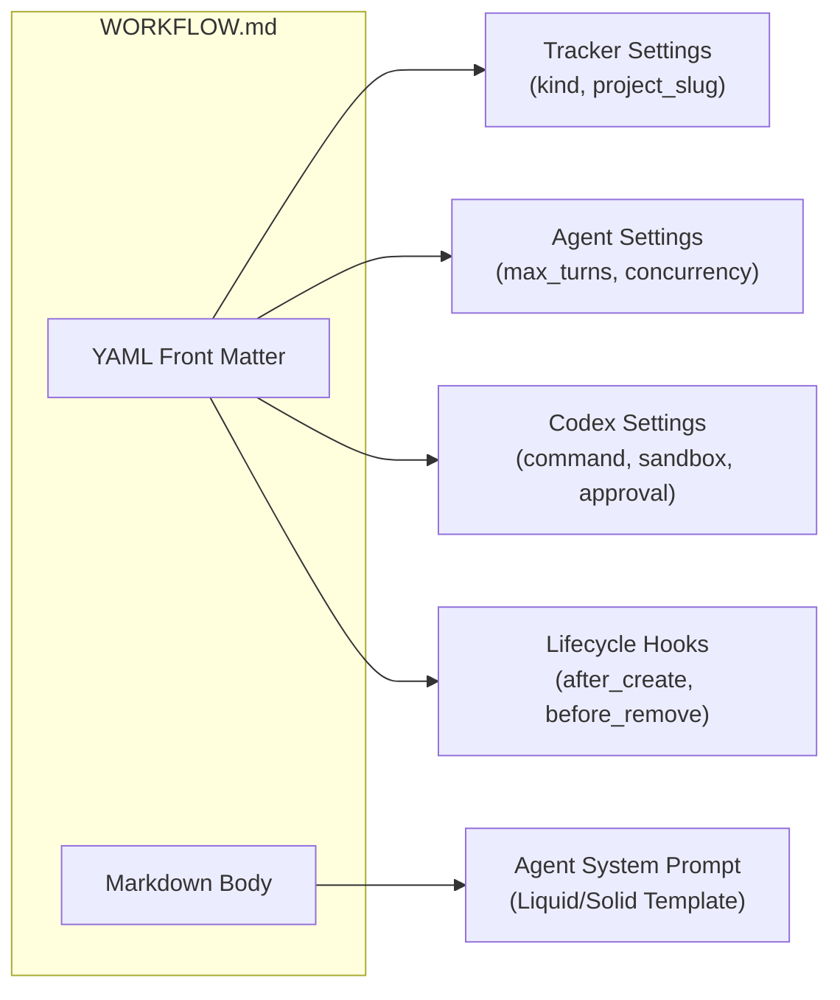

**Key Settings:**
*   `tracker.kind`: Selects the adapter (e.g., `linear`) [elixir/README.md:122-123]().
*   `codex.approval_policy`: Defines how Symphony handles Codex requests for approval or MCP elicitation [elixir/README.md:152-158]().
*   `hooks.after_create`: Shell commands to run when a workspace is first initialized (e.g., `git clone`) [elixir/README.md:128-130]().

**Sources:** [elixir/README.md:100-170](), [elixir/WORKFLOW.md:1-40]()

---

## Observability and Monitoring

Symphony provides multiple layers of observability to monitor autonomous agents:

1.  **Phoenix LiveView Dashboard:** If started with the `--port` flag, Symphony hosts a real-time dashboard showing active agents, token usage, and logs [elixir/README.md:113-113](), [elixir/mix.exs:34-34]().
2.  **REST API:** Provides JSON endpoints for querying the current state of the orchestrator and individual agent runs [elixir/mix.exs:39-39]().
3.  **Structured Logging:** Symphony writes detailed logs for each issue under the configured `--logs-root` [elixir/README.md:112-112]().

**Sources:** [elixir/README.md:110-114](), [SPEC.md:111-112](), [elixir/mix.exs:34-43]()

---

# Page: Getting Started

# Getting Started

<details>
<summary>Relevant source files</summary>

The following files were used as context for generating this wiki page:

- [.github/workflows/burrito-release.yml](.github/workflows/burrito-release.yml)
- [elixir/.gitignore](elixir/.gitignore)
- [elixir/README.md](elixir/README.md)
- [elixir/WORKFLOW.md](elixir/WORKFLOW.md)
- [elixir/config/config.exs](elixir/config/config.exs)
- [elixir/lib/symphony_elixir.ex](elixir/lib/symphony_elixir.ex)
- [elixir/lib/symphony_elixir/cli.ex](elixir/lib/symphony_elixir/cli.ex)
- [elixir/lib/symphony_elixir/workflow_store.ex](elixir/lib/symphony_elixir/workflow_store.ex)
- [elixir/mise.toml](elixir/mise.toml)
- [elixir/test/fixtures/startup_workflow.md](elixir/test/fixtures/startup_workflow.md)

</details>


This guide walks through setting up Symphony for the first time, configuring your `WORKFLOW.md` file, and running the orchestrator service. By the end of this guide, you will have Symphony polling Linear for issues and launching Codex agents in isolated workspaces.

For architectural details about how these components interact, see [Architecture](). For in-depth configuration reference, see [Configuration System]().

---

## Prerequisites

Symphony requires three runtime dependencies to function:

| Dependency | Purpose | Installation |
|------------|---------|--------------|
| **Elixir/Erlang** | Runtime platform for Symphony service | Managed via `mise` tool |
| **Codex binary** | AI agent execution engine | Installed separately (see Codex documentation) |
| **Linear API key** | Issue tracker integration | Generated from Linear Settings → Security & access → Personal API keys |

### Installing Elixir/Erlang with mise

Symphony uses [mise](https://mise.jdx.dev/) for version management. The repository includes a `mise.toml` file that specifies the required Elixir and Erlang versions [elixir/mise.toml:1-4]().

```bash
# Install mise if not already present
curl https://mise.run | sh

# Navigate to the elixir directory
cd symphony/elixir

# Install required Elixir/Erlang versions
mise install

# Verify installation
mise exec -- elixir --version
```

**Sources:** [elixir/README.md:58-63](), [elixir/mise.toml:1-4]()

### Obtaining a Linear API Key

1. Navigate to Linear Settings → Security & access → Personal API keys [elixir/README.md:42-43]().
2. Create a new personal API key.
3. Store it securely - you will set it as `LINEAR_API_KEY` environment variable.

The API key is required for Symphony's tracker integration to fetch and update issues. Symphony executes tracker tools (like `linear_graphql`) with host-side auth and manages these tokens so the agent does not need a second login [elixir/README.md:24-28]().

**Sources:** [elixir/README.md:24-28](), [elixir/README.md:42-43]()

---

## Installation

### Clone and Build

```bash
# Clone the repository
git clone https://github.com/openai/symphony
cd symphony/elixir

# Trust mise configuration
mise trust

# Install dependencies
mise install

# Run Mix setup task
mise exec -- mix setup

# Build the Symphony binary
mise exec -- mix build
```

The `mix setup` and `mix build` commands prepare the Elixir environment and compile the project [elixir/README.md:67-75](). Symphony also supports building self-contained executables using Burrito for various targets like `macos_arm64` and `linux_x86_64` [elixir/README.md:79-88]().

**Sources:** [elixir/README.md:67-75](), [elixir/README.md:79-88]()

---

## Configuration

Symphony reads its configuration from a `WORKFLOW.md` file using YAML front matter. This file defines tracker settings, workspace behavior, Codex parameters, and the prompt template [elixir/README.md:115-116]().

### Configuration Pipeline

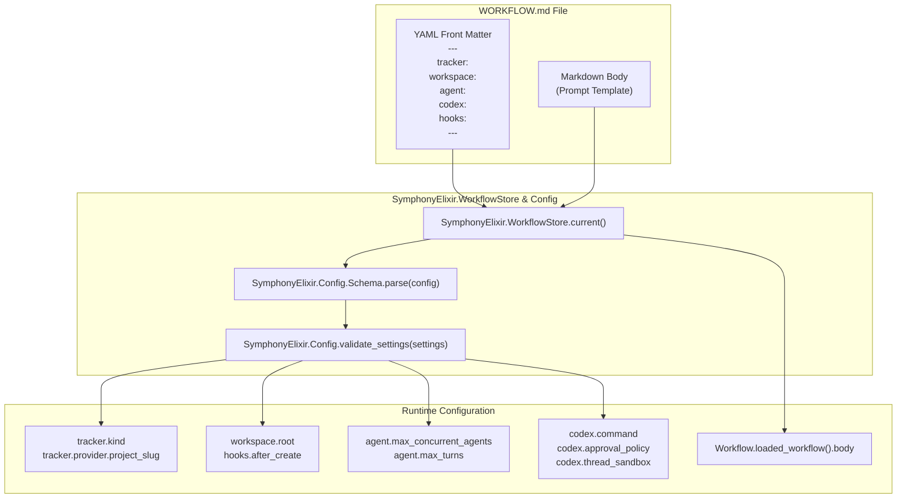

**Diagram: WORKFLOW.md structure and parsing pipeline**

The `SymphonyElixir.WorkflowStore` GenServer caches the last known good workflow and automatically reloads it when `WORKFLOW.md` changes [elixir/lib/symphony_elixir/workflow_store.ex:1-4]().

**Sources:** [elixir/lib/symphony_elixir/workflow_store.ex:1-4](), [elixir/lib/symphony_elixir/workflow_store.ex:157-167](), [elixir/README.md:115-116]()

### Minimal Configuration Example

Create a `WORKFLOW.md` file in your repository root [elixir/README.md:120-141]():

```markdown
---
tracker:
  kind: linear
  provider:
    project_slug: "..."
workspace:
  root: ~/code/workspaces
hooks:
  after_create: |
    git clone git@github.com:your-org/your-repo.git .
agent:
  max_concurrent_agents: 10
  max_turns: 20
codex:
  command: codex app-server
---

You are working on an issue from the configured tracker {{ issue.identifier }}.

Title: {{ issue.title }} Body: {{ issue.description }}
```

**Sources:** [elixir/README.md:120-141]()

### Required Configuration Fields

| Field | Description | Default |
|-------|-------------|---------|
| `tracker.kind` | Issue tracker adapter (e.g., `linear`, `github`, `jira`) | None [elixir/README.md:123]() |
| `tracker.provider.project_slug` | Tracker-specific project identifier | None [elixir/README.md:125]() |
| `workspace.root` | Root directory for issue workspaces | None [elixir/README.md:127]() |
| `hooks.after_create` | Script to bootstrap a fresh workspace (e.g., `git clone`) | None [elixir/README.md:129-130]() |
| `codex.command` | Command to launch Codex app-server | `codex app-server` [elixir/README.md:135]() |

**Sources:** [elixir/README.md:120-135]()

### Security Defaults

When policy fields are omitted, Symphony applies safer defaults to the Codex execution environment:
- `codex.approval_policy`: Defaults to rejecting sandbox approvals, rules, and MCP elicitations [elixir/README.md:153]().
- `codex.thread_sandbox`: Defaults to `workspace-write` [elixir/README.md:154]().
- `codex.turn_sandbox_policy`: Defaults to `workspaceWrite` rooted at the current issue workspace [elixir/README.md:155]().

**Sources:** [elixir/README.md:152-156]()

---

## Running Symphony

### CLI Entrypoint

Symphony is started via the CLI, which handles argument parsing and initializes the OTP application.

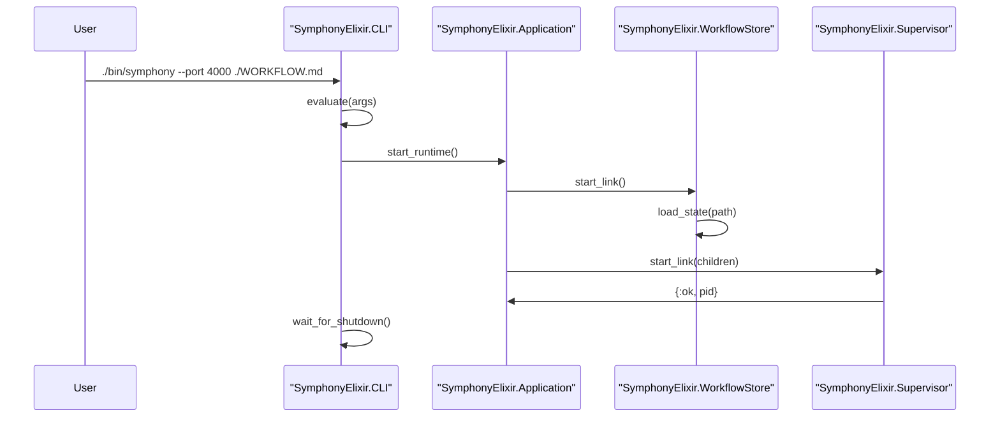

**Diagram: Symphony CLI Startup Flow**

The CLI requires an explicit acknowledgement of the "engineering preview" status via a specific flag if running the burrito release [elixir/lib/symphony_elixir/cli.ex:111-120]().

**Sources:** [elixir/lib/symphony_elixir/cli.ex:27-36](), [elixir/lib/symphony_elixir/cli.ex:111-120](), [elixir/lib/symphony_elixir.ex:35-51]()

### Command-Line Options

Pass a custom workflow file path to the binary. If no path is passed, Symphony defaults to `./WORKFLOW.md` [elixir/README.md:102-108]().

- `--logs-root`: Sets the directory for writing logs (default: `./log`) [elixir/README.md:112]().
- `--port`: Starts the Phoenix observability service/dashboard (default: disabled) [elixir/README.md:113]().

**Sources:** [elixir/README.md:102-113]()

---

## Verifying Your Setup

### Enable Dashboard for Visualization

Run Symphony with the `--port` flag to enable the real-time monitoring dashboard [elixir/README.md:113]():

```bash
./bin/symphony ./WORKFLOW.md --port 4000
```

The dashboard (started via `SymphonyElixir.StatusDashboard`) provides a view of active agents, token usage, and blocked states [elixir/lib/symphony_elixir.ex:43](), [elixir/README.md:33-36]().

**Sources:** [elixir/lib/symphony_elixir.ex:43](), [elixir/README.md:33-36](), [elixir/README.md:113]()

### Test with a Linear Issue

1. Create a test issue in Linear.
2. Ensure the issue has the labels required by `tracker.required_labels` if configured [elixir/README.md:149-151]().
3. Set the issue to one of the `active_states` (e.g., `Todo`, `In Progress`) [elixir/WORKFLOW.md:7-11]().
4. Symphony polls every `polling.interval_ms` (default 5000ms) [elixir/WORKFLOW.md:19]().
5. Upon discovery, Symphony creates a workspace and launches Codex [elixir/README.md:16-22]().

**Sources:** [elixir/README.md:16-22](), [elixir/README.md:149-151](), [elixir/WORKFLOW.md:7-19]()

---

## Troubleshooting Common Issues

### Issue: Workflow Reload Errors
If you modify `WORKFLOW.md` and introduce a syntax error, `SymphonyElixir.WorkflowStore` will log the error but continue using the last known good configuration [elixir/lib/symphony_elixir/workflow_store.ex:178-180](). Check the logs to see validation failures.

### Issue: Network Access Denied
If your `hooks.after_create` or Codex turns need to access the internet (e.g., for `npm install`), ensure `networkAccess: true` is set in `codex.turn_sandbox_policy` [elixir/README.md:163-165]().

**Sources:** [elixir/lib/symphony_elixir/workflow_store.ex:178-180](), [elixir/README.md:163-165]()

---

# Page: Architecture

# Architecture

<details>
<summary>Relevant source files</summary>

The following files were used as context for generating this wiki page:

- [SPEC.md](SPEC.md)
- [elixir/lib/symphony_elixir/orchestrator.ex](elixir/lib/symphony_elixir/orchestrator.ex)
- [elixir/mix.exs](elixir/mix.exs)
- [elixir/test/support/test_support.exs](elixir/test/support/test_support.exs)

</details>


This page describes Symphony's end-to-end system architecture: the major components, how they interact, and the key design principles that govern the system.

---

## Purpose and Scope

Symphony is a long-running orchestration service that reads work from Linear, creates isolated per-issue workspaces, and drives a Codex coding-agent session for each issue. The architecture solves four operational problems:

1.  **Repeatability** — turns issue execution into a repeatable daemon workflow instead of manual scripts [SPEC.md:24-24]().
2.  **Isolation** — per-issue workspaces ensure agent commands run only inside their assigned directory [SPEC.md:25-26]().
3.  **Policy-as-code** — `WORKFLOW.md` keeps the agent prompt and runtime settings version-controlled alongside the codebase [SPEC.md:27-28]().
4.  **Observability** — structured logs and an optional Phoenix LiveView dashboard give operators visibility into concurrent agent runs [SPEC.md:29-29]().

Symphony is a **scheduler and tracker reader**. Tracker writes (state transitions, comments, PR links) are performed by the coding agent using tools defined in `WORKFLOW.md`, not by the orchestrator directly [SPEC.md:38-40]().

---

## Abstraction Layers

The system is organized into six layers. Each layer has a single responsibility and clear interfaces to its neighbors.

| Layer | Responsibility | Key Artifacts |
| :--- | :--- | :--- |
| **Policy** | Defines what the agent should do | `WORKFLOW.md` body (prompt template) |
| **Configuration** | Typed getters, defaults, env resolution | `SymphonyElixir.WorkflowStore`, `SymphonyElixir.Config` |
| **Coordination** | Polling loop, concurrency, retries, reconciliation | `SymphonyElixir.Orchestrator` |
| **Execution** | Workspace lifecycle, agent subprocess | `SymphonyElixir.AgentRunner`, `SymphonyElixir.Workspace` |
| **Integration** | Linear API adapter, normalization | `SymphonyElixir.Codex.AppServer` + `SymphonyElixir.Linear.Client` |
| **Observability** | Structured logs, Phoenix LiveView dashboard | `SymphonyElixir.StatusDashboard`, `SymphonyElixirWeb.DashboardLive` |

**Sources:** [SPEC.md:114-136](), [elixir/lib/symphony_elixir/orchestrator.ex:10-11](), [elixir/mix.exs:31-43]()

---

## Component Map

**Component overview — module names correspond directly to Elixir source files under `elixir/lib/`.**

```mermaid
graph TD
    ["SymphonyElixir.CLI"] -- "starts" --> ["SymphonyElixir.Orchestrator"]

    subgraph ConfigLayer ["Configuration Layer"]
        ["WORKFLOW.md"] --> ["SymphonyElixir.WorkflowStore"]
        ["SymphonyElixir.WorkflowStore"] --> ["SymphonyElixir.Config"]
    end

    subgraph CoordinationLayer ["Coordination Layer"]
        ["SymphonyElixir.Orchestrator"] -- "manages" --> ["SymphonyElixir.Orchestrator.State"]
    end

    subgraph ExecutionLayer ["Execution Layer"]
        ["SymphonyElixir.Orchestrator"] -- "spawns" --> ["SymphonyElixir.AgentRunner"]
        ["SymphonyElixir.AgentRunner"] -- "prepares" --> ["SymphonyElixir.Workspace"]
        ["SymphonyElixir.AgentRunner"] -- "manages" --> ["SymphonyElixir.Codex.AppServer"]
    end

    subgraph IntegrationLayer ["Integration Layer"]
        ["SymphonyElixir.Codex.AppServer"] -- "executes" --> ["codex app-server"]
        ["SymphonyElixir.Codex.AppServer"] -- "provides" --> ["SymphonyElixir.Codex.DynamicTool"]
        ["SymphonyElixir.Codex.DynamicTool"] -- "calls" --> ["SymphonyElixir.Linear.Client"]
    end

    subgraph ObservabilityLayer ["Observability Layer"]
        ["SymphonyElixir.Orchestrator"] -- "updates" --> ["SymphonyElixir.StatusDashboard"]
        ["SymphonyElixir.StatusDashboard"] -- "renders" --> ["SymphonyElixirWeb.DashboardLive"]
    end

    ["SymphonyElixir.Config"] --> ["SymphonyElixir.Orchestrator"]
```

**Sources:** [SPEC.md:71-113](), [elixir/lib/symphony_elixir/orchestrator.ex:10-45](), [elixir/mix.exs:100-100](), [elixir/lib/symphony_elixir/codex/app_server.ex:1-5]()

---

## Configuration: WORKFLOW.md as Policy Contract

`WORKFLOW.md` is the single source of truth for runtime behavior. It has two parts:

*   **YAML front matter** — parsed into a typed config map consumed by `SymphonyElixir.Config` [elixir/test/support/test_support.exs:169-178]().
*   **Markdown body** — used as the Liquid-compatible prompt template rendered per issue [elixir/test/support/test_support.exs:165-165]().

The file is watched at runtime; changes are re-applied without restart by `SymphonyElixir.WorkflowStore.force_reload/0` [elixir/test/support/test_support.exs:57-63]().

**WORKFLOW.md configuration categories:**

| Category | Purpose |
| :--- | :--- |
| `tracker` | Issue tracker kind, API key, project slug, active/terminal states [elixir/test/support/test_support.exs:170-182]() |
| `polling` | Poll interval (`poll_interval_ms`) [elixir/lib/symphony_elixir/orchestrator.ex:61-61]() |
| `workspace` | Workspace root path and lifecycle hooks [elixir/test/support/test_support.exs:103-103]() |
| `agent` | `max_concurrent_agents`, `max_turns`, and retry backoffs [elixir/lib/symphony_elixir/orchestrator.ex:62-62]() |
| `codex` | Subprocess command, approval policy, sandbox, and timeouts [elixir/test/support/test_support.exs:148-154]() |

For details, see [Configuration System](#3.2).

---

## Orchestrator State Machine

The `SymphonyElixir.Orchestrator` GenServer is the single authority over in-memory scheduling state [elixir/lib/symphony_elixir/orchestrator.ex:1-6]().

**Internal orchestration states:**

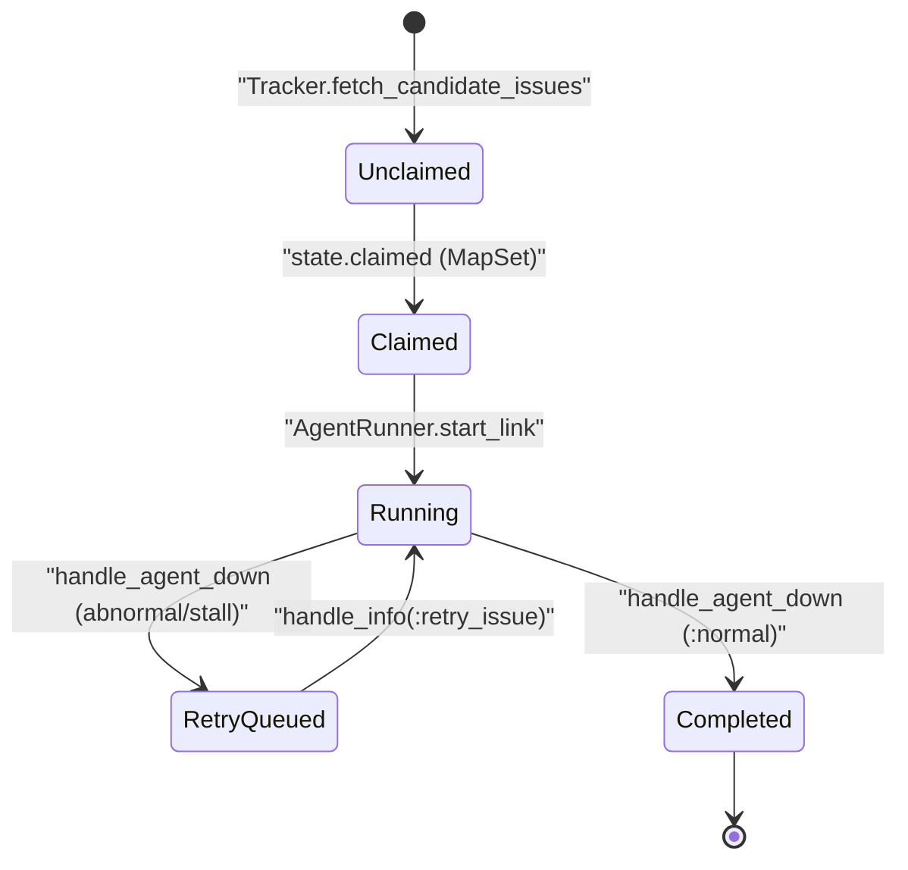

**Key orchestrator data structures** (defined in `SymphonyElixir.Orchestrator.State`):

| Field | Type | Purpose |
| :--- | :--- | :--- |
| `running` | `%{issue_id => entry}` | Active worker processes and their runtime metadata [elixir/lib/symphony_elixir/orchestrator.ex:37-37]() |
| `claimed` | `MapSet.t()` | Reserved IDs to prevent duplicate dispatch [elixir/lib/symphony_elixir/orchestrator.ex:39-39]() |
| `retry_attempts` | `%{issue_id => attempt}` | Scheduled retry timers and backoff state [elixir/lib/symphony_elixir/orchestrator.ex:41-41]() |
| `codex_totals` | `map()` | Aggregate token usage and execution time [elixir/lib/symphony_elixir/orchestrator.ex:42-42]() |

For details, see [Issue Lifecycle](#3.1).

---

## Poll Loop and Dispatch

Every `poll_interval_ms`, the orchestrator runs a tick to synchronize with the tracker [elixir/lib/symphony_elixir/orchestrator.ex:118-126]().

**Poll tick sequence:**

```mermaid
flowchart TD
    ["handle_info(:tick)"] --> ["refresh_runtime_config"]
    ["refresh_runtime_config"] --> ["maybe_dispatch"]
    ["maybe_dispatch"] --> ["Tracker.fetch_candidate_issues"]
    ["Tracker.fetch_candidate_issues"] --> ["AgentRunner.start_link"]
    ["AgentRunner.start_link"] --> ["schedule_tick"]
```

**Retry backoff logic:**

*   **Continuation retry:** `1,000 ms` delay for agents that finish normally but require further turns [elixir/lib/symphony_elixir/orchestrator.ex:13-13]().
*   **Failure retry:** Base `10,000 ms` with exponential backoff for crashes or timeouts [elixir/lib/symphony_elixir/orchestrator.ex:14-14]().

**Sources:** [elixir/lib/symphony_elixir/orchestrator.ex:13-126]()

---

## Agent Runner and Codex Protocol

`SymphonyElixir.AgentRunner` manages the Codex subprocess lifecycle, while `SymphonyElixir.Codex.AppServer` handles the JSON-RPC 2.0 communication [elixir/mix.exs:25-28]().

**Startup handshake sequence:**

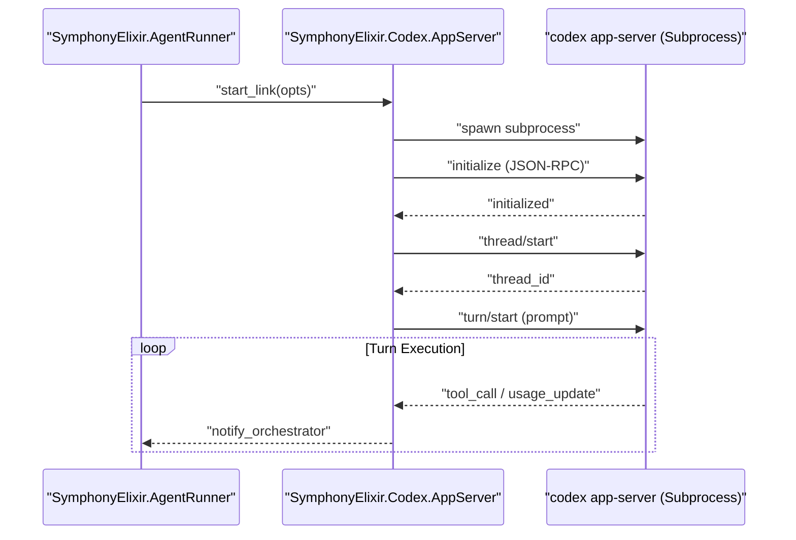

For details, see [Worker Deployment Models](#3.3).

---

## Workspace Management and Safety

`SymphonyElixir.Workspace` handles the filesystem isolation for each issue [elixir/lib/symphony_elixir/orchestrator.ex:10-10]().

**Lifecycle hooks supported:**
*   `after_create`: Executed once when a workspace is initialized [elixir/test/support/test_support.exs:155-155]().
*   `before_run`: Executed before every agent session starts [elixir/test/support/test_support.exs:156-156]().
*   `after_run`: Executed after an agent session concludes [elixir/test/support/test_support.exs:157-157]().
*   `before_remove`: Executed before workspace cleanup [elixir/test/support/test_support.exs:158-158]().

---

## Linear Integration

Symphony interacts with Linear through a normalized `Tracker` interface [elixir/lib/symphony_elixir/orchestrator.ex:10-11]().

| Component | Responsibility |
| :--- | :--- |
| `SymphonyElixir.Linear.Client` | Low-level GraphQL API calls to Linear [elixir/mix.exs:21-21]() |
| `SymphonyElixir.Tracker.Issue` | Normalized struct for work items [elixir/lib/symphony_elixir/orchestrator.ex:11-11]() |
| `linear_graphql` tool | Dynamic tool allowing Codex agents to perform mutations [elixir/lib/symphony_elixir/codex/dynamic_tool.ex:29-29]() |

**Sources:** [elixir/lib/symphony_elixir/orchestrator.ex:10-11](), [elixir/mix.exs:21-21]()

---

# Page: Issue Lifecycle

# Issue Lifecycle

<details>
<summary>Relevant source files</summary>

The following files were used as context for generating this wiki page:

- [SPEC.md](SPEC.md)
- [elixir/lib/symphony_elixir/orchestrator.ex](elixir/lib/symphony_elixir/orchestrator.ex)
- [elixir/lib/symphony_elixir/tracker.ex](elixir/lib/symphony_elixir/tracker.ex)
- [elixir/lib/symphony_elixir/tracker/issue.ex](elixir/lib/symphony_elixir/tracker/issue.ex)
- [elixir/test/support/test_support.exs](elixir/test/support/test_support.exs)
- [elixir/test/symphony_elixir/core_test.exs](elixir/test/symphony_elixir/core_test.exs)

</details>


This page traces the complete journey of a single issue through Symphony: from the first poll that discovers it, through workspace creation, Codex session execution, state transitions, retry handling, and final workspace cleanup.

---

## Two State Spaces

The lifecycle involves two parallel state spaces that must not be confused:

| State Space | Owner | Visibility |
|---|---|---|
| **Orchestrator internal states** | `SymphonyElixir.Orchestrator` (in-memory) | Symphony only |
| **Issue tracker states** | Tracker (e.g., Linear), mutated by the Codex agent | Team-visible |

The Orchestrator internal states govern dispatch, concurrency, and retry logic. The tracker issue states (e.g., "Todo", "Done") govern what work the agent performs and when Symphony stops or cleans up.

---

## Orchestrator Internal States

These in-memory states are defined in [SPEC.md:591-614]() and implemented in `SymphonyElixir.Orchestrator.State` [elixir/lib/symphony_elixir/orchestrator.ex:24-45](). Symphony reconstructs this state on restart via tracker queries [SPEC.md:57-58]().

| State | Meaning |
|---|---|
| `Unclaimed` | Issue is not running and has no retry timer. |
| `Claimed` | Reserved to prevent duplicate dispatch; stored in `claimed` [elixir/lib/symphony_elixir/orchestrator.ex:39](). |
| `Running` | Worker task is active; entry exists in the `running` map [elixir/lib/symphony_elixir/orchestrator.ex:37](). |
| `RetryQueued` | No active worker; a timer exists in `retry_attempts` [elixir/lib/symphony_elixir/orchestrator.ex:41](). |
| `Released` | Claim removed; issue is terminal, non-active, or retry loop ended. |

**Orchestrator Internal State Machine**

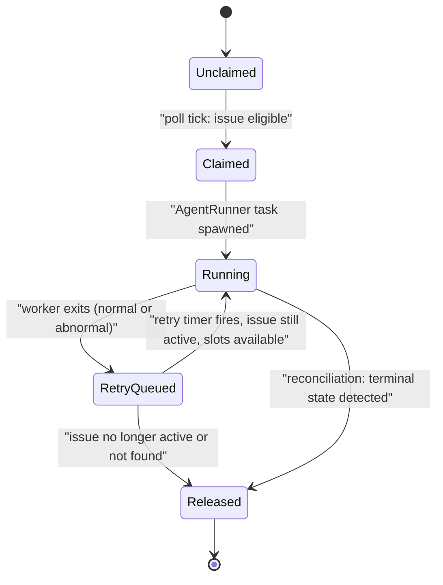

Sources: [SPEC.md:581-668](), [elixir/lib/symphony_elixir/orchestrator.ex:24-45]()

---

## Poll and Discovery

`SymphonyElixir.Orchestrator` runs a poll tick every `polling.interval_ms` [elixir/lib/symphony_elixir/orchestrator.ex:61](). Default is 30,000 ms [elixir/test/symphony_elixir/core_test.exs:16]().

**Tick sequence** [elixir/lib/symphony_elixir/orchestrator.ex:118-126]():

1. **Refresh** runtime config from `WorkflowStore` [elixir/lib/symphony_elixir/orchestrator.ex:119]().
2. **Dispatch** eligible issues via `maybe_dispatch/1` [elixir/lib/symphony_elixir/orchestrator.ex:120]().
3. **Schedule** next tick [elixir/lib/symphony_elixir/orchestrator.ex:121]().
4. **Notify** dashboard [elixir/lib/symphony_elixir/orchestrator.ex:124]().

### Candidate Selection Rules

All of the following must be true for an issue to be dispatched [SPEC.md:702-711]():

- Has `id`, `identifier`, `title`, and `state` [elixir/lib/symphony_elixir/tracker/issue.ex:12-28]().
- State is in `active_states` and not in `terminal_states` [elixir/test/symphony_elixir/core_test.exs:17-18]().
- Not already in `running` or `claimed` [elixir/lib/symphony_elixir/orchestrator.ex:37-39]().
- Global slots available: `max_concurrent_agents` [elixir/lib/symphony_elixir/orchestrator.ex:62]().

**Dispatch sort order** (stable, applied in order) [SPEC.md:715-725]():

| Priority | Field | Direction |
|---|---|---|
| 1 | `priority` | Ascending (1 = highest) |
| 2 | `created_at` | Oldest first |
| 3 | `identifier` | Lexicographic tie-break |

Sources: [SPEC.md:679-715](), [elixir/lib/symphony_elixir/orchestrator.ex:118-126](), [elixir/test/symphony_elixir/core_test.exs:14-20](), [elixir/lib/symphony_elixir/tracker/issue.ex:1-28]()

---

## Claim and Workspace Creation

When an issue passes eligibility, the Orchestrator adds it to the `claimed` set [elixir/lib/symphony_elixir/orchestrator.ex:39](). This prevents duplicate dispatch across concurrent ticks [SPEC.md:671-676]().

`SymphonyElixir.AgentRunner` then prepares the workspace.

**Workspace lifecycle** [SPEC.md:815-824]():

1. Sanitize `issue.identifier` to a unique workspace key.
2. Ensure directory exists at `<workspace_root>/<identifier>`.
3. Run the `after_create` hook if newly created [elixir/test/symphony_elixir/core_test.exs:125-127]().

**Hook failure semantics** [SPEC.md:863-868]():

| Hook | Trigger | Failure behavior |
|---|---|---|
| `after_create` | New workspace only | Fatal to workspace creation |
| `before_run` | Before each agent attempt | Fatal to current attempt |
| `after_run` | After each attempt | Logged, ignored |
| `before_remove` | Before workspace deletion | Logged, ignored [elixir/test/symphony_elixir/core_test.exs:128-129]|

Sources: [SPEC.md:793-868](), [elixir/test/symphony_elixir/core_test.exs:123-129]()

---

## Prompt Construction and Session Launch

`SymphonyElixir.AgentRunner` builds the prompt using the `WORKFLOW.md` template [elixir/test/symphony_elixir/core_test.exs:113]().

**Prompt inputs** [SPEC.md:1223-1253]():

- **Template**: the Markdown body of `WORKFLOW.md`.
- **`issue`**: the full normalized `SymphonyElixir.Tracker.Issue` object [elixir/lib/symphony_elixir/tracker/issue.ex:12-28]().
- **`attempt`**: integer tracking retry/continuation count.

The agent subprocess is launched via the `codex_command` [elixir/test/symphony_elixir/core_test.exs:76]().

**Handshake sequence** [SPEC.md:927-970]():

1. Send `initialize` request.
2. Send `initialized` notification.
3. Send `thread/start` with sandbox policy.
4. Send `turn/start` with rendered prompt.

Sources: [SPEC.md:922-970](), [elixir/test/symphony_elixir/core_test.exs:113-133](), [elixir/lib/symphony_elixir/tracker/issue.ex:1-28]()

---

## Codex Turns and Interaction

The Orchestrator listens for events from the worker via `handle_info({:codex_worker_update, ...}, ...)` [elixir/lib/symphony_elixir/orchestrator.ex:167-186]().

**Turn completion outcomes** [SPEC.md:976-982]():

| Event | Result |
|---|---|
| `turn/completed` | Success; proceed to next turn or finish. |
| `turn/failed` | Failure; trigger retry logic. |
| `turn/cancelled` | Failure; trigger retry logic. |

Symphony tracks tokens and rate limits from these updates [elixir/lib/symphony_elixir/orchestrator.ex:178-181]().

Sources: [SPEC.md:976-982](), [elixir/lib/symphony_elixir/orchestrator.ex:167-186]()

---

## Tracker Integration and Transitions

Symphony does not write to the tracker directly in the main loop. State transitions are performed by the Codex agent using provider-native tools defined in `SymphonyElixir.Tracker` [elixir/lib/symphony_elixir/tracker.ex:24-25]().

**Issue State Progression (Agent-Driven)**

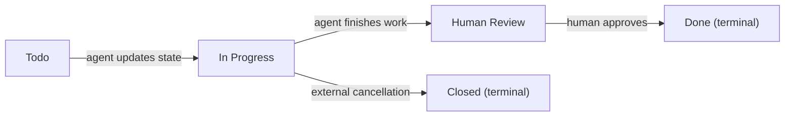

The `SymphonyElixir.Tracker` module provides the abstraction for fetching issues [elixir/lib/symphony_elixir/tracker.ex:34-41]() and executing tools [elixir/lib/symphony_elixir/tracker.ex:61-75]().

Sources: [elixir/lib/symphony_elixir/tracker.ex:1-141](), [elixir/lib/symphony_elixir/tracker/issue.ex:1-67]()

---

## Retry and Stall Handling

### Worker Exit
The Orchestrator handles process termination in `handle_info({:DOWN, ...}, ...)` [elixir/lib/symphony_elixir/orchestrator.ex:128-148]().
- **Normal exit**: Schedules a **continuation check** via `schedule_issue_retry/4` [elixir/lib/symphony_elixir/orchestrator.ex:216-222]().
- **Abnormal exit**: Applies exponential backoff starting at `failure_retry_base_ms` [elixir/lib/symphony_elixir/orchestrator.ex:14]().

### Stall Detection
Symphony detects stalled agents (no output within `codex_stall_timeout_ms`) during the poll tick. Stalled workers are terminated and retried [SPEC.md:768-773]().

Sources: [elixir/lib/symphony_elixir/orchestrator.ex:13-14](), [elixir/lib/symphony_elixir/orchestrator.ex:128-148](), [elixir/lib/symphony_elixir/orchestrator.ex:208-232](), [SPEC.md:739-773]()

---

## Full Lifecycle — Module Map

The following diagram bridges the high-level lifecycle to the specific Elixir modules responsible for each phase.

**Full Issue Lifecycle with Code Entity Mapping**

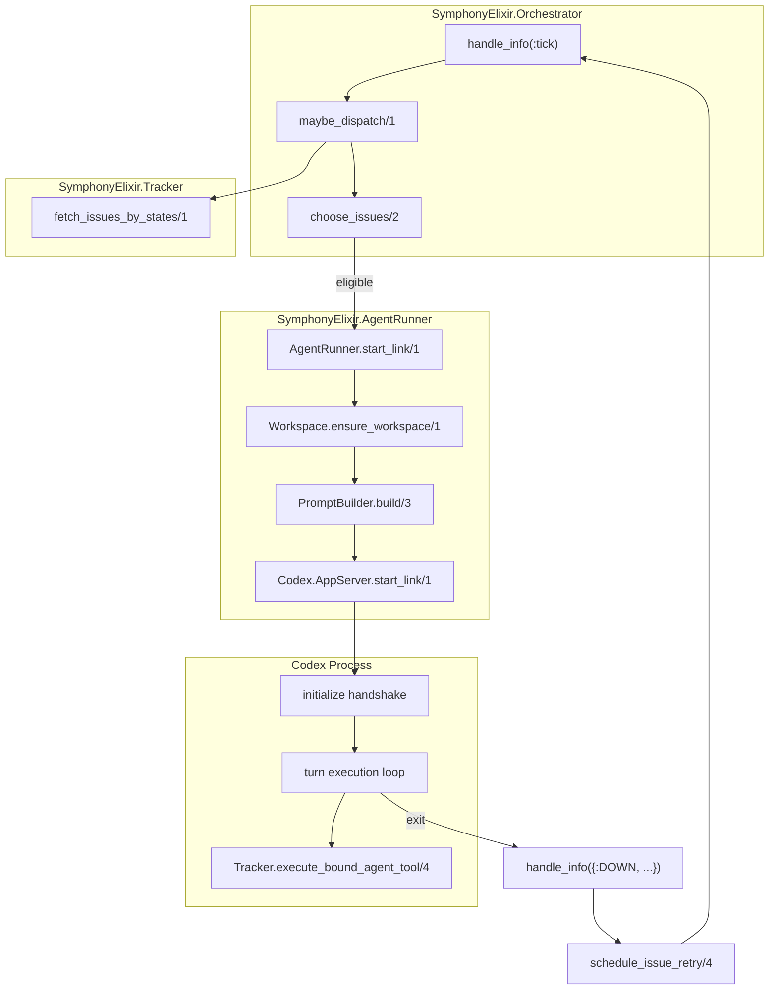

Sources: [elixir/lib/symphony_elixir/orchestrator.ex:1-235](), [elixir/lib/symphony_elixir/tracker.ex:1-60](), [elixir/lib/symphony_elixir/tracker/issue.ex:1-67]()

---

# Page: Configuration System

# Configuration System

<details>
<summary>Relevant source files</summary>

The following files were used as context for generating this wiki page:

- [elixir/config/config.exs](elixir/config/config.exs)
- [elixir/lib/symphony_elixir/agent_runner.ex](elixir/lib/symphony_elixir/agent_runner.ex)
- [elixir/lib/symphony_elixir/config.ex](elixir/lib/symphony_elixir/config.ex)
- [elixir/lib/symphony_elixir/config/schema.ex](elixir/lib/symphony_elixir/config/schema.ex)
- [elixir/lib/symphony_elixir/linear/client.ex](elixir/lib/symphony_elixir/linear/client.ex)
- [elixir/lib/symphony_elixir/workflow.ex](elixir/lib/symphony_elixir/workflow.ex)
- [elixir/lib/symphony_elixir/workflow_store.ex](elixir/lib/symphony_elixir/workflow_store.ex)
- [elixir/test/fixtures/startup_workflow.md](elixir/test/fixtures/startup_workflow.md)
- [elixir/test/symphony_elixir/workspace_and_config_test.exs](elixir/test/symphony_elixir/workspace_and_config_test.exs)

</details>


Symphony's configuration system loads runtime settings from `WORKFLOW.md`, a repository-owned file that combines YAML front matter (settings) with a Markdown body (prompt template). The configuration layer provides typed access to these settings throughout the system and enforces validation rules at startup and during runtime reloads.

**Key responsibilities:**
- Parse `WORKFLOW.md` into structured configuration and prompt template.
- Apply defaults for omitted fields via `Ecto.Schema` definitions.
- Validate required fields before dispatch.
- Distribute settings to Orchestrator, AgentRunner, Workspace, and other components.
- Support dynamic reload without restart via a polling cache.

## Configuration Architecture

The configuration system consists of modules that work together to load, parse, and distribute settings. The system uses `Ecto.Schema` to define the structure and `YamlElixir` for front-matter parsing.

**Natural Language to Code Entity Space: Loading Flow**

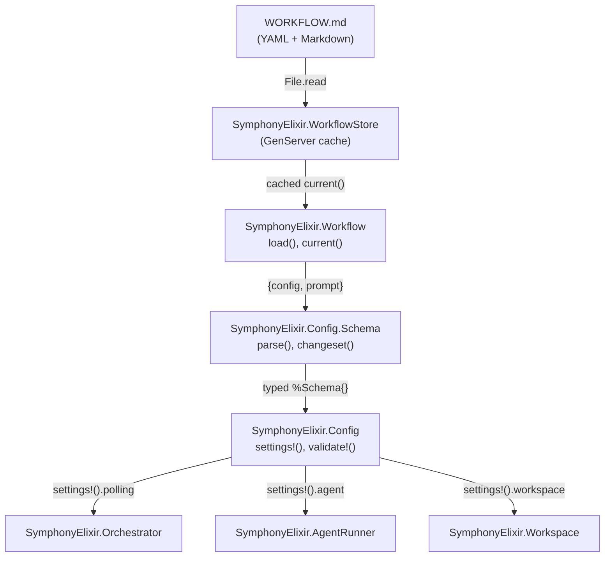

**Module responsibilities:**

| Module | Purpose | Key Functions |
|--------|---------|---------------|
| `SymphonyElixir.Workflow` | File loading and front matter/prompt splitting. | `load/1`, `current/0`, `workflow_file_path/0` [elixir/lib/symphony_elixir/workflow.ex:10-53]() |
| `SymphonyElixir.WorkflowStore` | GenServer that caches the last known good workflow and polls for changes. | `start_link/1`, `current/0`, `force_reload/0` [elixir/lib/symphony_elixir/workflow_store.ex:21-52]() |
| `SymphonyElixir.Config.Schema` | YAML to typed structs using Ecto; defines defaults and field types. | `parse/1`, `changeset/2`, `resolve_runtime_turn_sandbox_policy/2` [elixir/lib/symphony_elixir/config/schema.ex:1-240]() |
| `SymphonyElixir.Config` | Public API for settings access and runtime derivation. | `settings!/0`, `validate!/0`, `codex_runtime_settings/2` [elixir/lib/symphony_elixir/config.ex:29-115]() |

Sources: [elixir/lib/symphony_elixir/config.ex:1-144](), [elixir/lib/symphony_elixir/workflow.ex:1-124](), [elixir/lib/symphony_elixir/workflow_store.ex:1-181]()

---

## File Format and Discovery

`WORKFLOW.md` is a Markdown file with optional YAML front matter.

**Parsing rules:**
1. The file is split by `---` delimiters [elixir/lib/symphony_elixir/workflow.ex:85-100]().
2. Lines between delimiters are parsed as YAML into a map [elixir/lib/symphony_elixir/workflow.ex:102-114]().
3. Remaining lines become the `prompt_template` [elixir/lib/symphony_elixir/workflow.ex:68-75]().
4. If front matter is absent, the entire file is treated as prompt body.

**File discovery precedence:**
1. Explicit path set via `SymphonyElixir.Workflow.set_workflow_file_path/1` [elixir/lib/symphony_elixir/workflow.ex:16-21]().
2. Environment configuration: `:symphony_elixir, :workflow_file_path` [elixir/lib/symphony_elixir/workflow.ex:12-13]().
3. Default: `WORKFLOW.md` in the current working directory [elixir/lib/symphony_elixir/workflow.ex:14]().

Sources: [elixir/lib/symphony_elixir/workflow.ex:8-124](), [elixir/config/config.exs:18-21]()

---

## Configuration Loading and Resolution

**Code Entity Space: Resolution Sequence**

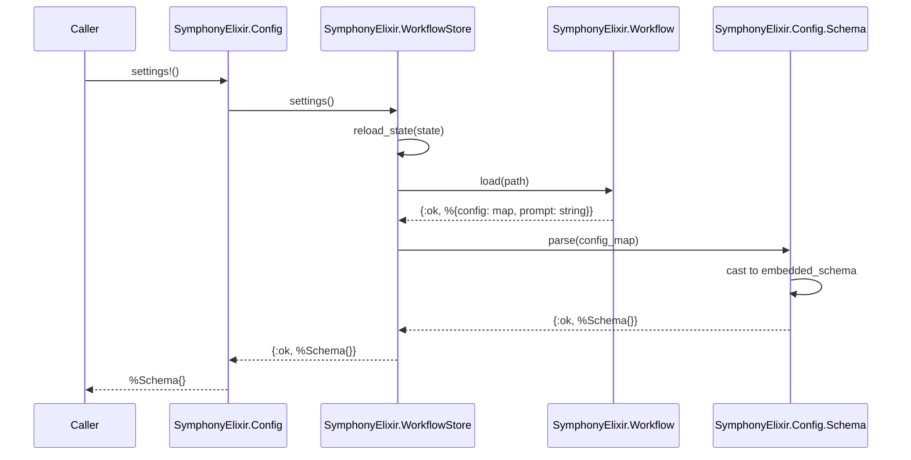

**Resolution precedence:**
1. **YAML values** — parsed from `WORKFLOW.md`.
2. **Built-in defaults** — defined in `SymphonyElixir.Config.Schema` modules (e.g., `Polling` default `30_000` [elixir/lib/symphony_elixir/config/schema.ex:96]()).
3. **Environment overrides** — specific fields like `server_port` check `Application.get_env` [elixir/lib/symphony_elixir/config.ex:81-86]().

Sources: [elixir/lib/symphony_elixir/config.ex:35-43](), [elixir/lib/symphony_elixir/config/schema.ex:89-228](), [elixir/lib/symphony_elixir/workflow_store.ex:157-167]()

---

## Validation

Validation occurs in two phases: structural (via Ecto changesets) and semantic (via business logic).

**Validation implementation:**
- **Structural:** `SymphonyElixir.Config.Schema` uses `Ecto.Changeset` to validate types and ranges, such as `interval_ms` being greater than 0 [elixir/lib/symphony_elixir/config/schema.ex:103]().
- **Semantic:** `SymphonyElixir.Config.validate_settings/1` checks business rules [elixir/lib/symphony_elixir/config.ex:118-124]():
    - `tracker.kind` must not be nil [elixir/lib/symphony_elixir/config.ex:119]().
    - The `Tracker` implementation must validate its own specific config [elixir/lib/symphony_elixir/config.ex:122]().

**Error taxonomy:**
| Error Reason | Source | Effect |
|--------------|--------|--------|
| `{:missing_workflow_file, path, reason}` | `Workflow.load/1` | `settings!/0` raises ArgumentError [elixir/lib/symphony_elixir/config.ex:131-132]() |
| `{:workflow_parse_error, reason}` | `Workflow.parse/1` | `settings!/0` raises ArgumentError [elixir/lib/symphony_elixir/config.ex:134-135]() |
| `{:invalid_workflow_config, message}` | `Schema.parse/1` | `settings!/0` raises ArgumentError [elixir/lib/symphony_elixir/config.ex:128-129]() |

Sources: [elixir/lib/symphony_elixir/config.ex:126-143](), [elixir/lib/symphony_elixir/config/schema.ex:1-240]()

---

## Dynamic Reload

The `SymphonyElixir.WorkflowStore` GenServer implements dynamic reloading.

1. **Polling:** It polls the `WORKFLOW.md` file every 1,000ms [elixir/lib/symphony_elixir/workflow_store.ex:13]().
2. **Staleness Check:** It compares the file's `mtime`, `size`, and a hash of its content (`phash2`) against the cached version [elixir/lib/symphony_elixir/workflow_store.ex:169-176]().
3. **Graceful Failure:** If a reload fails (e.g., due to a syntax error), it logs the error and continues serving the last known good configuration [elixir/lib/symphony_elixir/workflow_store.ex:178-180]().

Sources: [elixir/lib/symphony_elixir/workflow_store.ex:109-181]()

---

## Settings Reference

### `tracker` Settings
Defines the issue tracker connection [elixir/lib/symphony_elixir/config/schema.ex:50-61]().
- `kind`: "linear", "memory", etc.
- `endpoint`: API endpoint (e.g., Linear GraphQL).
- `active_states`: List of states considered "active" for polling.
- `required_labels`: Labels required for an issue to be picked up.

### `agent` Settings
Controls concurrency and turn limits [elixir/lib/symphony_elixir/config/schema.ex:151-156]().
- `max_concurrent_agents`: Default 10.
- `max_turns`: Default 20.
- `max_concurrent_agents_by_state`: Map for per-state limits.

### `codex` Settings
Subprocess and sandbox configuration [elixir/lib/symphony_elixir/config/schema.ex:180-198]().
- `command`: Default `"codex app-server"`.
- `approval_policy`: Defines when Codex requires human approval.
- `thread_sandbox`: Default `"workspace-write"`.
- `stall_timeout_ms`: Timeout for detecting stalled agent turns.

### `hooks` Settings
Shell scripts for workspace lifecycle [elixir/lib/symphony_elixir/config/schema.ex:236-242]().
- `after_create`: Run once after workspace initialization.
- `before_run`: Run before each agent run attempt [elixir/lib/symphony_elixir/agent_runner.ex:46]().
- `after_run`: Run after the agent run finishes [elixir/lib/symphony_elixir/agent_runner.ex:50]().

Sources: [elixir/lib/symphony_elixir/config/schema.ex:43-245](), [elixir/lib/symphony_elixir/agent_runner.ex:21-56]()

---

# Page: Worker Deployment Models

# Worker Deployment Models

<details>
<summary>Relevant source files</summary>

The following files were used as context for generating this wiki page:

- [SPEC.md](SPEC.md)
- [elixir/lib/symphony_elixir/ssh.ex](elixir/lib/symphony_elixir/ssh.ex)
- [elixir/test/support/live_e2e_docker/Dockerfile](elixir/test/support/live_e2e_docker/Dockerfile)
- [elixir/test/support/live_e2e_docker/docker-compose.yml](elixir/test/support/live_e2e_docker/docker-compose.yml)
- [elixir/test/support/live_e2e_docker/live_worker_entrypoint.sh](elixir/test/support/live_e2e_docker/live_worker_entrypoint.sh)
- [elixir/test/support/test_support.exs](elixir/test/support/test_support.exs)
- [elixir/test/symphony_elixir/ssh_test.exs](elixir/test/symphony_elixir/ssh_test.exs)

</details>


This document describes the three deployment architectures Symphony supports for executing Codex agents: local execution, SSH workers, and Docker workers. Each model provides different tradeoffs between simplicity, isolation, and scalability.

For information about workspace lifecycle management within these deployment models, see [Workspace Management](4.3). For details on the Codex communication protocol itself, see [AppServer Protocol](5.1).

---

## Overview

Symphony supports three distinct worker deployment models, controlled by the `worker_host` parameter passed to `SymphonyElixir.Codex.AppServer.start_session/2` [elixir/lib/symphony_elixir/codex/app_server.ex:22-26]().

| Deployment Model | `worker_host` Value | Use Case | Workspace Location |
|-----------------|---------------------|----------|-------------------|
| **Local Execution** | `nil` | Development, single-machine deployments | Local filesystem under `workspace.root` |
| **SSH Workers** | `"hostname:port"` or `"hostname"` | Production, distributed execution | Remote filesystem on worker host |
| **Docker Workers** | `"localhost:port"` | CI/CD testing, integration tests | Containerized remote filesystem |

The deployment model determines:
- Where the Codex process executes.
- How workspace operations (creation, cleanup) are performed [elixir/lib/symphony_elixir/workspace.ex:34-79]().
- How the `codex app-server` command is invoked.
- What validation and path safety checks are applied [elixir/lib/symphony_elixir/workspace.ex:358-384]().

**Sources:** [elixir/lib/symphony_elixir/codex/app_server.ex:16-26](), [elixir/lib/symphony_elixir/workspace.ex:1-11]()

---

## Local Execution Mode

### Architecture

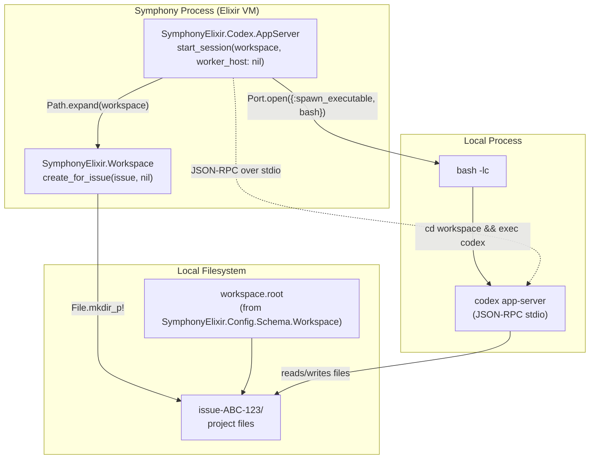

**Diagram: Local execution spawns Codex directly as a child process**

In local execution mode, Symphony spawns the Codex process directly on the same machine using Erlang's `Port.open/2` [elixir/lib/symphony_elixir/codex/app_server.ex:193-200](). The workspace is created in the local filesystem and validated against the configured `workspace.root` to prevent path traversal attacks [elixir/lib/symphony_elixir/workspace.ex:358-372]().

**Sources:** [elixir/lib/symphony_elixir/codex/app_server.ex:189-209](), [elixir/lib/symphony_elixir/workspace.ex:34-46]()

### Port Creation

The `SymphonyElixir.Codex.AppServer.start_port/2` function handles local process spawning:

```elixir
# elixir/lib/symphony_elixir/codex/app_server.ex:189-209
defp start_port(workspace, nil) do
  with {:ok, bash} <- find_bash() do
    # ...
    port = Port.open({:spawn_executable, bash}, [
      :binary,
      :exit_status,
      :stderr_to_stdout,
      args: ["-lc", Config.settings!().codex.command],
      cd: workspace,
      line: 1_048_576
    ])
    {:ok, port}
  end
end
```

The `-lc` flags ensure a login shell (loading user environment) and command execution mode. The `line: 1_048_576` option enables line-oriented I/O for JSON-RPC messages, with a maximum line size of 1MB [elixir/lib/symphony_elixir/codex/app_server.ex:200]().

**Sources:** [elixir/lib/symphony_elixir/codex/app_server.ex:189-209]()

### Workspace Validation

Local workspaces undergo strict path safety validation to prevent symlink attacks and directory traversal. Symphony uses `SymphonyElixir.PathSafety.canonicalize/1` to resolve absolute paths and verify they reside within the configured root [elixir/lib/symphony_elixir/workspace.ex:358-384]().

**Sources:** [elixir/lib/symphony_elixir/workspace.ex:358-384](), [elixir/test/symphony_elixir/workspace_and_config_test.exs:109-112]()

---

## SSH Worker Deployment

### Architecture

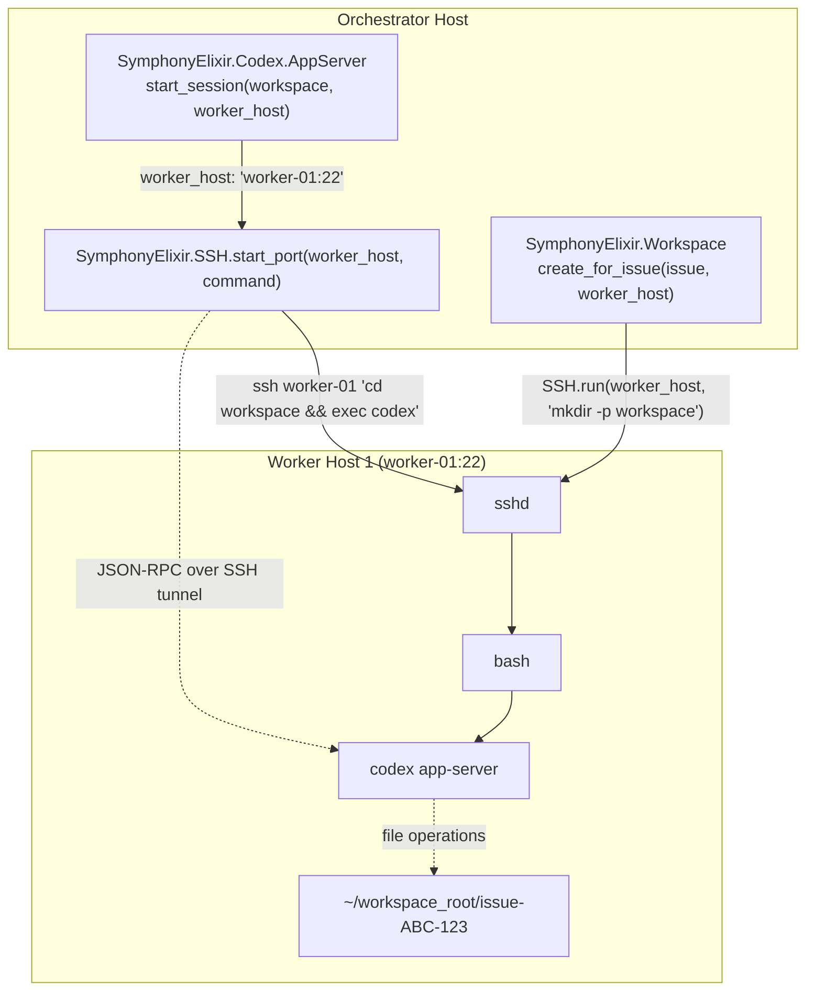

**Diagram: SSH workers execute Codex on remote hosts via SSH connections**

SSH worker deployment enables distributed execution across multiple hosts. Symphony communicates with remote Codex instances over SSH tunnels, forwarding JSON-RPC messages over stdin/stdout [elixir/lib/symphony_elixir/ssh.ex:11-27]().

**Sources:** [elixir/lib/symphony_elixir/codex/app_server.ex:212-223](), [elixir/lib/symphony_elixir/workspace.ex:48-79](), [elixir/lib/symphony_elixir/ssh.c:11-27]()

### Remote Port Creation

For SSH workers, `SymphonyElixir.Codex.AppServer.start_port/2` delegates to the `SymphonyElixir.SSH` module:

```elixir
# elixir/lib/symphony_elixir/codex/app_server.ex:212-223
defp start_port(workspace, worker_host) when is_binary(worker_host) do
  command = remote_launch_command(workspace)
  SSH.start_port(worker_host, command, line: 1_048_576)
end
```

The `SymphonyElixir.SSH.start_port/3` function uses `System.find_executable("ssh")` and `Port.open/2` with `:spawn_executable` to establish the tunnel [elixir/lib/symphony_elixir/ssh.c:13-27](). It supports `SYMPHONY_SSH_CONFIG` for custom SSH configurations [elixir/lib/symphony_elixir/ssh.ex:54-62]().

**Sources:** [elixir/lib/symphony_elixir/ssh.ex:11-27](), [elixir/lib/symphony_elixir/ssh.ex:54-62]()

### Remote Workspace Creation

Remote workspace operations are performed via SSH command execution. The `SymphonyElixir.Workspace` module executes a shell script on the remote host to create the directory and return its canonical path using `pwd -P` [elixir/lib/symphony_elixir/workspace.ex:59-66]().

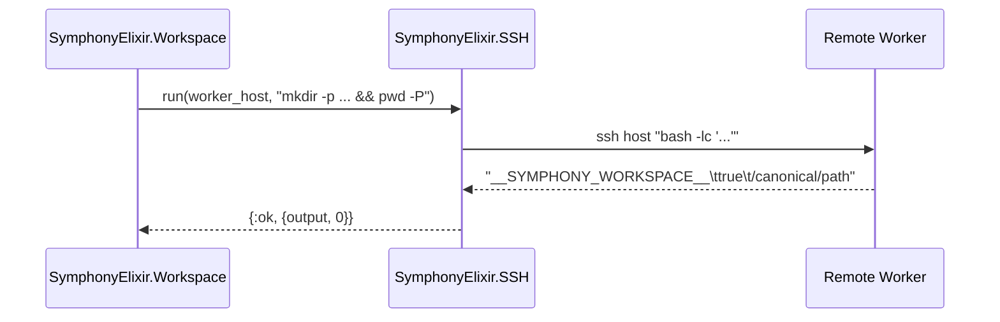

The marker `__SYMPHONY_WORKSPACE__` allows Symphony to parse the canonical workspace path from potentially noisy SSH output [elixir/lib/symphony_elixir/workspace.ex:412-433]().

**Sources:** [elixir/lib/symphony_elixir/workspace.ex:48-79](), [elixir/lib/symphony_elixir/workspace.ex:412-433](), [elixir/lib/symphony_elixir/ssh.ex:29-32]()

---

## Docker Worker Deployment

### Architecture

Docker workers provide ephemeral environments for testing. The system uses `docker compose` to spin up containers running `sshd` [elixir/test/support/live_e2e_docker/docker-compose.yml:1-21]().

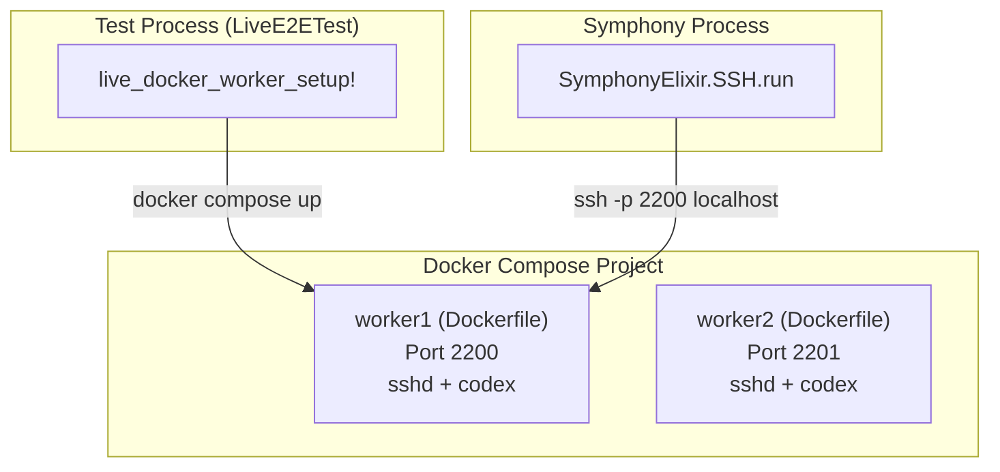

**Sources:** [elixir/test/support/live_e2e_docker/docker-compose.yml:1-21](), [elixir/test/support/live_e2e_docker/Dockerfile:1-22]()

### Worker Environment

The Docker worker image is based on `node:20-bookworm-slim` and includes:
- `openssh-server` for remote access [elixir/test/support/live_e2e_docker/Dockerfile:7]().
- `@openai/codex` global installation [elixir/test/support/live_e2e_docker/Dockerfile:14]().
- A custom entrypoint `symphony-live-worker` that initializes SSH authorized keys [elixir/test/support/live_e2e_docker/live_worker_entrypoint.sh:11-13]().

### SSH Target Parsing

The `SymphonyElixir.SSH` module includes logic to parse `host:port` strings, which is essential for connecting to Docker containers mapped to local ports [elixir/lib/symphony_elixir/ssh.ex:67-84]().

```elixir
# elixir/lib/symphony_elixir/ssh.ex:67-84
defp parse_target(target) do
  # Splits "localhost:2222" into destination and port
  # ...
end
```

**Sources:** [elixir/lib/symphony_elixir/ssh.ex:67-84](), [elixir/test/symphony_elixir/ssh_test.exs:46-68]()

---

## Worker Selection and Load Balancing

Symphony balances load across multiple `worker_ssh_hosts` configured in `WORKFLOW.md` [elixir/test/support/test_support.exs:104]().

### Metadata and Tracking

Sessions track which worker host executed them via port metadata. This is used for observability and to ensure that workspace cleanup targets the correct host [elixir/lib/symphony_elixir/codex/app_server.ex:225-239]().

```elixir
# elixir/lib/symphony_elixir/codex/app_server.ex:225-239
defp port_metadata(port, worker_host) do
  # ...
  if worker_host, do: Map.put(metadata, :worker_host, worker_host), else: metadata
end
```

### Workspace Cleanup

When an issue is finished, Symphony cleans up the workspace. If `worker_ssh_hosts` are used, it iterates through all hosts to ensure no stale directories remain [elixir/lib/symphony_elixir/workspace.ex:130-164]().

```elixir
# elixir/lib/symphony_elixir/workspace.ex:130-164
def remove_issue_workspaces(identifier, nil) do
  # ...
  case Config.settings!().worker.ssh_hosts do
    [] -> remove_local_workspace(identifier)
    hosts -> Enum.each(hosts, &remove_remote_workspace(&1, identifier))
  end
end
```

**Sources:** [elixir/lib/symphony_elixir/workspace.ex:130-164](), [elixir/lib/symphony_elixir/codex/app_server.ex:225-239](), [elixir/test/support/test_support.exs:104-105]()

---

# Page: Core Components

# Core Components

<details>
<summary>Relevant source files</summary>

The following files were used as context for generating this wiki page:

- [.github/workflows/burrito-release.yml](.github/workflows/burrito-release.yml)
- [elixir/.gitignore](elixir/.gitignore)
- [elixir/lib/symphony_elixir.ex](elixir/lib/symphony_elixir.ex)
- [elixir/lib/symphony_elixir/cli.ex](elixir/lib/symphony_elixir/cli.ex)
- [elixir/mix.exs](elixir/mix.exs)

</details>


This page documents the primary Elixir modules that implement Symphony's execution engine. These modules handle the continuous poll-dispatch-execute cycle that transforms Linear issues into autonomous agent sessions.

For details on how individual Codex sessions are managed, see [AppServer Protocol](#5.1). For HTTP endpoints and monitoring, see [REST API](#6.2). For configuration loading and validation, see [Configuration System](#3.2).

---

## Component Overview

Symphony's core execution layer consists of four primary modules and their supporting infrastructure. The system is initialized via the `SymphonyElixir.Application` OTP entry point, which starts the `SymphonyElixir.AgentRuntimeSupervisor` [elixir/lib/symphony_elixir.ex:15-51]().

**Component** | **Module** | **Type** | **Responsibility**
--- | --- | --- | ---
Orchestrator | `SymphonyElixir.Orchestrator` | GenServer | Poll cycle, dispatch, reconciliation, retry scheduling
Agent Runner | `SymphonyElixir.AgentRunner` | Module | Per-issue execution, workspace lifecycle, Codex session management
Workspace Manager | `SymphonyElixir.Workspace` | Module | Directory creation, hook execution, path validation
Tracker Facade | `SymphonyElixir.Tracker` | Module | Issue fetching abstraction layer

Supporting modules provide specialized functionality:

**Module** | **Purpose**
--- | ---
`SymphonyElixir.Config` | Typed configuration accessors, validation
`SymphonyElixir.PromptBuilder` | Liquid template rendering for issue prompts
`SymphonyElixir.Linear.Issue` | Data structure for normalized issue state
`SymphonyElixir.Codex.AppServer` | JSON-RPC bridge to Codex agents
`SymphonyElixir.CLI` | Escript entrypoint for running with specific `WORKFLOW.md` [elixir/lib/symphony_elixir/cli.ex:1-4]()

Sources: [elixir/lib/symphony_elixir.ex:15-51](), [elixir/lib/symphony_elixir/cli.ex:1-4]()

---

## Orchestrator State Machine

The `SymphonyElixir.Orchestrator` GenServer is the central coordinator that owns all scheduling state. It runs a continuous tick-based loop, maintains the set of running agents, and makes all dispatch and retry decisions.

### Orchestrator State Structure

The `SymphonyElixir.Orchestrator.State` struct tracks runtime information including token usage, rate limits, and the set of claimed issues.

```elixir
%SymphonyElixir.Orchestrator.State{
  poll_interval_ms: integer(),
  max_concurrent_agents: integer(),
  running: %{issue_id => running_entry},
  claimed: MapSet.t(issue_id),
  retry_attempts: %{issue_id => retry_entry},
  completed: MapSet.t(issue_id),
  codex_totals: %{input_tokens, output_tokens, total_tokens, seconds_running},
  codex_rate_limits: map() | nil,
  next_poll_due_at_ms: integer(),
  poll_check_in_progress: boolean(),
  tick_timer_ref: reference() | nil,
  tick_token: reference()
}
```

### Orchestrator Tick Cycle

```mermaid
stateDiagram-v2
    [*] --> "init/1"
    "init/1" --> "schedule_tick/2"
    "schedule_tick/2" --> "handle_info(:tick)"
    "handle_info(:tick)" --> "schedule_poll_cycle_start/0"
    "schedule_poll_cycle_start/0" --> "handle_info(:run_poll_cycle)"
    
    state "handle_info(:run_poll_cycle)" as PollCycle {
        direction TB
        "maybe_dispatch/1" --> "reconcile_running_issues/1"
        "reconcile_running_issues/1" --> "Config.validate!/"
        "Config.validate!/" --> "Tracker.fetch_candidate_issues/0"
        "Tracker.fetch_candidate_issues/0" --> "choose_issues/2"
        "choose_issues/2" --> "spawn AgentRunner.run/3"
    }
    
    PollCycle --> "schedule_tick/2" : "loop"
```

The Orchestrator processes each tick in a fixed sequence:

1.  **Reconciliation**: Check running agents against current tracker state.
2.  **Validation**: Ensure workflow configuration is valid.
3.  **Candidate Fetch**: Query tracker for issues in active states via `Tracker.fetch_candidate_issues/0`.
4.  **Dispatch**: Launch `AgentRunner.run/3` tasks for eligible issues while available slots remain.

For details, see [Orchestrator](#4.1).

---

## Agent Runner Lifecycle

The `SymphonyElixir.AgentRunner` module manages the execution of a single issue from workspace preparation through Codex session completion. Each runner executes in a separate Task supervised by the Orchestrator.

### Execution Phases

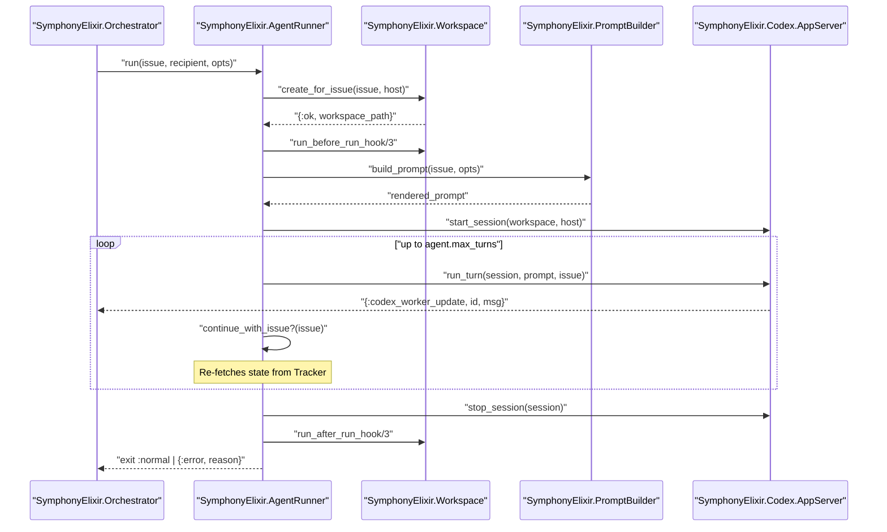

The `AgentRunner` follows a turn-based execution model:
1.  **Workspace Setup**: Creates the directory for the issue.
2.  **Turn Loop**: Executes turns via `AppServer.run_turn/4` until the issue is no longer in an active state or `max_turns` is reached.
3.  **Continuation**: Re-fetches the issue state after each turn to decide whether to continue.

For details, see [Agent Runner](#4.2).

---

## Workspace Management

The `SymphonyElixir.Workspace` module handles filesystem operations for per-issue workspaces, including directory creation and hook execution.

### Remote Execution

When a `worker_host` is provided (e.g., an SSH host), workspace operations are performed on the remote machine. The Orchestrator manages the selection of these hosts from the configured `worker.ssh_hosts` list.

For details, see [Workspace Management](#4.3).

---

## Tracker Integration

The `SymphonyElixir.Tracker` module acts as a facade for issue trackers (primarily Linear). It is responsible for fetching candidate issues for the dispatch cycle and refreshing issue states during execution.

### State Normalization

Issue states are normalized to lowercase and trimmed to ensure consistent comparison against the `active_states` configuration.

For details, see [Tracker Integration](#4.4).

---

## Orchestrator Retry and Backoff

The Orchestrator handles failures and continuations by scheduling retries. 

-   **Continuations**: If a turn completes normally but the issue is still active, a continuation is scheduled with a short delay.
-   **Failures**: If a worker process crashes (abnormal exit), the Orchestrator calculates an exponential backoff.

---

## Distribution and Releases

Symphony is distributed as a self-contained executable using **Burrito**. The release process targets multiple architectures including Linux and macOS (x86_64 and arm64) [.github/workflows/burrito-release.yml:18-19]().

When running as a Burrito binary, the `SymphonyElixir.Application` detects the environment and routes execution through `SymphonyElixir.CLI` [elixir/lib/symphony_elixir.ex:26-31]().

Sources: [.github/workflows/burrito-release.yml:13-19](), [elixir/lib/symphony_elixir.ex:26-31](), [elixir/mix.exs:106-120]()

---

# Page: Orchestrator

# Orchestrator

<details>
<summary>Relevant source files</summary>

The following files were used as context for generating this wiki page:

- [elixir/lib/symphony_elixir/orchestrator.ex](elixir/lib/symphony_elixir/orchestrator.ex)
- [elixir/test/symphony_elixir/core_test.exs](elixir/test/symphony_elixir/core_test.exs)
- [elixir/test/symphony_elixir/orchestrator_status_test.exs](elixir/test/symphony_elixir/orchestrator_status_test.exs)

</details>


The Orchestrator is the central control plane of Symphony. It is implemented as a `GenServer` responsible for the continuous lifecycle of issue automation: polling the issue tracker, reconciling the state of active agents, dispatching new work within concurrency limits, and managing retries for failed or stalled tasks.

## Orchestrator Responsibilities

`SymphonyElixir.Orchestrator` [elixir/lib/symphony_elixir/orchestrator.ex:1-4]() acts as the single authority for all scheduling decisions. It owns the polling tick, the in-memory runtime state, and all transitions into and out of that state.

### Runtime State Management

The orchestrator maintains an internal `%State{}` [elixir/lib/symphony_elixir/orchestrator.ex:24-45]() struct that tracks the following:

| Field | Purpose |
|---|---|
| `running` | A map of `issue_id` to worker metadata (PID, session IDs, token usage). [elixir/lib/symphony_elixir/orchestrator.ex:37]() |
| `completed` | A `MapSet` of issue IDs that have reached a terminal state. [elixir/lib/symphony_elixir/orchestrator.ex:38]() |
| `claimed` | A `MapSet` of issue IDs currently being processed to prevent duplicate dispatch. [elixir/lib/symphony_elixir/orchestrator.ex:39]() |
| `blocked` | A map of issues waiting on human input (e.g., `inputRequired` blockers). [elixir/lib/symphony_elixir/orchestrator.ex:40]() |
| `retry_attempts` | A map tracking scheduled retries and their backoff counters. [elixir/lib/symphony_elixir/orchestrator.ex:41]() |
| `codex_totals` | Global counters for input/output tokens and total runtime. [elixir/lib/symphony_elixir/orchestrator.ex:42]() |

Sources: [elixir/lib/symphony_elixir/orchestrator.ex:24-45](), [elixir/lib/symphony_elixir/orchestrator.ex:60-70]()

### The Poll Loop

The orchestrator operates on a "tick" mechanism. At each interval (defined by `polling.interval_ms` [elixir/lib/symphony_elixir/orchestrator.ex:61]()), it executes a reconciliation and dispatch cycle.

**Orchestrator Polling & Dispatch Logic**

```mermaid
flowchart TD
    subgraph "SymphonyElixir.Orchestrator (GenServer)"
        T["handle_info(:tick)"] --> RF["refresh_runtime_config/1"]
        RF --> NS["schedule_poll_cycle_start/0"]
        NS --> HP["handle_info(:run_poll_cycle)"]
        HP --> MD["maybe_dispatch/1"]
        MD --> ST["schedule_tick/2"]
    end

    subgraph "External Systems"
        MD -.->|"Tracker.fetch_candidate_issues/1"| L["Linear API"]
    end

    subgraph "Worker Processes"
        MD -->|"Task.Supervisor.async"| AR["SymphonyElixir.AgentRunner"]
    end
```

Sources: [elixir/lib/symphony_elixir/orchestrator.ex:83-126](), [elixir/lib/symphony_elixir/orchestrator.ex:73-75]()

### Reconciliation and Stall Detection

The Orchestrator actively monitors running agents to ensure system health:

1.  **Issue State Reconciliation**: It monitors if a running issue has been moved to a terminal state (like "Done" or "Canceled") in the tracker [elixir/test/symphony_elixir/core_test.exs:18]().
2.  **Stall Detection**: It tracks the time since the last `{:codex_worker_update, ...}` message [elixir/lib/symphony_elixir/orchestrator.ex:167-186](). If an agent exceeds the stall timeout, the orchestrator terminates the process and schedules a retry.
3.  **Process Monitoring**: Using `:DOWN` messages, it detects if an `AgentRunner` process has crashed or finished [elixir/lib/symphony_elixir/orchestrator.ex:128-148]().

Sources: [elixir/lib/symphony_elixir/orchestrator.ex:128-186](), [elixir/test/symphony_elixir/orchestrator_status_test.exs:24-102]()

---

## Dispatch Logic

Dispatching occurs during the `:run_poll_cycle` [elixir/lib/symphony_elixir/orchestrator.ex:118]() if there are available slots (`max_concurrent_agents` [elixir/lib/symphony_elixir/orchestrator.ex:62]).

1.  **Concurrency Control**: The orchestrator checks the length of the `running` map against `max_concurrent_agents` [elixir/lib/symphony_elixir/orchestrator.ex:62]().
2.  **Candidate Selection**: It fetches issues that are in "active" states (e.g., "Todo", "In Progress") [elixir/test/symphony_elixir/core_test.exs:17]() and filters out those already in `claimed`, `running`, `blocked`, or `completed` sets.
3.  **Process Spawning**: It uses `Task.Supervisor.async` [elixir/lib/symphony_elixir/orchestrator.ex:36]() to start an `AgentRunner` for each selected issue, storing the resulting `ref` in the state to track the process.

### Per-Issue Orchestration States

These internal sets manage the lifecycle of an issue within the Orchestrator's memory:

| State | Description |
|---|---|
| **Claimed** | Reserved for dispatch; prevents duplicate work before the process starts. [elixir/lib/symphony_elixir/orchestrator.ex:39]() |
| **Running** | An `AgentRunner` process is actively executing. [elixir/lib/symphony_elixir/orchestrator.ex:37]() |
| **Blocked** | Execution is paused, typically awaiting human input (`inputRequired`). [elixir/lib/symphony_elixir/orchestrator.ex:40]() |
| **RetryQueued** | The worker exited, and a timer is running for the next attempt. [elixir/lib/symphony_elixir/orchestrator.ex:41]() |

Sources: [elixir/lib/symphony_elixir/orchestrator.ex:36-41]()

---

## Retry and Continuation Logic

The Orchestrator differentiates between successful turn completions and errors.

### 1. Continuation (Normal Exit)
When an agent finishes its work but the issue remains in an active state, the `AgentRunner` exits with `:normal`. The orchestrator treats this as a request for a "continuation check" and schedules a retry with a low delay (`@continuation_retry_delay_ms` = 1,000ms) [elixir/lib/symphony_elixir/orchestrator.ex:13](), [elixir/lib/symphony_elixir/orchestrator.ex:208-224]().

### 2. Failure-Driven Retry
If a worker crashes or encounters a transient error, the orchestrator applies an exponential backoff starting at `@failure_retry_base_ms` (10,000ms) [elixir/lib/symphony_elixir/orchestrator.ex:14]().

**Retry Sequence Diagram**

```mermaid
sequenceDiagram
    participant O as "SymphonyElixir.Orchestrator"
    participant AR as "SymphonyElixir.AgentRunner"
    
    AR-->>O: "{:DOWN, ref, :process, pid, reason}"
    Note over O: handle_agent_down(reason, ...)
    alt reason == :normal
        O->>O: "schedule_issue_retry(delay: 1s)"
    else reason == :error
        O->>O: "schedule_issue_retry(exponential backoff)"
    end
    O->>O: handle_info({:retry_issue, issue_id, token})
    O->>AR: "Task.Supervisor.async"
```

Sources: [elixir/lib/symphony_elixir/orchestrator.ex:128-148](), [elixir/lib/symphony_elixir/orchestrator.ex:190-202](), [elixir/lib/symphony_elixir/orchestrator.ex:208-232]()

---

## Observability and Token Tracking

The Orchestrator acts as the data aggregator for system observability.

### Status Snapshots
The `handle_call(:snapshot, ...)` implementation provides a full view of the system state, including per-issue details like `turn_count`, `last_codex_message`, and `session_id` [elixir/test/symphony_elixir/orchestrator_status_test.exs:24-103]().

### Token Aggregation
As agents run, they send `codex_worker_update` messages [elixir/lib/symphony_elixir/orchestrator.ex:167](). The orchestrator extracts token usage from these updates (specifically `thread/tokenUsage/updated` notifications) and updates both the specific `running` entry and global `codex_totals` [elixir/test/symphony_elixir/orchestrator_status_test.exs:185-201]().

**Code Entity Mapping**

| Code Symbol | Role |
|---|---|
| `SymphonyElixir.Orchestrator.State` | Runtime struct for the GenServer state. [elixir/lib/symphony_elixir/orchestrator.ex:24]() |
| `handle_info(:run_poll_cycle, ...)` | Main loop logic for fetching and dispatching work. [elixir/lib/symphony_elixir/orchestrator.ex:118]() |
| `integrate_codex_update/2` | Merges incoming agent metrics into the Orchestrator state. [elixir/lib/symphony_elixir/orchestrator.ex:176]() |
| `handle_agent_down/5` | Core logic for deciding between completion, continuation, or retry. [elixir/lib/symphony_elixir/orchestrator.ex:208]() |

Sources: [elixir/lib/symphony_elixir/orchestrator.ex:24-45](), [elixir/lib/symphony_elixir/orchestrator.ex:118-126](), [elixir/lib/symphony_elixir/orchestrator.ex:176-185](), [elixir/test/symphony_elixir/orchestrator_status_test.exs:185-201]()

---

# Page: Agent Runner

# Agent Runner

<details>
<summary>Relevant source files</summary>

The following files were used as context for generating this wiki page:

- [elixir/lib/symphony_elixir/agent_runner.ex](elixir/lib/symphony_elixir/agent_runner.ex)
- [elixir/lib/symphony_elixir/config/schema.ex](elixir/lib/symphony_elixir/config/schema.ex)
- [elixir/lib/symphony_elixir/linear/client.ex](elixir/lib/symphony_elixir/linear/client.ex)
- [elixir/lib/symphony_elixir/prompt_builder.ex](elixir/lib/symphony_elixir/prompt_builder.ex)
- [elixir/test/symphony_elixir/core_test.exs](elixir/test/symphony_elixir/core_test.exs)

</details>


## Purpose and Scope

The Agent Runner executes a single tracker work item (e.g., a Linear issue) within a dedicated workspace using Codex. It manages the complete lifecycle of an agent session, from workspace creation through multi-turn execution to cleanup. The Agent Runner is spawned by the Orchestrator for each issue being processed and coordinates with Workspace Management for file system operations and the Codex AppServer for turn execution.

For information about how issues are selected and dispatched, see [Orchestrator](4.1). For details on the JSON-RPC protocol used to communicate with Codex, see [AppServer Protocol](5.1).

---

## Responsibilities

The `SymphonyElixir.AgentRunner` module provides the logic to execute a tracker work item. Its core responsibilities include:

| Responsibility | Description |
|---------------|-------------|
| **Worker Host Selection** | Chooses an available worker host from configured options, with preference support and automatic fallback [elixir/lib/symphony_elixir/agent_runner.ex:24-24](). |
| **Workspace Lifecycle Management** | Creates workspaces and executes hooks (`before_run`, `after_run`) [elixir/lib/symphony_elixir/agent_runner.ex:41-51](). |
| **Turn-Based Execution** | Runs multiple Codex turns (up to `agent.max_turns`) with continuation logic based on issue state [elixir/lib/symphony_elixir/agent_runner.ex:89-140](). |
| **Issue State Monitoring** | Fetches current issue state between turns to detect external completion or reassignment [elixir/lib/symphony_elixir/agent_runner.ex:156-171](). |
| **Message Propagation** | Forwards Codex events and runtime information to the Orchestrator for observability [elixir/lib/symphony_elixir/agent_runner.ex:58-86](). |

**Sources:** [elixir/lib/symphony_elixir/agent_runner.ex:1-9]()

---

## Execution Flow

The Agent Runner follows a structured execution flow that integrates workspace management, Codex interaction, and issue state monitoring.

### Complete Execution Sequence

```mermaid
sequenceDiagram
    participant O as "SymphonyElixir.Orchestrator"
    participant AR as "SymphonyElixir.AgentRunner"
    participant WS as "SymphonyElixir.Workspace"
    participant AS as "SymphonyElixir.Codex.AppServer"
    participant Tracker as "SymphonyElixir.Tracker"

    O->>AR: "run(issue, recipient, opts)"
    
    Note over AR: "selected_worker_host/2"
    
    AR->>WS: "create_for_issue(issue, host)"
    WS-->>AR: "{:ok, workspace_path}"
    
    AR->>O: "send :worker_runtime_info"
    
    AR->>WS: "run_before_run_hook(workspace, issue, host)"
    WS-->>AR: ":ok"
    
    AR->>AS: "start_session(workspace, worker_host: host)"
    AS-->>AR: "{:ok, session}"
    
    loop "Turn 1..max_turns"
        Note over AR: "build_turn_prompt/4"
        
        AR->>AS: "run_turn(session, prompt, issue, on_message: callback)"
        
        loop "Codex Events"
            AS->>O: "send {:codex_worker_update, ...}"
        end
        
        AS-->>AR: "{:ok, turn_session}"
        
        AR->>Tracker: "fetch_issues_by_ids([issue_id])"
        Tracker-->>AR: "{:ok, [refreshed_issue]}"
        
        alt "continue_with_issue? == :continue"
            Note over AR: "Loop next turn"
        else "continue_with_issue? == :done"
            Note over AR: "Exit turn loop"
        end
    end
    
    AR->>AS: "stop_session(session)"
    AR->>WS: "run_after_run_hook(workspace, issue, host)"
    
    AR-->>O: ":ok"
```

**Sources:** [elixir/lib/symphony_elixir/agent_runner.ex:22-56](), [elixir/lib/symphony_elixir/agent_runner.ex:88-140]()

---

## Worker Host Selection

The Agent Runner supports execution on a selected worker host. Worker hosts can be local (`nil`) or remote SSH hosts defined in configuration.

### Candidate Selection Logic

```mermaid
graph TD
    Start["selected_worker_host(preferred, configured)"]
    
    CheckPreferred{"preferred_host<br/>provided?"}
    CheckConfigured{"configured_hosts<br/>empty?"}
    
    BuildList["hosts = configured<br/>|> trim<br/>|> reject empty<br/>|> uniq"]
    
    ReturnPreferred["Return preferred"]
    ReturnLocal["Return nil (local)"]
    ReturnFirst["Return List.first(hosts)"]
    
    Start --> CheckPreferred
    CheckPreferred -->|"yes (binary)"| ReturnPreferred
    CheckPreferred -->|"no"| CheckConfigured
    
    CheckConfigured -->|"yes"| ReturnLocal
    CheckConfigured -->|"no"| BuildList
    
    BuildList --> ReturnFirst
```

The `selected_worker_host/2` function resolves which host to use based on the `worker.ssh_hosts` configuration [elixir/lib/symphony_elixir/config/schema.ex:131-131]() and any preferred host passed via options.

**Sources:** [elixir/lib/symphony_elixir/agent_runner.ex:188-212]()

---

## Turn Management and Continuation Logic

The Agent Runner executes Codex in turns. After each turn, the runner refreshes the issue state to determine if it should continue.

### Turn Execution State Machine

```mermaid
stateDiagram-v2
    [*] --> BuildPrompt: "Turn N (N=1..max_turns)"
    
    BuildPrompt --> RunTurn: "PromptBuilder.build_prompt or continuation text"
    
    RunTurn --> AppServerExecute: "AppServer.run_turn(session, prompt)"
    
    AppServerExecute --> TurnComplete: "turn/completed"
    
    TurnComplete --> FetchState: "Tracker.fetch_issues_by_ids"
    
    FetchState --> CheckContinue: "continue_with_issue?"
    
    CheckContinue --> NextTurn: "{:continue, issue} turn < max_turns"
    CheckContinue --> MaxTurnsReached: "{:continue, issue} turn == max_turns"
    CheckContinue --> IssueDone: "{:done, issue}"
    
    NextTurn --> BuildPrompt: "turn += 1"
    MaxTurnsReached --> [*]: "Return :ok"
    IssueDone --> [*]: "Return :ok"
```

### Continuation Decision Logic

The `continue_with_issue?/2` function determines whether to continue executing turns by verifying if the issue remains in an active state and is still routable (e.g., has required labels) [elixir/lib/symphony_elixir/agent_runner.ex:156-171]().

**Active state check:** Compares the issue's current state against `tracker.active_states` from configuration [elixir/lib/symphony_elixir/agent_runner.ex:175-180](). Default active states are "Todo" and "In Progress" [elixir/lib/symphony_elixir/config/schema.ex:12-12]().

**Sources:** [elixir/lib/symphony_elixir/agent_runner.ex:101-140](), [elixir/lib/symphony_elixir/agent_runner.ex:156-186]()

---

## Prompt Construction

The Agent Runner builds different prompts for the initial turn versus continuation turns.

### Prompt Types

| Turn Number | Prompt Source | Content |
|-------------|---------------|---------|
| **Turn 1** | `SymphonyElixir.PromptBuilder.build_prompt/2` | Rendered from `WORKFLOW.md` prompt template with issue context [elixir/lib/symphony_elixir/prompt_builder.ex:10-26](). |
| **Turn 2+** | `build_turn_prompt/4` | Continuation guidance explaining the turn is resuming from prior state [elixir/lib/symphony_elixir/agent_runner.ex:144-154](). |

**Continuation Prompt (Turn 2+):**
```text
Continuation guidance:

- The previous Codex turn completed normally, but the tracker work item is still in an active state.
- This is continuation turn #N of M for the current agent run.
- Resume from the current workspace and workpad state instead of restarting from scratch.
- The original task instructions and prior turn context are already present in this thread, so do not restate them before acting.
- Focus on the remaining ticket work and do not end the turn while the issue stays active unless you are truly blocked.
```

**Sources:** [elixir/lib/symphony_elixir/agent_runner.ex:142-154](), [elixir/lib/symphony_elixir/prompt_builder.ex:1-26]()

---

## Workspace Lifecycle Integration

The Agent Runner orchestrates workspace operations through the `SymphonyElixir.Workspace` module.

### Hook Execution Order

```mermaid
graph LR
    Create["Workspace.create_for_issue"]
    BeforeRun["Workspace.run_before_run_hook"]
    Codex["run_codex_turns"]
    AfterRun["Workspace.run_after_run_hook"]
    
    Create --> BeforeRun
    BeforeRun --> Codex
    Codex --> AfterRun
```

**Hook guarantees:**
- `Workspace.run_after_run_hook/3` executes in an `after` block, ensuring cleanup even if turn execution fails [elixir/lib/symphony_elixir/agent_runner.ex:45-51]().
- Hooks run on the worker host where the workspace was created [elixir/lib/symphony_elixir/agent_runner.ex:46-50]().

**Sources:** [elixir/lib/symphony_elixir/agent_runner.ex:38-56]()

---

## Message Protocol

The Agent Runner communicates with the recipient (usually the Orchestrator) via message passing.

### Message Types

**Worker Runtime Info:**
Sent after workspace creation to inform the system of the execution context [elixir/lib/symphony_elixir/agent_runner.ex:72-84]().

```elixir
{:worker_runtime_info, issue_id, %{
  worker_host: "worker-01" | nil,
  workspace_path: "/tmp/symphony_workspaces/issue-123"
}}
```

**Codex Worker Updates:**
Forwarded from `AppServer` during turn execution for real-time observability [elixir/lib/symphony_elixir/agent_runner.ex:64-68]().

```elixir
{:codex_worker_update, issue_id, message}
```

**Sources:** [elixir/lib/symphony_elixir/agent_runner.ex:58-86]()

---

## Configuration

The Agent Runner reads configuration from the `Config` module and accepts runtime options.

### Configuration Sources

| Parameter | Config Schema Path | Default |
|-----------|--------------------|---------|
| `max_turns` | `agent.max_turns` | `20` [elixir/lib/symphony_elixir/config/schema.ex:153-153]() |
| `active_states` | `tracker.active_states` | `["Todo", "In Progress"]` [elixir/lib/symphony_elixir/config/schema.ex:12-12]() |
| `ssh_hosts` | `worker.ssh_hosts` | `[]` [elixir/lib/symphony_elixir/config/schema.ex:131-131]() |

### Runtime Options (`opts`)

| Option | Type | Purpose |
|--------|------|---------|
| `:worker_host` | `String.t() \| nil` | Specific host to use for this run [elixir/lib/symphony_elixir/agent_runner.ex:24-24](). |
| `:max_turns` | `integer()` | Override for the turn limit [elixir/lib/symphony_elixir/agent_runner.ex:89-89](). |
| `:issue_state_fetcher` | `function()` | Function to refresh issue state (for testing) [elixir/lib/symphony_elixir/agent_runner.ex:90-90](). |

**Sources:** [elixir/lib/symphony_elixir/agent_runner.ex:22-24](), [elixir/lib/symphony_elixir/agent_runner.ex:88-90](), [elixir/lib/symphony_elixir/config/schema.ex:1-240]()

---

## Key Data Structures

### Issue State Normalization

State names are normalized to lowercase with whitespace trimmed for comparison against `active_states` [elixir/lib/symphony_elixir/agent_runner.ex:175-180]().

```elixir
defp normalize_issue_state(state_name) when is_binary(state_name) do
  state_name
  |> String.trim()
  |> String.downcase()
end
```

**Sources:** [elixir/lib/symphony_elixir/agent_runner.ex:221-225]()

### Logging Context

The `issue_context/1` helper provides consistent log context including issue ID and identifier [elixir/lib/symphony_elixir/agent_runner.ex:227-229]().

**Sources:** [elixir/lib/symphony_elixir/agent_runner.ex:227-229]()

---

# Page: Workspace Management

# Workspace Management

<details>
<summary>Relevant source files</summary>

The following files were used as context for generating this wiki page:

- [elixir/lib/mix/tasks/workspace.before_remove.ex](elixir/lib/mix/tasks/workspace.before_remove.ex)
- [elixir/lib/symphony_elixir/linear/adapter.ex](elixir/lib/symphony_elixir/linear/adapter.ex)
- [elixir/lib/symphony_elixir/path_safety.ex](elixir/lib/symphony_elixir/path_safety.ex)
- [elixir/lib/symphony_elixir/workspace.ex](elixir/lib/symphony_elixir/workspace.ex)
- [elixir/test/symphony_elixir/workspace_and_config_test.exs](elixir/test/symphony_elixir/workspace_and_config_test.exs)

</details>


This page documents the `SymphonyElixir.Workspace` module [elixir/lib/symphony_elixir/workspace.ex:1-4](), which manages isolated per-issue workspaces for Codex agents. The module handles both **local workspaces** (created on the orchestrator host) and **remote workspaces** (created on SSH worker hosts via the `SSH` module).

Key responsibilities:
- Derive workspace paths from issue identifiers using safe character sanitization [elixir/lib/symphony_elixir/workspace.ex:206-208]()
- Create and reuse workspace directories (local and remote) [elixir/lib/symphony_elixir/workspace.ex:15-85]()
- Execute lifecycle hooks (`after_create`, `before_run`, `after_run`, `before_remove`) [elixir/lib/symphony_elixir/workspace.ex:166-332]()
- Enforce safety invariants via `PathSafety` to prevent directory traversal attacks [elixir/lib/symphony_elixir/path_safety.ex:1-16]()
- Clean up workspaces when issues reach terminal states [elixir/lib/symphony_elixir/workspace.ex:164-215]()

The workspace system ensures that each Linear issue gets an isolated filesystem environment where the Codex agent operates, with no risk of corrupting the Symphony source repository or other issues' workspaces.

Sources: [elixir/lib/symphony_elixir/workspace.ex:1-483](), [elixir/lib/symphony_elixir/path_safety.ex:1-50]()

---

## Workspace Layout and Naming

Every Linear issue gets exactly one workspace directory. The directory name is derived deterministically from the issue's identifier using `workspace_key/1` [elixir/lib/symphony_elixir/workspace.ex:196-208](), which sanitizes the identifier to contain only safe filesystem characters.

| Concept | Value |
|---|---|
| **Workspace root** | `workspace_root` config value (default: `<system-temp>/symphony_workspaces`) |
| **Issue identifier** | Human-readable issue key from Linear (e.g. `MT-32`, `SYM-5`) |
| **Safe identifier** | Result of `String.replace(identifier, ~r/[^a-zA-Z0-9._-]/, "_")` |
| **Workspace path (local)** | `Path.join(workspace_root, safe_id)` with canonicalization via `PathSafety` |
| **Workspace path (remote)** | `Path.join(workspace_root, safe_id)` executed on SSH worker host |

**Example transformations:**

| Issue Identifier | Safe Identifier | Workspace Path (if root = `/var/symphony`) |
|---|---|---|
| `MT-32` | `MT-32` | `/var/symphony/MT-32` |
| `SYM#5` | `SYM_5` | `/var/symphony/SYM_5` |
| `PROJ/123` | `PROJ_123` | `/var/symphony/PROJ_123` |

**Workspace persistence:** Workspaces survive across agent runs for the same issue [elixir/test/symphony_elixir/workspace_and_config_test.exs:112-146](). A successful run does **not** delete the workspace. This allows the agent to accumulate git history, installed dependencies, and context across retries and continuation turns. Workspaces are only removed when an issue reaches a terminal state [elixir/lib/symphony_elixir/workspace.ex:164-215]().

Sources: [elixir/lib/symphony_elixir/workspace.ex:196-208](), [elixir/test/symphony_elixir/workspace_and_config_test.exs:43-58](), [elixir/test/symphony_elixir/workspace_and_config_test.exs:112-146]()

---

## Creation and Reuse Algorithm

The `create_for_issue/2` function is the entry point for workspace creation [elixir/lib/symphony_elixir/workspace.ex:13-38](). It handles both local (when `worker_host` is `nil`) and remote (when `worker_host` is a string) workspace creation.

**Workspace creation flow (code entities)**

```mermaid
flowchart TD
    A["create_for_issue(issue, worker_host)"] --> B["workspace_key(issue_identifier)"]
    B --> C["workspace_path_for_issue(safe_id, worker_host)"]
    C --> D{"worker_host == nil?"}
    D -->|"Yes (local)"| E["PathSafety.canonicalize(path)"]
    D -->|"No (remote)"| F["Return raw path string"]
    E --> G["validate_workspace_path(workspace, nil)"]
    F --> H["validate_workspace_path(workspace, worker_host)"]
    G --> I["ensure_workspace(workspace, nil)"]
    H --> J["ensure_workspace(workspace, worker_host)"]
    I --> K{"File.dir?(workspace)?"}
    J --> L["run_remote_command(worker_host, script, timeout)"]
    K -->|"Yes"| M["Return (workspace, false)"]
    K -->|"No"| N["File.mkdir_p!(workspace)"]
    L --> O["parse_remote_workspace_output(output)"]
    N --> P["Return (workspace, true)"]
    O --> Q["Return (workspace, created?)"]
    M --> R["maybe_run_after_create_hook(workspace, issue, created?, worker_host)"]
    P --> R
    Q --> R
    R --> S["Return {:ok, workspace}"]
```

**Local workspace creation** ([elixir/lib/symphony_elixir/workspace.ex:40-52]()):
1. Check if the directory exists with `File.dir?(workspace)` [elixir/lib/symphony_elixir/workspace.ex:42]().
2. If exists, return with `created? = false` [elixir/lib/symphony_elixir/workspace.ex:43]().
3. If doesn't exist or is a non-directory file, create it with `File.mkdir_p!` [elixir/lib/symphony_elixir/workspace.ex:45-50]().
4. Return with `created? = true` [elixir/lib/symphony_elixir/workspace.ex:90]().

**Remote workspace creation** ([elixir/lib/symphony_elixir/workspace.ex:54-85]()):
1. Construct a shell script that creates the directory and outputs a marker line [elixir/lib/symphony_elixir/workspace.ex:55-73]().
2. Execute the script via `run_remote_command/3` [elixir/lib/symphony_elixir/workspace.ex:75]().
3. Parse the output to extract the marker line `__SYMPHONY_WORKSPACE__\t<created>\t<path>` [elixir/lib/symphony_elixir/workspace.ex:70]().
4. The marker format ensures reliable parsing even if stdout contains other text [elixir/lib/symphony_elixir/workspace.ex:412-433]().

**The `created?` flag:** The `after_create` hook only runs when `created? == true`, meaning the directory was just created during this call [elixir/lib/symphony_elixir/workspace.ex:213-221](). This ensures that expensive operations like `git clone` only happen once per workspace [elixir/test/symphony_elixir/workspace_and_config_test.exs:8-41]().

Sources: [elixir/lib/symphony_elixir/workspace.ex:13-85](), [elixir/test/symphony_elixir/workspace_and_config_test.exs:8-41]()

---

## The Four Lifecycle Hooks

Hooks are shell commands defined in `WORKFLOW.md`. Each hook is executed with the workspace directory as the working directory. All hooks share a single timeout (`hooks.timeout_ms`) [elixir/lib/symphony_elixir/workspace.ex:75]().

**Lifecycle hook execution sequence**

```mermaid
sequenceDiagram
    participant AR as "AgentRunner"
    participant WS as "Workspace"
    participant SH as "Shell/SSH"
    participant AS as "AppServer"
    participant CX as "Codex"

    AR->>WS: "create_for_issue(issue, worker_host)"
    WS->>SH: "after_create hook (if created? == true)"
    SH-->>WS: "exit 0 / non-zero"
    note over WS: "non-zero → abort workspace creation"
    WS-->>AR: "{:ok, workspace}"
    AR->>WS: "run_before_run_hook(workspace, issue, worker_host)"
    WS->>SH: "hooks.before_run"
    SH-->>WS: "exit 0 / non-zero"
    note over WS: "non-zero → abort this run attempt"
    WS-->>AR: ":ok"
    AR->>AS: "AppServer.run(workspace, prompt, issue)"
    AS->>CX: "spawn codex app-server"
    CX-->>AS: "session completed"
    AS-->>AR: "{:ok, result}"
    AR->>WS: "run_after_run_hook(workspace, issue, worker_host)"
    WS->>SH: "hooks.after_run"
    SH-->>WS: "exit 0 / non-zero"
    note over WS: "failure logged, ignored"
    WS-->>AR: ":ok"
```

Sources: [elixir/lib/symphony_elixir/workspace.ex:166-332]()

### Hook Reference Table

| Hook | Function | Trigger | Failure Behavior | Typical Use |
|---|---|---|---|---|
| `after_create` | `maybe_run_after_create_hook/4` | Once, when directory is first created | **Fatal** — returns `{:error, reason}` | Clone repo, install dependencies [elixir/lib/symphony_elixir/workspace.ex:210-226]() |
| `before_run` | `run_before_run_hook/3` | Before every agent run | **Fatal** — returns `{:error, reason}` | Sync state, pre-flight checks [elixir/lib/symphony_elixir/workspace.ex:166-179]() |
| `after_run` | `run_after_run_hook/3` | After every agent run | **Non-fatal** — failures ignored via `ignore_hook_failure/1` | Collect artifacts, cleanup [elixir/lib/symphony_elixir/workspace.ex:181-194]() |
| `before_remove` | `maybe_run_before_remove_hook/2` | Before workspace directory is deleted | **Non-fatal** — failures logged | Close open PRs, release locks [elixir/lib/symphony_elixir/workspace.ex:228-245]() |

**Hook timeout handling:** All hooks are subject to `hooks.timeout_ms`. When a hook times out:
- Local execution: The task is killed with `Task.shutdown(task, :brutal_kill)` [elixir/lib/symphony_elixir/workspace.ex:309]().
- Remote execution: The SSH connection is terminated [elixir/lib/symphony_elixir/workspace.ex:446]().

Sources: [elixir/lib/symphony_elixir/workspace.ex:166-344]()

---

## Remote Workspace Operations

When Symphony runs with SSH workers, workspace operations are executed remotely. The `Workspace` module handles the protocol for creating and managing workspaces on remote hosts.

**Remote shell scripting (code entities)**

```mermaid
flowchart TD
    A["Workspace operation needs to run remotely"] --> B["Construct shell script with remote_shell_assign/2"]
    B --> C["Handle tilde expansion (~, ~/path)"]
    B --> D["Escape path value with shell_escape/1"]
    C --> E["Generate: variable='escaped_path'"]
    E --> F["Add tilde expansion logic"]
    F --> G["Wrap in Task.async"]
    G --> H["run_remote_command(worker_host, script, timeout)"]
    H --> I["Task.yield(task, timeout_ms)"]
    I --> J{"Task completed?"}
    J -->|"Yes"| K["Parse output"]
    J -->|"No (timeout)"| L["Task.shutdown(task, :brutal_kill)"]
    K --> M["Return {:ok, result}"]
    L --> N["Return {:error, :workspace_hook_timeout}"]
```

**Shell escaping** ([elixir/lib/symphony_elixir/workspace.ex:452-454]()): The `shell_escape/1` function wraps values in single quotes and escapes embedded single quotes using `'"'"'` sequence to prevent command injection.

**Tilde expansion** ([elixir/lib/symphony_elixir/workspace.ex:400-410]()): The `remote_shell_assign/2` function generates POSIX shell script that handles `~` and `~/path` expansion by checking the variable content at runtime on the remote host.

Sources: [elixir/lib/symphony_elixir/workspace.ex:400-454]()

---

## The mix workspace.before_remove Task

`Mix.Tasks.Workspace.BeforeRemove` [elixir/lib/mix/tasks/workspace.before_remove.ex]() is the implementation invoked by the `before_remove` hook. It closes any open GitHub PRs for the workspace's current git branch before the directory is removed.

**Code entity map**

```mermaid
graph TD
    subgraph "before_remove hook"
        H["hooks.before_remove\n(WORKFLOW.md)"]
    end

    subgraph "Mix.Tasks.Workspace.BeforeRemove"
        R["run/1\n(entry point)"]
        MCP["maybe_close_open_pull_requests/2"]
        GHAv["gh_available?/0\nSystem.find_executable(gh)"]
        GHAu["gh_authenticated?/0\ngh auth status"]
        List["list_open_pull_request_numbers/2\ngh pr list --json number"]
        Close["close_pull_request/3\ngh pr close <pr_number>"]
        Branch["current_branch/0\ngit branch --show-current"]
    end

    H -->|"mise exec -- mix workspace.before_remove"| R
    R --> Branch
    R --> MCP
    MCP --> GHAv
    MCP --> GHAu
    MCP --> List
    List --> Close
```

Sources: [elixir/lib/mix/tasks/workspace.before_remove.ex:1-140]()

**Behavior summary:**
1. Parses optional `--branch` and `--repo` CLI flags [elixir/lib/mix/tasks/workspace.before_remove.ex:23-40]().
2. Defaults repo to `"openai/symphony"` [elixir/lib/mix/tasks/workspace.before_remove.ex:18]().
3. Defaults branch to the output of `git branch --show-current` [elixir/lib/mix/tasks/workspace.before_remove.ex:115-126]().
4. Closes each PR with `gh pr close <number>` and a comment stating the issue entered a terminal state [elixir/lib/mix/tasks/workspace.before_remove.ex:88-110]().

---

## Safety Invariants

Workspace safety is enforced by `validate_workspace_path/2` before any operations occur [elixir/lib/symphony_elixir/workspace.ex:358-398]().

**Local workspace validation** ([elixir/lib/symphony_elixir/workspace.ex:358-384]()):

```mermaid
flowchart TD
    A["validate_workspace_path(workspace, nil)"] --> B["Path.expand(workspace)"]
    A2["Path.expand(workspace_root)"] --> C["PathSafety.canonicalize(workspace)"]
    B --> C
    A2 --> D["PathSafety.canonicalize(workspace_root)"]
    C --> E{"workspace == root?"}
    D --> E
    E -->|"Yes"| F["Error: :workspace_equals_root"]
    E -->|"No"| G{"canonical_workspace starts with canonical_root/?"}
    G -->|"Yes"| H[":ok"]
    G -->|"No"| I{"expanded_workspace starts with expanded_root/?"}
    I -->|"Yes"| J["Error: :workspace_symlink_escape"]
    I -->|"No"| K["Error: :workspace_outside_root"]
```

**Local validation rules:**
1. The workspace path cannot equal the workspace root [elixir/lib/symphony_elixir/workspace.ex:370-371]().
2. The canonicalized workspace path must be a child of the canonicalized root to prevent traversal attacks [elixir/lib/symphony_elixir/workspace.ex:373-383]().
3. `PathSafety.canonicalize/1` resolves all symlinks to their real paths to detect escapes [elixir/lib/symphony_elixir/path_safety.ex:4-16](), [elixir/test/symphony_elixir/workspace_and_config_test.exs:171-181]().

**Remote workspace validation** ([elixir/lib/symphony_elixir/workspace.ex:386-398]()):
- Rejects empty paths or paths with invalid characters like newlines or null bytes [elixir/lib/symphony_elixir/workspace.ex:388-393]().

Sources: [elixir/lib/symphony_elixir/workspace.ex:358-398](), [elixir/lib/symphony_elixir/path_safety.ex:1-50](), [elixir/test/symphony_elixir/workspace_and_config_test.exs:171-181]()

---

# Page: Tracker Integration

# Tracker Integration

<details>
<summary>Relevant source files</summary>

The following files were used as context for generating this wiki page:

- [elixir/lib/mix/tasks/workspace.before_remove.ex](elixir/lib/mix/tasks/workspace.before_remove.ex)
- [elixir/lib/symphony_elixir/agent_runner.ex](elixir/lib/symphony_elixir/agent_runner.ex)
- [elixir/lib/symphony_elixir/config/schema.ex](elixir/lib/symphony_elixir/config/schema.ex)
- [elixir/lib/symphony_elixir/linear/adapter.ex](elixir/lib/symphony_elixir/linear/adapter.ex)
- [elixir/lib/symphony_elixir/linear/client.ex](elixir/lib/symphony_elixir/linear/client.ex)
- [elixir/lib/symphony_elixir/tracker.ex](elixir/lib/symphony_elixir/tracker.ex)
- [elixir/lib/symphony_elixir/tracker/issue.ex](elixir/lib/symphony_elixir/tracker/issue.ex)
- [elixir/lib/symphony_elixir/tracker/memory.ex](elixir/lib/symphony_elixir/tracker/memory.ex)

</details>


## Purpose and Scope

This document explains Symphony's tracker integration layer, which provides an abstraction for fetching and normalizing issues from external project management systems. The primary implementation integrates with Linear's GraphQL API, while a memory-based adapter supports testing and local development.

For information about how the Orchestrator uses tracker data to dispatch work, see [Orchestrator](4.1). For workspace lifecycle management tied to issue states, see [Workspace Management](4.3).

---

## Architecture Overview

Symphony uses the **Facade pattern** to decouple core orchestration logic from specific tracker implementations. This allows the system to operate against different issue sources without changing dispatch or reconciliation logic.

### Tracker Facade Architecture

```mermaid
graph TB
    Orchestrator["SymphonyElixir.Orchestrator"]
    AgentRunner["SymphonyElixir.AgentRunner"]
    TrackerFacade["SymphonyElixir.Tracker<br/>(Facade Module)"]
    
    subgraph Adapters["Adapter Layer"]
        LinearAdapter["SymphonyElixir.Linear.Adapter"]
        MemoryAdapter["SymphonyElixir.Tracker.Memory"]
        OtherAdapters["GitHub/Jira/GitLab Adapters"]
    end
    
    subgraph Infrastructure["Infrastructure"]
        LinearClient["SymphonyElixir.Linear.Client<br/>(GraphQL)"]
        Config["SymphonyElixir.Config"]
        AppServer["SymphonyElixir.Codex.AppServer"]
    end
    
    subgraph External["External Systems"]
        LinearAPI["Linear GraphQL API<br/>api.linear.app/graphql"]
    end
    
    Orchestrator -->|"fetch_issues_by_states()"| TrackerFacade
    AgentRunner -->|"fetch_issues_by_ids()"| TrackerFacade
    
    TrackerFacade -->|"adapter() selects based on<br/>tracker.kind config"| LinearAdapter
    TrackerFacade -->|"adapter() selects based on<br/>tracker.kind config"| MemoryAdapter
    
    LinearAdapter -->|"fetch_issues_by_states()<br/>fetch_issues_by_ids()"| LinearClient
    
    MemoryAdapter -->|"reads issues from<br/>Application env"| Config
    
    LinearClient -->|"POST GraphQL requests"| LinearAPI
    
    AppServer -->|"execute_bound_agent_tool()"| TrackerFacade
    TrackerFacade -->|"execute_agent_tool()"| LinearAdapter
```

**Sources:** [elixir/lib/symphony_elixir/tracker.ex:1-20](), [elixir/lib/symphony_elixir/agent_runner.ex:89-91](), [elixir/lib/symphony_elixir/linear/adapter.ex:31-35]()

The facade provides a stable interface defined by the `SymphonyElixir.Tracker` behavior:

| Method | Purpose | Return Type |
|--------|---------|-------------|
| `fetch_issues_by_states([states])` | Fetch issues matching specific state names for dispatch | `{:ok, [Issue.t()]} \| {:error, term()}` |
| `fetch_issues_by_ids([ids])` | Fetch current states for running issues (reconciliation) | `{:ok, [Issue.t()]} \| {:error, term()}` |
| `agent_tool_specs()` | Get JSON-RPC tool definitions for the Codex agent | `[map()]` |
| `execute_agent_tool(tool, args, opts)` | Execute a tracker mutation requested by the agent | `map()` |
| `validate_config(config)` | Validate tracker-specific settings during startup | `:ok \| {:error, term()}` |

**Sources:** [elixir/lib/symphony_elixir/tracker.ex:22-31]()

---

## Issue Data Model

Symphony normalizes tracker-specific payloads into a canonical `SymphonyElixir.Tracker.Issue` struct. This normalization ensures consistent behavior across orchestration, retry logic, and workspace management.

### Normalized Issue Structure

```mermaid
classDiagram
    class Issue["SymphonyElixir.Tracker.Issue"] {
        +String id
        +map native_ref
        +String identifier
        +String title
        +String description
        +Integer priority
        +String state
        +String branch_name
        +String url
        +String assignee_id
        +List~String~ labels
        +List~map~ blocked_by
        +Boolean dispatchable
        +DateTime created_at
        +DateTime updated_at
    }
```

**Sources:** [elixir/lib/symphony_elixir/tracker/issue.ex:1-28]()

| Field | Description | Normalization Rules |
|-------|-------------|---------------------|
| `id` | Stable dispatch identity | Used for API calls and internal tracking [elixir/lib/symphony_elixir/tracker/issue.ex:5-6]() |
| `identifier` | Human-readable key (e.g., `SYM-123`) | Used for workspace naming and logs [elixir/lib/symphony_elixir/tracker/issue.ex:8-9]() |
| `native_ref` | Provider-native identifiers | Carries non-secret IDs for agent tools [elixir/lib/symphony_elixir/tracker/issue.ex:7-8]() |
| `state` | Current issue state | Normalized for comparison with `active_states` [elixir/lib/symphony_elixir/agent_runner.ex:175-180]() |
| `dispatchable` | Boolean flag | Must be `true` for the issue to be routed [elixir/lib/symphony_elixir/tracker/issue.ex:53-58]() |
| `labels` | List of issue labels | Used for requirement filtering in `routable?/2` [elixir/lib/symphony_elixir/tracker/issue.ex:53-58]() |

---

## Linear Adapter Implementation

The Linear adapter (`SymphonyElixir.Linear.Adapter`) translates facade calls into Linear-specific GraphQL operations via the `Client`.

### Configuration Validation

The adapter ensures that essential Linear credentials and filters are present before the system starts:

```elixir
def validate_config(tracker_settings) do
  cond do
    not present_string?(tracker_settings.endpoint) -> {:error, :invalid_linear_endpoint}
    not present_string?(tracker_settings.api_key) -> {:error, :missing_linear_api_token}
    # ...
  end
end
```

**Sources:** [elixir/lib/symphony_elixir/linear/adapter.ex:11-29]()

### Agent Tool Integration

A unique feature of the Tracker integration is the `bind_agent_tools/0` function. It captures the current adapter and settings to prevent "drift" if configuration reloads while an agent session is active.

```mermaid
sequenceDiagram
    participant AppServer as "SymphonyElixir.Codex.AppServer"
    participant Tracker as "SymphonyElixir.Tracker"
    participant Adapter as "SymphonyElixir.Linear.Adapter"
    participant Tool as "SymphonyElixir.Linear.AgentTool"
    
    AppServer->>Tracker: bind_agent_tools()
    Tracker->>Tracker: Snapshot current adapter + settings
    Tracker-->>AppServer: Bound tool map
    
    Note over AppServer,Tool: Agent requests Linear mutation
    
    AppServer->>Tracker: execute_bound_agent_tool(bound_map, "linear_graphql", args)
    Tracker->>Adapter: execute_agent_tool("linear_graphql", args, opts)
    Adapter->>Tool: execute("linear_graphql", args, opts)
    Tool-->>AppServer: JSON-RPC response
```

**Sources:** [elixir/lib/symphony_elixir/tracker.ex:48-74](), [elixir/lib/symphony_elixir/linear/adapter.ex:37-43]()

---

## Linear GraphQL Client

The `SymphonyElixir.Linear.Client` module handles communication with Linear's API, including pagination and complex issue normalization.

### GraphQL Queries

The client defines specific GraphQL fragments for polling and ID-based fetching, ensuring it retrieves `inverseRelations` to detect blocking issues and `labels` for routing.

**Sources:** [elixir/lib/symphony_elixir/linear/client.ex:13-97]()

### Pagination and Merging

The client handles Linear's cursor-based pagination automatically, merging all pages before returning results to the adapter.

| Function | Role |
|----------|------|
| `do_fetch_by_states_page/5` | Recursively fetches pages using `after` cursor [elixir/lib/symphony_elixir/linear/client.ex:224-245]() |
| `prepend_page_issues/2` | Efficiently accumulates issues during pagination [elixir/lib/symphony_elixir/linear/client.ex:274-277]() |
| `finalize_paginated_issues/1` | Flattens and reverses the accumulated list [elixir/lib/symphony_elixir/linear/client.ex:279-282]() |

### Error Handling

To prevent log pollution, Linear API errors are captured and logged with context, including the status code and a truncated version of the error body.

**Sources:** [elixir/lib/symphony_elixir/linear/client.ex:150-165](), [elixir/lib/symphony_elixir/linear/client.ex:361-381]()

---

## Memory Adapter

The `SymphonyElixir.Tracker.Memory` adapter provides a lightweight in-memory tracker for testing. It retrieves issues from the Elixir application environment.

**Sources:** [elixir/lib/symphony_elixir/tracker/memory.ex:1-52]()

- **Fetch Logic:** Uses `MapSet` for efficient filtering of issues by state or ID [elixir/lib/symphony_elixir/tracker/memory.ex:10-31]().
- **State Normalization:** Trims and downcases state names to match Symphony's internal comparison logic [elixir/lib/symphony_elixir/tracker/memory.ex:44-50]().

---

## Configuration Schema

The tracker configuration is validated using an Ecto schema, which provides defaults for common Linear states.

| Field | Default | Description |
|-------|---------|-------------|
| `kind` | - | One of `asana`, `github`, `gitlab`, `jira`, `linear`, `memory` [elixir/lib/symphony_elixir/tracker.ex:13-20]() |
| `active_states` | `["Todo", "In Progress"]` | States that trigger agent dispatch [elixir/lib/symphony_elixir/config/schema.ex:12]() |
| `terminal_states` | `["Closed", "Done", ...]` | States that signify work completion [elixir/lib/symphony_elixir/config/schema.ex:13]() |
| `required_labels` | `[]` | Labels required for an issue to be routable [elixir/lib/symphony_elixir/config/schema.ex:58]() |

**Sources:** [elixir/lib/symphony_elixir/config/schema.ex:43-87]()

---

# Page: Codex Integration

# Codex Integration

<details>
<summary>Relevant source files</summary>

The following files were used as context for generating this wiki page:

- [elixir/lib/symphony_elixir/codex/app_server.ex](elixir/lib/symphony_elixir/codex/app_server.ex)
- [elixir/lib/symphony_elixir/codex/dynamic_tool.ex](elixir/lib/symphony_elixir/codex/dynamic_tool.ex)
- [elixir/test/symphony_elixir/app_server_test.exs](elixir/test/symphony_elixir/app_server_test.exs)

</details>


This document explains how Symphony integrates with Codex, the AI agent binary that performs autonomous development work. It covers the `AppServer` module, which implements a JSON-RPC 2.0 client for communicating with Codex processes via stdio, and describes the execution models for both local and SSH-based workers.

For detailed information about the JSON-RPC protocol messages and handshake sequence, see [AppServer Protocol](#5.1). For session and turn lifecycle management, including continuation and stall detection, see [Session and Turn Management](#5.2). For the dynamic tool system that enables Codex to interact with Linear, see [Dynamic Tools](#5.3). For approval policies and sandbox configurations, see [Approval and Sandbox Policies](#5.4).

## Overview

Codex is an external binary that Symphony spawns to execute AI-driven development tasks. Each issue being worked on receives its own Codex process, which operates within an isolated workspace directory. Symphony communicates with Codex using a JSON-RPC 2.0 protocol over stdio, sending prompts and receiving events about the agent's progress.

The `SymphonyElixir.Codex.AppServer` module serves as Symphony's Codex integration layer. It manages the lifecycle of Codex processes, handles protocol communication, validates workspace paths for security, and supports both local process spawning and SSH-based remote execution.

**Sources:** [elixir/lib/symphony_elixir/codex/app_server.ex:1-10]()

## Integration Architecture

The following diagram shows how Symphony components interact with Codex processes:

```mermaid
graph TB
    AgentRunner["AgentRunner<br/>(Task)"]
    AppServer["AppServer<br/>Module"]
    Port["Erlang Port"]
    LocalBash["bash -lc<br/>Local Process"]
    SSHPort["SSH.start_port/3"]
    SSHBash["SSH Connection<br/>Remote bash -lc"]
    CodexLocal["codex app-server<br/>(Local Binary)"]
    CodexRemote["codex app-server<br/>(Remote Binary)"]
    Workspace["Workspace<br/>Directory"]
    Config["Config.codex_runtime_settings/2"]
    
    AgentRunner -->|"run/4<br/>run_turn/4"| AppServer
    AgentRunner -->|"provides workspace path"| Workspace
    
    AppServer -->|"start_port(workspace, nil)"| Port
    AppServer -->|"start_port(workspace, worker_host)"| SSHPort
    AppServer -->|"session_policies/2"| Config
    
    Port -->|"spawn_executable bash"| LocalBash
    SSHPort -->|"SSH.start_port/3"| SSHBash
    
    LocalBash -->|"cd workspace && exec codex"| CodexLocal
    SSHBash -->|"cd workspace && exec codex"| CodexRemote
    
    CodexLocal -->|"stdio: JSON-RPC 2.0"| Port
    CodexRemote -->|"stdio: JSON-RPC 2.0"| SSHPort
    
    Port -->|"messages"| AppServer
    SSHPort -->|"messages"| AppServer
    
    Config -->|"approval_policy<br/>thread_sandbox<br/>turn_sandbox_policy"| AppServer
    
    Workspace -.->|"cwd for codex process"| CodexLocal
    Workspace -.->|"cwd for codex process"| CodexRemote
```

**Sources:** [elixir/lib/symphony_elixir/codex/app_server.ex:28-67](), [elixir/lib/symphony_elixir/codex/app_server.ex:189-223]()

## JSON-RPC 2.0 Protocol

Symphony communicates with Codex using JSON-RPC 2.0 messages sent over stdio. Each message is a newline-delimited JSON object. The protocol follows a request-response pattern for initialization and session control, with notifications for streaming events during turn execution.

### Message Flow

```mermaid
sequenceDiagram
    participant AS as AppServer
    participant Port as Erlang Port
    participant Codex as codex app-server
    
    Note over AS,Codex: Session Initialization
    AS->>Port: send_message(initialize, id=1)
    Port->>Codex: {"method":"initialize","id":1,...}
    Codex-->>Port: {"id":1,"result":{}}
    Port-->>AS: await_response(port, 1)
    AS->>Port: send_message(initialized, no id)
    Port->>Codex: {"method":"initialized",...}
    
    Note over AS,Codex: Thread Creation
    AS->>Port: send_message(thread/start, id=2)
    Port->>Codex: {"method":"thread/start","id":2,...}
    Codex-->>Port: {"id":2,"result":{"thread":{"id":"..."}}}
    Port-->>AS: await_response(port, 2)
    
    Note over AS,Codex: Turn Execution
    AS->>Port: send_message(turn/start, id=3)
    Port->>Codex: {"method":"turn/start","id":3,...}
    Codex-->>Port: {"id":3,"result":{"turn":{"id":"..."}}}
    Port-->>AS: await_response(port, 3)
    
    loop Turn Events
        Codex-->>Port: {"method":"notification",...}
        Port-->>AS: receive_loop
        Codex-->>Port: {"method":"item/tool/call","id":99,...}
        Port-->>AS: handle_turn_method
        AS->>Port: send_message(id=99, result={...})
        Port->>Codex: {"id":99,"result":{...}}
    end
    
    Codex-->>Port: {"method":"turn/completed"}
    Port-->>AS: receive_loop returns {:ok, :turn_completed}
    
    AS->>Port: Port.close(port)
```

The protocol uses three fixed request IDs defined as module constants: `@initialize_id = 1` [elixir/lib/symphony_elixir/codex/app_server.ex:9](), `@thread_start_id = 2` [elixir/lib/symphony_elixir/codex/app_server.ex:10](), and `@turn_start_id = 3` [elixir/lib/symphony_elixir/codex/app_server.ex:11](). All other messages use dynamic IDs for request-response correlation.

**Sources:** [elixir/lib/symphony_elixir/codex/app_server.ex:9-11](), [elixir/lib/symphony_elixir/codex/app_server.ex:241-302](), [elixir/lib/symphony_elixir/codex/app_server.ex:304-327]()

## Execution Modes

Symphony supports two execution modes for Codex processes, selected based on the `worker_host` parameter:

### Local Execution

When `worker_host` is `nil` [elixir/lib/symphony_elixir/codex/app_server.ex:192](), Codex runs as a local subprocess. The `start_port/3` function spawns bash with the command from `Config.settings!().codex.command`, using the workspace directory as the current working directory.

```mermaid
graph LR
    AppServer["AppServer.start_port/3<br/>worker_host: nil"]
    FindBash["System.find_executable('bash')"]
    PortOpen["Port.open<br/>{:spawn_executable, bash}"]
    Bash["bash -lc<br/>'codex app-server'"]
    Codex["codex process<br/>cwd: workspace"]
    
    AppServer -->|"checks for bash"| FindBash
    FindBash -->|"bash path"| PortOpen
    PortOpen -->|"args: ['-lc', command]<br/>cd: workspace"| Bash
    Bash -->|"exec"| Codex
```

The Port is opened with:
- `:binary` mode for raw data [elixir/lib/symphony_elixir/codex/app_server.ex:202]()
- `:exit_status` to receive exit codes [elixir/lib/symphony_elixir/codex/app_server.ex:203]()
- `:stderr_to_stdout` to capture all output [elixir/lib/symphony_elixir/codex/app_server.ex:204]()
- `line: @port_line_bytes` (1,048,576 bytes) for line buffering [elixir/lib/symphony_elixir/codex/app_server.ex:12]()

**Sources:** [elixir/lib/symphony_elixir/codex/app_server.ex:192-209](), [elixir/lib/symphony_elixir/codex/app_server.ex:12]()

### SSH Remote Execution

When `worker_host` is a string [elixir/lib/symphony_elixir/codex/app_server.ex:212](), Codex runs on a remote host via SSH. The `SSH.start_port/3` function establishes the connection, and `remote_launch_command/1` constructs the command to change directory and execute Codex remotely.

```mermaid
graph LR
    AppServer["AppServer.start_port/3<br/>worker_host: 'host:port'"]
    RemoteCmd["remote_launch_command/1"]
    SSHStart["SSH.start_port/3"]
    SSHConn["SSH Connection<br/>-T -p port host"]
    RemoteBash["bash -lc 'cd workspace && exec codex'"]
    RemoteCodex["codex process<br/>cwd: remote workspace"]
    
    AppServer -->|"generates remote command"| RemoteCmd
    RemoteCmd -->|"'cd ... && exec ...'"| SSHStart
    SSHStart -->|"ssh -T -p 2200 worker-01"| SSHConn
    SSHConn -->|"executes bash -lc"| RemoteBash
    RemoteBash -->|"exec"| RemoteCodex
```

**Sources:** [elixir/lib/symphony_elixir/codex/app_server.ex:212-223]()

## Session Lifecycle

A Codex session progresses through the following stages:

| Stage | Function | Description |
|-------|----------|-------------|
| **Start Session** | `start_session/2` | Validates workspace, spawns port, initializes protocol, creates thread [elixir/lib/symphony_elixir/codex/app_server.ex:39-67]() |
| **Run Turn** | `run_turn/4` | Starts a turn with a prompt, processes events until completion [elixir/lib/symphony_elixir/codex/app_server.ex:71-143]() |
| **Stop Session** | `stop_session/1` | Closes the port and terminates the Codex process [elixir/lib/symphony_elixir/codex/app_server.ex:145-148]() |

The `run/4` function provides a convenience wrapper that starts a session, runs a single turn, and stops the session in a `try/after` block to ensure cleanup [elixir/lib/symphony_elixir/codex/app_server.ex:28-36]().

**Sources:** [elixir/lib/symphony_elixir/codex/app_server.ex:28-148]()

## Dynamic Tools

Codex agents can request the execution of "dynamic tools" on the client side. Symphony implements these in the `SymphonyElixir.Codex.DynamicTool` module. The primary dynamic tool provided is `linear_graphql`, which allows the agent to interact directly with the Linear API.

When a turn starts, Symphony binds these tools [elixir/lib/symphony_elixir/codex/app_server.ex:41](). When Codex issues a tool call, `AppServer` delegates execution to `DynamicTool.execute/4` [elixir/lib/symphony_elixir/codex/app_server.ex:91](), which in turn calls the tracker adapter [elixir/lib/symphony_elixir/codex/dynamic_tool.ex:10]().

For details, see [Dynamic Tools](#5.3).

**Sources:** [elixir/lib/symphony_elixir/codex/dynamic_tool.ex:1-17](), [elixir/lib/symphony_elixir/codex/app_server.ex:89-92]()

## Workspace Safety

AppServer validates workspace paths to prevent directory traversal attacks and ensure Codex processes only access subdirectories of the configured workspace root.

### Local Workspace Validation

For local execution, `validate_workspace_cwd/2` performs canonical path resolution [elixir/lib/symphony_elixir/codex/app_server.ex:155-156]() and ensures the workspace is under the configured workspace root [elixir/lib/symphony_elixir/codex/app_server.ex:163-170](). It specifically checks for symlink escape attempts [elixir/lib/symphony_elixir/codex/app_server.ex:166-167]().

**Sources:** [elixir/lib/symphony_elixir/codex/app_server.ex:150-176](), [elixir/test/symphony_elixir/app_server_test.exs:4-77]()

### Remote Workspace Validation

For remote execution, AppServer validates that the workspace path is not empty [elixir/lib/symphony_elixir/codex/app_server.ex:181-182]() and does not contain control characters [elixir/lib/symphony_elixir/codex/app_server.ex:184-185]().

**Sources:** [elixir/lib/symphony_elixir/codex/app_server.ex:178-190]()

## Event Handling

AppServer processes Codex events through an `on_message` callback [elixir/lib/symphony_elixir/codex/app_server.ex:87](). This includes handling turn completion, tool calls, and stall detection via timeouts. The `codex_turn_timeout_ms` setting allows the system to detect when an agent has stopped responding [elixir/test/symphony_elixir/app_server_test.exs:79-166]().

For details on how turns are managed, see [Session and Turn Management](#5.2).

**Sources:** [elixir/lib/symphony_elixir/codex/app_server.ex:110-136](), [elixir/test/symphony_elixir/app_server_test.exs:79-166]()

---

# Page: AppServer Protocol

# AppServer Protocol

<details>
<summary>Relevant source files</summary>

The following files were used as context for generating this wiki page:

- [SPEC.md](SPEC.md)
- [elixir/lib/symphony_elixir/codex/app_server.ex](elixir/lib/symphony_elixir/codex/app_server.ex)
- [elixir/test/support/test_support.exs](elixir/test/support/test_support.exs)
- [elixir/test/symphony_elixir/app_server_test.exs](elixir/test/symphony_elixir/app_server_test.exs)

</details>


This document describes the JSON-RPC 2.0 protocol used by Symphony's `AppServer` module to communicate with the Codex AI agent binary. It covers message format, initialization sequences, turn lifecycle events, approval handling, and dynamic tool execution.

For information about session lifecycle management, continuation logic, and stall detection, see [Session and Turn Management](5.2). For details on specific dynamic tool implementations like `linear_graphql`, see [Dynamic Tools](5.3). For approval policies and sandbox configurations, see [Approval and Sandbox Policies](5.4).

---

## Protocol Overview

The `AppServer` implements a **JSON-RPC 2.0** client that communicates with the `codex app-server` process over **newline-delimited JSON on stdio** [elixir/lib/symphony_elixir/codex/app_server.ex:1-4](). The protocol is bidirectional:

- **Symphony → Codex**: Requests with `id` field (expecting responses), initialization messages [elixir/lib/symphony_elixir/codex/app_server.ex:241-327]().
- **Codex → Symphony**: Responses with matching `id`, notifications without `id` (approval requests, tool calls, turn events) [elixir/lib/symphony_elixir/codex/app_server.ex:364-439]().

All messages are UTF-8 JSON objects terminated by newlines (`\n`). The protocol does not support batching—each line is a single JSON-RPC message [elixir/lib/symphony_elixir/codex/app_server.ex:12]().

**Sources:** [elixir/lib/symphony_elixir/codex/app_server.ex:1-4](), [elixir/lib/symphony_elixir/codex/app_server.ex:12](), [elixir/lib/symphony_elixir/codex/app_server.ex:241-327](), [elixir/lib/symphony_elixir/codex/app_server.ex:364-439]()

---

## Transport Layer

### Port Communication

The protocol runs over an **Erlang port** connected to the Codex process. The port configuration depends on the deployment mode [elixir/lib/symphony_elixir/codex/app_server.ex:192-223]():

| Deployment Mode | Port Type | Command |
|-----------------|-----------|---------|
| Local execution | `spawn_executable` bash | `Config.settings!().codex.command` in workspace directory |
| Remote SSH worker | `SSH.start_port/3` | `cd {workspace} && exec {codex_command}` via SSH |

**Port Options:**
- `:binary` mode for UTF-8 handling [elixir/lib/symphony_elixir/codex/app_server.ex:202]().
- `:exit_status` monitoring for process termination [elixir/lib/symphony_elixir/codex/app_server.ex:203]().
- `:stderr_to_stdout` to capture all output [elixir/lib/symphony_elixir/codex/app_server.ex:204]().
- `line: 1_048_576` for line buffering with 1MB max per line [elixir/lib/symphony_elixir/codex/app_server.ex:12]().

**Sources:** [elixir/lib/symphony_elixir/codex/app_server.ex:12](), [elixir/lib/symphony_elixir/codex/app_server.ex:192-223]()

### Message Framing

Messages are **newline-delimited**. The receive loop accumulates partial chunks until a complete line is received [elixir/lib/symphony_elixir/codex/app_server.ex:340-362]():

- `{:data, {:eol, chunk}}` → Complete line, parse immediately.
- `{:data, {:noeol, chunk}}` → Partial line, buffer and continue.
- `{:exit_status, status}` → Port terminated.

Non-JSON lines are logged but do not terminate the session unless they indicate errors. Lines starting with `{` that fail JSON parsing emit a `:malformed` event [elixir/lib/symphony_elixir/codex/app_server.ex:424-437]().

**Sources:** [elixir/lib/symphony_elixir/codex/app_server.ex:340-362](), [elixir/lib/symphony_elixir/codex/app_server.ex:424-437]()

---

## Initialization Sequence

The session begins with a four-step initialization before the first turn can start [elixir/lib/symphony_elixir/codex/app_server.ex:225-239]().

**Diagram: Initialization Sequence and Thread Management**

```mermaid
sequenceDiagram
    participant Symphony as "AppServer"
    participant Codex as "codex app-server"
    
    Note over Symphony,Codex: Phase 1: Protocol Handshake
    Symphony->>Codex: "initialize" (id=1)
    Note right of Symphony: clientInfo, capabilities
    Codex-->>Symphony: result (id=1)
    Symphony->>Codex: "initialized" (notification)
    
    Note over Symphony,Codex: Phase 2: Thread Creation
    Symphony->>Codex: "thread/start" (id=2)
    Note right of Symphony: approvalPolicy, sandbox, cwd, dynamicTools
    Codex-->>Symphony: result (id=2) with thread.id
    
    Note over Symphony,Codex: Phase 3: Turn Execution
    Symphony->>Codex: "turn/start" (id=3)
    Note right of Symphony: threadId, input, sandboxPolicy
    Codex-->>Symphony: result (id=3) with turn.id
    
    Note over Symphony,Codex: Phase 4: Turn Processing
    Codex->>Symphony: turn events (notifications)
    Codex->>Symphony: approval requests
    Codex->>Symphony: tool calls
    Codex->>Symphony: "turn/completed"
```

**Sources:** [elixir/lib/symphony_elixir/codex/app_server.ex:225-327]()

### Step 1: Initialize Request

Symphony sends the `initialize` request with `id: 1` to establish protocol capabilities [elixir/lib/symphony_elixir/codex/app_server.ex:241-263]().

**Request Payload:**
```json
{
  "method": "initialize",
  "id": 1,
  "params": {
    "capabilities": {
      "experimentalApi": true
    },
    "clientInfo": {
      "name": "symphony-orchestrator",
      "title": "Symphony Orchestrator",
      "version": "0.1.0"
    }
  }
}
```

After receiving the response, Symphony immediately sends the `initialized` notification [elixir/lib/symphony_elixir/codex/app_server.ex:265-271]().

**Sources:** [elixir/lib/symphony_elixir/codex/app_server.ex:241-271]()

### Step 2: Thread Start Request

Symphony sends `thread/start` with `id: 2` to create a conversation thread [elixir/lib/symphony_elixir/codex/app_server.ex:280-302]().

**Request Payload:**
```json
{
  "method": "thread/start",
  "id": 2,
  "params": {
    "approvalPolicy": "never",
    "sandbox": "workspace-write",
    "cwd": "/path/to/workspace",
    "dynamicTools": [...]
  }
}
```

The `thread.id` is extracted and stored in the `session` for subsequent turns [elixir/lib/symphony_elixir/codex/app_server.ex:48-58]().

**Sources:** [elixir/lib/symphony_elixir/codex/app_server.ex:48-58](), [elixir/lib/symphony_elixir/codex/app_server.ex:280-302]()

### Step 3: Turn Start Request

Symphony sends `turn/start` with `id: 3` to begin agent execution [elixir/lib/symphony_elixir/codex/app_server.ex:304-327]().

**Request Payload:**
```json
{
  "method": "turn/start",
  "id": 3,
  "params": {
    "threadId": "thread-abc123",
    "input": [...],
    "cwd": "/path/to/workspace",
    "approvalPolicy": "never",
    "sandboxPolicy": { ... }
  }
}
```

**Sources:** [elixir/lib/symphony_elixir/codex/app_server.ex:304-327]()

---

## Turn Execution Phase

During turn execution, Codex sends various notifications and requests. Symphony processes these in a `receive_loop/6` with timeout [elixir/lib/symphony_elixir/codex/app_server.ex:329-362]().

**Diagram: AppServer Message Dispatch Logic**

```mermaid
graph TD
    ReceiveLoop["receive_loop/6"]
    ReceiveLoop --> ParseJSON["handle_incoming/6"]
    
    ParseJSON --> IsResponse["Has 'id' field?"]
    IsResponse -->|Yes| IgnoreResponse["Ignore (awaiting specific id)"]
    IgnoreResponse --> ReceiveLoop
    
    IsResponse -->|No| HasMethod["handle_turn_method/8"]
    
    HasMethod -->|"turn/completed"| TurnCompleted["Return {:ok, :turn_completed}"]
    HasMethod -->|"turn/failed"| TurnFailed["Return {:error, {:turn_failed, ...}}"]
    HasMethod -->|"turn/cancelled"| TurnCancelled["Return {:error, {:turn_cancelled, ...}}"]
    
    HasMethod -->|"Approval request"| HandleApproval["maybe_handle_approval_request/8"]
    HandleApproval --> AutoApprove{"auto_approve_requests?"}
    AutoApprove -->|Yes| SendApproval["Send approval response"]
    SendApproval --> ReceiveLoop
    AutoApprove -->|No| ApprovalRequired["Return {:error, {:approval_required, ...}}"]
    
    HasMethod -->|"item/tool/call"| HandleTool["tool_executor/2"]
    HandleTool --> SendToolResult["Send tool result"]
    SendToolResult --> ReceiveLoop
```

**Sources:** [elixir/lib/symphony_elixir/codex/app_server.ex:329-524]()

### Turn Completion Events

- **Turn Completed**: `method: "turn/completed"` returns `{:ok, :turn_completed}` [elixir/lib/symphony_elixir/codex/app_server.ex:368-372]().
- **Turn Failed**: `method: "turn/failed"` returns `{:error, {:turn_failed, params}}` [elixir/lib/symphony_elixir/codex/app_server.ex:374-380]().
- **Turn Cancelled**: `method: "turn/cancelled"` returns `{:error, {:turn_cancelled, params}}` [elixir/lib/symphony_elixir/codex/app_server.ex:382-388]().

**Sources:** [elixir/lib/symphony_elixir/codex/app_server.ex:368-388]()

---

## Approval Request Handling

Codex sends approval requests when it wants to execute commands or modify files. Symphony's handling depends on the `auto_approve_requests` flag [elixir/lib/symphony_elixir/codex/app_server.ex:526-538]().

### Approval Request Types

| Method | Decision Value (auto-approve) | Use Case |
|--------|------------------------------|----------|
| `item/commandExecution/requestApproval` | `"acceptForSession"` | Command execution [elixir/lib/symphony_elixir/codex/app_server.ex:595-608]() |
| `execCommandApproval` | `"approved_for_session"` | Legacy command execution [elixir/lib/symphony_elixir/codex/app_server.ex:610-621]() |
| `item/fileChange/requestApproval` | `"acceptForSession"` | File modifications [elixir/lib/symphony_elixir/codex/app_server.ex:623-635]() |
| `applyPatchApproval` | `"approved_for_session"` | Legacy patch application [elixir/lib/symphony_elixir/codex/app_server.ex:637-647]() |

**Sources:** [elixir/lib/symphony_elixir/codex/app_server.ex:595-647]()

---

## Dynamic Tool Execution

When Codex calls a dynamic tool, Symphony executes it via the `tool_executor` and returns the result [elixir/lib/symphony_elixir/codex/app_server.ex:548-581]().

**Sequence: Dynamic Tool Flow**
```mermaid
sequenceDiagram
    participant Codex
    participant AppServer
    participant ToolExecutor as "DynamicTool.execute/2"
    
    Codex->>AppServer: "item/tool/call" (id="call-123")
    Note right of Codex: tool: "linear_graphql"
    
    AppServer->>ToolExecutor: execute("linear_graphql", arguments)
    ToolExecutor-->>AppServer: {"success": true, "output": "..."}
    
    AppServer->>Codex: Response (id="call-123")
    Note right of AppServer: {"success": true, "output": "..."}
```

**Sources:** [elixir/lib/symphony_elixir/codex/app_server.ex:548-581](), [elixir/lib/symphony_elixir/codex/app_server.ex:684-721]()

---

## Error Handling and Timeouts

### Protocol Error Handling

- **Malformed JSON**: Lines starting with `{` that fail parsing emit a `:malformed` event [elixir/lib/symphony_elixir/codex/app_server.ex:424-437]().
- **Turn Timeout**: If no messages are received within `codex_turn_timeout_ms`, the turn fails [elixir/lib/symphony_elixir/codex/app_server.ex:353-356](), [elixir/test/symphony_elixir/app_server_test.exs:79-166]().
- **Input Required**: If `auto_approve_requests` is false and an approval is requested, it returns `{:error, {:approval_required, ...}}` [elixir/lib/symphony_elixir/codex/app_server.ex:536]().

**Sources:** [elixir/lib/symphony_elixir/codex/app_server.ex:353-356](), [elixir/lib/symphony_elixir/codex/app_server.ex:424-437](), [elixir/lib/symphony_elixir/codex/app_server.ex:536](), [elixir/test/symphony_elixir/app_server_test.exs:79-166]()

### Validation: Workspace Guard

The `AppServer` validates the workspace path using `PathSafety.canonicalize/1` to ensure it is within the `Config.local_workspace_root()` and prevents symlink escapes [elixir/lib/symphony_elixir/codex/app_server.ex:150-176](), [elixir/test/symphony_elixir/app_server_test.exs:4-77]().

**Sources:** [elixir/lib/symphony_elixir/codex/app_server.ex:150-176](), [elixir/test/symphony_elixir/app_server_test.exs:4-77]()

---

## Code Entities Reference

### Core Functions

- `AppServer.start_session/2`: Initializes the port and thread [elixir/lib/symphony_elixir/codex/app_server.ex:38-69]().
- `AppServer.run_turn/4`: Manages the turn lifecycle and message loop [elixir/lib/symphony_elixir/codex/app_server.ex:71-143]().
- `AppServer.stop_session/1`: Terminates the port [elixir/lib/symphony_elixir/codex/app_server.ex:145-148]().
- `receive_loop/6`: Core Erlang `receive` loop for port data [elixir/lib/symphony_elixir/codex/app_server.ex:329-362]().
- `handle_incoming/6`: JSON parsing and RPC dispatch logic [elixir/lib/symphony_elixir/codex/app_server.ex:364-439]().

**Sources:** [elixir/lib/symphony_elixir/codex/app_server.ex:38-439]()

---

# Page: Session and Turn Management

# Session and Turn Management

<details>
<summary>Relevant source files</summary>

The following files were used as context for generating this wiki page:

- [elixir/lib/symphony_elixir/codex/app_server.ex](elixir/lib/symphony_elixir/codex/app_server.ex)
- [elixir/lib/symphony_elixir/orchestrator.ex](elixir/lib/symphony_elixir/orchestrator.ex)
- [elixir/test/symphony_elixir/app_server_test.exs](elixir/test/symphony_elixir/app_server_test.exs)
- [elixir/test/symphony_elixir/core_test.exs](elixir/test/symphony_elixir/core_test.exs)

</details>


This document explains how Symphony manages Codex agent sessions and turn-based execution. A **session** represents a single Codex `app-server` process with a persistent thread, while a **turn** is an individual interaction within that session where the agent receives a prompt and produces a response. Sessions can span multiple turns, enabling agents to maintain context and continue work across iterations.

For details on the JSON-RPC protocol messages exchanged during sessions, see [AppServer Protocol](5.1). For information on dynamic tool execution and approval workflows, see [Dynamic Tools](5.3) and [Approval and Sandbox Policies](5.4).

---

## Session Lifecycle

A Codex session begins when Symphony spawns a `codex app-server` process (either locally or over SSH) and performs a handshake to establish a persistent thread. The session remains active across multiple turns until the agent completes its work or encounters a terminal condition.

### Session Creation Flow

```mermaid
sequenceDiagram
    participant AR as "SymphonyElixir.AgentRunner"
    participant AS as "SymphonyElixir.Codex.AppServer"
    participant Port as "Erlang Port"
    participant Codex as "Codex Binary (app-server)"

    AR->>AS: start_session(workspace, worker_host: host)
    AS->>AS: validate_workspace_cwd
    AS->>Port: start_port (local or SSH)
    Port->>Codex: spawn codex app-server
    AS->>Codex: initialize (id=1)
    Codex-->>AS: {"id":1,"result":{}}
    AS->>Codex: initialized notification
    AS->>Codex: thread/start (id=2)
    Codex-->>AS: {"id":2,"result":{"thread":{"id":"thread-xyz"}}}
    AS-->>AR: {:ok, session}
    
    Note over AR,AS: Session now ready for turns
    
    AR->>AS: run_turn(session, prompt, issue)
    AS->>Codex: turn/start (id=3)
    Note over AS,Codex: Multiple message exchanges
    Codex-->>AS: turn/completed
    AS-->>AR: {:ok, result}
    
    AR->>AS: stop_session(session)
    AS->>Port: Port.close(port)
```

**Sources:** [elixir/lib/symphony_elixir/codex/app_server.ex:39-67](), [elixir/lib/symphony_elixir/codex/app_server.ex:192-210](), [elixir/lib/symphony_elixir/codex/app_server.ex:241-263]()

### Session State Structure

A session is represented as a map containing all necessary context for turn execution:

| Field | Type | Description |
|-------|------|-------------|
| `port` | `port()` | Erlang port connected to Codex process |
| `metadata` | `map()` | Process metadata (PID, worker_host) |
| `approval_policy` | `String.t()` \| `map()` | Approval policy from config |
| `auto_approve_requests` | `boolean()` | True if policy is "never" |
| `thread_sandbox` | `String.t()` | Thread-level sandbox policy |
| `turn_sandbox_policy` | `map()` | Turn-level sandbox policy map |
| `thread_id` | `String.t()` | Persistent thread ID from Codex |
| `workspace` | `Path.t()` | Canonicalized workspace path |
| `worker_host` | `String.t()` \| `nil` | SSH host or nil for local |

**Sources:** [elixir/lib/symphony_elixir/codex/app_server.ex:14-25](), [elixir/lib/symphony_elixir/codex/app_server.ex:50-62]()

### Initialization Protocol

The initialization sequence follows the Codex app-server protocol:

1. **Initialize Request** (`id=1`): Send client capabilities and metadata [elixir/lib/symphony_elixir/codex/app_server.ex:241-263]()
2. **Initialize Response**: Await acknowledgment from Codex [elixir/lib/symphony_elixir/codex/app_server.ex:265-271]()
3. **Initialized Notification**: Confirm initialization complete [elixir/lib/symphony_elixir/codex/app_server.ex:273-278]()
4. **Thread Start** (`id=2`): Create persistent thread with sandbox and approval policies [elixir/lib/symphony_elixir/codex/app_server.ex:280-302]()
5. **Thread Response**: Receive `thread_id` for subsequent turns [elixir/lib/symphony_elixir/codex/app_server.ex:304-327]()

---

## Turn Lifecycle

A **turn** is a single prompt-response cycle within a session. Symphony starts a turn, processes streaming messages from Codex, and awaits a terminal event (`turn/completed`, `turn/failed`, or `turn/cancelled`).

### Turn Execution Flow

```mermaid
stateDiagram-v2
    [*] --> StartTurn: run_turn called
    StartTurn --> AwaitResponse: send turn/start (id=3)
    AwaitResponse --> ReceiveLoop: turn/start response
    
    ReceiveLoop --> HandleMessage: message received
    HandleMessage --> ProcessNotification: notification
    HandleMessage --> ProcessApproval: approval request
    HandleMessage --> ProcessToolCall: tool call
    HandleMessage --> ProcessInput: input required
    HandleMessage --> TurnCompleted: turn/completed
    HandleMessage --> TurnFailed: turn/failed
    HandleMessage --> TurnCancelled: turn/cancelled
    
    ProcessNotification --> ReceiveLoop
    ProcessApproval --> AutoApprove: auto_approve=true
    ProcessApproval --> RequireApproval: auto_approve=false
    AutoApprove --> ReceiveLoop
    RequireApproval --> [*]: error returned
    
    ProcessToolCall --> ExecuteTool
    ExecuteTool --> SendResult
    SendResult --> ReceiveLoop
    
    ProcessInput --> [*]: error returned
    
    TurnCompleted --> [*]: success
    TurnFailed --> [*]: error
    TurnCancelled --> [*]: error
```

**Sources:** [elixir/lib/symphony_elixir/codex/app_server.ex:71-143](), [elixir/lib/symphony_elixir/codex/app_server.ex:340-362]()

### Turn Start Parameters

When starting a turn, Symphony sends the following parameters to Codex:

```json
{
  "jsonrpc": "2.0",
  "id": 3,
  "method": "turn/start",
  "params": {
    "threadId": "thread-xyz",
    "input": [{"type": "text", "text": "<prompt>"}],
    "cwd": "/path/to/workspace",
    "title": "ISSUE-123: Title",
    "approvalPolicy": "never",
    "sandboxPolicy": {"type": "workspaceWrite", "writableRoots": ["..."]}
  }
}
```

**Sources:** [elixir/lib/symphony_elixir/codex/app_server.ex:304-327]()

### Message Processing Loop

The turn awaits completion by processing streaming messages from Codex. The receive loop handles:

- **Line buffering**: Messages are newline-delimited; partial lines are buffered [elixir/lib/symphony_elixir/codex/app_server.ex:364-438]()
- **JSON decoding**: Each line is parsed as JSON [elixir/lib/symphony_elixir/codex/app_server.ex:376-383]()
- **Method routing**: Messages are routed by `method` field [elixir/lib/symphony_elixir/codex/app_server.ex:454-524]()
- **Timeout enforcement**: Managed via `receive` block timeouts [elixir/lib/symphony_elixir/codex/app_server.ex:358-361]()

---

## Multi-turn Execution

Symphony supports **multi-turn execution** where an agent can continue working on an issue across multiple turns within the same session. This enables long-running tasks that exceed the scope of a single turn.

### Multi-turn Coordination

```mermaid
sequenceDiagram
    participant OR as "SymphonyElixir.Orchestrator"
    participant AR as "SymphonyElixir.AgentRunner"
    participant AS as "SymphonyElixir.Codex.AppServer"
    participant TR as "SymphonyElixir.Tracker (Linear)"
    
    OR->>AR: spawn agent task
    AR->>AS: start_session
    AS-->>AR: session ready
    
    loop For each turn (up to max_turns)
        AR->>AR: build_turn_prompt(turn_number)
        AR->>AS: run_turn(session, prompt)
        AS-->>AR: turn completed
        
        AR->>TR: fetch_issue_states_by_ids
        TR-->>AR: current issue state
        
        alt Issue still active AND turn < max_turns
            AR->>AR: Continue to next turn
        else Issue terminal OR reached max_turns
            AR->>AS: stop_session
            AR-->>OR: agent task exits
        end
    end
```

**Sources:** [elixir/lib/symphony_elixir/orchestrator.ex:212-224](), [elixir/lib/symphony_elixir/orchestrator.ex:226-231]()

### Turn Prompts

The first turn receives the full task prompt built from `WORKFLOW.md`, while continuation turns receive a condensed guidance message. The `Orchestrator` schedules continuation checks when an agent task finishes normally if the issue is still in an active state [elixir/lib/symphony_elixir/orchestrator.ex:212-224]().

### Issue State Checking

The `Orchestrator` handles agent completion by checking if the issue requires continuation. If the issue remains in an active state, it schedules a continuation retry [elixir/lib/symphony_elixir/orchestrator.ex:215-223]().

---

## Message Handling During Turns

During turn execution, Symphony processes various message types from Codex, handling approvals, tool calls, and notifications in real-time.

### Message Type Routing

```mermaid
graph TD
    RcvMsg["Receive Message from Codex"]
    
    RcvMsg --> ParseJSON["SymphonyElixir.Codex.AppServer.parse_json"]
    ParseJSON --> CheckMethod{"Check method field"}
    
    CheckMethod -->|"turn/completed"| EmitCompleted["Emit :turn_completed"]
    CheckMethod -->|"turn/failed"| EmitFailed["Emit :turn_failed"]
    CheckMethod -->|"turn/cancelled"| EmitCancelled["Emit :turn_cancelled"]
    CheckMethod -->|"item/commandExecution/requestApproval"| HandleCmdApproval["Handle Command Approval"]
    CheckMethod -->|"item/fileChange/requestApproval"| HandleFileApproval["Handle File Approval"]
    CheckMethod -->|"item/tool/call"| HandleToolCall["Handle Tool Call"]
    CheckMethod -->|"item/tool/requestUserInput"| HandleToolInput["Handle Tool Input"]
    
    HandleCmdApproval --> CheckAutoApprove{"auto_approve?"}
    CheckAutoApprove -->|"true"| SendApproval["Send approval decision"]
    
    HandleToolCall --> ExecuteTool["SymphonyElixir.Codex.DynamicTool.execute"]
    ExecuteTool --> SendToolResult["Send tool result"]
```

**Sources:** [elixir/lib/symphony_elixir/codex/app_server.ex:454-524](), [elixir/lib/symphony_elixir/codex/app_server.ex:548-581]()

### Approval Request Handling

When Codex requests approval for a command or file change, Symphony's behavior depends on the `auto_approve_requests` boolean derived from the configuration:

| Policy | Behavior |
|--------|----------|
| `"never"` | Auto-approve with `acceptForSession` decision [elixir/lib/symphony_elixir/codex/app_server.ex:55](), [elixir/lib/symphony_elixir/codex/app_server.ex:526-546]() |
| Other | Return `{:error, {:approval_required, payload}}` [elixir/lib/symphony_elixir/codex/app_server.ex:544]() |

### Tool Call Execution

Dynamic tool calls are handled synchronously:

1. Extract tool name and arguments from `item/tool/call` [elixir/lib/symphony_elixir/codex/app_server.ex:548-554]()
2. Execute tool via `tool_executor` (default: `DynamicTool.execute/2`) [elixir/lib/symphony_elixir/codex/app_server.ex:89-92]()
3. Send result back to Codex via JSON-RPC [elixir/lib/symphony_elixir/codex/app_server.ex:569-581]()

---

## Timeout and Stall Detection

Symphony employs multiple timeout mechanisms to detect and handle stalled Codex processes.

### Timeout Handling

The `await_turn_completion/4` function uses a `receive` block with a configurable timeout.

- **Port Exit Detection**: If the Codex process exits, the port sends an `{:exit_status, status}` message [elixir/lib/symphony_elixir/codex/app_server.ex:356-357]().
- **Turn Timeout**: If no messages are received within the timeout window, Symphony returns `{:error, :turn_timeout}` [elixir/lib/symphony_elixir/codex/app_server.ex:358-361](). This is validated in tests where silent turns trigger the timeout [elixir/test/symphony_elixir/app_server_test.exs:158-162]().

---

## Session Cleanup

Sessions are cleaned up deterministically using Elixir's `try...after` blocks to ensure resources are released even when errors occur.

### Cleanup Sequence

In `AppServer.run/4`, the session is started and then wrapped in a `try...after` to ensure `stop_session(session)` is always called [elixir/lib/symphony_elixir/codex/app_server.ex:28-35]().

### Port Cleanup

The `stop_session/1` function safely closes the Erlang port [elixir/lib/symphony_elixir/codex/app_server.ex:145-148](). This terminates the local process or the SSH connection used for the agent workspace.

---

## Event Emission

Throughout session and turn execution, Symphony emits structured events via the `on_message` callback, enabling observability and real-time monitoring.

### Event Types

- **`:session_started`**: Emitted when `run_turn` begins [elixir/lib/symphony_elixir/codex/app_server.ex:99-108]().
- **`:turn_ended_with_error`**: Emitted if the receive loop crashes or times out [elixir/lib/symphony_elixir/codex/app_server.ex:125-133]().
- **`:startup_failed`**: Emitted if the `turn/start` call itself fails [elixir/lib/symphony_elixir/codex/app_server.ex:140]().

**Sources:** [elixir/lib/symphony_elixir/codex/app_server.ex:94-143]()

---

# Page: Dynamic Tools

# Dynamic Tools

<details>
<summary>Relevant source files</summary>

The following files were used as context for generating this wiki page:

- [elixir/lib/symphony_elixir/codex/dynamic_tool.ex](elixir/lib/symphony_elixir/codex/dynamic_tool.ex)
- [elixir/lib/symphony_elixir/jira/adapter.ex](elixir/lib/symphony_elixir/jira/adapter.ex)
- [elixir/lib/symphony_elixir/jira/agent_tool.ex](elixir/lib/symphony_elixir/jira/agent_tool.ex)
- [elixir/lib/symphony_elixir/jira/client.ex](elixir/lib/symphony_elixir/jira/client.ex)
- [elixir/lib/symphony_elixir/linear/agent_tool.ex](elixir/lib/symphony_elixir/linear/agent_tool.ex)
- [elixir/test/symphony_elixir/dynamic_tool_test.exs](elixir/test/symphony_elixir/dynamic_tool_test.exs)
- [elixir/test/symphony_elixir/jira_adapter_test.exs](elixir/test/symphony_elixir/jira_adapter_test.exs)
- [elixir/test/symphony_elixir/jira_live_e2e_test.exs](elixir/test/symphony_elixir/jira_live_e2e_test.exs)

</details>


Dynamic tools enable Codex agents to execute client-side operations during their sessions. Symphony advertises available tools during session initialization, and Codex can invoke them through the `item/tool/call` JSON-RPC method. The system primarily supports `linear_graphql` and `jira_rest`, allowing agents to interact directly with issue trackers using Symphony's configured authentication.

---

## Tool Advertisement

During Codex session initialization, Symphony advertises available dynamic tools by including their specifications in the `thread/start` request parameters. The `Tracker.bind_agent_tools/0` function (invoked via [`DynamicTool.bind/0`](elixir/lib/symphony_elixir/codex/dynamic_tool.ex:14-16)) returns a binding that contains tool specifications conforming to the Codex tool schema.

Each tool specification includes:
- `name`: Unique tool identifier (e.g., `linear_graphql` or `jira_rest`).
- `description`: Human-readable explanation of the tool's purpose.
- `inputSchema`: JSON Schema defining the expected input format.

**Tool Advertisement in Session Startup**

```mermaid
sequenceDiagram
    participant AR as "AgentRunner"
    participant AS as "AppServer<br/>(app_server.ex)"
    participant DT as "DynamicTool<br/>(dynamic_tool.ex)"
    participant TR as "Tracker<br/>(tracker.ex)"
    participant Codex as "Codex Process"
    
    AR->>AS: "start_session(workspace, opts)"
    AS->>DT: "bind()"
    DT->>TR: "bind_agent_tools()"
    TR-->>AS: "{tool_specs, tracker_settings}"
    AS->>Codex: "thread/start"
    Note over AS,Codex: params.dynamicTools = tool_specs
    Codex-->>AS: "{thread: {id: thread_id}}"
    AS-->>AR: "{:ok, session}"
```

The tool specifications are bound at session start to ensure they use the correct tracker configuration for the duration of the session [elixir/lib/symphony_elixir/codex/dynamic_tool.ex:13-16]().

**Sources:**
- [elixir/lib/symphony_elixir/codex/dynamic_tool.ex:13-16]()
- [elixir/lib/symphony_elixir/codex/dynamic_tool.ex:8-11]()
- [elixir/test/symphony_elixir/dynamic_tool_test.exs:46-76]()

---

## Tool Execution Flow

When Codex invokes a dynamic tool, it sends an `item/tool/call` request. Symphony's `AppServer` intercepts this request and delegates to [`DynamicTool.execute/4`](elixir/lib/symphony_elixir/codex/dynamic_tool.ex:8-11), which uses the session's bound tracker to perform the operation.

**Tool Invocation Data Flow**

```mermaid
graph TB
    subgraph "Codex Process"
        CodexAgent["Codex Agent<br/>Decision to use tool"]
    end
    
    subgraph "Symphony AppServer"
        HandleMethod["handle_turn_method<br/>item/tool/call handler"]
        ToolExecutor["tool_executor callback"]
    end
    
    subgraph "DynamicTool Module"
        Execute["DynamicTool.execute/4"]
    end

    subgraph "Tracker Layer"
        TrackerExec["Tracker.execute_bound_agent_tool/4"]
        LinearTool["Linear.AgentTool.execute/3"]
        JiraTool["Jira.AgentTool.execute/3"]
    end
    
    CodexAgent-->|"item/tool/call"| HandleMethod
    HandleMethod-->ToolExecutor
    ToolExecutor-->Execute
    Execute-->TrackerExec
    
    TrackerExec-->|"if linear"| LinearTool
    TrackerExec-->|"if jira"| JiraTool
    
    LinearTool-->|"GraphQL Result"| Execute
    JiraTool-->|"REST Result"| Execute
    
    Execute-->|"normalized result"| CodexAgent
```

The execution logic ensures that tool calls are routed to the specific adapter configured for the issue being worked on [elixir/lib/symphony_elixir/codex/dynamic_tool.ex:8-11]().

**Sources:**
- [elixir/lib/symphony_elixir/codex/dynamic_tool.ex:8-11]()
- [elixir/lib/symphony_elixir/linear/agent_tool.ex:30-43]()
- [elixir/lib/symphony_elixir/jira/agent_tool.ex:38-44]()

---

## The linear_graphql Tool

The `linear_graphql` tool enables Codex agents to execute arbitrary GraphQL operations against Linear. This allows agents to query issue details, create comments, or transition issues without Symphony needing a pre-defined API for every possible action.

**Tool Specification and Input**

The tool is defined in [`SymphonyElixir.Linear.AgentTool`](elixir/lib/symphony_elixir/linear/agent_tool.ex:8-27). It accepts:
1. **Object format**: `{"query": "...", "variables": {...}}`
2. **String format**: A raw GraphQL query string.

Input normalization in [`normalize_linear_graphql_arguments/1`](elixir/lib/symphony_elixir/linear/agent_tool.ex:69-92) ensures that even if the agent sends a simple string, it is treated as a valid query with empty variables.

**Execution Logic**

The tool execution follows these steps in [`execute_linear_graphql/2`](elixir/lib/symphony_elixir/linear/agent_tool.ex:56-67):
- **Normalization**: Validates that the query is a non-empty string [elixir/lib/symphony_elixir/linear/agent_tool.ex:94-105]().
- **Client Dispatch**: Calls `SymphonyElixir.Linear.Client.graphql/3` using the session's tracker settings [elixir/lib/symphony_elixir/linear/agent_tool.ex:57-61]().
- **Response Handling**: Returns `success: false` if the GraphQL response contains an `errors` key [elixir/lib/symphony_elixir/linear/agent_tool.ex:114-123]().

**Sources:**
- [elixir/lib/symphony_elixir/linear/agent_tool.ex:8-27]()
- [elixir/lib/symphony_elixir/linear/agent_tool.ex:56-67]()
- [elixir/lib/symphony_elixir/linear/agent_tool.ex:114-123]()
- [elixir/test/symphony_elixir/dynamic_tool_test.exs:78-99]()

---

## The jira_rest Tool

For projects using Jira, Symphony provides the `jira_rest` tool. This tool allows Codex to make authenticated requests to the Jira Cloud REST v3 API [elixir/lib/symphony_elixir/jira/agent_tool.ex:10-12]().

**Tool Specification**

The tool is defined in [`SymphonyElixir.Jira.AgentTool`](elixir/lib/symphony_elixir/jira/agent_tool.ex:8-36):
- **method**: Must be one of `GET`, `POST`, `PUT`, or `DELETE` [elixir/lib/symphony_elixir/jira/agent_tool.ex:82-88]().
- **path**: Must begin with `/rest/api/3/` [elixir/lib/symphony_elixir/jira/agent_tool.ex:89-100]().
- **query**: Optional JSON object for URL parameters.
- **body**: Optional JSON body for write operations.

**Execution and Validation**

The tool performs strict validation on the path and method before dispatching the request via [`SymphonyElixir.Jira.Client.request/5`](elixir/lib/symphony_elixir/jira/agent_tool.ex:58-63). Responses are marked as successful if the HTTP status code is in the `200..299` range [elixir/lib/symphony_elixir/jira/agent_tool.ex:106-108]().

**Sources:**
- [elixir/lib/symphony_elixir/jira/agent_tool.ex:8-36]()
- [elixir/lib/symphony_elixir/jira/agent_tool.ex:89-100]()
- [elixir/lib/symphony_elixir/jira/agent_tool.ex:106-108]()
- [elixir/test/symphony_elixir/jira_adapter_test.exs:62-69]()

---

## Response Format and Normalization

All dynamic tool responses follow a standard structure required by the Codex protocol. This is implemented in helper functions like [`dynamic_tool_response/2`](elixir/lib/symphony_elixir/linear/agent_tool.ex:128-140).

| Field | Type | Description |
| :--- | :--- | :--- |
| `success` | boolean | Indicates if the operation was logically successful (e.g., no GraphQL errors, 2xx HTTP status). |
| `output` | string | A JSON-encoded string containing the full response payload or error details. |
| `contentItems` | list | A list containing an `inputText` item with the output string for Codex to read. |

If an agent attempts to call a tool that is not supported by the current adapter, the system returns a failure response listing the available tools [elixir/lib/symphony_elixir/linear/agent_tool.ex:35-42]().

**Sources:**
- [elixir/lib/symphony_elixir/linear/agent_tool.ex:128-140]()
- [elixir/lib/symphony_elixir/jira/agent_tool.ex:112-118]()
- [elixir/lib/symphony_elixir/linear/agent_tool.ex:35-42]()

---

## Error Handling

Symphony categorizes tool errors to provide Codex with actionable feedback. Common error scenarios include:

1.  **Missing Authentication**: Returned if the `api_token` (Linear) or `api_token` (Jira) is missing from the configuration [elixir/lib/symphony_elixir/linear/agent_tool.ex:172-178](), [elixir/lib/symphony_elixir/jira/agent_tool.ex:152-158]().
2.  **Invalid Arguments**: Returned if the query is empty or variables are not an object [elixir/lib/symphony_elixir/linear/agent_tool.ex:148-170]().
3.  **Upstream Failures**: Captures HTTP status errors or network timeouts during API requests [elixir/lib/symphony_elixir/linear/agent_tool.ex:180-196]().

**Sources:**
- [elixir/lib/symphony_elixir/linear/agent_tool.ex:147-205]()
- [elixir/lib/symphony_elixir/jira/agent_tool.ex:136-171]()

---

# Page: Approval and Sandbox Policies

# Approval and Sandbox Policies

<details>
<summary>Relevant source files</summary>

The following files were used as context for generating this wiki page:

- [elixir/lib/symphony_elixir/agent_runner.ex](elixir/lib/symphony_elixir/agent_runner.ex)
- [elixir/lib/symphony_elixir/codex/app_server.ex](elixir/lib/symphony_elixir/codex/app_server.ex)
- [elixir/lib/symphony_elixir/config/schema.ex](elixir/lib/symphony_elixir/config/schema.ex)
- [elixir/lib/symphony_elixir/linear/client.ex](elixir/lib/symphony_elixir/linear/client.ex)
- [elixir/test/symphony_elixir/app_server_test.exs](elixir/test/symphony_elixir/app_server_test.exs)
- [elixir/test/symphony_elixir/workspace_and_config_test.exs](elixir/test/symphony_elixir/workspace_and_config_test.exs)

</details>


This page documents Symphony's approval and sandbox policy system for controlling Codex agent behavior. These policies determine what actions require human approval, what the agent can access and modify, and how the system handles requests that would otherwise block execution in a non-interactive environment.

For details on the JSON-RPC protocol used to communicate these policies to Codex, see [5.1 AppServer Protocol](). For information on dynamic tools that may trigger approval prompts, see [5.3 Dynamic Tools]().

---

## Overview

Symphony runs Codex agents in non-interactive sessions where human input is unavailable. The approval and sandbox policy system provides three layers of control:

1.  **Approval Policy**: Determines whether command executions and file modifications require interactive approval.
2.  **Thread Sandbox**: Configures workspace-level access controls for the entire Codex thread.
3.  **Turn Sandbox Policy**: Specifies per-turn sandbox constraints (workspace roots, network access, external profiles).

These policies are configured in `WORKFLOW.md` and passed through to Codex during session initialization. Symphony handles approval requests and user input prompts according to the configured policy, ensuring agents can continue execution without stalling.

**Sources**: [elixir/lib/symphony_elixir/codex/app_server.ex:14-25](), [elixir/lib/symphony_elixir/config/schema.ex:180-198]()

---

## Configuration Schema

### WORKFLOW.md Fields

Approval and sandbox policies are defined in the `codex` section of `WORKFLOW.md`. The `SymphonyElixir.Config.Schema.Codex` module defines the defaults and validation for these fields.

| Field | Type | Description | Default |
| :--- | :--- | :--- | :--- |
| `approval_policy` | `StringOrMap` | Controls when approval is required. | `reject` (sandbox, rules, mcp) |
| `thread_sandbox` | `String` | Thread-level sandbox mode. | `"workspace-write"` |
| `turn_sandbox_policy` | `Map` | Per-turn sandbox policy object. | `nil` |

**Sources**: [elixir/lib/symphony_elixir/config/schema.ex:180-198](), [elixir/lib/symphony_elixir/config/schema.ex:17-41]()

---

## Configuration Flow

The following diagram bridges the Natural Language configuration space to the Elixir code entities that manage policy flow.

```mermaid
graph TB
    WORKFLOW["WORKFLOW.md<br/>codex section"]
    ConfigSchema["SymphonyElixir.Config.Schema.Codex<br/>Changeset validation"]
    AppServerStart["SymphonyElixir.Codex.AppServer.start_session/2<br/>Load policies into session map"]
    SessionPolicies["SymphonyElixir.Codex.AppServer.session_policies/2<br/>Resolve runtime policies"]
    CodexBinary["codex app-server<br/>Receive policy via JSON-RPC"]
    
    WORKFLOW --> ConfigSchema
    ConfigSchema --> AppServerStart
    AppServerStart --> SessionPolicies
    SessionPolicies -->|"thread/start params"| CodexBinary
    
    subgraph "Session State"
        SessionMap["AppServer.session()<br/>%{approval_policy, thread_sandbox, ...}"]
    end
    
    AppServerStart -.-> SessionMap
```

**Configuration Resolution Steps**:
1.  `SymphonyElixir.Config.Schema.Codex.changeset/2` validates the `WORKFLOW.md` fields [elixir/lib/symphony_elixir/config/schema.ex:200-227]().
2.  `AppServer.start_session/2` invokes `session_policies/2` to gather configured values [elixir/lib/symphony_elixir/codex/app_server.ex:39-69]().
3.  The resulting `session` map stores `auto_approve_requests` (boolean) based on whether the policy is set to `"never"` [elixir/lib/symphony_elixir/codex/app_server.ex:51-62]().
4.  `AppServer.run_turn/4` invokes `start_turn/7` which forwards the `turn_sandbox_policy` to the Codex process [elixir/lib/symphony_elixir/codex/app_server.ex:72-94]().

**Sources**: [elixir/lib/symphony_elixir/codex/app_server.ex:39-69](), [elixir/lib/symphony_elixir/config/schema.ex:200-227]()

---

## Approval Policy Behavior

### Default Behavior: Reject Approvals

Symphony's default configuration explicitly rejects approval requests to prevent agents from stalling. The `SymphonyElixir.Config.Schema.Codex` module sets a default map that rejects sandbox approvals, rules, and MCP elicitations [elixir/lib/symphony_elixir/config/schema.ex:183-191]().

When Codex sends a request requiring approval:
1.  `AppServer.await_turn_completion/4` receives the message.
2.  If `auto_approve_requests` is `false`, the system does not automatically accept.
3.  The turn fails, and `AppServer` returns `{:error, reason}` [elixir/lib/symphony_elixir/codex/app_server.ex:110-136]().

**Sources**: [elixir/lib/symphony_elixir/config/schema.ex:183-191](), [elixir/lib/symphony_elixir/codex/app_server.ex:110-136]()

### Auto-Approval Mode

Setting `approval_policy: "never"` enables auto-approval. This sets `auto_approve_requests: true` in the `AppServer` session [elixir/lib/symphony_elixir/codex/app_server.ex:55]().

```mermaid
sequenceDiagram
    participant Codex as "codex app-server"
    participant AppServer as "SymphonyElixir.Codex.AppServer"
    
    Codex->>AppServer: "item/commandExecution/requestApproval"
    Note over AppServer: Check session.auto_approve_requests
    AppServer->>Codex: "{"id": N, "result": {"decision": "acceptForSession"}}"
    Note over Codex: Continue execution
```

**Sources**: [elixir/lib/symphony_elixir/codex/app_server.ex:51-62](), [elixir/lib/symphony_elixir/codex/app_server.ex:110-136]()

---

## Turn Sandbox Policy

### Policy Passthrough

Symphony supports passing complex sandbox objects to Codex. The `SymphonyElixir.AppServerTest` validates that policies like `externalSandbox` or `workspaceWrite` with `writableRoots` are forwarded unchanged [elixir/test/symphony_elixir/app_server_test.exs:168-188]().

**Example Config**:
```yaml
codex:
  turn_sandbox_policy:
    type: "workspaceWrite"
    writableRoots: ["relative/path"]
    networkAccess: true
```

**Sources**: [elixir/test/symphony_elixir/app_server_test.exs:168-188](), [elixir/lib/symphony_elixir/config/schema.ex:194]()

---

## Tool Approval and Input Handling

### User Input Requests

When a tool requests input via `item/tool/requestUserInput`, Symphony provides automated responses to avoid hanging the session.

1.  **Approval Questions**: If `auto_approve_requests` is enabled, Symphony responds with `"Approve this Session"`.
2.  **Freeform Questions**: Symphony responds with a standard string defined in `AppServer`: `"This is a non-interactive session. Operator input is unavailable."`.

**Sources**: [elixir/lib/symphony_elixir/codex/app_server.ex:110-136]()

---

## Workspace Safety Enforcement

### Path Validation Logic

Before starting a Codex session, `AppServer` performs rigorous path validation in `validate_workspace_cwd/2` to ensure the agent cannot operate outside the designated workspace root [elixir/lib/symphony_elixir/codex/app_server.ex:150-176]().

```mermaid
graph TD
    Start["validate_workspace_cwd(workspace, host)"]
    Canonical["SymphonyElixir.PathSafety.canonicalize/1"]
    Compare["Compare against Config.local_workspace_root/0"]
    
    Start --> Canonical
    Canonical --> Compare
    Compare -->|"Is Root"| Err1["{:error, :workspace_root}"]
    Compare -->|"Outside Root"| Err2["{:error, :outside_workspace_root}"]
    Compare -->|"Symlink Escape"| Err3["{:error, :symlink_escape}"]
    Compare -->|"Safe Subdir"| Success["{:ok, canonical_workspace}"]
```

**Validation Constraints**:
- **Workspace Root Protection**: The agent cannot run directly in the root workspace folder [elixir/lib/symphony_elixir/codex/app_server.ex:159-161]().
- **Containment**: The workspace must be a child of the root [elixir/lib/symphony_elixir/codex/app_server.ex:163-164]().
- **Symlink Safety**: If a path is inside the root but its canonical (resolved) path is outside, it is rejected as a `:symlink_escape` [elixir/lib/symphony_elixir/codex/app_server.ex:166-167]().

**Sources**: [elixir/lib/symphony_elixir/codex/app_server.ex:150-176](), [elixir/test/symphony_elixir/app_server_test.exs:4-40]()

---

## Request Handling Matrix

Symphony maps Codex JSON-RPC requests to specific internal behaviors:

| Codex Request Method | Elixir Handler/Logic | Outcome |
| :--- | :--- | :--- |
| `item/commandExecution/requestApproval` | `auto_approve_requests` check | Auto-approve if `"never"`, else fail. |
| `item/tool/requestUserInput` | `AppServer` non-interactive response | Returns automated approval or "Operator input unavailable". |
| `turn/input_required` | `await_turn_completion/4` | Hard failure; session cannot proceed. |

**Sources**: [elixir/lib/symphony_elixir/codex/app_server.ex:110-136](), [elixir/test/symphony_elixir/app_server_test.exs:79-166]()

---

# Page: Observability

# Observability

<details>
<summary>Relevant source files</summary>

The following files were used as context for generating this wiki page:

- [elixir/lib/symphony_elixir/status_dashboard.ex](elixir/lib/symphony_elixir/status_dashboard.ex)
- [elixir/lib/symphony_elixir_web/controllers/static_asset_controller.ex](elixir/lib/symphony_elixir_web/controllers/static_asset_controller.ex)
- [elixir/lib/symphony_elixir_web/live/dashboard_live.ex](elixir/lib/symphony_elixir_web/live/dashboard_live.ex)
- [elixir/lib/symphony_elixir_web/presenter.ex](elixir/lib/symphony_elixir_web/presenter.ex)
- [elixir/lib/symphony_elixir_web/router.ex](elixir/lib/symphony_elixir_web/router.ex)
- [elixir/priv/static/favicon.png](elixir/priv/static/favicon.png)

</details>


Symphony provides comprehensive real-time monitoring capabilities through an optional Phoenix HTTP server that exposes both a LiveView dashboard and REST API endpoints. The observability system tracks running agents, token usage, rate limits, retry attempts, and system state, broadcasting updates via Phoenix PubSub to connected clients.

For information about the core orchestration loop that generates the observable state, see [Orchestrator](#4.1). For details on Phoenix configuration and HTTP server setup, see [Phoenix LiveView Dashboard](#6.1) and [REST API](#6.2).

---

## Architecture Overview

Symphony's observability layer operates independently from the core orchestration logic, consuming state snapshots and broadcasting updates without blocking the main polling loop. All observability features are optional and can be disabled by omitting HTTP server configuration.

```mermaid
graph TB
    subgraph Core_State["Core State Management"]
        Orchestrator["Orchestrator GenServer<br/>lib/symphony_elixir/orchestrator.ex"]
        AgentRunner["AgentRunner Tasks<br/>lib/symphony_elixir/agent_runner.ex"]
        AppServer["AppServer Sessions<br/>lib/symphony_elixir/codex/app_server.ex"]
    end
    
    subgraph PubSub_Layer["PubSub Broadcasting"]
        StatusDashboard["StatusDashboard GenServer<br/>lib/symphony_elixir/status_dashboard.ex"]
        PubSub["Phoenix.PubSub<br/>SymphonyElixirWeb.ObservabilityPubSub"]
    end
    
    subgraph HTTP_Layer["HTTP Server (Optional)"]
        HttpServer["HttpServer (Bandit)<br/>lib/symphony_elixir/http_server.ex"]
        Endpoint["Phoenix.Endpoint<br/>SymphonyElixirWeb.Endpoint"]
    end
    
    subgraph Consumers["State Consumers"]
        LiveView["DashboardLive<br/>lib/symphony_elixir_web/live/dashboard_live.ex"]
        RestAPI["ObservabilityApiController<br/>lib/symphony_elixir_web/controllers/observability_api_controller.ex"]
        Presenter["Presenter Module<br/>lib/symphony_elixir_web/presenter.ex"]
    end
    
    AppServer -->|"{:codex_worker_update, issue_id, update}"| Orchestrator
    AgentRunner -->|"{:worker_runtime_info, issue_id, info}"| Orchestrator
    
    Orchestrator -->|"StatusDashboard.notify_update()"| StatusDashboard
    StatusDashboard -->|"ObservabilityPubSub.broadcast_update()"| PubSub
    
    HttpServer -->|"starts/supervises"| Endpoint
    Endpoint -->|"routes requests"| LiveView
    Endpoint -->|"routes requests"| RestAPI
    
    LiveView -->|"subscribes via handle_info"| PubSub
    LiveView -->|"calls Presenter.state_payload"| Presenter
    RestAPI -->|"calls state_payload/issue_payload"| Presenter
    
    Presenter -->|"Orchestrator.snapshot(timeout)"| Orchestrator
```

**Sources:** [elixir/lib/symphony_elixir/status_dashboard.ex:1-95](), [elixir/lib/symphony_elixir_web/presenter.ex:1-50](), [elixir/lib/symphony_elixir_web/live/dashboard_live.ex:1-38](), [elixir/lib/symphony_elixir_web/router.ex:31-41]()

---

## State Snapshot Model

The `Orchestrator` maintains authoritative runtime state and provides synchronous snapshots via the `snapshot/2` function. Snapshots capture the complete system state at a point in time without blocking the orchestration loop.

### Orchestrator State Structure

The `SymphonyElixirWeb.Presenter` transforms these snapshots into a structured payload for the UI and API.

| Field | Description |
|-------|-------------|
| `running` | List of active agent tasks with token usage and last event details [elixir/lib/symphony_elixir_web/presenter.ex:17-21]() |
| `retrying` | List of issues scheduled for retry with backoff timers [elixir/lib/symphony_elixir_web/presenter.ex:18-22]() |
| `blocked` | Issues paused for operator input or approval policies [elixir/lib/symphony_elixir_web/presenter.ex:19-23]() |
| `codex_totals` | Cumulative input, output, and total token usage [elixir/lib/symphony_elixir_web/presenter.ex:24]() |
| `rate_limits` | Most recent upstream rate-limit headers from Codex [elixir/lib/symphony_elixir_web/presenter.ex:25]() |

**Sources:** [elixir/lib/symphony_elixir_web/presenter.ex:8-34](), [elixir/lib/symphony_elixir_web/presenter.ex:102-122]()

### Running Entry Structure

Each entry in the `running` list contains detailed metadata about an active agent session, projected for consumption by the `Presenter`:

```elixir
%{
  issue_id: entry.issue_id,                    # Internal issue ID
  issue_identifier: entry.identifier,          # Human ID (e.g., "MT-123")
  state: entry.state,                          # Current orchestration state
  worker_host: entry.worker_host,              # SSH worker host or nil
  workspace_path: entry.workspace_path,        # Workspace directory
  session_id: entry.session_id,                # Codex thread ID
  turn_count: entry.turn_count,                # Turns executed
  last_event: entry.last_codex_event,          # Last event type symbol
  last_message: summarize_message(msg),        # Summarized message string
  started_at: iso8601(entry.started_at),       # ISO8601 start time
  tokens: %{
    input_tokens: entry.codex_input_tokens,
    output_tokens: entry.codex_output_tokens,
    total_tokens: entry.codex_total_tokens
  }
}
```

**Sources:** [elixir/lib/symphony_elixir_web/presenter.ex:102-122](), [elixir/lib/symphony_elixir_web/presenter.ex:154-171]()

---

## State Update Flow

State updates flow from the Codex integration through the `Orchestrator`, which aggregates them. The `StatusDashboard` module then broadcasts notifications to subscribers and manages terminal rendering.

```mermaid
sequenceDiagram
    participant OS as Orchestrator GenServer
    participant SD as StatusDashboard GenServer
    participant PS as ObservabilityPubSub
    participant LV as DashboardLive (LiveView)
    
    OS->>SD: notify_update(server)
    SD->>PS: broadcast_update()
    PS-->>LV: handle_info(:observability_updated, socket)
    
    Note over LV: Calls Presenter.state_payload/2
    LV->>OS: snapshot(orchestrator, timeout)
    OS-->>LV: snapshot_data
    Note over LV: Renders new state to browser
```

**Sources:** [elixir/lib/symphony_elixir/status_dashboard.ex:83-95](), [elixir/lib/symphony_elixir_web/live/dashboard_live.ex:32-38](), [elixir/lib/symphony_elixir_web/presenter.ex:8-34]()

---

## Token Tracking and Rate Limits

Symphony extracts and aggregates token usage from Codex events, maintaining both per-session and global cumulative totals. This data is exposed through the `codex_totals` and `rate_limits` fields in the system snapshot. The `StatusDashboard` also calculates throughput metrics like Tokens Per Second (TPS).

For detailed information on how token deltas are calculated and how rate limit buckets are tracked, see [Token Tracking and Rate Limits](#6.3).

**Sources:** [elixir/lib/symphony_elixir_web/presenter.ex:24-25](), [elixir/lib/symphony_elixir/status_dashboard.ex:193-213]()

---

## Presenter State Transformations

The `SymphonyElixirWeb.Presenter` module provides shared projection logic for converting raw `Orchestrator` state into JSON-serializable maps used by both the dashboard and the REST API.

### Key Projections:
- **`state_payload/2`**: Returns a high-level overview of the entire system, including counts of running/retrying issues and token totals. [elixir/lib/symphony_elixir_web/presenter.ex:8-34]()
- **`issue_payload/3`**: Provides a deep-dive into a specific issue's lifecycle, including workspace paths, worker hosts, recent events, and errors. [elixir/lib/symphony_elixir_web/presenter.ex:36-53]()
- **`refresh_payload/1`**: Triggers a manual refresh of the orchestrator state and returns the request status. [elixir/lib/symphony_elixir_web/presenter.ex:55-64]()

---

## Dashboard and API Endpoints

Symphony provides two primary interfaces for observability:

### Phoenix LiveView Dashboard
An optional real-time web dashboard for monitoring active agents, viewing token throughput, and inspecting system logs. It is served at the root path `/` when the browser pipeline is used.
For details, see [Phoenix LiveView Dashboard](#6.1).

**Sources:** [elixir/lib/symphony_elixir_web/router.ex:25-29](), [elixir/lib/symphony_elixir_web/live/dashboard_live.ex:41-113]()

### REST API
A set of HTTP endpoints for programmatic access to system state, enabling integration with external monitoring tools or CLI utilities. Endpoints include `/api/v1/state` and `/api/v1/:issue_identifier`.
For details, see [REST API](#6.2).

**Sources:** [elixir/lib/symphony_elixir_web/router.ex:31-41]()

---

## Error Handling and Timeouts

The observability system is designed to be resilient to orchestration load. Snapshot requests to the `Orchestrator` include a timeout (defaulting to 15 seconds) to prevent the HTTP layer from hanging if the core engine is busy.

```elixir
case Orchestrator.snapshot(orchestrator, snapshot_timeout_ms) do
  %{} = snapshot -> # Success
  :timeout -> # Returns snapshot_timeout error payload
  :unavailable -> # Returns snapshot_unavailable error payload
end
```

**Sources:** [elixir/lib/symphony_elixir_web/presenter.ex:12-33]()

---

# Page: Phoenix LiveView Dashboard

# Phoenix LiveView Dashboard

<details>
<summary>Relevant source files</summary>

The following files were used as context for generating this wiki page:

- [elixir/lib/symphony_elixir/status_dashboard.ex](elixir/lib/symphony_elixir/status_dashboard.ex)
- [elixir/lib/symphony_elixir_web/components/layouts.ex](elixir/lib/symphony_elixir_web/components/layouts.ex)
- [elixir/lib/symphony_elixir_web/live/dashboard_live.ex](elixir/lib/symphony_elixir_web/live/dashboard_live.ex)
- [elixir/lib/symphony_elixir_web/presenter.ex](elixir/lib/symphony_elixir_web/presenter.ex)
- [elixir/lib/symphony_elixir_web/static_assets.ex](elixir/lib/symphony_elixir_web/static_assets.ex)
- [elixir/priv/static/dashboard.css](elixir/priv/static/dashboard.css)
- [elixir/test/symphony_elixir/extensions_test.exs](elixir/test/symphony_elixir/extensions_test.exs)
- [elixir/test/symphony_elixir/status_dashboard_snapshot_test.exs](elixir/test/symphony_elixir/status_dashboard_snapshot_test.exs)

</details>


The Phoenix LiveView Dashboard provides optional real-time web-based monitoring of Symphony's orchestration state. When enabled, it displays currently running agents, retry queue status, token usage metrics, and rate limit information through a live-updating interface. The dashboard is disabled by default and requires explicit configuration to start.

For programmatic access to the same data, see [REST API](6.2). For detailed information about token tracking and rate limit data structures, see [Token Tracking and Rate Limits](6.3).

---

## Purpose and Scope

The dashboard serves as a human-readable observability interface for Symphony operators. It transforms the internal state maintained by the Orchestrator into a visual representation that updates in real-time as agents execute turns, issues transition states, and retry attempts are scheduled. The implementation uses Phoenix LiveView for server-rendered real-time updates without requiring a separate frontend build process.

**Sources:** [elixir/lib/symphony_elixir_web/live/dashboard_live.ex:1-4](), [elixir/lib/symphony_elixir/status_dashboard.ex:1-4]()

---

## Enabling the Dashboard

The dashboard is **disabled by default**. To enable it, the system checks for a valid port configuration. If the port is an integer `>= 0`, the `HttpServer` starts the Phoenix endpoint.

The configuration is resolved through `SymphonyElixir.Config.server_port/0` and the `observability.dashboard_enabled` setting in `WORKFLOW.md` [elixir/lib/symphony_elixir/status_dashboard.ex:102-106]().

When disabled, the `HttpServer` component returns `:ignore` from its `start_link/1` function, preventing any network listeners from starting.

The dashboard becomes accessible at the configured host and port. The same server instance also hosts the REST API endpoints.

**Sources:** [elixir/lib/symphony_elixir/status_dashboard.ex:102-106](), [elixir/lib/symphony_elixir/status_dashboard.ex:179-188]()

---

## Architecture Overview

```mermaid
graph TB
    subgraph "Orchestrator Process Space"
        Orchestrator["SymphonyElixir.Orchestrator"]
    end
    
    subgraph "HTTP & Web Space"
        HttpServer["SymphonyElixir.HttpServer"]
        Endpoint["SymphonyElixirWeb.Endpoint"]
        Presenter["SymphonyElixirWeb.Presenter"]
        LiveView["SymphonyElixirWeb.DashboardLive"]
    end
    
    subgraph "Observability Space"
        StatusDashboard["SymphonyElixir.StatusDashboard"]
        PubSub["SymphonyElixirWeb.ObservabilityPubSub"]
    end
    
    subgraph "Client Side"
        BrowserUI["LiveView Client<br/>(phoenix_live_view.js)"]
    end
    
    StatusDashboard -->|broadcast_update| PubSub
    PubSub -->|subscribe| LiveView
    
    BrowserUI -->|WebSocket /live| Endpoint
    Endpoint --> LiveView
    
    LiveView -->|Presenter.state_payload| Orchestrator
    Orchestrator -->|snapshot| Presenter
    Presenter -->|formatted map| LiveView
    LiveView -->|~H template| BrowserUI
    
    PubSub -.->|:observability_updated| LiveView
    LiveView -.->|push diffs| BrowserUI
    
    Endpoint -->|serve static| StaticAssets["SymphonyElixirWeb.StaticAssets"]
```

**Diagram: Dashboard Component Architecture**

The dashboard architecture consists of four layers:

1.  **Orchestrator Process**: Maintains authoritative state about running agents, retry queue, and metrics.
2.  **HTTP Layer**: `SymphonyElixir.HttpServer` initializes the Phoenix `Endpoint` using the Bandit adapter.
3.  **Presentation Layer**: `SymphonyElixirWeb.DashboardLive` [elixir/lib/symphony_elixir_web/live/dashboard_live.ex:1-6]() manages the lifecycle of the dashboard view, utilizing `SymphonyElixirWeb.Presenter` [elixir/lib/symphony_elixir_web/presenter.ex:1-4]() to format data from the `Orchestrator.snapshot/2` call [elixir/lib/symphony_elixir_web/presenter.ex:12-33]().
4.  **Real-time Layer**: `SymphonyElixir.StatusDashboard` [elixir/lib/symphony_elixir/status_dashboard.ex:1]() acts as the coordinator, triggering updates via `SymphonyElixirWeb.ObservabilityPubSub` [elixir/lib/symphony_elixir/status_dashboard.ex:83-95]().

**Sources:** [elixir/lib/symphony_elixir/status_dashboard.ex:83-95](), [elixir/lib/symphony_elixir_web/live/dashboard_live.ex:11-40](), [elixir/lib/symphony_elixir_web/presenter.ex:8-34]()

---

## Dashboard UI Components

The `SymphonyElixirWeb.DashboardLive` module renders several key sections based on the payload received from the Orchestrator:

### Running Sessions Table
Displays active agent activity with the following data points:
*   **Issue Identifier**: The unique ID of the issue being processed [elixir/lib/symphony_elixir_web/live/dashboard_live.ex:159-164]().
*   **State**: Current execution state (e.g., `running`, `retrying`) [elixir/lib/symphony_elixir_web/live/dashboard_live.ex:165-169]().
*   **Session ID**: The Codex thread/session identifier [elixir/lib/symphony_elixir_web/live/dashboard_live.ex:170-186]().
*   **Runtime / Turns**: Cumulative time spent and turn count for the session [elixir/lib/symphony_elixir_web/live/dashboard_live.ex:187]().
*   **Codex Update**: The last message or event received from the agent [elixir/lib/symphony_elixir_web/live/dashboard_live.ex:188-193]().
*   **Tokens**: Breakdown of input, output, and total tokens used by the specific session [elixir/lib/symphony_elixir_web/live/dashboard_live.ex:194-197]().

### Aggregate Metrics
The "Metric Grid" provides high-level system health [elixir/lib/symphony_elixir_web/live/dashboard_live.ex:81-113]():
*   **Running/Retrying/Blocked Counts**: Total issues in active, backoff, or approval-blocked states [elixir/lib/symphony_elixir_web/live/dashboard_live.ex:82-98]().
*   **Total Tokens**: Global token consumption (Input vs Output) [elixir/lib/symphony_elixir_web/live/dashboard_live.ex:100-106]().
*   **Runtime**: Total Codex execution time across all sessions [elixir/lib/symphony_elixir_web/live/dashboard_live.ex:108-112]().

### Rate Limits and Health
*   **Rate Limits Panel**: A code-panel displaying the latest upstream rate-limit snapshot (GPT limits, credits balance, etc.) [elixir/lib/symphony_elixir_web/live/dashboard_live.ex:115-124]().
*   **Status Badges**: Visual indicators for "Live" (WebSocket connected) and "Offline" (WebSocket disconnected) [elixir/lib/symphony_elixir_web/live/dashboard_live.ex:58-67]().

**Sources:** [elixir/lib/symphony_elixir_web/live/dashboard_live.ex:41-198](), [elixir/lib/symphony_elixir_web/presenter.ex:102-122](), [elixir/test/symphony_elixir/status_dashboard_snapshot_test.exs:46-85]()

---

## Real-time Update Mechanism

```mermaid
sequenceDiagram
    participant SD as "SymphonyElixir.StatusDashboard"
    participant PS as "SymphonyElixirWeb.ObservabilityPubSub"
    participant LV as "SymphonyElixirWeb.DashboardLive"
    participant Browser as "Browser Client"
    
    Note over SD: notify_update()
    SD->>PS: broadcast_update()
    
    Note over LV: Subscribed in mount/3
    PS->>LV: :observability_updated
    
    LV->>LV: handle_info(:observability_updated)
    LV->>LV: Presenter.state_payload()
    
    LV->>Browser: push diff over WebSocket
    Note right of Browser: DOM patched via LiveView
```

**Diagram: Real-time Update Flow**

The dashboard uses Phoenix PubSub for event-driven updates:

1.  **Notification**: Components (like the Orchestrator or Agent Runners) call `StatusDashboard.notify_update/1` [elixir/lib/symphony_elixir/status_dashboard.ex:83-84]().
2.  **Broadcast**: `StatusDashboard` invokes `ObservabilityPubSub.broadcast_update/0` [elixir/lib/symphony_elixir/status_dashboard.ex:85]().
3.  **Subscription**: The LiveView process subscribes to this topic during `mount/3` [elixir/lib/symphony_elixir_web/live/dashboard_live.ex:18-21]().
4.  **Re-render**: Upon receiving `:observability_updated`, the LiveView re-fetches the state payload via `load_payload/0` and updates its assigns [elixir/lib/symphony_elixir_web/live/dashboard_live.ex:33-38](), triggering a push of HTML diffs to the client.

**Sources:** [elixir/lib/symphony_elixir/status_dashboard.ex:83-95](), [elixir/lib/symphony_elixir_web/live/dashboard_live.ex:11-40]()

---

## Static Asset Serving

The dashboard serves embedded static assets required for operation without external dependencies. These are managed by `SymphonyElixirWeb.StaticAssets` [elixir/lib/symphony_elixir_web/static_assets.ex:1-3]().

| Route | Content Source | Purpose |
| :--- | :--- | :--- |
| `/dashboard.css` | `priv/static/dashboard.css` | Custom styling and layout [elixir/lib/symphony_elixir_web/static_assets.ex:16](). |
| `/favicon.png` | `priv/static/favicon.png` | Dashboard icon [elixir/lib/symphony_elixir_web/static_assets.ex:20](). |
| `/vendor/phoenix/phoenix.js` | Phoenix dependency | Core WebSocket management [elixir/lib/symphony_elixir_web/static_assets.ex:25](). |
| `/vendor/phoenix_live_view/phoenix_live_view.js` | LiveView dependency | DOM patching [elixir/lib/symphony_elixir_web/static_assets.ex:26](). |

These assets are read into memory at compile time and served with content-type headers [elixir/lib/symphony_elixir_web/static_assets.ex:28-34]().

**Sources:** [elixir/lib/symphony_elixir_web/static_assets.ex:1-49](), [elixir/priv/static/dashboard.css:1-19]()

---

## Terminal UI Support

In addition to the web dashboard, `SymphonyElixir.StatusDashboard` provides a terminal-based UI. It uses ANSI escape codes to render a similar snapshot directly to the console [elixir/lib/symphony_elixir/status_dashboard.ex:29-39]().

*   **TPS Tracking**: Calculates tokens-per-second throughput by sampling token counts over time [elixir/lib/symphony_elixir/status_dashboard.ex:200-213]().
*   **Sparklines**: Renders token usage graphs using Unicode blocks (`▁` to `█`) [elixir/lib/symphony_elixir/status_dashboard.ex:17]().
*   **Throttled Rendering**: Uses a `flush_timer_ref` to ensure terminal updates do not exceed the `render_interval_ms` to prevent flicker [elixir/lib/symphony_elixir/status_dashboard.ex:158-175]().

**Sources:** [elixir/lib/symphony_elixir/status_dashboard.ex:1-127](), [elixir/test/symphony_elixir/status_dashboard_snapshot_test.exs:8-44]()

---

## Error Handling and Unavailable States

### Snapshot Unavailable
If the orchestrator state cannot be retrieved (e.g., timeout or crash), the `Presenter.state_payload/2` returns an error map [elixir/lib/symphony_elixir_web/presenter.ex:28-33](). The dashboard then renders an `error-card` with the specific error code [elixir/lib/symphony_elixir_web/live/dashboard_live.ex:71-79]().

### Offline Mode
If the Phoenix server is not running, the dashboard provides a fallback `render_offline_status/0` which outputs a simplified "app_status=offline" message to the terminal using `IO.ANSI.red()` [elixir/lib/symphony_elixir/status_dashboard.ex:129-145]().

**Sources:** [elixir/lib/symphony_elixir_web/live/dashboard_live.ex:71-79](), [elixir/lib/symphony_elixir/status_dashboard.ex:129-145](), [elixir/lib/symphony_elixir_web/presenter.ex:28-33]()

---

# Page: REST API

# REST API

<details>
<summary>Relevant source files</summary>

The following files were used as context for generating this wiki page:

- [elixir/lib/symphony_elixir_web/controllers/observability_api_controller.ex](elixir/lib/symphony_elixir_web/controllers/observability_api_controller.ex)
- [elixir/lib/symphony_elixir_web/controllers/static_asset_controller.ex](elixir/lib/symphony_elixir_web/controllers/static_asset_controller.ex)
- [elixir/lib/symphony_elixir_web/endpoint.ex](elixir/lib/symphony_elixir_web/endpoint.ex)
- [elixir/lib/symphony_elixir_web/observability_pubsub.ex](elixir/lib/symphony_elixir_web/observability_pubsub.ex)
- [elixir/lib/symphony_elixir_web/router.ex](elixir/lib/symphony_elixir_web/router.ex)
- [elixir/priv/static/favicon.png](elixir/priv/static/favicon.png)
- [elixir/test/symphony_elixir/extensions_test.exs](elixir/test/symphony_elixir/extensions_test.exs)

</details>


The REST API provides HTTP endpoints for querying Symphony's operational state, retrieving issue-specific details, and triggering system operations. All endpoints return JSON responses and are served under the `/api/v1` path prefix.

For real-time monitoring through a web interface, see [Phoenix LiveView Dashboard](#6.1). For token usage and rate limit details, see [Token Tracking and Rate Limits](#6.3).

---

## Purpose and Scope

The REST API enables external systems and scripts to:

- Query the current state of running and retrying agents.
- Retrieve detailed information about specific issues being processed.
- Trigger immediate poll/reconcile operations.
- Access aggregated token usage and rate limit information.

The API is implemented through the Phoenix web framework and uses the `SymphonyElixirWeb.Presenter` module to transform internal orchestrator state into JSON-serializable payloads.

**Sources:** [elixir/lib/symphony_elixir_web/controllers/observability_api_controller.ex:1-4](), [elixir/lib/symphony_elixir_web/router.ex:31-41]()

---

## System Architecture

### API Request Flow

The diagram below illustrates the flow of a request from an external client through the Phoenix stack to the `Orchestrator` GenServer.

```mermaid
sequenceDiagram
    participant Client
    participant "SymphonyElixirWeb.Endpoint" as Endpoint
    participant "SymphonyElixirWeb.Router" as Router
    participant "SymphonyElixirWeb.ObservabilityApiController" as ApiController
    participant "SymphonyElixirWeb.Presenter" as Presenter
    participant "SymphonyElixir.Orchestrator" as Orchestrator

    Client->>Endpoint: "GET /api/v1/state"
    Endpoint->>Router: "Route request"
    Router->>ApiController: "state/2"
    ApiController->>Presenter: "state_payload(orchestrator, timeout)"
    Presenter->>Orchestrator: "GenServer.call(orchestrator, :snapshot)"
    Orchestrator-->>Presenter: "%{} (Snapshot Map)"
    Presenter->>Presenter: "Transform to JSON-serializable map"
    Presenter-->>ApiController: "state payload map"
    ApiController-->>Client: "200 OK (JSON)"
```

**Sources:** [elixir/lib/symphony_elixir_web/router.ex:32-38](), [elixir/lib/symphony_elixir_web/controllers/observability_api_controller.ex:11-14](), [elixir/lib/symphony_elixir_web/endpoint.ex:31-31]()

### Module Responsibilities

This diagram maps the natural language roles of the API components to their specific code entities.

```mermaid
graph TB
    Endpoint["SymphonyElixirWeb.Endpoint"]
    Router["SymphonyElixirWeb.Router"]
    ApiController["SymphonyElixirWeb.ObservabilityApiController"]
    Presenter["SymphonyElixirWeb.Presenter"]
    Orchestrator["SymphonyElixir.Orchestrator"]
    PubSub["SymphonyElixirWeb.ObservabilityPubSub"]
    
    Endpoint --> Router
    Router --> ApiController
    ApiController --> Presenter
    Presenter --> Orchestrator
    Orchestrator -.-> PubSub
    
    note1["Applies Plug Pipeline (Parsers, Session)"]
    note2["Defines /api/v1/ routes"]
    note3["Handles state/2, issue/2, refresh/2"]
    note4["Maps internal structs to JSON maps"]
    note5["GenServer managing issue lifecycle"]
    note6["Broadcasts updates to Dashboard"]
    
    Endpoint -.-> note1
    Router -.-> note2
    ApiController -.-> note3
    Presenter -.-> note4
    Orchestrator -.-> note5
    PubSub -.-> note6
```

**Sources:** [elixir/lib/symphony_elixir_web/endpoint.ex:1-32](), [elixir/lib/symphony_elixir_web/router.ex:1-42](), [elixir/lib/symphony_elixir_web/observability_pubsub.ex:1-25]()

---

## API Endpoints

The router defines the following scope for the REST API: [elixir/lib/symphony_elixir_web/router.ex:31-41]().

### GET /api/v1/state

Returns the current operational state of Symphony, including running agents, retrying issues, token totals, and rate limits.

#### Request
`GET /api/v1/state`

#### Response (200 OK)
Returns a payload generated by `Presenter.state_payload/2`. [elixir/lib/symphony_elixir_web/controllers/observability_api_controller.ex:11-14]().

| Field | Type | Description |
|-------|------|-------------|
| `generated_at` | string | ISO8601 timestamp when the snapshot was generated |
| `counts.running` | integer | Number of currently running agents |
| `counts.retrying` | integer | Number of issues in retry state |
| `running[]` | array | List of active agent objects |
| `retrying[]` | array | List of issues currently waiting for retry |
| `codex_totals` | object | Aggregated token usage across all agents |

### GET /api/v1/{issue_identifier}

Returns detailed information about a specific issue identified by its human-readable identifier (e.g., "ENG-123").

#### Request
`GET /api/v1/ENG-123`

#### Response (200 OK)
Returns a payload generated by `Presenter.issue_payload/3`. [elixir/lib/symphony_elixir_web/controllers/observability_api_controller.ex:16-25]().

| Field | Type | Description |
|-------|------|-------------|
| `status` | string | Either `"running"` or `"retrying"` |
| `workspace.path` | string | Workspace directory path |
| `attempts.restart_count` | integer | Number of restarts |
| `running` | object \| null | Detailed metrics if the agent is active |
| `retry` | object \| null | Error and scheduling info if retrying |

#### Response (404 Not Found)
Returned if the issue identifier is not found in the current orchestrator snapshot. [elixir/lib/symphony_elixir_web/controllers/observability_api_controller.ex:22-23]().

### POST /api/v1/refresh

Requests an immediate poll and reconcile operation, bypassing the normal polling interval.

#### Request
`POST /api/v1/refresh`

#### Response (202 Accepted)
Returns a payload generated by `Presenter.refresh_payload/1`. [elixir/lib/symphony_elixir_web/controllers/observability_api_controller.ex:27-38]().

| Field | Type | Description |
|-------|------|-------------|
| `queued` | boolean | Whether the refresh was successfully queued |
| `requested_at` | string | ISO8601 timestamp of the request |

---

## Implementation Details

### Controller Configuration

The `ObservabilityApiController` looks up the orchestrator and timeout settings from the endpoint configuration, defaulting to `SymphonyElixir.Orchestrator` and `15,000ms`. [elixir/lib/symphony_elixir_web/controllers/observability_api_controller.ex:56-62]().

```elixir
defp orchestrator do
  Endpoint.config(:orchestrator) || SymphonyElixir.Orchestrator
end

defp snapshot_timeout_ms do
  Endpoint.config(:snapshot_timeout_ms) || 15_000
end
```

### Static Assets

The API is served alongside the dashboard assets. The `StaticAssetController` handles serving the embedded CSS and JS required for the Phoenix LiveView dashboard.

- `GET /dashboard.css`: [elixir/lib/symphony_elixir_web/controllers/static_asset_controller.ex:12-12]()
- `GET /favicon.png`: [elixir/lib/symphony_elixir_web/controllers/static_asset_controller.ex:14-14]()
- `GET /vendor/phoenix/phoenix.js`: [elixir/lib/symphony_elixir_web/controllers/static_asset_controller.ex:21-21]()

**Sources:** [elixir/lib/symphony_elixir_web/router.ex:17-23](), [elixir/lib/symphony_elixir_web/controllers/static_asset_controller.ex:1-38]()

---

## Testing

The API and its supporting extensions are tested using `Phoenix.ConnTest`. The test suite uses specialized orchestrator modules to verify different response scenarios:

- **SlowOrchestrator**: Simulates a delay in `handle_call(:snapshot, ...)` to verify timeout handling. [elixir/test/symphony_elixir/extensions_test.exs:24-41]().
- **StaticOrchestrator**: Returns a fixed snapshot to verify the `Presenter` correctly maps state fields. [elixir/test/symphony_elixir/extensions_test.exs:43-60]().
- **FakeLinearClient**: Used to verify tracker delegation and issue fetching within the testing environment. [elixir/test/symphony_elixir/extensions_test.exs:12-22]().

**Sources:** [elixir/test/symphony_elixir/extensions_test.exs:1-100]()

---

# Page: Token Tracking and Rate Limits

# Token Tracking and Rate Limits

<details>
<summary>Relevant source files</summary>

The following files were used as context for generating this wiki page:

- [elixir/docs/logging.md](elixir/docs/logging.md)
- [elixir/docs/token_accounting.md](elixir/docs/token_accounting.md)
- [elixir/lib/symphony_elixir/log_file.ex](elixir/lib/symphony_elixir/log_file.ex)
- [elixir/lib/symphony_elixir/orchestrator.ex](elixir/lib/symphony_elixir/orchestrator.ex)
- [elixir/test/symphony_elixir/extensions_test.exs](elixir/test/symphony_elixir/extensions_test.exs)

</details>


Token tracking and rate limit monitoring are core observability features that enable Symphony to track AI model usage, costs, and API quotas in real-time. This page documents how Codex token consumption is measured, aggregated, and exposed through the dashboard and API.

For information about how Codex events are received and processed, see [AppServer Protocol](#5.1). For dashboard rendering and real-time updates, see [Phoenix LiveView Dashboard](#6.1).

---

## Purpose and Scope

Symphony tracks two categories of usage metrics:

1. **Token Usage**: Incremental counts of input tokens, output tokens, and total tokens consumed by Codex agents across all sessions.
2. **Rate Limits**: Current API quota status including bucket identifiers, remaining capacity, and limit names.

Token tracking operates at two levels of granularity:
- **Per-Issue Tracking**: Individual token counts for each running agent session, including `input_tokens`, `output_tokens`, and `total_tokens` [elixir/lib/symphony_elixir_web/presenter.ex:111-115]().
- **Global Aggregation**: Cumulative totals across all completed and active sessions, stored in the `Orchestrator` state [elixir/lib/symphony_elixir_web/presenter.ex:22-23]().

All token data flows from Codex through the `AppServer` to the `Orchestrator`, which maintains both running and historical totals [elixir/lib/symphony_elixir/orchestrator.ex:167-186](). Rate limit information follows the same path but is stored as the most recent reported state rather than aggregated.

---

## Token Tracking Architecture

### Message Flow

The following diagram illustrates how token updates move from the Codex binary through the Elixir system to the UI.

Title: Token Data Flow Architecture
```mermaid
sequenceDiagram
    participant Codex as "Codex Binary (codex-rs)"
    participant AppServer as "SymphonyElixir.Codex.AppServer"
    participant Orchestrator as "SymphonyElixir.Orchestrator"
    participant Dashboard as "SymphonyElixir.StatusDashboard"
    participant UI as "Phoenix LiveView / REST API"
    
    Note over Codex,UI: Token Update Flow
    
    Codex->>AppServer: "JSON-RPC notification (thread/tokenUsage/updated)"
    AppServer->>Orchestrator: "{:codex_worker_update, issue_id, update}"
    
    Orchestrator->>Orchestrator: "integrate_codex_update/2"
    
    Note over Orchestrator: "Calculate incremental delta:<br/>next_total - prev_reported"
    
    Orchestrator->>Orchestrator: "apply_codex_token_delta/2"
    Orchestrator->>Orchestrator: "Update running_entry fields"
    
    Orchestrator->>Orchestrator: "apply_codex_rate_limits/2"
    Orchestrator->>Orchestrator: "state.codex_rate_limits = latest"
    
    Orchestrator->>Dashboard: "notify_dashboard/0"
    Dashboard->>UI: "PubSub broadcast"
```

**Sources:** [elixir/lib/symphony_elixir/orchestrator.ex:167-186](), [elixir/lib/symphony_elixir/orchestrator.ex:95](), [elixir/docs/token_accounting.md:69-80](), [elixir/lib/symphony_elixir_web/presenter.ex:22-24]()

---

## Token Delta Calculation

Symphony uses **incremental delta tracking** to avoid double-counting tokens when Codex reports cumulative usage. Each running entry in the `Orchestrator` state maintains both current totals and last-reported values.

### Delta Computation Logic

When a token-related event arrives, Symphony prefers absolute totals over deltas to ensure stability [elixir/docs/token_accounting.md:216-220]().

Title: Token Accounting Logic (Natural Language to Code)
```mermaid
flowchart TD
    Start["Codex Update Received"]
    Extract["extract_token_usage/1"]
    
    subgraph ComputeDelta ["compute_token_delta/4"]
        GetNext["next_total = get_token_usage/2"]
        GetPrev["prev_reported = entry.codex_last_reported_..."]
        CheckValid{"next_total >= prev_reported?"}
        CalcDelta["delta = next_total - prev_reported"]
        ZeroDelta["delta = 0"]
    end
    
    UpdateEntry["Update running_entry totals"]
    ApplyGlobal["apply_codex_token_delta/2"]
    
    Start --> Extract
    Extract --> ComputeDelta
    CheckValid -->|Yes| CalcDelta
    CheckValid -->|No| ZeroDelta
    CalcDelta & ZeroDelta --> UpdateEntry
    UpdateEntry --> ApplyGlobal
```

**Sources:** [elixir/lib/symphony_elixir/orchestrator.ex:1353-1405](), [elixir/docs/token_accounting.md:231-245]()

### Running Entry Token Fields

The `Orchestrator` tracks the following fields for each active issue in its `running` map [elixir/lib/symphony_elixir/orchestrator.ex:37]():

| Field | Purpose |
|-------|---------|
| `codex_input_tokens` | Cumulative input tokens for the session [elixir/lib/symphony_elixir_web/presenter.ex:112]() |
| `codex_output_tokens` | Cumulative output tokens for the session [elixir/lib/symphony_elixir_web/presenter.ex:113]() |
| `codex_total_tokens` | Cumulative total tokens for the session [elixir/lib/symphony_elixir_web/presenter.ex:114]() |
| `codex_last_reported_input_tokens` | High-water mark for the last seen input count to calculate deltas |

---

## Payload Parsing Strategy

Codex reports token usage in multiple message formats. Symphony searches multiple JSON paths to maximize compatibility, prioritizing canonical notifications.

### Supported Token Source Precedence

According to the `token_accounting.md` guidelines, Symphony prioritizes sources in this order:
1. `thread/tokenUsage/updated.tokenUsage.total` [elixir/docs/token_accounting.md:219]()
2. `TokenCountEvent.info.total_token_usage` [elixir/docs/token_accounting.md:220]()

### Field Mapping

Symphony maps various upstream field names to internal categories:

- **Input**: `input_tokens`, `prompt_tokens`, `inputTokens`, `promptTokens`, `input`.
- **Output**: `output_tokens`, `completion_tokens`, `outputTokens`, `completionTokens`, `output`, `completion`.
- **Total**: `total_tokens`, `totalTokens`, `total`.

**Sources:** [elixir/lib/symphony_elixir/orchestrator.ex:1584-1622](), [elixir/docs/token_accounting.md:148-164]()

---

## Rate Limit Tracking

Rate limits are snapshots of API quota availability. Unlike tokens, they are not accumulated but replaced by the latest report from Codex [elixir/lib/symphony_elixir/orchestrator.ex:1325-1335]().

### Extraction and Application

Rate limits are extracted via `extract_rate_limits/1` [elixir/lib/symphony_elixir/orchestrator.ex:1422-1429](). The logic recursively searches the payload for structures containing bucket identifiers like `primary`, `secondary`, or `credits` [elixir/lib/symphony_elixir/orchestrator.ex:1464-1529]().

**Sources:** [elixir/lib/symphony_elixir/orchestrator.ex:1325-1335](), [elixir/lib/symphony_elixir/orchestrator.ex:1422-1529]()

---

## Observability API Integration

Token and rate limit data are exposed through the `SymphonyElixirWeb.Presenter` module for use in the REST API and LiveView dashboard.

### State Payload Projection

The `state_payload/2` function aggregates the global `codex_totals` and `rate_limits` from the `Orchestrator` snapshot [elixir/lib/symphony_elixir_web/presenter.ex:22-23]().

Title: Presenter Data Mapping
```mermaid
classDiagram
    class StatePayload {
        +DateTime generated_at
        +Map counts
        +List running
        +Map codex_totals
        +Map rate_limits
    }
    class RunningEntry {
        +String issue_identifier
        +String session_id
        +Integer turn_count
        +Map tokens
    }
    class Presenter {
        +state_payload(snapshot, config)
        +running_entry_payload(entry)
    }
    Presenter ..> StatePayload : creates
    StatePayload --> RunningEntry : contains
```

**Sources:** [elixir/lib/symphony_elixir_web/presenter.ex:9-32](), [elixir/lib/symphony_elixir_web/presenter.ex:98-117]()

---

## Logging and Debugging

To assist in debugging token discrepancies, the system follows logging best practices defined in `logging.md`.

- **Context**: Every token-related log should include `issue_id`, `issue_identifier`, and `session_id` [elixir/docs/logging.md:11-21]().
- **Events**: `Codex.AppServer` logs session start and completion events, which often coincide with final token accounting [elixir/docs/logging.md:33]().
- **Persistence**: Logs are persisted using the `SymphonyElixir.LogFile` rotating disk handler [elixir/lib/symphony_elixir/log_file.ex:1-4]().

**Sources:** [elixir/docs/logging.md:1-41](), [elixir/lib/symphony_elixir/log_file.ex:1-4]()

---

# Page: Development Guide

# Development Guide

<details>
<summary>Relevant source files</summary>

The following files were used as context for generating this wiki page:

- [elixir/AGENTS.md](elixir/AGENTS.md)
- [elixir/mix.exs](elixir/mix.exs)

</details>


This guide provides an overview of developing on Symphony itself. It covers project structure, coding conventions, and the contribution workflow. Detailed setup instructions, testing strategies, and CI/CD pipeline documentation are in the child pages.

**Navigation:**
- **[Local Development Setup](#7.1)** — Environment dependencies, mise configuration, and running Symphony locally
- **[Testing Strategy](#7.2)** — Unit tests, integration tests, and test organization
- **[CI/CD Pipeline](#7.3)** — Makefile targets, automated quality checks, and CI workflows
- **[End-to-End Testing](#7.4)** — Live E2E tests with real Linear API calls and SSH/Docker workers
- **[Codex Skills](#7.5)** — Agent-facing skills in `.codex/skills/` used for Symphony development

---

## Quick Start

The Symphony Elixir implementation requires **Elixir 1.19.x on OTP 28**. For detailed setup instructions, see [Local Development Setup](#7.1).

```bash
git clone https://github.com/openai/symphony
cd symphony/elixir
mise trust
mise install
mix setup
make all
```

Sources: [elixir/AGENTS.md:7-9](), [elixir/mix.exs:8-8]()

---

## Project Structure

The repository is organized into implementation code, test coverage, and configuration:

```
symphony/
├── elixir/                   # Elixir OTP application
│   ├── lib/                  # Application code and Mix tasks
│   │   └── symphony_elixir/  # Core modules: Orchestrator, AgentRunner, etc.
│   ├── test/                 # ExUnit test suite
│   │   └── support/          # Test helpers and fixtures
│   ├── mix.exs               # Project dependencies and configuration
│   ├── AGENTS.md             # Coding conventions for contributors
│   ├── WORKFLOW.md           # In-repo workflow configuration
│   └── README.md             # Setup and usage instructions
├── .codex/
│   ├── skills/               # Codex skill definitions (commit, push, etc.)
│   └── worktree_init.sh      # Workspace bootstrap script
├── SPEC.md                   # Implementation-agnostic specification
└── WORKFLOW.md               # Root-level workflow contract
```

### Directory Organization

| Directory | Purpose |
|---|---|
| `lib/symphony_elixir/` | Core application modules (GenServers, business logic) |
| `lib/mix/tasks/` | Custom Mix tasks like `specs.check` and `pr_body.check` |
| `test/symphony_elixir/` | Unit and integration tests mirroring `lib/` structure |
| `test/support/` | Test helpers, case modules, and shared fixtures |

**Key conventions:**
- Application code belongs in `lib/symphony_elixir/` [elixir/AGENTS.md:53-53]().
- Workspace safety is critical: never run Codex with `cwd` set to the source repository [elixir/AGENTS.md:21-22]().
- Follow existing module/style patterns in `lib/symphony_elixir/*` [elixir/AGENTS.md:53-53]().

Sources: [elixir/AGENTS.md:1-26](), [elixir/mix.exs:47-50]()

### Module-to-File Mapping

The following diagram maps high-level system concepts to their specific Elixir implementations.

```mermaid
graph TB
    subgraph "Natural Language Space"
        IssuePoller["Issue Polling"]
        IssueExecution["Issue Execution"]
        WorkerEnv["Worker Environment"]
        CodexProtocol["Codex JSON-RPC"]
    end

    subgraph "Code Entity Space"
        Orchestrator["SymphonyElixir.Orchestrator<br/>lib/symphony_elixir/orchestrator.ex"]
        AgentRunner["SymphonyElixir.AgentRunner<br/>lib/symphony_elixir/agent_runner.ex"]
        Workspace["SymphonyElixir.Workspace<br/>lib/symphony_elixir/workspace.ex"]
        AppServer["SymphonyElixir.Codex.AppServer<br/>lib/symphony_elixir/codex/app_server.ex"]
        
        Orchestrator -- "dispatches to" --> AgentRunner
        AgentRunner -- "manages" --> Workspace
        AgentRunner -- "communicates via" --> AppServer
    end

    IssuePoller -.-> Orchestrator
    IssueExecution -.-> AgentRunner
    WorkerEnv -.-> Workspace
    CodexProtocol -.-> AppServer
```

Sources: [elixir/mix.exs:23-33](), [elixir/AGENTS.md:21-24]()

---

## Coding Conventions

Symphony follows strict coding conventions defined in `elixir/AGENTS.md` to ensure code quality and consistency.

### Configuration Access

**Always route configuration reads through `SymphonyElixir.Config`.** Do not use ad-hoc `System.get_env/1` calls in application code. Runtime config is loaded from `WORKFLOW.md` front matter via `SymphonyElixir.Workflow` and `SymphonyElixir.Config` [elixir/AGENTS.md:14-14]().

Sources: [elixir/AGENTS.md:14-20]()

### Typespec Requirements

Every public function (`def`) in `lib/` **must** have an adjacent `@spec` [elixir/AGENTS.md:47-47](). Private functions (`defp`) are optional, and `@impl` implementations are exempt [elixir/AGENTS.md:48-49]().

Validate typespecs locally:
```bash
mix specs.check
```

Sources: [elixir/AGENTS.md:47-59](), [elixir/mix.exs:93-93]()

### Workspace Safety

Two critical invariants must be preserved:
1. **Never run Codex turn cwd in source repo.** [elixir/AGENTS.md:22-22]()
2. **Workspaces must stay under configured workspace root.** [elixir/AGENTS.md:23-23]()

---

## Contribution Workflow

The standard contribution flow ensures code quality through automated checks and manual review.

### Mix Aliases and Quality Gate

The `mix.exs` file defines aliases that serve as the primary quality gates.

| Alias | Command | Purpose |
|---|---|---|
| `setup` | `deps.get` | Fetches project dependencies [elixir/mix.exs:91-91]() |
| `build` | `escript.build` | Builds the `symphony` executable [elixir/mix.exs:92-92]() |
| `lint` | `specs.check`, `credo --strict` | Runs static analysis and typespec checks [elixir/mix.exs:93-93]() |

The `make all` command is the main quality gate, performing format checks, linting, coverage, and dialyzer [elixir/AGENTS.md:9-9]().

Sources: [elixir/mix.exs:89-95](), [elixir/AGENTS.md:41-43]()

### CI Pipeline

The CI system executes checks on every push and pull request.

```mermaid
graph LR
    subgraph "CI Pipeline (.github/workflows/)"
        MakeAll["make-all.yml"]
        PRLint["pr-description-lint.yml"]
    end

    subgraph "Actions"
        Mise["mise-action (setup tools)"]
        Cache["actions/cache (deps & build)"]
        RunMake["make all"]
        RunPRCheck["mix pr_body.check"]
    end

    MakeAll --> Mise
    Mise --> Cache
    Cache --> RunMake
    PRLint --> RunPRCheck
```

Sources: [elixir/AGENTS.md:9-9](), [elixir/AGENTS.md:61-68]()

### PR Requirements

- PR body must follow `../.github/pull_request_template.md` exactly [elixir/AGENTS.md:63-63]().
- Validate PR body locally: `mix pr_body.check --file /path/to/pr_body.md` [elixir/AGENTS.md:67-67]().
- Update documentation in the same PR if behavior or config changes [elixir/AGENTS.md:70-77]().

---

## End-to-End Testing

Symphony includes a live E2E test suite that validates the entire system against real trackers and worker environments.

- **Trigger:** Use targeted tests or full gates [elixir/AGENTS.md:31-33]().
- **Coverage:** The project maintains a 100% coverage threshold for core modules, though many integration clients and GenServers are ignored in automated coverage summaries [elixir/mix.exs:11-46]().

For more details, see [End-to-End Testing](#7.4).

---

# Page: Local Development Setup

# Local Development Setup

<details>
<summary>Relevant source files</summary>

The following files were used as context for generating this wiki page:

- [elixir/AGENTS.md](elixir/AGENTS.md)
- [elixir/README.md](elixir/README.md)
- [elixir/WORKFLOW.md](elixir/WORKFLOW.md)
- [elixir/mise.toml](elixir/mise.toml)
- [elixir/mix.exs](elixir/mix.exs)

</details>


This page guides developers through setting up Symphony for local development work on the codebase itself. This includes installing dependencies, running Symphony locally, executing tests, and understanding the development workflow.

For instructions on using Symphony to automate your own projects, see **Getting Started**. For information about the testing strategy and test organization, see **7.2 Testing Strategy**.

---

## Prerequisites

Symphony requires Elixir, Erlang/OTP, and the Codex binary to run locally. The project uses [mise](https://mise.jdx.dev/) to manage runtime versions [elixir/README.md:58-63]().

### Required Tools

| Tool | Purpose | Installation |
|------|---------|--------------|
| **mise** | Elixir/Erlang version manager | Follow instructions at https://mise.jdx.dev/ |
| **Elixir 1.19.5** | Application runtime | Installed via mise [elixir/mise.toml:3]() |
| **Erlang/OTP 28** | VM and standard library | Installed via mise [elixir/mise.toml:2]() |
| **codex** | AI agent binary | Download from OpenAI Codex distribution [elixir/README.md:81]() |
| **Git** | Version control | System package manager [elixir/README.md:81]() |
| **Docker** (optional) | E2E SSH worker testing | System package manager |

The repository includes a `mise.toml` file that specifies the exact Elixir and Erlang versions used by the project [elixir/mise.toml:1-4]().

**Sources:** [elixir/README.md:56-64](), [elixir/mise.toml:1-4]()

---

## Initial Setup

Clone the repository and install dependencies using the provided automation [elixir/README.md:67-75]():

```bash
# Clone the repository
git clone https://github.com/openai/symphony
cd symphony/elixir

# Trust the mise configuration
mise trust

# Install Elixir and Erlang versions specified in mise.toml
mise install

# Verify installation
mise exec -- elixir --version

# Install Elixir dependencies and compile the project
mise exec -- mix setup

# Build the release binary
mise exec -- mix build
```

The `mix setup` task performs several operations, primarily fetching all Mix dependencies via `deps.get` [elixir/mix.exs:91]().

The `mix build` task creates the release script at `bin/symphony`, which is the entry point for running Symphony [elixir/mix.exs:92](), [elixir/mix.exs:102]().

**Sources:** [elixir/README.md:67-75](), [elixir/mix.exs:89-104]()

---

## Development Environment Architecture

The following diagram shows how the local development environment is structured, mapping system components to code entities.

**Symphony Local Development Entity Map**
```mermaid
graph TB
    subgraph "DeveloperMachine"
        ["lib/"] -- "Application Source"
        ["test/"] -- "Test Suites"
        ["WORKFLOW.md"] -- "Local Config"
        ["SymphonyElixir.CLI"] -- "bin/symphony Entry"
        ["mix setup"] -- "Dependency Mgmt"
    end
    
    subgraph "RuntimeEnvironment"
        ["ElixirVM"] -- "Erlang/OTP 28"
        ["codex"] -- "app-server mode"
        ["LinearAPI"] -- "External Tracker"
    end
    
    subgraph "LocalExecutionMode"
        ["SymphonyElixir.Orchestrator"]
        ["SymphonyElixir.AgentRunner"]
        ["SymphonyElixir.Workspace"]
        ["SymphonyElixir.Codex.AppServer"]
    end
    
    subgraph "DevTools"
        ["SymphonyElixirWeb.StatusDashboard"] -- "localhost:4000"
        ["ExUnit"] -- "Test Runner"
        ["Dialyzer"] -- "Type Checker"
        ["Credo"] -- "Linter"
    end
    
    ["SymphonyElixir.CLI"] --> ["WORKFLOW.md"]
    ["SymphonyElixir.CLI"] --> ["SymphonyElixir.Orchestrator"]
    
    ["SymphonyElixir.Orchestrator"] --> ["ElixirVM"]
    ["SymphonyElixir.Orchestrator"] --> ["SymphonyElixir.AgentRunner"]
    ["SymphonyElixir.AgentRunner"] --> ["SymphonyElixir.Workspace"]
    ["SymphonyElixir.AgentRunner"] --> ["SymphonyElixir.Codex.AppServer"]
    
    ["SymphonyElixir.Codex.AppServer"] --> ["codex"]
    ["SymphonyElixir.Orchestrator"] --> ["LinearAPI"]
    
    ["ExUnit"] --> ["test/"]
    ["Dialyzer"] --> ["lib/"]
    ["Credo"] --> ["lib/"]
    
    ["SymphonyElixir.Orchestrator"] --> ["SymphonyElixirWeb.StatusDashboard"]
```

**Development Flow:**
1. Developer modifies source code in `lib/` or tests in `test/` [elixir/AGENTS.md:14-24]().
2. Runs `mix` tasks to compile, test, or lint [elixir/mix.exs:89-95]().
3. Launches Symphony via `bin/symphony` (managed by `SymphonyElixir.CLI`) [elixir/mix.exs:100-102]().
4. Symphony spawns Codex processes locally [elixir/README.md:19-20]().
5. Workspaces are created under the configured root, e.g., `~/code/symphony-workspaces` [elixir/WORKFLOW.md:21]().
6. Optional Phoenix dashboard provides real-time monitoring [elixir/README.md:113-114]().

**Sources:** [elixir/README.md:16-36](), [elixir/mix.exs:89-104](), [elixir/WORKFLOW.md:1-40](), [elixir/AGENTS.md:7-10]()

---

## Development Configuration

Symphony uses a `WORKFLOW.md` file for configuration. For local development, use the provided `WORKFLOW.md` as a template.

### Minimal Development WORKFLOW.md

The configuration requires a tracker definition and workspace settings [elixir/WORKFLOW.md:1-40]():

```yaml
---
tracker:
  kind: linear
  provider:
    project_slug: "your-project-slug"
workspace:
  root: ~/code/symphony-workspaces
hooks:
  after_create: |
    git clone --depth 1 https://github.com/openai/symphony .
agent:
  max_concurrent_agents: 10
codex:
  command: codex app-server
---
```

### Required Environment Variables

```bash
# Required for Linear tracker integration
export LINEAR_API_KEY="lin_api_..."
```

Symphony executes tracker tools with configured host-side auth and removes declared tracker-token environment variables from the Codex child to maintain security [elixir/README.md:26-28]().

**Sources:** [elixir/README.md:42-43](), [elixir/WORKFLOW.md:1-40]()

---

## Running Symphony Locally

Start Symphony with the development configuration [elixir/README.md:74]():

```bash
# Basic local execution
mise exec -- ./bin/symphony ./WORKFLOW.md

# Enable Phoenix dashboard on default port (starts at localhost:4000)
mise exec -- ./bin/symphony ./WORKFLOW.md --port 4000

# Use custom log directory
mise exec -- ./bin/symphony ./WORKFLOW.md --logs-root ./dev-logs
```

### Command-Line Options

The `SymphonyElixir.CLI` module handles the following flags [elixir/README.md:110-114]():

| Flag | Purpose | Default |
|------|---------|---------|
| `--logs-root` | Directory where Symphony writes logs | `./log` |
| `--port` | Starts the Phoenix observability service | Disabled |

**Sources:** [elixir/README.md:100-114](), [elixir/mix.exs:100-102]()

---

## Development Workflow

### Mix Aliases

The project defines several aliases in `mix.exs` for common development tasks [elixir/mix.exs:89-95]():

| Alias | Command | Purpose |
|-------|---------|---------|
| `mix setup` | `deps.get` | Install dependencies [elixir/mix.exs:91]() |
| `mix build` | `escript.build` | Build the `bin/symphony` executable [elixir/mix.exs:92]() |
| `mix lint` | `specs.check`, `credo --strict` | Run static analysis and style checks [elixir/mix.exs:93]() |

**Sources:** [elixir/mix.exs:89-95](), [elixir/AGENTS.md:7-10]()

---

## Test Execution

### Standard Test Suite

Run the standard test suite using Mix:

```bash
# Run all tests
mix test
```

The test suite includes coverage thresholds (100% for core modules) and ignores specific client or UI modules [elixir/mix.exs:11-46]().

### Code Quality Gates

Before submitting changes, ensure all quality gates pass [elixir/AGENTS.md:41-43]():

```bash
# Run linting and type checks
mix lint
mix specs.check
```

The `specs.check` task ensures all public functions in `lib/` have `@spec` definitions [elixir/AGENTS.md:47-58]().

**Sources:** [elixir/mix.exs:11-58](), [elixir/AGENTS.md:7-10](), [elixir/AGENTS.md:41-60]()

---

## Codebase-Specific Conventions

When developing Symphony, adhere to the following conventions [elixir/AGENTS.md:12-29]():

1.  **Runtime Config**: Load configuration via `SymphonyElixir.Config` rather than direct environment reads [elixir/AGENTS.md:20]().
2.  **Workspace Safety**: Never run Codex turn `cwd` in the source repository; ensure workspaces stay under the configured root [elixir/AGENTS.md:21-23]().
3.  **Public Specs**: All public functions (`def`) in `lib/` must have an adjacent `@spec` [elixir/AGENTS.md:47-48]().
4.  **Logging**: Follow the logging conventions and include required issue/session context fields [elixir/AGENTS.md:28]().

**Sources:** [elixir/AGENTS.md:12-29](), [elixir/AGENTS.md:47-50]()

---

# Page: Testing Strategy

# Testing Strategy

<details>
<summary>Relevant source files</summary>

The following files were used as context for generating this wiki page:

- [SPEC.md](SPEC.md)
- [elixir/test/support/test_support.exs](elixir/test/support/test_support.exs)
- [elixir/test/symphony_elixir/core_test.exs](elixir/test/symphony_elixir/core_test.exs)
- [elixir/test/symphony_elixir/extensions_test.exs](elixir/test/symphony_elixir/extensions_test.exs)
- [elixir/test/symphony_elixir/workspace_and_config_test.exs](elixir/test/symphony_elixir/workspace_and_config_test.exs)
- [elixir/test/test_helper.exs](elixir/test/test_helper.exs)

</details>


This document explains Symphony's testing approach, test organization, and the utilities available for writing new tests. It covers unit tests, integration tests, and the comprehensive test suite organization.

For information about the end-to-end testing infrastructure with live Linear API calls and SSH/Docker workers, see [7.4 End-to-End Testing](). For information about local development setup before running tests, see [7.1 Local Development Setup]().

---

## Test Organization

Symphony's test suite is organized into several primary test files, each focusing on a different layer of the system:

| Test File | Focus | Key Modules Tested |
|-----------|-------|-------------------|
| `app_server_test.exs` | AppServer protocol and Codex integration | `AppServer`, workspace validation, approval policies, tool execution |
| `core_test.exs` | Core orchestration and configuration | `Config`, `Workflow`, `Orchestrator`, `AgentRunner`, `PromptBuilder` |
| `workspace_and_config_test.exs` | Workspace lifecycle and path safety | `Workspace`, `PathSafety`, `Config.Schema` |
| `extensions_test.exs` | Phoenix web layer and integrations | `WorkflowStore`, `Tracker` adapters, HTTP API, LiveView dashboard |

All test files use `SymphonyElixir.TestSupport` as their base, which provides common test utilities and helpers [elixir/test/support/test_support.exs:1-51]().

**Sources:** [elixir/test/symphony_elixir/core_test.exs:1-2](), [elixir/test/symphony_elixir/workspace_and_config_test.exs:1-2](), [elixir/test/symphony_elixir/extensions_test.exs:1-2](), [elixir/test/test_helper.exs:1-4]()

---

## Test Types and Coverage

### Unit Tests

Unit tests validate individual modules in isolation, focusing on configuration validation, prompt rendering, and path safety.

#### Data Flow: Configuration Validation
The following diagram illustrates how `core_test.exs` validates the transition from raw `WORKFLOW.md` content to typed `Config.Schema` structs.

```mermaid
graph LR
    subgraph "Natural Language Space (WORKFLOW.md)"
        WF_FILE["WORKFLOW.md YAML"]
    end

    subgraph "Code Entity Space"
        TestFunc["test 'config defaults...'"]
        WorkflowLoad["Workflow.load/0"]
        ConfigSettings["Config.settings!/0"]
        SchemaStruct["SymphonyElixir.Config.Schema"]
    end

    WF_FILE -- "Parsed by" --> WorkflowLoad
    WorkflowLoad -- "Populates" --> ConfigSettings
    ConfigSettings -- "Returns" --> SchemaStruct
    TestFunc -- "Asserts on" --> SchemaStruct
```

**Configuration validation tests** ensure that `WORKFLOW.md` settings are properly parsed and validated, including defaults, type checking, and required fields [elixir/test/symphony_elixir/core_test.exs:4-101](). It also verifies environment variable resolution for sensitive keys like `LINEAR_API_KEY` [elixir/test/symphony_elixir/core_test.exs:135-151]() and `LINEAR_ASSIGNEE` [elixir/test/symphony_elixir/core_test.exs:153-167]().

**Path safety tests** ensure the system rejects workspace paths that escape the configured workspace root, specifically testing symlink-based escapes [elixir/test/symphony_elixir/workspace_and_config_test.exs:171-175]().

**Sources:** [elixir/test/symphony_elixir/core_test.exs:4-101](), [elixir/test/symphony_elixir/core_test.exs:135-167](), [elixir/test/symphony_elixir/workspace_and_config_test.exs:171-175]()

### Integration Tests

Integration tests validate multi-component workflows using fake external dependencies.

#### Component Interaction: Codex AppServer Protocol
This diagram bridges the "Natural Language" concept of an Agent Session to the `AppServer` JSON-RPC implementation.

```mermaid
graph TB
    subgraph "Natural Language Space"
        Agent["Coding Agent"]
        Session["Agent Session"]
    end

    subgraph "Code Entity Space"
        AppServer["SymphonyElixir.Codex.AppServer"]
        TraceFile["SYMP_TEST_CODEX_TRACE"]
        FakeBin["Fake Codex Binary (Bash)"]
        AgentRunner["SymphonyElixir.AgentRunner"]
    end

    Agent -- "Represented by" --> Session
    Session -- "Managed by" --> AgentRunner
    AgentRunner -- "Calls" --> AppServer
    AppServer -- "Spawns" --> FakeBin
    FakeBin -- "Logs to" --> TraceFile
```

**Fake Codex Binary Pattern**: Tests create executable bash scripts that simulate the Codex app-server protocol by reading JSON-RPC requests from stdin and writing responses to stdout. These scripts log all interactions to a trace file for verification.

**Sources:** [elixir/test/support/test_support.exs:110-116](), [elixir/test/symphony_elixir/extensions_test.exs:24-60]()

### Workspace Lifecycle Tests

The `Workspace` module is tested for deterministic path generation and hook execution:

*   **Deterministic Paths**: Verifies that workspace paths are stable per issue identifier (e.g., `MT/Det` becomes `MT_Det--[hash]`) [elixir/test/symphony_elixir/workspace_and_config_test.exs:43-58]().
*   **Hook Execution**: Validates that `after_create` hooks (like `git clone`) correctly bootstrap the workspace [elixir/test/symphony_elixir/workspace_and_config_test.exs:8-41]().
*   **State Persistence**: Ensures that re-creating a workspace for an existing issue does not delete local changes or build artifacts [elixir/test/symphony_elixir/workspace_and_config_test.exs:112-146]().
*   **Collision Handling**: Ensures that identifiers which sanitize to the same string (e.g., `team/a-1` and `team_a-1`) are disambiguated into unique directories [elixir/test/symphony_elixir/workspace_and_config_test.exs:83-110]().

**Sources:** [elixir/test/symphony_elixir/workspace_and_config_test.exs:8-146]()

---

## Test Utilities and Helpers

### Core Test Helpers

Symphony provides several helper functions through the `TestSupport` module:

| Helper Function | Purpose | Implementation Detail |
|----------------|---------|-----------------------|
| `write_workflow_file!/2` | Create test workflow configuration | Generates a temporary `WORKFLOW.md` with YAML frontmatter [elixir/test/support/test_support.exs:53-66]() |
| `restore_env/2` | Clean up environment variables | Ensures system environment is returned to original state [elixir/test/support/test_support.exs:68-69]() |
| `stop_default_http_server/0` | Isolate web tests | Terminates the `HttpServer` child under the main supervisor [elixir/test/support/test_support.exs:71-88]() |

### Workflow Store Management

The `WorkflowStore` is a GenServer that monitors `WORKFLOW.md`. Tests in `extensions_test.exs` validate its ability to reload configuration on the fly and handle malformed files:

*   **Hot Reload**: Verifies that changing the `poll_interval_ms` in the file is reflected in the running system [elixir/test/symphony_elixir/extensions_test.exs:90-102]().
*   **Graceful Failure**: Ensures that if a broken YAML file is saved, the `WorkflowStore` keeps the last known "good" configuration [elixir/test/symphony_elixir/extensions_test.exs:104-117]().

**Sources:** [elixir/test/symphony_elixir/extensions_test.exs:86-142](), [elixir/test/support/test_support.exs:53-66]()

---

## Running Tests

### Basic Test Execution

Run the full test suite from the `elixir` directory:

```bash
cd elixir
mix test
```

### Environment Isolation

Tests use unique temporary directories for workspaces and configuration to prevent cross-test interference. This is handled automatically in the `setup` block of `SymphonyElixir.TestSupport`:

1.  A unique directory is created in `System.tmp_dir!()` [elixir/test/support/test_support.exs:29-34]().
2.  A default `WORKFLOW.md` is written to this directory [elixir/test/support/test_support.exs:35-36]().
3.  The `Workflow` module is pointed to this temporary file [elixir/test/support/test_support.exs:37]().
4.  An `on_exit` hook ensures the directory is deleted after the test finishes [elixir/test/support/test_support.exs:41-46]().

**Sources:** [elixir/test/support/test_support.exs:27-51]()

---

# Page: CI/CD Pipeline

# CI/CD Pipeline

<details>
<summary>Relevant source files</summary>

The following files were used as context for generating this wiki page:

- [.github/workflows/burrito-release.yml](.github/workflows/burrito-release.yml)
- [.github/workflows/make-all.yml](.github/workflows/make-all.yml)
- [.github/workflows/pr-description-lint.yml](.github/workflows/pr-description-lint.yml)
- [elixir/.gitignore](elixir/.gitignore)
- [elixir/lib/mix/tasks/pr_body.check.ex](elixir/lib/mix/tasks/pr_body.check.ex)
- [elixir/lib/mix/tasks/specs.check.ex](elixir/lib/mix/tasks/specs.check.ex)
- [elixir/lib/symphony_elixir.ex](elixir/lib/symphony_elixir.ex)
- [elixir/lib/symphony_elixir/cli.ex](elixir/lib/symphony_elixir/cli.ex)
- [elixir/lib/symphony_elixir/specs_check.ex](elixir/lib/symphony_elixir/specs_check.ex)

</details>


This page documents the continuous integration pipeline implemented via the Makefile in the `elixir/` directory and GitHub Actions workflows. The pipeline consists of multiple quality gates, including code formatting, static analysis, type checking, automated PR description validation, and multi-platform release builds.

---

## Overview

The CI pipeline is orchestrated through make targets defined in `elixir/Makefile`. The primary entry point is `make ci` (aliased as `make all`), which runs a comprehensive suite of checks ensuring code quality, type safety, and test coverage.

**Figure 1: CI Target Dependency Flow**

```mermaid
flowchart TB
    ci["make ci / make all"]
    setup["make setup<br/>mix setup"]
    build["make build<br/>mix build"]
    fmt_check["make fmt-check<br/>mix format --check-formatted"]
    lint["make lint<br/>mix lint"]
    coverage["make coverage<br/>mix test --cover"]
    dialyzer["make dialyzer<br/>mix deps.get<br/>mix dialyzer --format short"]
    
    ci --> setup
    ci --> build
    ci --> fmt_check
    ci --> lint
    ci --> coverage
    ci --> dialyzer
```

Sources: [.github/workflows/make-all.yml:38](), [elixir/lib/mix/tasks/specs.check.ex:9]()

---

## GitHub Actions Workflows

The repository uses GitHub Actions to automate checks and releases.

### `make-all` Workflow
This workflow runs the standard Elixir quality suite on an `ubuntu-latest` runner [.github/workflows/make-all.yml:11](). It uses `jdx/mise-action` to manage the Elixir/Erlang toolchain [.github/workflows/make-all.yml:21-25]() and caches dependencies to speed up execution [.github/workflows/make-all.yml:27-36](). The final step executes the `make all` target [.github/workflows/make-all.yml:38]().

### `pr-description-lint` Workflow
This workflow ensures that pull requests follow the project's documentation standards [.github/workflows/pr-description-lint.yml:1-34](). It triggers on PR events including opening, editing, and synchronization [.github/workflows/pr-description-lint.yml:4-5](). It executes `mix pr_body.check` [.github/workflows/pr-description-lint.yml:38](), which validates the PR body against the repository's template.

### `burrito-release` Workflow
Triggered by tags (e.g., `v*`) or manual dispatch [.github/workflows/burrito-release.yml:3-7](), this workflow builds self-contained executables for four targets: `linux_x86_64`, `linux_arm64`, `macos_x86_64`, and `macos_arm64` [.github/workflows/burrito-release.yml:19]().

*   **Build**: Uses Zig 0.15.2 to cross-compile the BEAM runtime and Symphony application into a single binary [.github/workflows/burrito-release.yml:59]().
*   **Version Check**: Verifies that the git tag matches the version defined in `mix.exs` [.github/workflows/burrito-release.yml:47-56]().
*   **Smoke Test**: Downloads the built artifact and runs it to ensure it displays the mandatory engineering preview banner [.github/workflows/burrito-release.yml:114-119]().
*   **Release**: Uploads the binaries to a GitHub Release [.github/workflows/burrito-release.yml:137-146]().

Sources: [.github/workflows/make-all.yml:1-39](), [.github/workflows/pr-description-lint.yml:1-39](), [.github/workflows/burrito-release.yml:1-147]()

---

## Custom Quality Checks

Beyond standard Elixir tooling, Symphony includes custom Mix tasks to enforce specific architectural and documentation rules.

### PR Body Validator
The `Mix.Tasks.PrBody.Check` module validates that a PR description adheres to the structure defined in `.github/pull_request_template.md` [elixir/lib/mix/tasks/pr_body.check.ex:1-21]().

**Validation Rules:**
*   **Required Headings**: Verifies presence of markdown headings [elixir/lib/mix/tasks/pr_body.check.ex:109-112]().
*   **Heading Order**: Ensures headings appear in the same sequence as the template [elixir/lib/mix/tasks/pr_body.check.ex:114-121]().
*   **No Placeholders**: Fails if the body still contains HTML comment placeholders (e.g., `<!-- ... -->`) [elixir/lib/mix/tasks/pr_body.check.ex:123-129]().
*   **Content Requirements**: Checks that sections requiring bullets or checkboxes actually contain them [elixir/lib/mix/tasks/pr_body.check.ex:151-169]().

Sources: [elixir/lib/mix/tasks/pr_body.check.ex:1-216]()

### Public API Spec Enforcement
The `Mix.Tasks.Specs.Check` task ensures that all public functions in the `lib/` directory have an associated `@spec` declaration [elixir/lib/mix/tasks/specs.check.ex:1-13]().

**Implementation Details:**
*   **Scanning**: It uses `SymphonyElixir.SpecsCheck.missing_public_specs/2` to traverse the AST of Elixir files [elixir/lib/mix/tasks/specs.check.ex:27]().
*   **Exemptions**: Supports an exemptions file to bypass checks for specific modules [elixir/lib/mix/tasks/specs.check.ex:41-52]().
*   **Compliance**: A function is compliant if it has a preceding `@spec`, an `@impl true` attribute, or is listed in the exemptions [elixir/lib/symphony_elixir/specs_check.ex:140-146]().

Sources: [elixir/lib/mix/tasks/specs.check.ex:1-53](), [elixir/lib/symphony_elixir/specs_check.ex:1-175]()

---

## Release Artifacts (Burrito)

Symphony uses the Burrito framework to distribute the orchestrator as a standalone binary. When the binary is executed, it checks for the `__BURRITO` environment variable to determine if it should launch the CLI wrapper or the standard OTP runtime [elixir/lib/symphony_elixir.ex:26-31]().

**Figure 2: Binary Execution Flow**

```mermaid
graph TD
    Entry["Binary Entry"] --> CheckBurrito{"System.get_env('__BURRITO') == '1'?"}
    CheckBurrito -- Yes --> CLI["SymphonyElixir.CLI.main/2"]
    CheckBurrito -- No --> Runtime["SymphonyElixir.Application.start_runtime/0"]
    CLI --> Banner["Display acknowledgement_banner"]
    Banner --> Start["Application.ensure_all_started(:symphony_elixir)"]
```

Sources: [elixir/lib/symphony_elixir.ex:25-31](), [elixir/lib/symphony_elixir/cli.ex:27-36](), [elixir/lib/symphony_elixir/cli.ex:67-73]()

---

## Summary: Gate Coverage

**Figure 3: CI Pipeline Architecture**

```mermaid
flowchart LR
    subgraph GitHub_Actions["GitHub Actions Runner"]
        direction TB
        Workflow_All["make-all.yml"]
        Workflow_PR["pr-description-lint.yml"]
        Workflow_Release["burrito-release.yml"]
    end

    subgraph Quality_Checks["Mix Tasks & Make Targets"]
        direction TB
        Task_Fmt["mix format"]
        Task_Specs["mix specs.check"]
        Task_PR["mix pr_body.check"]
        Task_Test["mix test --cover"]
        Task_Dialyzer["mix dialyzer"]
    end

    Workflow_All --> Task_Fmt
    Workflow_All --> Task_Specs
    Workflow_All --> Task_Test
    Workflow_All --> Task_Dialyzer
    Workflow_PR --> Task_PR
    Workflow_Release --> Task_Smoke["Smoke Test Executable"]

    Task_Fmt --> Status["Merge Status"]
    Task_Specs --> Status
    Task_PR --> Status
    Task_Test --> Status
    Task_Dialyzer --> Status
```

| Check | Tool / Module | Blocks merge? |
|---|---|---|
| Code formatting | `mix format` | Yes |
| Type safety | `mix dialyzer` | Yes |
| Test coverage | `mix test --cover` | Yes |
| Public API specs | `Mix.Tasks.Specs.Check` | Yes |
| PR description | `Mix.Tasks.PrBody.Check` | Yes |
| Release Health | `burrito-release.yml` (Smoke Test) | Yes (for tags) |

Sources: [.github/workflows/make-all.yml:1-39](), [.github/workflows/pr-description-lint.yml:1-39](), [.github/workflows/burrito-release.yml:83-120](), [elixir/lib/mix/tasks/specs.check.ex:1-13](), [elixir/lib/mix/tasks/pr_body.check.ex:1-21]()

---

# Page: End-to-End Testing

# End-to-End Testing

<details>
<summary>Relevant source files</summary>

The following files were used as context for generating this wiki page:

- [elixir/Makefile](elixir/Makefile)
- [elixir/lib/symphony_elixir/agent_runtime_supervisor.ex](elixir/lib/symphony_elixir/agent_runtime_supervisor.ex)
- [elixir/lib/symphony_elixir/asana/adapter.ex](elixir/lib/symphony_elixir/asana/adapter.ex)
- [elixir/lib/symphony_elixir/asana/agent_tool.ex](elixir/lib/symphony_elixir/asana/agent_tool.ex)
- [elixir/lib/symphony_elixir/asana/client.ex](elixir/lib/symphony_elixir/asana/client.ex)
- [elixir/lib/symphony_elixir/github/adapter.ex](elixir/lib/symphony_elixir/github/adapter.ex)
- [elixir/lib/symphony_elixir/github/agent_tool.ex](elixir/lib/symphony_elixir/github/agent_tool.ex)
- [elixir/lib/symphony_elixir/github/client.ex](elixir/lib/symphony_elixir/github/client.ex)
- [elixir/lib/symphony_elixir/jira/adapter.ex](elixir/lib/symphony_elixir/jira/adapter.ex)
- [elixir/lib/symphony_elixir/jira/agent_tool.ex](elixir/lib/symphony_elixir/jira/agent_tool.ex)
- [elixir/lib/symphony_elixir/jira/client.ex](elixir/lib/symphony_elixir/jira/client.ex)
- [elixir/test/support/live_e2e_docker/Dockerfile](elixir/test/support/live_e2e_docker/Dockerfile)
- [elixir/test/support/live_e2e_docker/docker-compose.yml](elixir/test/support/live_e2e_docker/docker-compose.yml)
- [elixir/test/symphony_elixir/asana_adapter_test.exs](elixir/test/symphony_elixir/asana_adapter_test.exs)
- [elixir/test/symphony_elixir/asana_live_e2e_test.exs](elixir/test/symphony_elixir/asana_live_e2e_test.exs)
- [elixir/test/symphony_elixir/github_adapter_test.exs](elixir/test/symphony_elixir/github_adapter_test.exs)
- [elixir/test/symphony_elixir/github_live_e2e_test.exs](elixir/test/symphony_elixir/github_live_e2e_test.exs)
- [elixir/test/symphony_elixir/jira_adapter_test.exs](elixir/test/symphony_elixir/jira_adapter_test.exs)
- [elixir/test/symphony_elixir/jira_live_e2e_test.exs](elixir/test/symphony_elixir/jira_live_e2e_test.exs)
- [elixir/test/symphony_elixir/live_e2e_test.exs](elixir/test/symphony_elixir/live_e2e_test.exs)

</details>


This document describes Symphony's live end-to-end (E2E) test suite that validates the complete system against real external services. The E2E tests exercise the full orchestration flow using actual API calls (Linear, Jira, Asana, GitHub), real Codex agents, and production-like worker configurations.

For general testing strategy and unit/integration tests, see [Testing Strategy](7.2). For local development setup, see [Local Development Setup](7.1). For CI/CD pipeline integration, see [CI/CD Pipeline](7.3).

---

## Overview

Symphony's E2E test suite validates the entire system by creating real issues and running actual Codex agents to complete them. Unlike unit or integration tests that mock external dependencies, E2E tests interact with:

- **Tracker APIs**: Creating projects, issues, comments, and state transitions via provider-specific clients [elixir/test/symphony_elixir/live_e2e_test.exs:20-121]().
- **Codex Binary**: Spawning real `codex app-server` processes with production settings [elixir/test/symphony_elixir/live_e2e_test.exs:315-316]().
- **Worker Environments**: Testing local execution, SSH-based distributed workers, and Docker-based workers [elixir/test/symphony_elixir/live_e2e_test.exs:124-131]().
- **File Systems**: Verifying workspace creation, file operations, and result persistence [elixir/test/symphony_elixir/live_e2e_test.exs:402-432]().

The primary E2E suite is located in `elixir/test/symphony_elixir/live_e2e_test.exs` [elixir/test/symphony_elixir/live_e2e_test.exs:1-5](). Provider-specific E2E tests exist for Jira [elixir/test/symphony_elixir/jira_live_e2e_test.exs:1]() and Asana [elixir/test/symphony_elixir/asana_live_e2e_test.exs:1](). These tests are disabled by default and must be explicitly enabled via environment variables to prevent accidental consumption of API quotas [elixir/test/symphony_elixir/live_e2e_test.exs:16-18]().

**Sources:** [elixir/test/symphony_elixir/live_e2e_test.exs:1-121](), [elixir/test/symphony_elixir/jira_live_e2e_test.exs:1-13](), [elixir/test/symphony_elixir/asana_live_e2e_test.exs:1-15]()

---

## Test Execution

### Running E2E Tests

The E2E tests are gated behind environment variables and can be executed using the `Makefile`:

```bash
make e2e
```

This expands to:

```bash
SYMPHONY_RUN_LIVE_E2E=1 $(MIX) test test/symphony_elixir/live_e2e_test.exs
```

**Requirements:**
- Valid API keys (e.g., `LINEAR_API_KEY`, `ASANA_PAT`, `JIRA_API_TOKEN`) [elixir/test/symphony_elixir/asana_live_e2e_test.exs:19](), [elixir/test/symphony_elixir/jira_live_e2e_test.exs:18]().
- `codex` binary available on `PATH` with valid authentication [elixir/test/support/live_e2e_docker/Dockerfile:14]().
- For SSH tests: Either `SYMPHONY_LIVE_SSH_WORKER_HOSTS` configured OR Docker available [elixir/test/symphony_elixir/live_e2e_test.exs:521-530]().
- Timeout: 300 seconds (5 minutes) per test [elixir/test/symphony_elixir/live_e2e_test.exs:8]().

**Sources:** [elixir/Makefile:36-37](), [elixir/test/symphony_elixir/live_e2e_test.exs:8-18](), [elixir/test/symphony_elixir/asana_live_e2e_test.exs:12-14]()

---

## Test Modes

The E2E suite validates different worker deployment models:

| Test Case | Worker Type | Description |
|-----------|-------------|-------------|
| `test "creates a real Linear project and issue with a local worker"` | Local | Codex spawned directly on test machine [elixir/test/symphony_elixir/live_e2e_test.exs:124-126]() |
| `test "creates a real Linear project and issue with an ssh worker"` | SSH | Codex spawned on remote SSH host(s) [elixir/test/symphony_elixir/live_e2e_test.exs:128-131]() |

### Local Worker Mode

In local mode, Symphony spawns Codex processes directly on the test machine using `run_live_issue_flow!(:local)` [elixir/test/symphony_elixir/live_e2e_test.exs:125](). Workspaces are created in temporary directories under `System.tmp_dir!()`.

### SSH Worker Mode

SSH mode tests distributed execution by spawning Codex on remote hosts. The test supports two SSH provisioning strategies:

1. **Pre-configured SSH Hosts**: If `SYMPHONY_LIVE_SSH_WORKER_HOSTS` is set, it uses existing hosts [elixir/test/symphony_elixir/live_e2e_test.exs:521-525]().
2. **Automatic Docker Provisioning**: If the environment variable is unset, it automatically provisions SSH workers using Docker Compose [elixir/test/symphony_elixir/live_e2e_test.exs:532-540]().

**Sources:** [elixir/test/symphony_elixir/live_e2e_test.exs:124-131](), [elixir/test/symphony_elixir/live_e2e_test.exs:521-566]()

---

## Docker Worker Provisioning

### Architecture

```mermaid
graph TB
    TestProcess["LiveE2ETest Process"]
    DockerCompose["docker-compose.yml"]
    Worker1["worker1 Container<br/>Port: SYMPHONY_LIVE_DOCKER_WORKER_1_PORT"]
    Worker2["worker2 Container<br/>Port: SYMPHONY_LIVE_DOCKER_WORKER_2_PORT"]
    SSHKeypair["Generated SSH Keypair<br/>id_ed25519"]
    AuthJSON["~/.codex/auth.json<br/>(mounted read-only)"]
    
    TestProcess -->|"reserve_tcp_ports(2)"| TestProcess
    TestProcess -->|"generate_ssh_keypair!"| SSHKeypair
    TestProcess -->|"docker_compose_up!"| DockerCompose
    
    DockerCompose -->|"Start worker1"| Worker1
    DockerCompose -->|"Start worker2"| Worker2
    
    Worker1 -.->|"Mount authorized_keys"| SSHKeypair
    Worker2 -.->|"Mount authorized_keys"| SSHKeypair
    Worker1 -.->|"Mount credentials"| AuthJSON
    Worker2 -.->|"Mount credentials"| AuthJSON
    
    TestProcess -->|"wait_for_ssh_hosts!"| Worker1
    TestProcess -->|"wait_for_ssh_hosts!"| Worker2
```

### Provisioning Process

When `SYMPHONY_LIVE_SSH_WORKER_HOSTS` is unset, the test automatically provisions SSH workers:

1. **TCP Port Reservation**: Allocates unique TCP ports using `reserve_tcp_ports/1` [elixir/test/symphony_elixir/live_e2e_test.exs:713-725]().
2. **SSH Key Generation**: Creates an ephemeral Ed25519 keypair using `ssh-keygen` via `generate_ssh_keypair!/1` [elixir/test/symphony_elixir/live_e2e_test.exs:727-731]().
3. **Docker Compose Up**: Starts containers using `docker_compose_up!/2` with environment variables mapping ports and credentials [elixir/test/symphony_elixir/live_e2e_test.exs:738-756]().
4. **Connection Verification**: Polls each worker with `wait_for_ssh_hosts!/1` until responsive [elixir/test/symphony_elixir/live_e2e_test.exs:701-711]().
5. **Cleanup**: Executes `docker_compose_down/2` to stop containers and remove volumes [elixir/test/symphony_elixir/live_e2e_test.exs:758-765]().

**Sources:** [elixir/test/symphony_elixir/live_e2e_test.exs:675-801](), [elixir/test/support/live_e2e_docker/docker-compose.yml:1-21]()

---

## Test Architecture

### Component Interaction

```mermaid
sequenceDiagram
    participant Test as "LiveE2ETest"
    participant Tracker as "Tracker API (Linear/Jira/Asana)"
    participant Runner as "AgentRunner"
    participant AppServer as "AppServer"
    participant Workspace as "Workspace Filesystem"
    
    Note over Test,Workspace: Setup Phase
    Test->>Tracker: create_project!
    Tracker-->>Test: project_id
    Test->>Tracker: create_issue!
    
    Note over Test,Workspace: Execution Phase
    Test->>Runner: AgentRunner.run(issue, self())
    Runner->>Workspace: Create path
    Runner->>AppServer: Start session
    
    loop Turn Loop
        AppServer->>Workspace: Write RESULT.txt
        AppServer->>Tracker: provider_native_tool (Comment/Complete)
    end
    
    Runner-->>Test: :ok
    
    Note over Test,Workspace: Verification Phase
    Test->>Workspace: read_worker_result!
    Test->>Tracker: fetch_issue_details!
    Test->>Test: Assertions
```

**Sources:** [elixir/test/symphony_elixir/live_e2e_test.exs:438-519](), [elixir/test/symphony_elixir/jira_live_e2e_test.exs:82-113](), [elixir/test/symphony_elixir/asana_live_e2e_test.exs:79-102]()

---

## Provider-Specific E2E Flows

### Jira Live E2E
The Jira E2E test validates the `jira_rest` tool [elixir/lib/symphony_elixir/jira/agent_tool.ex:8-12](). It creates a real issue, performs status transitions, and posts comments using Atlassian Document Format (ADF) [elixir/test/symphony_elixir/jira_live_e2e_test.exs:15-133]().

### Asana Live E2E
The Asana E2E test validates the `asana_api` tool [elixir/lib/symphony_elixir/asana/agent_tool.ex:8-12](). It creates tasks within a project section, moves them to a "Done" section, and adds stories (comments) [elixir/test/symphony_elixir/asana_live_e2e_test.exs:17-118]().

---

## Test Lifecycle

### Phase 1: Setup
The test creates a dedicated project and issue for isolation. For example, in Jira, it fetches transition IDs to ensure the agent can move the issue to the terminal state [elixir/test/symphony_elixir/jira_live_e2e_test.exs:50-52]().

### Phase 2: WORKFLOW.md Generation
The test writes a temporary `WORKFLOW.md` [elixir/test/symphony_elixir/live_e2e_test.exs:310-388](). The prompt template specifically instructs Codex to use provider-native tools (e.g., `jira_rest`, `asana_api`) for every operation [elixir/test/symphony_elixir/jira_live_e2e_test.exs:195-207](), [elixir/test/symphony_elixir/asana_live_e2e_test.exs:186-202]().

### Phase 3: Agent Execution
The test invokes `AgentRunner.run/3` [elixir/test/symphony_elixir/live_e2e_test.exs:501](). The runner manages the workspace, spawns the Codex process, and executes turns until the issue is terminal or `max_turns` is reached.

### Phase 4: Verification
Success criteria include:
1. **Local File Verification**: Reading a result file created by the agent in the workspace [elixir/test/symphony_elixir/live_e2e_test.exs:413-424]().
2. **Remote API Verification**: Fetching the issue from the tracker to confirm the comment exists and the state is terminal [elixir/test/symphony_elixir/live_e2e_test.exs:241-249]().
3. **Tool Call Auditing**: Inspecting `tool_calls` to ensure the correct REST methods and paths were used [elixir/test/symphony_elixir/jira_live_e2e_test.exs:98-113]().

### Phase 5: Cleanup
Tests perform best-effort cleanup by deleting created issues and projects [elixir/test/symphony_elixir/jira_live_e2e_test.exs:115-132](), [elixir/test/symphony_elixir/asana_live_e2e_test.exs:104-117]().

**Sources:** [elixir/test/symphony_elixir/live_e2e_test.exs:399-519](), [elixir/test/symphony_elixir/jira_live_e2e_test.exs:15-133](), [elixir/test/symphony_elixir/asana_live_e2e_test.exs:17-118]()

---

# Page: Codex Skills

# Codex Skills

<details>
<summary>Relevant source files</summary>

The following files were used as context for generating this wiki page:

- [.codex/skills/commit/SKILL.md](.codex/skills/commit/SKILL.md)
- [.codex/skills/debug/SKILL.md](.codex/skills/debug/SKILL.md)
- [.codex/skills/land/SKILL.md](.codex/skills/land/SKILL.md)
- [.codex/skills/linear/SKILL.md](.codex/skills/linear/SKILL.md)
- [.codex/skills/pull/SKILL.md](.codex/skills/pull/SKILL.md)
- [.codex/skills/push/SKILL.md](.codex/skills/push/SKILL.md)
- [.codex/skills/release/SKILL.md](.codex/skills/release/SKILL.md)
- [.codex/worktree_init.sh](.codex/worktree_init.sh)

</details>


Codex Skills are a set of specialized, agent-facing capabilities defined in `.codex/skills/` that enable Codex agents to perform autonomous development tasks on the Symphony codebase itself. These skills encapsulate complex workflows—such as conflict resolution, PR management, release engineering, and log-based debugging—into structured procedures that ensure consistency with project conventions and safety standards.

[ .codex/skills/commit/SKILL.md:1-7 ]()
[ .codex/skills/debug/SKILL.md:1-7 ]()
[ .codex/skills/land/SKILL.md:1-7 ]()
[ .codex/skills/release/SKILL.md:1-4 ]()

## Skill Architecture and Implementation

Each skill is defined by a `SKILL.md` file containing metadata, goals, preconditions, and a sequence of execution steps. These skills often leverage standard CLI tools (`git`, `gh`, `rg`) or custom Python helpers to bridge the gap between high-level intent and low-level system operations.

### Data Flow: From Intent to Execution

The following diagram illustrates how a Codex agent transitions from a natural language request to executing a specific skill like `land`, `commit`, or `release`.

**Natural Language to Code Entity Mapping**
```mermaid
graph TD
    subgraph "Natural Language Space"
        A["'Land this PR'"]
        B["'Fix the failing run'"]
        C["'Cut a new release'"]
    end

    subgraph "Codex Skill Space (.codex/skills/)"
        D[".codex/skills/land/SKILL.md"]
        E[".codex/skills/debug/SKILL.md"]
        F[".codex/skills/commit/SKILL.md"]
        G[".codex/skills/release/SKILL.md"]
    end

    subgraph "System Execution Space"
        H["gh pr checks --watch"]
        I["python3 land_watch.py"]
        J["rg 'issue_identifier=...' log/symphony.log"]
        K["git commit -F <file>"]
        L["git tag -a vX.Y.Z"]
    end

    A --> D
    B --> E
    C --> G
    D --> I
    I --> H
    E --> J
    F --> K
    G --> L
```
Sources: [ .codex/skills/land/SKILL.md:101-108 ](), [ .codex/skills/debug/SKILL.md:46-61 ](), [ .codex/skills/commit/SKILL.md:46-47 ](), [ .codex/skills/release/SKILL.md:17-22 ]()

## Core Development Skills

### Commit and Push
The `commit` and `push` skills enforce repository standards for history and PR quality.
*   **Commit**: Uses session history to derive rationale. It mandates conventional commit types (e.g., `feat`, `fix`) and appends `Co-authored-by: Codex <codex@openai.com>` trailers. [ .codex/skills/commit/SKILL.md:35-45 ]()
*   **Push**: Handles upstream tracking and PR lifecycle. It validates the PR body against `.github/pull_request_template.md` using the Elixir-based `mix pr_body.check` tool. [ .codex/skills/push/SKILL.md:47-55 ]()

### Pull and Conflict Resolution
The `pull` skill manages branch synchronization. It is specifically designed to handle non-fast-forward rejections encountered during `push`.
*   **Implementation**: Configures `git` with `zdiff3` conflict style and `rerere` (reuse recorded resolution) to automate repetitive resolutions. [ .codex/skills/pull/SKILL.md:15-29 ]()
*   **Heuristics**: Agents are instructed to resolve source files before generated artifacts and to use `git diff :1:file` through `git diff :3:file` to compare base, ours, and theirs versions. [ .codex/skills/pull/SKILL.md:43-71 ]()

### Land (PR Shepherding)
The `land` skill involves a continuous monitoring loop to shepherd a PR from green CI to squash-merge.
*   **Async Watcher**: Uses `land_watch.py`, an `asyncio` script that concurrently monitors GitHub Actions, review comments, and head updates. [ .codex/skills/land/SKILL.md:101-108 ]()
*   **Exit Codes**: The watcher communicates state via exit codes: `2` for new review comments, `3` for CI failure, and `4` for head updates (e.g., GitHub Actions auto-fixes). [ .codex/skills/land/SKILL.md:110-115 ]()

**PR Landing State Machine**
```mermaid
stateDiagram-v2
    [*] --> LocalValidation: "land" skill invoked
    LocalValidation --> Watching: push success
    
    state Watching {
        [*] --> land_watch.py
        land_watch.py --> ReviewDetected: Exit 2
        land_watch.py --> CIFailure: Exit 3
        land_watch.py --> HeadUpdated: Exit 4
        land_watch.py --> AllGreen: Success
    }

    ReviewDetected --> AddressFeedback: Reply [codex]
    AddressFeedback --> Watching
    CIFailure --> DebugAndFix: Inspect logs
    DebugAndFix --> Watching
    HeadUpdated --> PullAndMerge: Sync auto-fix
    PullAndMerge --> Watching
    
    AllGreen --> SquashMerge: gh pr merge --squash
    SquashMerge --> [*]
```
Sources: [ .codex/skills/land/SKILL.md:26-57 ](), [ .codex/skills/land/SKILL.md:110-115 ]()

## Specialized Integration Skills

### Linear GraphQL
The `linear` skill provides direct access to the Linear API via the `linear_graphql` tool. This is used for operations not covered by the standard tracker integration, such as:
*   **Comment Management**: `commentCreate` and `commentUpdate` mutations. [ .codex/skills/linear/SKILL.md:208-238 ]()
*   **State Transitions**: Moving issues between workflow states using `issueUpdate`. [ .codex/skills/linear/SKILL.md:240-258 ]()
*   **Schema Discovery**: Introspection queries to find available mutations or input shapes. [ .codex/skills/linear/SKILL.md:35-70 ]()

### Debugging
The `debug` skill enables agents to self-diagnose failures in the Symphony runtime by correlating identifiers across log files.
*   **Log Correlation**: Agents join data using `issue_identifier` (e.g., `MT-625`), `issue_id` (Linear UUID), and `session_id` (thread-turn pair). [ .codex/skills/debug/SKILL.md:25-32 ]()
*   **Tooling**: Primarily uses `rg` (ripgrep) for high-speed searching across `log/symphony.log` and rotated logs. [ .codex/skills/debug/SKILL.md:46-61 ]()

**Log Correlation Flow**
```mermaid
sequenceDiagram
    participant A as Codex Agent
    participant L as log/symphony.log
    A->>L: rg "issue_identifier=MT-625"
    L-->>A: session_id=thread_123-turn_456
    A->>L: rg "session_id=thread_123-turn_456"
    L-->>A: "Issue stalled... restarting with backoff"
    Note over A: Classify failure as Stall Loop
```
Sources: [ .codex/skills/debug/SKILL.md:34-42 ](), [ .codex/skills/debug/SKILL.md:63-77 ]()

### Release Management
The `release` skill automates the process of cutting a new version of Symphony.
*   **Version Bumping**: Updates `elixir/mix.exs` with the target version string. [ .codex/skills/release/SKILL.md:12-14 ]()
*   **Verification**: Runs `make -C elixir all` and monitors the `burrito-release` workflow after tagging the merged commit. [ .codex/skills/release/SKILL.md:15-25 ]()
*   **Tagging**: Creates an annotated tag (`git tag -a`) on the merged `main` commit. [ .codex/skills/release/SKILL.md:17-22 ]()

## Workspace Initialization
Before any skills can be executed in a new workspace, the `worktree_init.sh` script must be run. This script ensures that the environment is prepared by:
1.  Verifying `mise` is installed for tool version management. [ .codex/worktree_init.sh:8-11 ]()
2.  Trusting the local `.mise.toml` configuration. [ .codex/worktree_init.sh:14 ]()
3.  Executing `make setup` in the `elixir/` directory to install dependencies and compile the system. [ .codex/worktree_init.sh:16 ]()

Sources:
*   [ .codex/skills/commit/SKILL.md ]()
*   [ .codex/skills/debug/SKILL.md ]()
*   [ .codex/skills/land/SKILL.md ]()
*   [ .codex/skills/linear/SKILL.md ]()
*   [ .codex/skills/pull/SKILL.md ]()
*   [ .codex/skills/push/SKILL.md ]()
*   [ .codex/skills/release/SKILL.md ]()
*   [ .codex/worktree_init.sh ]()

---

# Page: Glossary

# Glossary

<details>
<summary>Relevant source files</summary>

The following files were used as context for generating this wiki page:

- [SPEC.md](SPEC.md)
- [elixir/README.md](elixir/README.md)
- [elixir/WORKFLOW.md](elixir/WORKFLOW.md)
- [elixir/lib/symphony_elixir/agent_runner.ex](elixir/lib/symphony_elixir/agent_runner.ex)
- [elixir/lib/symphony_elixir/codex/app_server.ex](elixir/lib/symphony_elixir/codex/app_server.ex)
- [elixir/lib/symphony_elixir/config/schema.ex](elixir/lib/symphony_elixir/config/schema.ex)
- [elixir/lib/symphony_elixir/jira/adapter.ex](elixir/lib/symphony_elixir/jira/adapter.ex)
- [elixir/lib/symphony_elixir/jira/agent_tool.ex](elixir/lib/symphony_elixir/jira/agent_tool.ex)
- [elixir/lib/symphony_elixir/jira/client.ex](elixir/lib/symphony_elixir/jira/client.ex)
- [elixir/lib/symphony_elixir/linear/client.ex](elixir/lib/symphony_elixir/linear/client.ex)
- [elixir/lib/symphony_elixir/orchestrator.ex](elixir/lib/symphony_elixir/orchestrator.ex)
- [elixir/lib/symphony_elixir/tracker.ex](elixir/lib/symphony_elixir/tracker.ex)
- [elixir/test/support/test_support.exs](elixir/test/support/test_support.exs)
- [elixir/test/symphony_elixir/app_server_test.exs](elixir/test/symphony_elixir/app_server_test.exs)
- [elixir/test/symphony_elixir/jira_adapter_test.exs](elixir/test/symphony_elixir/jira_adapter_test.exs)
- [elixir/test/symphony_elixir/jira_live_e2e_test.exs](elixir/test/symphony_elixir/jira_live_e2e_test.exs)

</details>


This page defines codebase-specific terms, jargon, and domain concepts used within Symphony. It maps natural language concepts to their specific implementations in the Elixir codebase.

## Core Concepts

### Orchestrator
The central GenServer responsible for the service's control loop. It manages the polling cadence, reconciliation of issue states, and dispatching of `AgentRunner` processes [elixir/lib/symphony_elixir/orchestrator.ex:1-4](). It maintains the in-memory state of active runs, retries, and blocked issues [elixir/lib/symphony_elixir/orchestrator.ex:24-45]().
*   **Code Pointer:** `SymphonyElixir.Orchestrator` [elixir/lib/symphony_elixir/orchestrator.ex:1-1]()

### Agent Runner
A transient process or logic block that manages the execution of a single issue. It coordinates the workspace preparation and the turn-based communication with the Codex App Server [elixir/lib/symphony_elixir/agent_runner.ex:1-4](). It handles the transition between turns and checks if an issue should continue running based on its state [elixir/lib/symphony_elixir/agent_runner.ex:113-139]().
*   **Code Pointer:** `SymphonyElixir.AgentRunner` [elixir/lib/symphony_elixir/agent_runner.ex:1-1]()

### Workspace
An isolated directory on a local or remote filesystem where the agent performs its work. Workspaces are deterministic based on the issue identifier (e.g., `PROJ-123` maps to a specific folder) and are managed by lifecycle hooks like `after_create` [elixir/README.md:18-18](). Symphony ensures path safety by validating that workspaces reside within a configured root [elixir/lib/symphony_elixir/codex/app_server.ex:150-176]().
*   **Code Pointer:** `SymphonyElixir.Workspace` [elixir/lib/symphony_elixir/agent_runner.ex:8-8]()

### Codex App Server
The underlying agent engine that Symphony communicates with via JSON-RPC 2.0 over stdio [elixir/lib/symphony_elixir/codex/app_server.ex:1-4](). It executes the "turns" where the model processes the prompt and uses tools. It supports sandbox policies for thread and turn execution [elixir/lib/symphony_elixir/codex/app_server.ex:14-25]().
*   **Code Pointer:** `SymphonyElixir.Codex.AppServer` [elixir/lib/symphony_elixir/codex/app_server.ex:1-1]()

### WORKFLOW.md
The repository-owned configuration file. It contains YAML front matter for system settings (concurrency, timeouts, hooks) and a Markdown body that serves as the base prompt for the agent [elixir/README.md:115-116]().
*   **Code Pointer:** `SymphonyElixir.Config` [elixir/lib/symphony_elixir/orchestrator.ex:10-10]()

---

## Domain Mapping: Natural Language to Code

The following diagrams bridge the gap between abstract system concepts and the specific Elixir modules and functions that implement them.

### Mapping: Issue Lifecycle and Dispatch
This diagram shows how tracker concepts (e.g., Linear, Jira) are translated into Symphony's execution entities.

```mermaid
graph TD
    subgraph "Natural Language Space"
        A["Issue (e.g. 'Fix Bug')"]
        B["Issue State (e.g. 'In Progress')"]
        C["Poll Interval"]
    end

    subgraph "Code Entity Space"
        A --- D["SymphonyElixir.Tracker.Issue (Struct)"]
        B --- E["SymphonyElixir.Config.Schema.Tracker.active_states"]
        C --- F["SymphonyElixir.Orchestrator.State.poll_interval_ms"]
        
        D --> G["SymphonyElixir.AgentRunner.run/3"]
        G --> H["SymphonyElixir.Workspace.create_for_issue/2"]
    end
```
**Sources:** [elixir/lib/symphony_elixir/orchestrator.ex:24-45](), [elixir/lib/symphony_elixir/agent_runner.ex:21-36](), [elixir/lib/symphony_elixir/config/schema.ex:43-87](), [SPEC.md:156-178]().

### Mapping: Agent Communication and Tooling
This diagram maps the interaction between the agent's intent and the system's capabilities.

```mermaid
graph TD
    subgraph "Natural Language Space"
        I["Agent Instruction"]
        J["Tool Call"]
        K["Sandbox Policy"]
    end

    subgraph "Code Entity Space"
        I --- L["SymphonyElixir.PromptBuilder.build_prompt/2"]
        J --- M["SymphonyElixir.Codex.DynamicTool.execute/4"]
        K --- N["SymphonyElixir.Config.Schema.Codex.turn_sandbox_policy"]
        
        M --> O["linear_graphql (tool name)"]
        O --> P["SymphonyElixir.Linear.Client.graphql/3"]
    end
```
**Sources:** [elixir/lib/symphony_elixir/codex/app_server.ex:89-94](), [elixir/lib/symphony_elixir/config/schema.ex:174-198](), [elixir/lib/symphony_elixir/linear/client.ex:139-141]().

---

## Technical Terms Table

| Term | Definition | Code Site |
| :--- | :--- | :--- |
| **Turn** | A single request-response cycle between Symphony and the Codex App Server. | `AppServer.run_turn/4` [elixir/lib/symphony_elixir/codex/app_server.ex:71-86]() |
| **Hook** | Shell commands executed at specific workspace lifecycle points (e.g., `after_create`, `before_run`). | `Workspace.run_before_run_hook/3` [elixir/lib/symphony_elixir/agent_runner.ex:46-46]() |
| **Tracker** | An abstraction for an issue source (Linear, Jira, GitHub, etc.). | `SymphonyElixir.Tracker` [elixir/lib/symphony_elixir/tracker.ex:1-8]() |
| **Worker Host** | An SSH destination where workspaces and agents are deployed. | `AgentRunner.selected_worker_host/2` [elixir/lib/symphony_elixir/agent_runner.ex:188-192]() |
| **Terminal State** | Issue statuses that signal work is complete or abandoned (e.g., `Done`, `Closed`). | `Config.Schema.Tracker.terminal_states` [elixir/lib/symphony_elixir/config/schema.ex:60-60]() |
| **Dynamic Tool** | A Symphony-provided capability exposed to Codex via JSON-RPC (e.g., `linear_graphql`). | `SymphonyElixir.Codex.DynamicTool` [elixir/lib/symphony_elixir/codex/app_server.ex:7-7]() |
| **App Server Protocol** | The JSON-RPC 2.0 protocol used to communicate with the `codex` binary. | `SymphonyElixir.Codex.AppServer` [elixir/lib/symphony_elixir/codex/app_server.ex:1-4]() |

---

## System State Flow

The Orchestrator maintains the "source of truth" for what is currently running. This diagram illustrates the data flow from the external tracker into the internal execution state.

```mermaid
sequenceDiagram
    participant T as Linear/Jira API
    participant O as Orchestrator
    participant AR as AgentRunner
    participant AS as Codex AppServer

    O->>T: fetch_issues_by_states (active_states)
    T-->>O: List of Issue structs
    O->>O: maybe_dispatch (check concurrency)
    O->>AR: spawn(AgentRunner.run(issue))
    AR->>AS: start_session (JSON-RPC initialize)
    loop for each Turn (up to max_turns)
        AR->>AS: run_turn (Prompt + Issue context)
        AS->>AR: Tool Request (e.g. linear_graphql)
        AR->>T: Execute API call via Tracker Adapter
        T-->>AR: API Response
        AR->>AS: Tool Response (JSON-RPC)
        AS-->>AR: turn/completed or turn/error
    end
    AR-->>O: :normal / :error (via Process.monitor)
    O->>O: handle_agent_down (retry or complete)
```
**Sources:** [elixir/lib/symphony_elixir/orchestrator.ex:118-126](), [elixir/lib/symphony_elixir/orchestrator.ex:128-148](), [elixir/lib/symphony_elixir/agent_runner.ex:88-99](), [elixir/lib/symphony_elixir/agent_runner.ex:101-140](), [elixir/lib/symphony_elixir/codex/app_server.ex:110-136]().

---
**Sources:** [elixir/README.md:18-116](), [elixir/lib/symphony_elixir/orchestrator.ex:1-116](), [elixir/lib/symphony_elixir/agent_runner.ex:1-192](), [elixir/lib/symphony_elixir/codex/app_server.ex:1-190](), [elixir/lib/symphony_elixir/tracker.ex:1-20](), [elixir/lib/symphony_elixir/config/schema.ex:1-245](), [SPEC.md:89-178]().