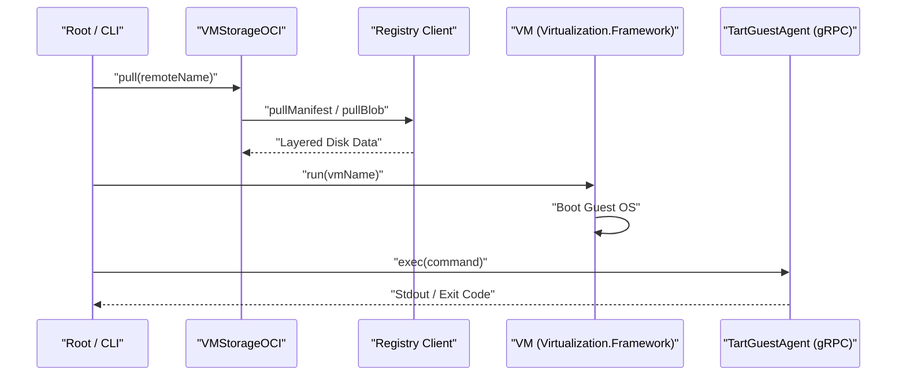

<!-- source: DeepWiki mcp.deepwiki.com · repo openai/tart · page 1 Overview · fetched 2026-10-26 -->

# Overview

<details>
<summary>Relevant source files</summary>

The following files were used as context for generating this wiki page:

- [Package.resolved](Package.resolved)
- [Package.swift](Package.swift)
- [README.md](README.md)
- [Sources/tart/Root.swift](Sources/tart/Root.swift)
- [docs/index.md](docs/index.md)
- [docs/layouts/custom.yml](docs/layouts/custom.yml)
- [docs/quick-start.md](docs/quick-start.md)

</details>


Tart is a virtualization toolset designed to build, run, and manage macOS and Linux virtual machines (VMs) on Apple Silicon [README.md:3-4](). It leverages Apple's `Virtualization.Framework` to provide near-native performance while introducing modern DevOps workflows, such as using OCI-compatible container registries for VM image distribution [README.md:6-7]().

The system is designed for high-performance CI/CD automation, offering features like directory sharing via Virtio-FS, automated VM creation via a Packer plugin, and a gRPC-based guest agent for remote execution [README.md:8-9]().

### High-Level Architecture

The Tart codebase is organized around a central CLI entry point defined in `Root.swift` that dispatches commands to various subsystems including storage managers, OCI registry clients, and the virtualization engine [Sources/tart/Root.swift:9-33]().

**System Context: Natural Language to Code Entities**

```mermaid
graph TD
    subgraph "Natural_Language_Space"
        [User_CLI_Command]
        [VM_Storage]
        [Remote_Registry]
    end

    subgraph "Code_Entity_Space"
        [User_CLI_Command] --> ["Root: AsyncParsableCommand"]
        ["Root: AsyncParsableCommand"] --> ["Create, Run, Pull, etc."]
        [VM_Storage] --> ["VMStorageLocal / VMStorageOCI"]
        ["VMStorageLocal / VMStorageOCI"] --> ["VMDirectory"]
        [Remote_Registry] --> ["Registry: OCI Distribution Client"]
    end

    subgraph "Hardware_/_OS_Interface"
        ["Create, Run, Pull, etc."] --> ["Virtualization.Framework"]
        ["VMDirectory"] --> ["APFS / Local Filesystem"]
    end
```
Sources: [Sources/tart/Root.swift:9-33](), [README.md:6-7](), [Package.swift:33-51]()

### Key Capabilities

Tart bridges the gap between traditional virtualization and container-like workflows:

*   **OCI Integration**: VMs are treated as OCI images. You can `push` and `pull` entire VM states to registries like GitHub Packages (GHCR) [README.md:54-55]().
*   **Performance**: By using `Virtualization.Framework`, Tart avoids the overhead of traditional emulation [README.md:6]().
*   **Automation-First**: Includes native support for headless execution, gRPC guest agents for command execution (`tart exec`), and IP resolution for SSH access [docs/quick-start.md:90-104]().
*   **Platform Support**: Supports macOS (Monterey through Sequoia/macOS 15 and Tahoe/macOS 16) and major Linux distributions (Ubuntu, Debian, Fedora) [docs/quick-start.md:33-68]().

### Subsystem Relationships

The diagram below illustrates how the major internal components interact during a typical VM lifecycle (Pull -> Run -> Exec). The `Root` entry point manages the lifecycle, deciding whether to run a command on the `MainActor` (required for SwiftUI/AppKit UI) or in a detached background task [Sources/tart/Root.swift:68-91]().

**Component Interaction Map**


Sources: [Sources/tart/Root.swift:13-33](), [Sources/tart/Root.swift:68-91](), [docs/quick-start.md:12-13](), [Package.swift:27]()

---

### Getting Started
To begin using Tart, you can install it via Homebrew or manually from a release archive [docs/quick-start.md:11-20](). The development workflow involves building from source and requires specific code signing (via `embedded.provisionprofile`) to access elevated virtualization privileges [docs/quick-start.md:26-28]().

For details, see [Getting Started](#1.1).

Sources: [README.md:52-56](), [docs/quick-start.md:10-28]()

### CLI Command Reference
Tart provides a comprehensive set of commands for local VM management (`create`, `run`, `set`, `delete`) and remote distribution (`pull`, `push`, `login`, `logout`) [Sources/tart/Root.swift:13-33](). Specialized commands like `exec` and `ip` facilitate automation by interacting with the guest environment, while `suspend` is available on macOS 14+ [Sources/tart/Root.swift:22-23](), [Sources/tart/Root.swift:44-46]().

For details, see [CLI Command Reference](#1.2).

Sources: [Sources/tart/Root.swift:13-33](), [docs/quick-start.md:152-180]()

---

