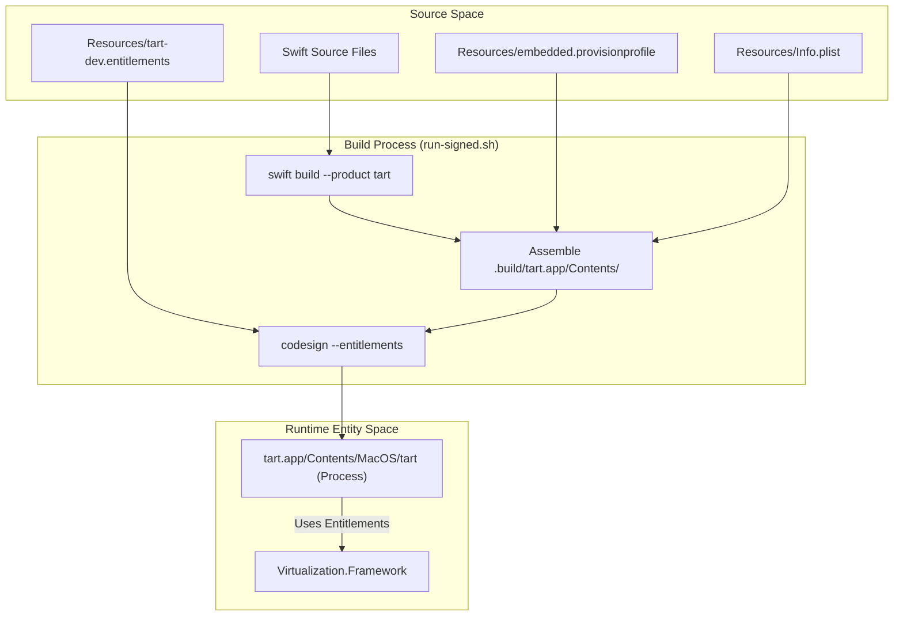
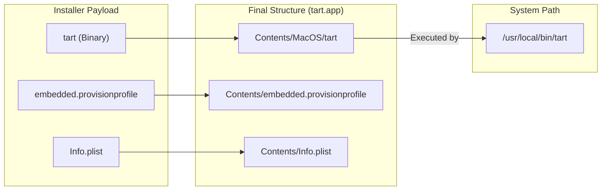

<!-- source: DeepWiki mcp.deepwiki.com · repo openai/tart · page 1.1 Getting Started · fetched 2026-10-26 -->

# Getting Started

<details>
<summary>Relevant source files</summary>

The following files were used as context for generating this wiki page:

- [.ci/pkg/scripts/postinstall](.ci/pkg/scripts/postinstall)
- [README.md](README.md)
- [Resources/Info.plist](Resources/Info.plist)
- [docs/quick-start.md](docs/quick-start.md)
- [scripts/build-docs.sh](scripts/build-docs.sh)
- [scripts/run-signed.sh](scripts/run-signed.sh)
- [scripts/start-docs.sh](scripts/start-docs.sh)

</details>


Tart is a virtualization toolset designed specifically for Apple Silicon, leveraging Apple's `Virtualization.Framework` to build, run, and manage macOS and Linux virtual machines (VMs) with near-native performance [README.md:3-6](). This page covers the installation methods, initial setup, and the development workflow for building Tart from source.

## Installation

Tart can be installed via Homebrew, a manual release archive, or built from source.

### Homebrew (Recommended)
The simplest way to install Tart on macOS 13.0 (Ventura) or later is via the official tap:

```bash
brew install openai/tools/tart
```
[README.md:50-53](), [docs/quick-start.md:8-11]()

### Manual Installation
You can manually install the `tart` binary from the GitHub releases. Note that for the binary to function correctly with elevated privileges, it must remain within the `.app` bundle structure to correctly reference the `embedded.provisionprofile` [docs/quick-start.md:16-27]().

```bash
curl -LO https://github.com/openai/tart/releases/latest/download/tart.tar.gz
tar -xzvf tart.tar.gz
./tart.app/Contents/MacOS/tart clone ghcr.io/cirruslabs/macos-tahoe-base:latest tahoe-base
./tart.app/Contents/MacOS/tart run tahoe-base
```
[docs/quick-start.md:20-24]()

## First-Run Setup

To verify your installation, you can pull and run a pre-built macOS image. Note that downloading a full macOS image typically requires ~25 GB of disk space [docs/quick-start.md:8-14]().

```bash
# Clone a remote image to a local VM named "tahoe-base"
tart clone ghcr.io/cirruslabs/macos-tahoe-base:latest tahoe-base

# Run the VM
tart run tahoe-base
```
[README.md:54-55](), [docs/quick-start.md:12-13]()

### Default Credentials
Standard images provided by Cirrus Labs use the following credentials for GUI, SSH, and console access:
- **Username:** `admin`
- **Password:** `admin`

[docs/quick-start.md:81-86]()

## Building from Source

### Prerequisites
- Apple Silicon Mac
- macOS 13.0 or newer [docs/quick-start.md:8-8]()
- Swift toolchain

### Development Workflow: `run-signed.sh`
Tart requires specific entitlements and a provisioning profile to interact with the `Virtualization.Framework` [docs/quick-start.md:26-28](). The `scripts/run-signed.sh` script automates the process of building the Swift package, assembling a minimal `.app` bundle, and signing it with developer entitlements [scripts/run-signed.sh:1-19]().

#### Execution Flow
The `run-signed.sh` script performs the following steps:
1. **Build**: Compiles the `tart` product using `swift build --product tart` [scripts/run-signed.sh:8-8]().
2. **Assemble**: Creates a directory structure at `.build/tart.app/` and copies the binary, `Info.plist`, and `embedded.provisionprofile` [scripts/run-signed.sh:10-14]().
3. **Sign**: Applies `Resources/tart-dev.entitlements` to the bundle using `codesign --sign -` [scripts/run-signed.sh:17-17]().
4. **Execute**: Runs the signed binary with any arguments passed to the script [scripts/run-signed.sh:19-19]().

```bash
# Example: List VMs using a locally built and signed binary
./scripts/run-signed.sh list
```
[scripts/run-signed.sh:4-4]()

### Code Entity Mapping: Build and Sign
The following diagram illustrates how the development script bridges the gap between the source code and a functional, entitled macOS process.

**Build and Signing Data Flow**

Sources: [scripts/run-signed.sh:8-19](), [Resources/Info.plist:1-29]()

## Packaging and Post-Installation
When Tart is installed via the `.pkg` installer, a post-install script ensures the correct `.app` bundle structure is maintained while providing a convenient symlink in the user's path [ .ci/pkg/scripts/postinstall:1-16]().

**Post-Install File Relocation**

Sources: [.ci/pkg/scripts/postinstall:5-15]()

### Implementation Details
The `postinstall` script performs these key actions:
- Creates the required directory structure: `tart.app/Contents/MacOS` and `tart.app/Resources` [.ci/pkg/scripts/postinstall:6-6]().
- Moves the raw binary and metadata files into their respective bundle locations [.ci/pkg/scripts/postinstall:7-10]().
- Creates a wrapper script at `/usr/local/bin/tart` that uses `exec` to call the bundled binary, ensuring macOS recognizes the provisioning profile [.ci/pkg/scripts/postinstall:12-15]().

Sources: [README.md:1-59](), [docs/quick-start.md:1-172](), [scripts/run-signed.sh:1-19](), [.ci/pkg/scripts/postinstall:1-15](), [Resources/Info.plist:1-29]()

---

