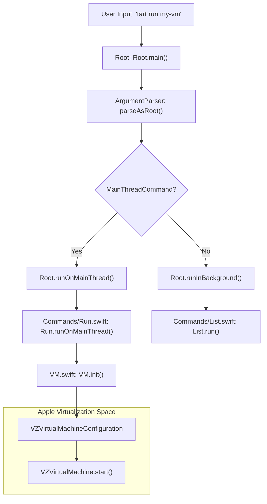
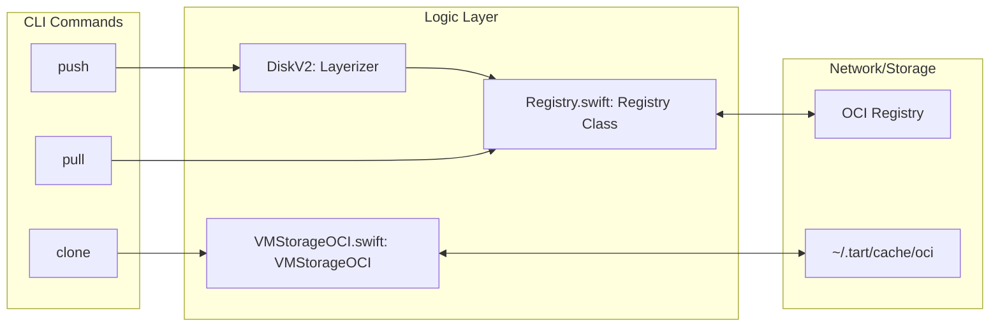

<!-- source: DeepWiki mcp.deepwiki.com · repo openai/tart · page 1.2 CLI Command Reference · fetched 2026-10-26 -->

# CLI Command Reference

Relevant source files

The following files were used as context for generating this wiki page:

- [Package.resolved](Package.resolved)
- [Package.swift](Package.swift)
- [Sources/tart/Commands/Create.swift](Sources/tart/Commands/Create.swift)
- [Sources/tart/Commands/Delete.swift](Sources/tart/Commands/Delete.swift)
- [Sources/tart/Commands/Export.swift](Sources/tart/Commands/Export.swift)
- [Sources/tart/Commands/FQN.swift](Sources/tart/Commands/FQN.swift)
- [Sources/tart/Commands/Get.swift](Sources/tart/Commands/Get.swift)
- [Sources/tart/Commands/Import.swift](Sources/tart/Commands/Import.swift)
- [Sources/tart/Commands/List.swift](Sources/tart/Commands/List.swift)
- [Sources/tart/Commands/Rename.swift](Sources/tart/Commands/Rename.swift)
- [Sources/tart/Commands/Stop.swift](Sources/tart/Commands/Stop.swift)
- [Sources/tart/Commands/Suspend.swift](Sources/tart/Commands/Suspend.swift)
- [Sources/tart/DiskImageStack.swift](Sources/tart/DiskImageStack.swift)
- [Sources/tart/Formatter/HumanReadableByteCount.swift](Sources/tart/Formatter/HumanReadableByteCount.swift)
- [Sources/tart/PIDLock.swift](Sources/tart/PIDLock.swift)
- [Sources/tart/Root.swift](Sources/tart/Root.swift)
- [Sources/tart/ShellCompletions/ShellCompletions.swift](Sources/tart/ShellCompletions/ShellCompletions.swift)
- [Sources/tart/VMDirectory+Archive.swift](Sources/tart/VMDirectory+Archive.swift)
- [Tests/TartTests/DiskImageStackTests.swift](Tests/TartTests/DiskImageStackTests.swift)
- [Tests/TartTests/HumanReadableByteCountTests.swift](Tests/TartTests/HumanReadableByteCountTests.swift)
- [Tests/TartTests/VMDirectoryDiskImageStackTests.swift](Tests/TartTests/VMDirectoryDiskImageStackTests.swift)
- [Tests/TartTests/VMDirectoryLayoutTests.swift](Tests/TartTests/VMDirectoryLayoutTests.swift)
- [integration-tests/clone_lock_darwin_test.go](integration-tests/clone_lock_darwin_test.go)

This page provides a comprehensive technical reference for the Tart Command Line Interface (CLI). The CLI is built using the `swift-argument-parser` library, which handles command routing, argument validation, and help generation.

## Command Architecture and Dispatch

The CLI entry point is the `Root` struct (the root command), which dispatches to individual `ParsableCommand` or `AsyncParsableCommand` implementations [Sources/tart/Root.swift:9-33](). 

### Threading Model and Dispatch
Tart employs a specific threading model to accommodate the requirements of Apple's `Virtualization.Framework` and `SwiftUI`.
- **Main Thread Commands**: Commands that drive a UI or run loop (like `run`) implement `MainThreadCommand` and are executed on the main actor to prevent blocking the Dispatch main queue [Sources/tart/Root.swift:68-73]().
- **Background Commands**: Most management commands (like `list`, `delete`) run in a detached task using `runInBackground` [Sources/tart/Root.swift:78-80]().
- **Signal Handling**: The `Root` command manages `SIGINT` (Ctrl+C) by capturing it via a `DispatchSource` and cancelling the active task [Sources/tart/Root.swift:83-87]().

### Command Execution Flow

The following diagram illustrates how a command transitions from a user string to code execution within the system.

**Natural Language to Code Entity Space: Execution Flow**

Sources: [Sources/tart/Root.swift:42-91](), [Sources/tart/Commands/List.swift:37-75](), [Sources/tart/Root.swift:111-129]()

---

## Core VM Management

### create
Creates a new VM bundle from an operating system source.
- **Implementation**: For macOS, it fetches the latest supported IPSW via `VZMacOSRestoreImage.fetchLatestSupported()` or uses a provided path/URL [Sources/tart/Commands/Create.swift:53-62](). For Linux, it calls `VM.linux()` [Sources/tart/Commands/Create.swift:74]().
- **Data Flow**: Creates a temporary directory via `VMDirectory.temporary()`, applies a `FileLock` to prevent garbage collection during creation, and moves it to local storage upon completion [Sources/tart/Commands/Create.swift:42-81]().
- **Key Options**:
    - `--from-ipsw`: Path, URL, or `latest` [Sources/tart/Commands/Create.swift:13-14]().
    - `--linux`: Flag for Linux VMs [Sources/tart/Commands/Create.swift:16-17]().
    - `--disk-format`: Supports `raw` or `asif`. `asif` requires macOS 15+ (Tahoe) [Sources/tart/Commands/Create.swift:22-23]().

### run
Starts a virtual machine.
- **Implementation**: Instantiates a `VM` object. It handles window management via SwiftUI unless `--no-graphics` is passed.
- **Key Logic**: 
    - Enters the run loop on the main thread [Sources/tart/Root.swift:101]().
    - Triggers garbage collection before execution unless it's a pull/clone command [Sources/tart/Root.swift:153-161]().

### get
Retrieves configuration and status of a local VM.
- **Implementation**: Opens `VMStorageLocal`, decodes the `config.json` into a `VMConfig` object, and queries the `VMDirectory` for disk usage and state [Sources/tart/Commands/Get.swift:25-42]().
- **Output**: Returns OS type, CPU count, Memory size, Disk format, and current state (`Running`, `Stopped`, `Suspended`) [Sources/tart/Commands/Get.swift:4-14]().

### list
Enumerates local and OCI-cached VMs.
- **Implementation**: Queries `VMStorageLocal` and `VMStorageOCI` [Sources/tart/Commands/List.swift:40-66]().
- **Filtering**: Supports filtering by `--source` (local or oci) [Sources/tart/Commands/List.swift:18-19]().
- **Output**: Supports `text` and `json` formats via `Format.renderList` [Sources/tart/Commands/List.swift:21-22]().

### stop / suspend / delete / rename
- **stop**: Attempts graceful termination via `SIGINT` to the VM process, falling back to `SIGKILL` after a timeout (default 30s) [Sources/tart/Commands/Stop.swift:12-13, 51-68]().
- **suspend**: Saves the VM state to `state.vzvmsave`. Only available on macOS 14+ [Sources/tart/Root.swift:44-46]().
- **delete**: Removes the VM bundle from disk.
- **rename**: Uses `VMStorageLocal.rename()` after verifying the target name doesn't exist and acquiring a lock on `TART_HOME` [Sources/tart/Commands/Rename.swift:19-34]().

---

## Networking and Interaction

### ip
Resolves the IP address of a running VM.
- **Implementation**: Uses a multi-strategy approach including DHCP lease parsing, ARP table lookups, and the `TartGuestAgent` [Sources/tart/Commands/IP.swift:62-82]().

### exec
Executes a command inside the guest OS.
- **Implementation**: Communicates with `TartGuestAgent` via gRPC over a Unix Domain Socket (UDS) [Sources/tart/Commands/Exec.swift:36-50]().
- **Exit Codes**: If the guest command fails, `exec` returns the specific exit code via `ExecCustomExitCodeError` [Sources/tart/Root.swift:165-169]().

---

## OCI Registry Operations

Tart treats OCI registries as a distribution backend.

**OCI Integration Mapping**

Sources: [Sources/tart/Commands/Push.swift](), [Sources/tart/Commands/Pull.swift](), [Sources/tart/Commands/Clone.swift]()

### pull / push
- **pull**: Downloads OCI manifests and layers to the local cache.
- **push**: Splits the VM disk into layers (DiskV2) and uploads them to a remote registry [Sources/tart/Commands/Push.swift]().

### login / logout
- **Implementation**: Persists registry credentials using the macOS Keychain or standard OCI config files [Sources/tart/Root.swift:20-21]().

---

## Maintenance and Utilities

### prune
Reclaims disk space by deleting unused OCI cached layers and VMs.
- **Logic**: Invokes `Config().gc()` which is also called automatically before most commands [Sources/tart/Root.swift:153-161]().

### import / export
- **export**: Compresses a VM bundle into a `.tvm` archive.
- **import**: Extracts a `.tvm` archive into a local VM bundle. It automatically regenerates the MAC address if a collision is detected in local storage [Sources/tart/Commands/Import.swift:45-48]().

### fqn
- **Purpose**: Resolves and prints the Fully Qualified Name (FQN) of a VM [Sources/tart/Root.swift:32]().

| Command | Primary Class | Key Implementation |
| :--- | :--- | :--- |
| `create` | `Create` | `VM.init` / `VM.linux` |
| `list` | `List` | `VMStorageLocal.list` / `VMStorageOCI.list` |
| `stop` | `Stop` | `kill(pid, SIGINT/SIGKILL)` |
| `import` | `Import` | `VMDirectory.importFromArchive` |
| `rename` | `Rename` | `VMStorageLocal.rename` |

Sources: [Sources/tart/Commands/Create.swift](), [Sources/tart/Commands/List.swift](), [Sources/tart/Commands/Stop.swift](), [Sources/tart/Commands/Import.swift](), [Sources/tart/Commands/Rename.swift]()

---

