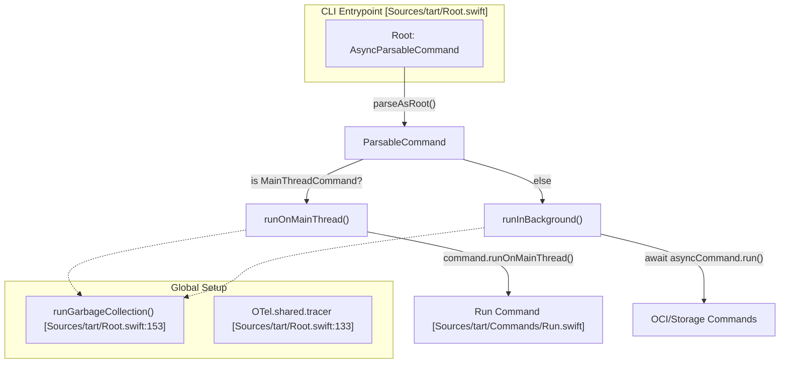
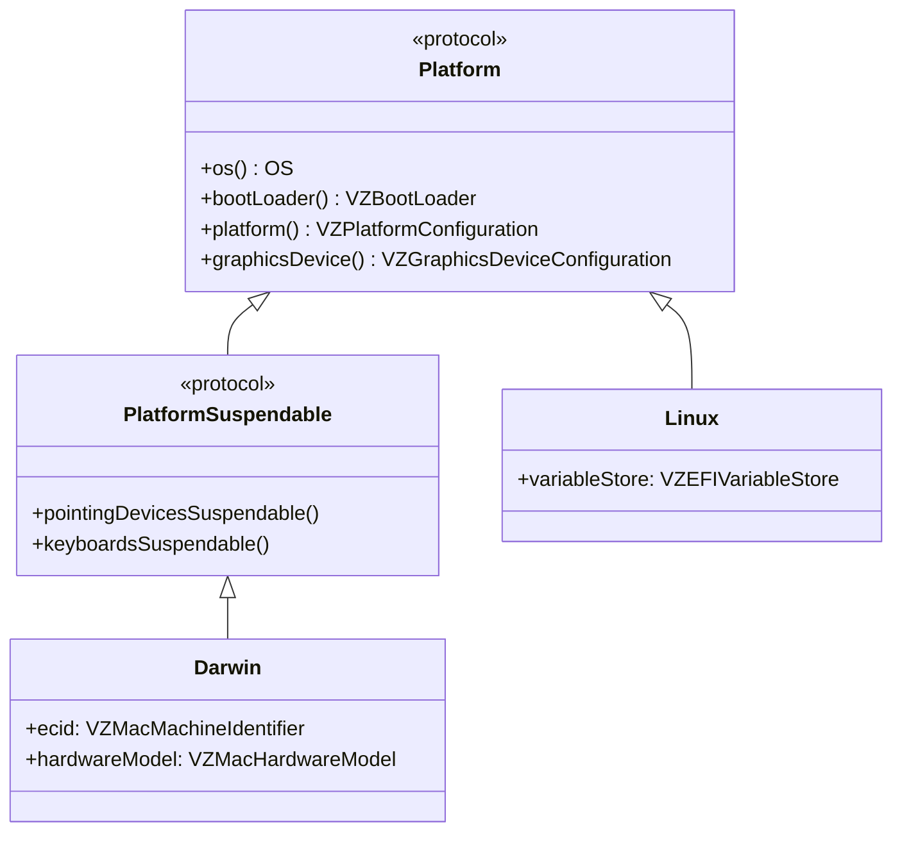

<!-- source: DeepWiki mcp.deepwiki.com · repo openai/tart · page 2 Core Architecture · fetched 2026-10-26 -->

# Core Architecture

Relevant source files

The following files were used as context for generating this wiki page:

- [Package.resolved](Package.resolved)
- [Package.swift](Package.swift)
- [Sources/tart/Commands/Run.swift](Sources/tart/Commands/Run.swift)
- [Sources/tart/Root.swift](Sources/tart/Root.swift)
- [Sources/tart/VM.swift](Sources/tart/VM.swift)

Tart is a virtualization tool built on top of Apple's `Virtualization.framework`. Its architecture is designed to bridge the gap between high-level OCI (Open Container Initiative) image distribution and low-level macOS virtualization primitives.

## System Entrypoint and Dispatch

The `Root` struct serves as the main entrypoint for the `tart` executable. It uses `Swift Argument Parser` to manage a wide array of subcommands including `create`, `run`, `pull`, and `push` [Sources/tart/Root.swift:8-33]().

Tart employs a specialized dispatch mechanism to handle the requirements of the macOS main run loop. Commands that require a graphical interface or specific AppKit/SwiftUI event loops (like `tart run`) implement the `MainThreadCommand` protocol and are executed directly on the main thread using `MainActor.assumeIsolated` [Sources/tart/Root.swift:68-73](). All other commands are executed in a detached background task [Sources/tart/Root.swift:78-80]().

### Command Dispatch Architecture

**Sources:** [Sources/tart/Root.swift:42-129](), [Sources/tart/Root.swift:132-161]()

---

## VM Lifecycle and Configuration

The core of Tart's VM management is the `VM` class, which orchestrates the `Virtualization.framework` objects. The `VM` class initializes a `VZVirtualMachine` using a `VZVirtualMachineConfiguration` generated by `craftConfiguration` [Sources/tart/VM.swift:25-86](). The lifecycle is driven by the `VMConfig`, which defines hardware characteristics such as CPU count, memory, and display resolution.

For details, see [VM Lifecycle and Configuration](#2.1).

---

## Platform Abstraction

Tart provides a unified interface for different guest operating systems through the `Platform` protocol. This allows the system to abstract away the differences between macOS (Darwin) and Linux guests, such as bootloaders (`VZBootLoader`), graphics devices, and hardware identifiers.

### Platform Class Hierarchy

**Sources:** [Sources/tart/VM.swift:41-82](), [Sources/tart/Commands/Run.swift:98-117]()

For details, see [Platform Abstraction (Darwin and Linux)](#2.2).

---

## VM Storage and OCI Backends

Tart manages VMs as directories on the local filesystem, encapsulated by the `VMDirectory` struct. It supports local storage and OCI-compatible backends where images are stored in a content-addressed cache.

### Storage Layout and Entity Mapping

| Entity | Code Implementation | Purpose |
| :--- | :--- | :--- |
| **VM Directory** | `VMDirectory` | Represents the folder containing all VM assets. |
| **Config** | `config.json` | Serialized `VMConfig` including hardware specs [Sources/tart/VM.swift:59](). |
| **Disk Image** | `disk.img` | The actual guest filesystem image [Sources/tart/VM.swift:183](). |
| **NVRAM** | `nvram.bin` | Non-volatile RAM for EFI/macOS boot variables [Sources/tart/VM.swift:180](). |
| **State** | `state.vzvmsave` | Saved memory state for suspended VMs [Sources/tart/VM.swift:138-140](). |

For details, see [VM Storage: Local and OCI Backends](#2.3).

---

## Networking

Tart implements multiple networking stacks to balance performance and ease of use. This includes `NetworkShared` (NAT) and `NetworkBridged` for standard macOS virtualization networking [Sources/tart/VM.swift:41-44](). It also supports advanced features like Virtio-FS directory sharing and Rosetta 2 acceleration for Linux guests [Sources/tart/Commands/Run.swift:147-169]().

For details, see [Networking](#2.4).

---

## Guest Agent and Communication

To enable commands like `tart exec`, Tart establishes a communication channel between the host and the guest. This involves a `ControlSocket` proxy on the host and a gRPC-based agent running inside the guest VM, utilizing the `cirruslabs_tart-guest-agent_grpc_swift` package [Package.swift:27-47]().

For details, see [Guest Agent and Host-Guest Communication](#2.5).

---

## Subsystems Overview

| Subsystem | Key Files | Responsibility |
| :--- | :--- | :--- |
| **CLI Root** | `Root.swift` | Argument parsing and main thread management [Sources/tart/Root.swift:8-33](). |
| **VM Engine** | `VM.swift` | Wrapping `Virtualization.framework` and managing guest state [Sources/tart/VM.swift:25-86](). |
| **Commands** | `Run.swift` | Handling the complex logic of booting and displaying VMs [Sources/tart/Commands/Run.swift:65-170](). |
| **Dependencies** | `Package.swift` | Managing external libraries like OTel, gRPC, and ANTLR [Package.swift:12-31](). |

**Sources:** [Sources/tart/Root.swift:8-33](), [Sources/tart/VM.swift:25-86](), [Sources/tart/Commands/Run.swift:65-170](), [Package.swift:1-62]()

---

