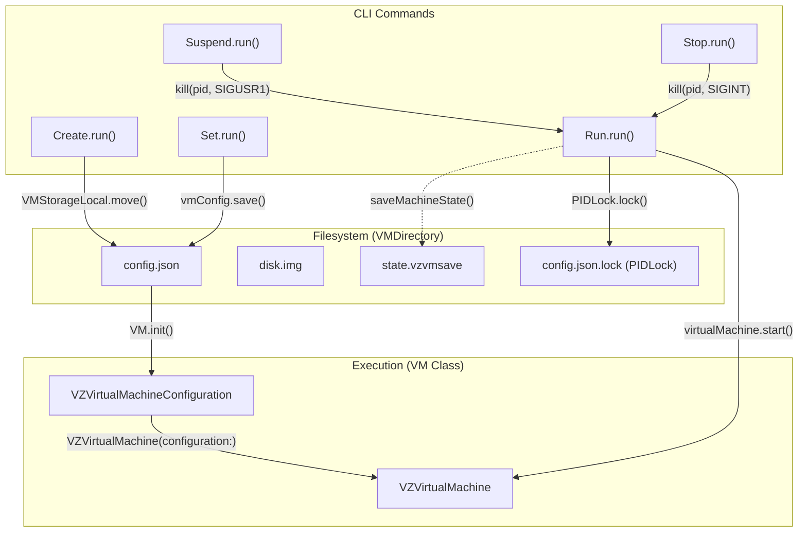
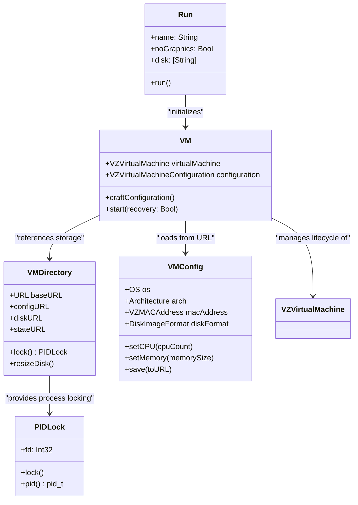

<!-- source: DeepWiki mcp.deepwiki.com · repo openai/tart · page 2.1 VM Lifecycle and Configuration · fetched 2026-10-26 -->

# VM Lifecycle and Configuration

Relevant source files

The following files were used as context for generating this wiki page:

- [Sources/tart/Commands/Create.swift](Sources/tart/Commands/Create.swift)
- [Sources/tart/Commands/Rename.swift](Sources/tart/Commands/Rename.swift)
- [Sources/tart/Commands/Run.swift](Sources/tart/Commands/Run.swift)
- [Sources/tart/Commands/Set.swift](Sources/tart/Commands/Set.swift)
- [Sources/tart/Commands/Stop.swift](Sources/tart/Commands/Stop.swift)
- [Sources/tart/Commands/Suspend.swift](Sources/tart/Commands/Suspend.swift)
- [Sources/tart/DiskImageFormat.swift](Sources/tart/DiskImageFormat.swift)
- [Sources/tart/PIDLock.swift](Sources/tart/PIDLock.swift)
- [Sources/tart/VM+Recovery.swift](Sources/tart/VM+Recovery.swift)
- [Sources/tart/VM.swift](Sources/tart/VM.swift)
- [Sources/tart/VMConfig.swift](Sources/tart/VMConfig.swift)
- [Tests/TartTests/DiskImageFormatTests.swift](Tests/TartTests/DiskImageFormatTests.swift)
- [Tests/TartTests/VMConfigTests.swift](Tests/TartTests/VMConfigTests.swift)
- [docs/assets/images/faq/tart-run-recovery-options.png](docs/assets/images/faq/tart-run-recovery-options.png)
- [docs/assets/images/faq/tart-run-recovery-terminal.png](docs/assets/images/faq/tart-run-recovery-terminal.png)
- [integration-tests/clone_lock_darwin_test.go](integration-tests/clone_lock_darwin_test.go)

This section describes the lifecycle of a Tart virtual machine, from initial creation and configuration to execution, suspension, and termination. Tart leverages Apple's `Virtualization.Framework` while providing a management layer for persistent configuration, storage, and state.

## VM Configuration and Serialization

The `VMConfig` struct is the primary data structure for defining a VM's hardware and software characteristics. It is serialized as a `config.json` file within the VM's directory [Sources/tart/VMConfig.swift:56-69]().

### Key Configuration Properties
| Property | Type | Description |
| :--- | :--- | :--- |
| `version` | `Int` | Configuration schema version [Sources/tart/VMConfig.swift:57](). |
| `os` | `OS` | Guest operating system (Darwin or Linux) [Sources/tart/VMConfig.swift:58](). |
| `arch` | `Architecture` | Target CPU architecture (arm64 or x86_64) [Sources/tart/VMConfig.swift:59](). |
| `cpuCount` | `Int` | Number of virtual CPUs [Sources/tart/VMConfig.swift:62](). |
| `memorySize` | `UInt64` | RAM size in bytes [Sources/tart/VMConfig.swift:64](). |
| `macAddress` | `VZMACAddress` | Virtual MAC address for the primary interface [Sources/tart/VMConfig.swift:65](). |
| `display` | `VMDisplayConfig` | Resolution and unit (pt vs px) [Sources/tart/VMConfig.swift:66](). |
| `diskFormat` | `DiskImageFormat` | Format of the primary disk (`raw` or `asif`) [Sources/tart/VMConfig.swift:68](). |

### Serialization Logic
`VMConfig` implements `Codable` to handle JSON conversion [Sources/tart/VMConfig.swift:106-162](). During decoding, it polymorphically handles platform-specific data:
* **Darwin**: Includes `ecid` and `hardwareModel` [Sources/tart/VMConfig.swift:115]().
* **Linux**: Uses standard EFI boot parameters [Sources/tart/VMConfig.swift:123]().

**Sources:** [Sources/tart/VMConfig.swift:1-191](), [Sources/tart/DiskImageFormat.swift:4-33]()

---

## VM Lifecycle Flow

The lifecycle is managed by the `VM` class, which acts as a wrapper around `VZVirtualMachine` [Sources/tart/VM.swift:25-27]().

### 1. Creation (`tart create`)
The `Create` command initializes a new VM directory [Sources/tart/Commands/Create.swift:42]().
* **macOS**: Fetches or uses a local `.ipsw` restore image [Sources/tart/Commands/Create.swift:50-62](). It then calls `VM.retrieveIPSW` to cache the image [Sources/tart/VM.swift:88-103]().
* **Linux**: Initializes a Linux-specific configuration [Sources/tart/Commands/Create.swift:74]().
* **Storage**: Creates a disk image of a specified size (default 50GB) and format [Sources/tart/Commands/Create.swift:20-23]().

### 2. Modification (`tart set`)
The `Set` command allows modifying a stopped VM's configuration [Sources/tart/Commands/Set.swift:40-88]().
* **Resource Scaling**: Updates `cpuCount` and `memorySize` in `config.json` [Sources/tart/Commands/Set.swift:52-59]().
* **Disk Resizing**: Increases the size of `disk.img` [Sources/tart/Commands/Set.swift:92-94](). It supports both `raw` and `asif` formats via the `VMDirectory.resizeDisk` helper.

### 3. Execution (`tart run`)
The `Run` command instantiates the `VM` class and starts the virtualization engine [Sources/tart/Commands/Run.swift:65]().
* **Configuration Crafting**: The `VM.craftConfiguration` method converts `VMConfig` and CLI flags into a `VZVirtualMachineConfiguration` [Sources/tart/VM.swift:67-81]().
* **Recovery Mode**: macOS VMs can be booted into recovery using private `Virtualization.Framework` options [Sources/tart/VM+Recovery.swift:15-28]().

### 4. Suspension and Stopping
* **Suspension**: The `Suspend` command sends a `SIGUSR1` signal to the `tart run` process [Sources/tart/Commands/Suspend.swift:23-26](). This triggers the VM to save its state to a `state.vzvmsave` file.
* **Stopping**: The `Stop` command attempts a graceful termination by sending `SIGINT` to the process [Sources/tart/Commands/Stop.swift:51](). If it fails to terminate within the timeout, it sends `SIGKILL` [Sources/tart/Commands/Stop.swift:68]().
* **PID Locking**: Tart uses a `PIDLock` (based on `fcntl` locks) to ensure only one process manages a specific VM at a time [Sources/tart/PIDLock.swift:4-57]().

### VM Lifecycle State Transitions
Title: "VM State Transitions and Code Entities"

**Sources:** [Sources/tart/VM.swift:82](), [Sources/tart/Commands/Create.swift:81](), [Sources/tart/Commands/Set.swift:82](), [Sources/tart/Commands/Stop.swift:51-68](), [Sources/tart/Commands/Suspend.swift:23](), [Sources/tart/PIDLock.swift:4-57]().

---

## Disk Formats

Tart supports two primary disk formats for the `disk.img` file:

| Format | Implementation | Characteristics |
| :--- | :--- | :--- |
| **RAW** | Sparse file | Default format. |
| **ASIF** | Apple Sparse Image Format | Higher performance. Requires macOS 15+ (Tahoe) [Sources/tart/DiskImageFormat.swift:24-28](). |

### Disk Synchronization and Caching
The `Run` command provides granular control over how `Virtualization.Framework` handles disk I/O:
* **Synchronization Mode**: `none`, `fsync`, or `full` [Sources/tart/Commands/Run.swift:16-46]().
* **Caching Mode**: `automatic`, `cached`, or `uncached` [Sources/tart/Commands/Run.swift:48-63]().

**Sources:** [Sources/tart/DiskImageFormat.swift:4-33](), [Sources/tart/Commands/Run.swift:16-63](), [Tests/TartTests/DiskImageFormatTests.swift:1-63]().

---

## Implementation Mapping

The following diagram maps high-level lifecycle concepts to the internal Swift classes and `Virtualization.Framework` components.

Title: "VM Implementation Mapping"

**Sources:** [Sources/tart/VM.swift:25-57](), [Sources/tart/VMConfig.swift:56-69](), [Sources/tart/Commands/Run.swift:65-110](), [Sources/tart/PIDLock.swift:4-16]().

---
**Sources:**
* `Sources/tart/VM.swift`
* `Sources/tart/VMConfig.swift`
* `Sources/tart/Commands/Run.swift`
* `Sources/tart/Commands/Create.swift`
* `Sources/tart/Commands/Set.swift`
* `Sources/tart/Commands/Stop.swift`
* `Sources/tart/Commands/Suspend.swift`
* `Sources/tart/DiskImageFormat.swift`
* `Sources/tart/PIDLock.swift`
* `Sources/tart/VM+Recovery.swift`
* `Tests/TartTests/DiskImageFormatTests.swift`

---

