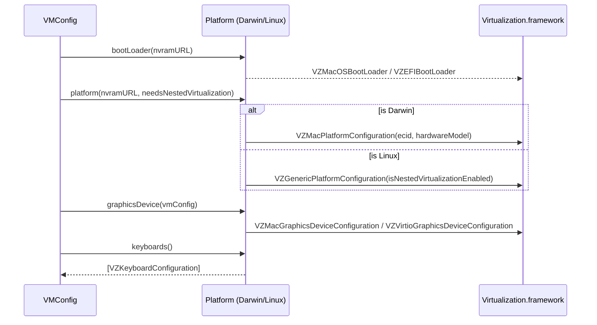

<!-- source: DeepWiki mcp.deepwiki.com · repo openai/tart · page 2.2 Platform Abstraction (Darwin and Linux) · fetched 2026-10-26 -->

# Platform Abstraction (Darwin and Linux)

<details>
<summary>Relevant source files</summary>

The following files were used as context for generating this wiki page:

- [Sources/tart/Commands/Set.swift](Sources/tart/Commands/Set.swift)
- [Sources/tart/Platform/Architecture.swift](Sources/tart/Platform/Architecture.swift)
- [Sources/tart/Platform/Darwin.swift](Sources/tart/Platform/Darwin.swift)
- [Sources/tart/Platform/Linux.swift](Sources/tart/Platform/Linux.swift)
- [Sources/tart/Platform/OS.swift](Sources/tart/Platform/OS.swift)
- [Sources/tart/Platform/Platform.swift](Sources/tart/Platform/Platform.swift)
- [Sources/tart/VMConfig.swift](Sources/tart/VMConfig.swift)
- [Tests/TartTests/VMConfigTests.swift](Tests/TartTests/VMConfigTests.swift)
- [docs/assets/images/faq/tart-run-recovery-options.png](docs/assets/images/faq/tart-run-recovery-options.png)
- [docs/assets/images/faq/tart-run-recovery-terminal.png](docs/assets/images/faq/tart-run-recovery-terminal.png)

</details>


Tart abstracts the differences between macOS (Darwin) and Linux guest operating systems using a protocol-oriented design. This allows the core VM lifecycle logic to remain platform-agnostic while delegating hardware-specific configurations—such as bootloaders, graphics devices, and input methods—to specialized implementations.

## The Platform Protocol

The foundation of Tart's platform abstraction is the `Platform` protocol. It defines the interface for generating the necessary `Virtualization.framework` configurations based on the target OS.

| Method | Purpose |
| :--- | :--- |
| `os()` | Returns the `OS` enum (`.darwin` or `.linux`). |
| `bootLoader(nvramURL:)` | Returns a `VZBootLoader` (e.g., `VZMacOSBootLoader` or `VZEFIBootLoader`). |
| `platform(nvramURL:needsNestedVirtualization:)` | Configures the platform-specific hardware (e.g., machine identifiers for Mac). |
| `graphicsDevice(vmConfig:)` | Configures the display device (Virtio for Linux, MacGraphics for Darwin). |
| `keyboards()` | Returns a list of supported keyboard configurations. |
| `pointingDevices()` | Returns a list of supported pointing devices (Mouse/Trackpad). |

For VMs that support suspension, the `PlatformSuspendable` protocol extends `Platform` to provide configurations compatible with state saving [Sources/tart/Platform/Platform.swift:13-16]().

### Platform Hierarchy Diagram

This diagram illustrates how the `Platform` protocol bridges the high-level `VMConfig` to the specific Apple `Virtualization` framework entities.

```mermaid
classDiagram
    class Platform {
        <<protocol>>
        +os() OS
        +bootLoader(nvramURL) VZBootLoader
        +platform(nvramURL, nested) VZPlatformConfiguration
        +graphicsDevice(vmConfig) VZGraphicsDeviceConfiguration
    }

    class PlatformSuspendable {
        <<protocol>>
        +pointingDevicesSuspendable()
        +keyboardsSuspendable()
    }

    class Darwin {
        +ecid: VZMacMachineIdentifier
        +hardwareModel: VZMacHardwareModel
        +init(from decoder)
        +encode(to encoder)
    }

    class Linux {
        +os() OS
    }

    Platform <|-- PlatformSuspendable : [Sources/tart/Platform/Platform.swift:13-13]()
    PlatformSuspendable <|-- Darwin : [Sources/tart/Platform/Darwin.swift:11-11]()
    Platform <|-- Linux : [Sources/tart/Platform/Linux.swift:4-4]()

    Darwin ..> VZMacOSBootLoader : [Sources/tart/Platform/Darwin.swift:58-58]()
    Darwin ..> VZMacPlatformConfiguration : [Sources/tart/Platform/Darwin.swift:66-66]()
    Linux ..> VZEFIBootLoader : [Sources/tart/Platform/Linux.swift:10-10]()
    Linux ..> VZGenericPlatformConfiguration : [Sources/tart/Platform/Linux.swift:18-18]()
```
**Sources:** [Sources/tart/Platform/Platform.swift:3-16](), [Sources/tart/Platform/Darwin.swift:11-143](), [Sources/tart/Platform/Linux.swift:4-50]()

---

## Darwin (macOS) Implementation

The `Darwin` implementation handles the strict hardware identity requirements of Apple Silicon macOS guests.

### Hardware Identity (ECID and Hardware Model)
macOS guests require a unique machine identifier (ECID) and a specific hardware model to boot. Tart stores these in the VM's `config.json` as Base64-encoded data representations of `VZMacMachineIdentifier` and `VZMacHardwareModel` [Sources/tart/Platform/Darwin.swift:46-51]().

*   **ECID:** Represented by `ecid` [Sources/tart/Platform/Darwin.swift:12-12](). During decoding, Tart recreates the `VZMacMachineIdentifier` from its data representation [Sources/tart/Platform/Darwin.swift:29-33]().
*   **Hardware Model:** Represented by `hardwareModel` [Sources/tart/Platform/Darwin.swift:13-13](). Tart checks `hardwareModel.isSupported` during platform initialization to ensure the host OS can run the specified hardware model, otherwise throwing an `UnsupportedHostOSError` [Sources/tart/Platform/Darwin.swift:71-77]().
*   **Randomization:** The `tart set --random-serial` command allows generating a new `VZMacMachineIdentifier` while preserving the existing `hardwareModel` [Sources/tart/Commands/Set.swift:77-79]().

### Graphics and Input
*   **Graphics:** Uses `VZMacGraphicsDeviceConfiguration` [Sources/tart/Platform/Darwin.swift:83-83](). If the display unit is set to `point`, Tart uses `NSScreen.main` to configure the display size [Sources/tart/Platform/Darwin.swift:85-89](). Otherwise, it defaults to a pixel-based configuration with 72 PPI [Sources/tart/Platform/Darwin.swift:94-102]().
*   **Input:** Supports both `VZUSBKeyboardConfiguration` and `VZMacKeyboardConfiguration` (for guests on macOS 14+) [Sources/tart/Platform/Darwin.swift:107-114](). Pointing devices include both the standard USB mouse and `VZMacTrackpadConfiguration` [Sources/tart/Platform/Darwin.swift:125-128]().

**Sources:** [Sources/tart/Platform/Darwin.swift:11-143](), [Sources/tart/Commands/Set.swift:77-79]()

---

## Linux Implementation

The `Linux` implementation provides a generic virtualization environment using standard Virtio devices and EFI.

### Boot and Platform Configuration
*   **EFI Boot:** Linux guests use `VZEFIBootLoader` [Sources/tart/Platform/Linux.swift:10-10](). The EFI variable store (NVRAM) is persisted to a file via `VZEFIVariableStore(url: nvramURL)` [Sources/tart/Platform/Linux.swift:12-12]().
*   **Platform:** Uses `VZGenericPlatformConfiguration` [Sources/tart/Platform/Linux.swift:18-18]().

### Nested Virtualization
Starting with macOS 15, Tart supports nested virtualization for Linux guests. This is toggled via the `needsNestedVirtualization` flag passed to `platform(...)`, which sets `isNestedVirtualizationEnabled` on the `VZGenericPlatformConfiguration` [Sources/tart/Platform/Linux.swift:19-22](). 

> **Note:** Darwin guests do not support nested virtualization and will throw a `VMConfigurationError` if requested [Sources/tart/Platform/Darwin.swift:61-64]().

### Graphics and Input
*   **Graphics:** Uses `VZVirtioGraphicsDeviceConfiguration` with a single scanout [Sources/tart/Platform/Linux.swift:26-35]().
*   **Input:** Limited to standard USB devices (`VZUSBKeyboardConfiguration` and `VZUSBScreenCoordinatePointingDeviceConfiguration`) [Sources/tart/Platform/Linux.swift:38-44](). Unlike Darwin, Linux pointing devices do not include trackpad support in Tart [Sources/tart/Platform/Linux.swift:46-49]().

**Sources:** [Sources/tart/Platform/Linux.swift:1-50]()

---

## Data Flow: Platform Configuration

The following sequence diagram shows how Tart transforms a `VMConfig` into a runnable `VZVirtualMachineConfiguration`.



### Key Logic Comparison

| Feature | Darwin (`Darwin.swift`) | Linux (`Linux.swift`) |
| :--- | :--- | :--- |
| **Bootloader** | `VZMacOSBootLoader` [58]() | `VZEFIBootLoader` [10]() |
| **Platform Config** | `VZMacPlatformConfiguration` [66]() | `VZGenericPlatformConfiguration` [18]() |
| **Graphics** | `VZMacGraphicsDeviceConfiguration` [83]() | `VZVirtioGraphicsDeviceConfiguration` [26]() |
| **Nested Virt** | Unsupported (throws error) [63]() | Supported on macOS 15+ [20]() |
| **Trackpad** | Supported (`VZMacTrackpadConfiguration`) [127]() | Unsupported [47]() |
| **Default Display Unit** | Points (`pt`) [Sources/tart/Commands/Set.swift:17-18]() | Pixels (`px`) [Sources/tart/Commands/Set.swift:17-18]() |

**Sources:** [Sources/tart/Platform/Darwin.swift:57-143](), [Sources/tart/Platform/Linux.swift:9-50](), [Sources/tart/Commands/Set.swift:17-18]()

---

