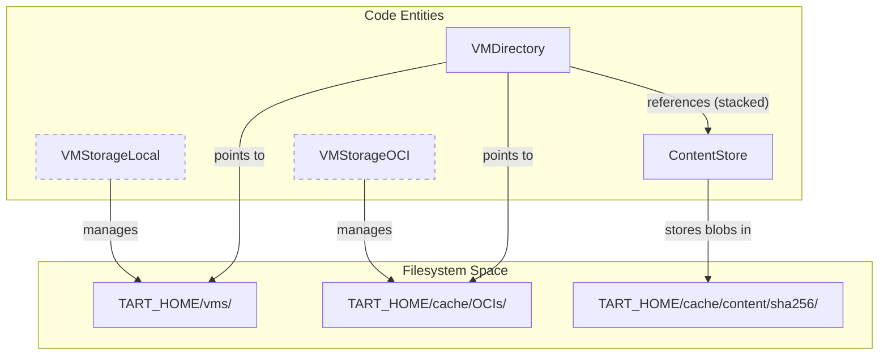
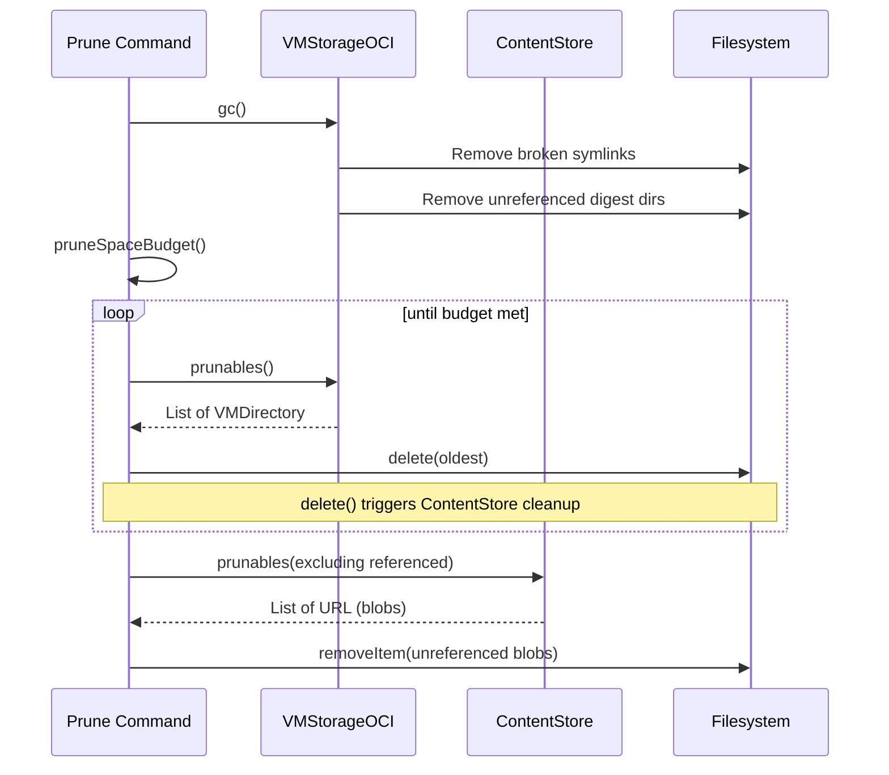

<!-- source: DeepWiki mcp.deepwiki.com · repo openai/tart · page 2.3 VM Storage: Local and OCI Backends · fetched 2026-10-26 -->

# VM Storage: Local and OCI Backends

Relevant source files

The following files were used as context for generating this wiki page:

- [Sources/tart/Commands/Prune.swift](Sources/tart/Commands/Prune.swift)
- [Sources/tart/Config.swift](Sources/tart/Config.swift)
- [Sources/tart/ContentStore.swift](Sources/tart/ContentStore.swift)
- [Sources/tart/FileLock.swift](Sources/tart/FileLock.swift)
- [Sources/tart/IPSWCache.swift](Sources/tart/IPSWCache.swift)
- [Sources/tart/LocalLayerCache.swift](Sources/tart/LocalLayerCache.swift)
- [Sources/tart/Prunable.swift](Sources/tart/Prunable.swift)
- [Sources/tart/URL+AccessDate.swift](Sources/tart/URL+AccessDate.swift)
- [Sources/tart/URL+Prunable.swift](Sources/tart/URL+Prunable.swift)
- [Sources/tart/VMDirectory+DiskImageStack.swift](Sources/tart/VMDirectory+DiskImageStack.swift)
- [Sources/tart/VMDirectory.swift](Sources/tart/VMDirectory.swift)
- [Sources/tart/VMStorageLocal.swift](Sources/tart/VMStorageLocal.swift)
- [Sources/tart/VMStorageOCI.swift](Sources/tart/VMStorageOCI.swift)
- [Tests/TartTests/CommandBehaviorTests.swift](Tests/TartTests/CommandBehaviorTests.swift)
- [Tests/TartTests/ContentStoreTests.swift](Tests/TartTests/ContentStoreTests.swift)
- [Tests/TartTests/FileLockTests.swift](Tests/TartTests/FileLockTests.swift)
- [Tests/TartTests/OCIManifestTests.swift](Tests/TartTests/OCIManifestTests.swift)
- [Tests/TartTests/VMStorageOCITests.swift](Tests/TartTests/VMStorageOCITests.swift)

Tart manages Virtual Machine storage through two primary backends: **Local** and **OCI**. Local storage handles VMs created or imported on the host, while OCI storage manages images pulled from remote registries. Both backends utilize a standardized directory structure for the VM assets themselves.

## VMDirectory: The On-Disk Layout

The `VMDirectory` struct represents a single VM's bundle on disk. It encapsulates the paths and state for all necessary files required by Apple's `Virtualization.framework`.

### File Structure
A VM directory supports multiple layouts, including **standalone** (single disk) and **stacked** (layered disks) [Sources/tart/VMDirectory.swift:100-116]().

| File | Purpose | Code Reference |
| :--- | :--- | :--- |
| `config.json` | VM configuration (CPU, RAM, MAC address, etc.) | [Sources/tart/VMDirectory.swift:14-16]() |
| `disk.img` | The main disk image (used in standalone layout) | [Sources/tart/VMDirectory.swift:17-19]() |
| `nvram.bin` | Non-volatile RAM storage for EFI variables | [Sources/tart/VMDirectory.swift:20-22]() |
| `state.vzvmsave` | Saved execution state (present only if suspended) | [Sources/tart/VMDirectory.swift:23-25]() |
| `manifest.json` | OCI manifest describing layers and metadata | [Sources/tart/VMDirectory.swift:26-28]() |
| `overlay.asif` | Writable overlay for stacked VMs | [Sources/tart/VMDirectory.swift:29-31]() |
| `control.sock` | Unix domain socket for guest agent communication | [Sources/tart/VMDirectory.swift:32-34]() |

### State Management
The `VMDirectory` determines the VM's state based on the presence of specific files and process locks:
- **Running**: Detected by attempting to acquire a `PIDLock` on the `config.json`. If the lock is held by another process, the VM is considered running [Sources/tart/VMDirectory.swift:48-63]().
- **Suspended**: Detected if the VM is not running and the `state.vzvmsave` file exists [Sources/tart/VMDirectory.swift:68-69]().
- **Stopped**: The default state when no lock exists and no save state is present [Sources/tart/VMDirectory.swift:70-72]().

Sources: [Sources/tart/VMDirectory.swift:5-155]()

## Storage Backends

Tart implements the `PrunableStorage` protocol across different storage types to manage VM lifecycles.

### VMStorageLocal
This backend manages VMs located in the user's home directory. By default, these are stored in `~/.tart/vms/` [Sources/tart/VMStorageLocal.swift:6-8]().
- **Listing**: Iterates through the `vms` directory, returning only those that are properly initialized [Sources/tart/VMStorageLocal.swift:74-87]().
- **Renaming/Moving**: Uses `FileManager.default.replaceItemAt`. If the VM uses a stacked layout, it acquires a `ContentStore` prune lock to ensure shared layers aren't collected during the move [Sources/tart/VMStorageLocal.swift:49-68]().

### VMStorageOCI
This backend manages the local cache of remote images in `~/.tart/cache/OCIs/` [Sources/tart/VMStorageOCI.swift:8-10]().
- **Symlink-based Tagging**: OCI storage uses a content-addressable scheme. Digest-addressed images (e.g., `sha256:...`) are stored as actual directories. Tag-based names are implemented as **symbolic links** pointing to the specific digest directory [Sources/tart/VMStorageOCI.swift:121-129]().
- **Stacked Image Support**: Unlike standalone images, stacked images in the OCI cache do not contain a writable overlay and are not runnable until cloned [Sources/tart/VMDirectory.swift:109-111](). They rely on a shared `ContentStore` for immutable disk files [Sources/tart/VMStorageOCI.swift:24-53]().

### Storage Interaction Diagram
The following diagram illustrates how Tart identifies and accesses VM storage.

**VM Storage Entity Map**

Sources: [Sources/tart/VMStorageLocal.swift:3-8](), [Sources/tart/VMStorageOCI.swift:5-10](), [Sources/tart/ContentStore.swift:21-29](), [Sources/tart/VMDirectory.swift:5-12]()

## ContentStore: Shared Immutable Layers

The `ContentStore` is an opaque content-addressed storage for immutable disk files, primarily used by stacked VMs [Sources/tart/ContentStore.swift:8-13](). 

- **Deduplication**: Files are stored by their SHA256 digest in `~/.tart/cache/content/sha256/` [Sources/tart/ContentStore.swift:57-63]().
- **Verification**: When installing new content, Tart verifies the file's hash against the expected digest [Sources/tart/ContentStore.swift:153-157]().
- **Concurrency Control**: A `FileLock` at `.gc.lock` serializes reference publication and garbage collection [Sources/tart/ContentStore.swift:35-43]().

Sources: [Sources/tart/ContentStore.swift:1-176](), [Tests/TartTests/ContentStoreTests.swift:13-24]()

## Configuration and Environment

The `Config` struct initializes the directory structure used by Tart. It respects the `TART_HOME` environment variable for portability [Sources/tart/Config.swift:11-18]().

| Directory | Default Path | Purpose |
| :--- | :--- | :--- |
| `tartHomeDir` | `~/.tart/` | Root for all Tart data |
| `tartCacheDir` | `~/.tart/cache/` | Cache for OCI images and IPSW files |
| `tartTmpDir` | `~/.tart/tmp/` | Temporary space for downloads and locks |

Sources: [Sources/tart/Config.swift:3-26]()

## Garbage Collection and Pruning

Tart provides a `prune` command to manage disk usage by removing old or large entries [Sources/tart/Commands/Prune.swift:7-16]().

### Pruning Strategies
1. **Age-based**: Removes entries last accessed more than $N$ days ago [Sources/tart/Commands/Prune.swift:77-81]().
2. **Space Budget**: Shrinks the cache to a target size (in GB) by evicting the least recently used (LRU) entries [Sources/tart/Commands/Prune.swift:83-112]().
3. **Auto-Pruning**: Commands like `pull` trigger `reclaimIfNeeded` to free space before downloading large images, unless `TART_NO_AUTO_PRUNE` is set [Sources/tart/Commands/Prune.swift:114-153]().

### GC Logic
The `Config.gc()` function cleans up orphaned temporary directories in `~/.tart/tmp/`. It attempts to acquire a `FileLock` on each entry; if successful, it means no process is currently using that temporary VM, and it is safe to delete [Sources/tart/Config.swift:28-40]().

**Pruning and GC Flow**

Sources: [Sources/tart/Commands/Prune.swift:46-75](), [Sources/tart/Config.swift:28-40](), [Sources/tart/ContentStore.swift:124-147]()

---

