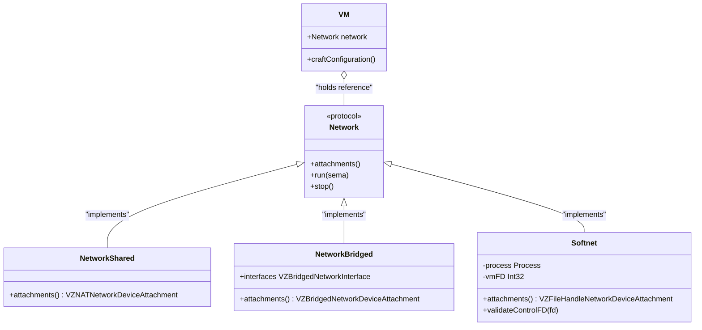
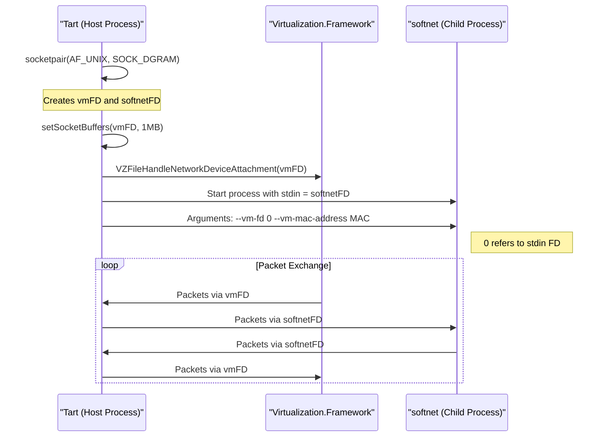

<!-- source: DeepWiki mcp.deepwiki.com · repo openai/tart · page 2.4 Networking · fetched 2026-10-26 -->

# Networking

Relevant source files

The following files were used as context for generating this wiki page:

- [Sources/tart/Commands/Run.swift](Sources/tart/Commands/Run.swift)
- [Sources/tart/Network/Network.swift](Sources/tart/Network/Network.swift)
- [Sources/tart/Network/NetworkBridged.swift](Sources/tart/Network/NetworkBridged.swift)
- [Sources/tart/Network/NetworkShared.swift](Sources/tart/Network/NetworkShared.swift)
- [Sources/tart/Network/Softnet.swift](Sources/tart/Network/Softnet.swift)
- [Sources/tart/VM.swift](Sources/tart/VM.swift)
- [Tests/TartTests/DirecotryShareTests.swift](Tests/TartTests/DirecotryShareTests.swift)
- [Tests/TartTests/SoftnetControlFDTests.swift](Tests/TartTests/SoftnetControlFDTests.swift)

Tart provides several networking modes to facilitate communication between the host and the guest VM, as well as external network access. These modes are abstracted via the `Network` protocol, allowing the VM lifecycle to manage network attachments and external helper processes uniformly.

## Networking Modes

Tart supports three primary networking modes, each corresponding to a specific implementation of the `Network` protocol defined in [Sources/tart/Network/Network.swift:4-8]().

### NAT (Shared Networking)
This is the default mode. It uses Apple's `VZNATNetworkDeviceAttachment` to provide the guest with access to the host's network connection via Network Address Translation (NAT).

*   **Implementation:** `NetworkShared` [Sources/tart/Network/NetworkShared.swift:5-17]().
*   **Behavior:** The guest is placed behind a virtual NAT, receiving an IP address usually in the `192.168.64.x` range. It returns a `VZNATNetworkDeviceAttachment` in its `attachments()` method [Sources/tart/Network/NetworkShared.swift:6-8]().

### Bridged Networking
In bridged mode, the VM appears as a distinct physical device on the same local network as the host.

*   **Implementation:** `NetworkBridged` [Sources/tart/Network/NetworkBridged.swift:5-23]().
*   **Configuration:** It utilizes an array of `VZBridgedNetworkInterface` to attach directly to physical or virtual network interfaces on the host [Sources/tart/Network/NetworkBridged.swift:12-14]().

### Softnet (User-mode Networking)
Softnet is a specialized user-mode networking stack used to provide advanced networking features or to bypass certain system limitations. It involves running an external `softnet` process that communicates with the VM via a socket pair.

*   **Implementation:** `Softnet` [Sources/tart/Network/Softnet.swift:12-126]().
*   **Data Flow:**
    1.  A Unix domain `socketpair` is created with `AF_UNIX` and `SOCK_DGRAM` [Sources/tart/Network/Softnet.swift:33]().
    2.  One file descriptor (`vmFD`) is used to create a `VZFileHandleNetworkDeviceAttachment` [Sources/tart/Network/Softnet.swift:147-150]().
    3.  The other descriptor (`softnetFD`) is passed to the `softnet` child process via its `standardInput` [Sources/tart/Network/Softnet.swift:46]().
    4.  The `softnet` process handles the actual packet routing and translation.

#### Control Socket Support
Softnet supports an optional control channel for policy management. This is passed via a `controlFD` which must be a connected Unix stream socket (`SOCK_STREAM`) [Sources/tart/Network/Softnet.swift:19-29](). The validity of this descriptor is checked using `getsockopt` and `getpeername` [Sources/tart/Network/Softnet.swift:54-85]().

#### SUID Bit Configuration
To perform certain network operations, the `softnet` binary may require elevated privileges. Tart includes logic in `configureSUIDBitIfNeeded()` to check if the SUID bit is set or if passwordless `sudo` is configured for the binary [Sources/tart/Network/Softnet.swift:152-181]().

### Networking Architecture

The following diagram illustrates the relationship between the `VM` class, the `Network` protocol, and the various concrete implementations.

**Networking Entity Map**

Sources: [Sources/tart/VM.swift:41](), [Sources/tart/Network/Network.swift:4-8](), [Sources/tart/Network/NetworkShared.swift:5](), [Sources/tart/Network/NetworkBridged.swift:5](), [Sources/tart/Network/Softnet.swift:12]()

## Data Flow: Softnet Communication

Softnet relies on a high-performance communication channel established during the `init` phase of the `Softnet` class. Tart optimizes this by setting large socket buffers (1 MiB) for both ends of the pair [Sources/tart/Network/Softnet.swift:41-42]().

**Softnet Initialization and Execution**

Sources: [Sources/tart/Network/Softnet.swift:31-51](), [Sources/tart/Network/Softnet.swift:128-145](), [Sources/tart/Network/Softnet.swift:147-150]()

## Virtio-FS Directory Sharing

While not strictly "networking" in the TCP/IP sense, Tart uses the Virtio-FS protocol to share directories between the host and guest, which serves as a primary data transfer mechanism.

### Configuration
Directory shares are configured via the `--dir` flag in the `run` command [Sources/tart/Commands/Run.swift:162-170](). These are converted into `VZDirectorySharingDeviceConfiguration` objects and passed to the `VM` initializer [Sources/tart/VM.swift:46]().

### Key Features
*   **Mount Tags:** By default, the `com.apple.virtio-fs.automount` tag is used, which macOS guests recognize for automatic mounting [Sources/tart/Commands/Run.swift:169]().
*   **Read-Only Access:** Shares can be restricted to read-only mode using the `:ro` suffix [Sources/tart/Commands/Run.swift:167]().
*   **Rosetta Sharing:** For Linux guests on Apple Silicon, a specialized Rosetta share can be attached via the `--rosetta` flag to allow the execution of Intel binaries within the ARM guest [Sources/tart/Commands/Run.swift:147-160]().

### Implementation Detail
The `VM.craftConfiguration` static method integrates these sharing devices into the final `VZVirtualMachineConfiguration` [Sources/tart/VM.swift:67-81](). Parsing logic for these shares supports both local paths and URLs, with optional names and mount tags [Tests/TartTests/DirecotryShareTests.swift:7-73]().

Sources: [Sources/tart/Commands/Run.swift:162-170](), [Sources/tart/VM.swift:46](), [Sources/tart/VM.swift:67-81](), [Tests/TartTests/DirecotryShareTests.swift:7-73]()

---

