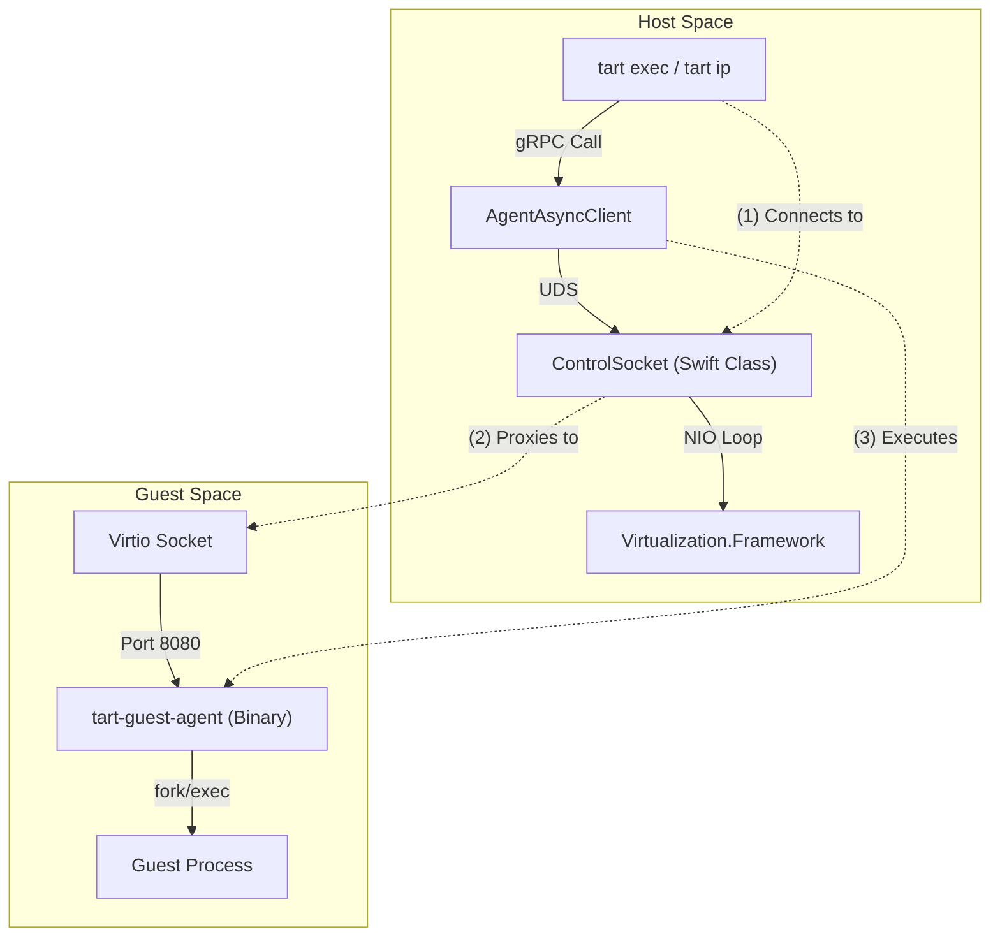
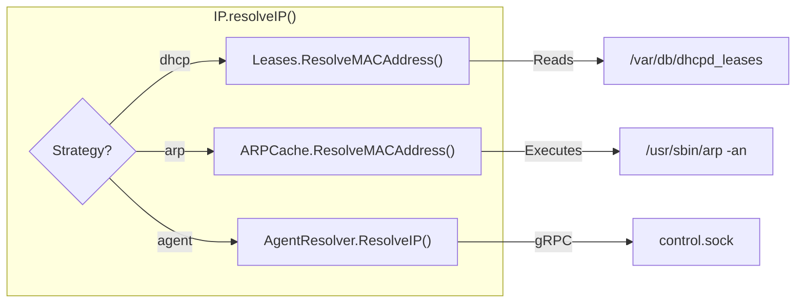

<!-- source: DeepWiki mcp.deepwiki.com · repo openai/tart · page 2.5 Guest Agent and Host-Guest Communication · fetched 2026-10-26 -->

# Guest Agent and Host-Guest Communication

Relevant source files

The following files were used as context for generating this wiki page:

- [Sources/tart/Commands/Exec.swift](Sources/tart/Commands/Exec.swift)
- [Sources/tart/Commands/IP.swift](Sources/tart/Commands/IP.swift)
- [Sources/tart/ControlSocket.swift](Sources/tart/ControlSocket.swift)
- [Sources/tart/GuestAgentChannel.swift](Sources/tart/GuestAgentChannel.swift)
- [Sources/tart/MACAddressResolver/ARPCache.swift](Sources/tart/MACAddressResolver/ARPCache.swift)
- [Sources/tart/MACAddressResolver/AgentResolver.swift](Sources/tart/MACAddressResolver/AgentResolver.swift)
- [Sources/tart/MACAddressResolver/Lease.swift](Sources/tart/MACAddressResolver/Lease.swift)
- [Sources/tart/MACAddressResolver/Leases.swift](Sources/tart/MACAddressResolver/Leases.swift)
- [Sources/tart/MACAddressResolver/MACAddress.swift](Sources/tart/MACAddressResolver/MACAddress.swift)
- [Sources/tart/Term.swift](Sources/tart/Term.swift)
- [Sources/tart/Utils.swift](Sources/tart/Utils.swift)
- [Tests/TartTests/ControlSocketTests.swift](Tests/TartTests/ControlSocketTests.swift)
- [Tests/TartTests/LeaseTest.swift](Tests/TartTests/LeaseTest.swift)
- [Tests/TartTests/LeasesTests.swift](Tests/TartTests/LeasesTests.swift)
- [Tests/TartTests/MACAddressResolverTests.swift](Tests/TartTests/MACAddressResolverTests.swift)
- [docs/.markdownlint.yml](docs/.markdownlint.yml)
- [docs/blog/images/tart-guest-agent-grpc-protocol.png](docs/blog/images/tart-guest-agent-grpc-protocol.png)
- [docs/blog/posts/2023-11-03-cirrus-runners-dashboard.md](docs/blog/posts/2023-11-03-cirrus-runners-dashboard.md)
- [docs/blog/posts/2025-06-01-tart-guest-agent.md](docs/blog/posts/2025-06-01-tart-guest-agent.md)

This page describes the mechanisms Tart uses to communicate with running virtual machines. This includes the Control Socket proxy for gRPC-based interactions, the execution of remote commands via `tart exec`, and the various strategies for resolving a guest's IP address.

## Overview of Communication Architecture

Tart facilitates host-to-guest communication through a layered architecture. At the lowest level, Tart uses `virtio-serial` or socket devices provided by `Virtualization.Framework`. For high-level commands like `exec`, Tart proxies a Unix Domain Socket (UDS) on the host to a specific port inside the guest (defaulting to 8080) where the `tart-guest-agent` listens.

### Code Entity Relationship: Control Socket and Guest Agent

The following diagram illustrates how the host-side `ControlSocket` class interacts with the gRPC client and the VM.

**Host-Guest Communication Flow**

Sources: [Sources/tart/ControlSocket.swift:8-17](), [Sources/tart/Commands/Exec.swift:75-78](), [Sources/tart/ControlSocket.swift:52-96](), [docs/blog/posts/2025-06-01-tart-guest-agent.md:40-48]()

## ControlSocket Proxy

The `ControlSocket` class [Sources/tart/ControlSocket.swift:8-17]() manages a Unix Domain Socket on the host that serves as a bridge to the VM.

- **Initialization**: It takes a `controlSocketURL` (usually pointing to `control.sock` inside the VM directory) and a `vmPort` (default 8080) [Sources/tart/ControlSocket.swift:14-17]().
- **Path Length Workaround**: To avoid the 104-character limitation for Unix Domain Sockets, the class changes the current working directory to the VM's base directory before binding [Sources/tart/ControlSocket.swift:27-33]().
- **Data Flow**: It uses `SwiftNIO` to bootstrap a server [Sources/tart/ControlSocket.swift:36-43](). When a client (like the `tart` CLI) connects, it dials the VM's internal socket using `vm?.connect(toPort:)` [Sources/tart/ControlSocket.swift:69-71]() and pipes data bidirectionally between the client and the VM using `NIOAsyncChannel` [Sources/tart/ControlSocket.swift:83-98]().

Sources: [Sources/tart/ControlSocket.swift:1-107]()

## Remote Execution (tart exec)

The `exec` command allows users to run commands inside a VM that has the `tart-guest-agent` installed [Sources/tart/Commands/Exec.swift:11-15](). It is only available on macOS 14 or newer [Sources/tart/Commands/Exec.swift:31-33]().

### Implementation Details
The command is implemented in `Exec.swift` [Sources/tart/Commands/Exec.swift:10-29]().

1.  **gRPC Stream**: It establishes a gRPC bidirectional stream using `AgentAsyncClient.makeExecCall()` [Sources/tart/Commands/Exec.swift:76-77]().
2.  **Interactive Mode**: If the `--interactive` (`-i`) flag is set, Tart reads from the host's `stdin` [Sources/tart/Commands/Exec.swift:101-143]() and sends it as `standardInput` events to the agent [Sources/tart/Commands/Exec.swift:145-160]().
3.  **Terminal Handling (PTY)**: If `--tty` (`-t`) is requested, Tart:
    *   Places the host terminal into raw mode using `Term.MakeRaw()` [Sources/tart/Commands/Exec.swift:54-56]().
    *   Sends initial terminal dimensions [Sources/tart/Commands/Exec.swift:85-92]().
    *   Listens for `SIGWINCH` signals on the host using `DispatchSource.makeSignalSource` [Sources/tart/Commands/Exec.swift:164-166]() to detect window resizing and propagates updates via `terminalResize` events [Sources/tart/Commands/Exec.swift:175-184]().
4.  **Output**: Data received from the agent's `responseStream` is processed to handle `standardOutput` and `standardError` [Sources/tart/Commands/Exec.swift:189-191]().

Sources: [Sources/tart/Commands/Exec.swift:1-191](), [docs/blog/posts/2025-06-01-tart-guest-agent.md:40-48]()

## IP Resolution Strategies

The `tart ip` command supports three distinct strategies for discovering a VM's IP address, defined by `IPResolutionStrategy` [Sources/tart/Commands/IP.swift:6-10]().

| Strategy | Implementation Class | Mechanism | Best Use Case |
| :--- | :--- | :--- | :--- |
| **DHCP** | `Leases` | Parses `/var/db/dhcpd_leases` on the host [Sources/tart/MACAddressResolver/Leases.swift:23](). | NAT networking (default). Fast and reliable. |
| **ARP** | `ARPCache` | Parses output of host `/usr/sbin/arp -an` [Sources/tart/MACAddressResolver/ARPCache.swift:46-47](). | Bridged networking. Requires guest network activity. |
| **Agent**| `AgentResolver` | Queries the `tart-guest-agent` via gRPC `ResolveIP` call [Sources/tart/MACAddressResolver/AgentResolver.swift:21](). | Works for all network types; requires agent in guest. |

### DHCP Lease Parsing
The `Leases` class parses the Apple-specific DHCP lease file format [Sources/tart/MACAddressResolver/Leases.swift:57-113](). It iterates through the file, extracting `ip_address`, `hw_address` (MAC), and `lease` expiration times. It filters out expired leases and prefers the newest entry if duplicates exist [Sources/tart/MACAddressResolver/Leases.swift:40-52]().

### ARP Cache Parsing
The `ARPCache` class executes the system `arp` command [Sources/tart/MACAddressResolver/ARPCache.swift:45-54]() and uses a regular expression `^.* \((?<ip>.*)\) at (?<mac>.*) on (?<interface>.*) .*$` to map MAC addresses to IPs found in the host's ARP table [Sources/tart/MACAddressResolver/ARPCache.swift:71-105]().

### Agent-based Resolution
The `AgentResolver` uses the `withGuestAgentChannel` helper to connect to the control socket and invoke the `ResolveIP()` gRPC method on the guest agent [Sources/tart/MACAddressResolver/AgentResolver.swift:16-27]().

**IP Resolution Logic**

Sources: [Sources/tart/Commands/IP.swift:53-89](), [Sources/tart/MACAddressResolver/Leases.swift:19-24](), [Sources/tart/MACAddressResolver/ARPCache.swift:41-48](), [Sources/tart/MACAddressResolver/AgentResolver.swift:7-14]()

## Technical Components Summary

### gRPC Integration
Tart utilizes `grpc-swift` and pre-generated Swift code (`Cirruslabs_TartGuestAgent_Grpc_Swift`) for agent communication [Sources/tart/Commands/Exec.swift:3-4](). The `withGuestAgentChannel` utility provides a standardized way to open a `GRPCChannel` over a Unix Domain Socket for any guest-bound request [Sources/tart/GuestAgentChannel.swift:10-28]().

### Control Socket Management
The `ControlSocket` implementation handles the lifecycle of the host-side socket file, ensuring it is removed before binding to avoid "address already in use" errors [Sources/tart/ControlSocket.swift:23-25](). It leverages `MultiThreadedEventLoopGroup` for efficient asynchronous I/O [Sources/tart/ControlSocket.swift:20-21]().

Sources: [Sources/tart/ControlSocket.swift:1-107](), [Sources/tart/GuestAgentChannel.swift:1-28](), [Sources/tart/Commands/Exec.swift:1-191]()

---

