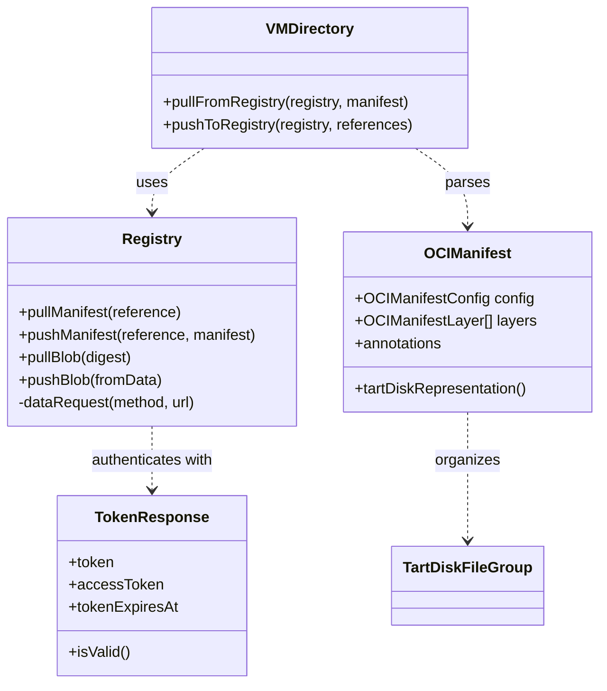

<!-- source: DeepWiki mcp.deepwiki.com · repo openai/tart · page 3 OCI Registry Integration · fetched 2026-10-26 -->

# OCI Registry Integration

<details>
<summary>Relevant source files</summary>

The following files were used as context for generating this wiki page:

- [Sources/tart/Commands/Push.swift](Sources/tart/Commands/Push.swift)
- [Sources/tart/Fetcher.swift](Sources/tart/Fetcher.swift)
- [Sources/tart/OCI/Authentication.swift](Sources/tart/OCI/Authentication.swift)
- [Sources/tart/OCI/Manifest.swift](Sources/tart/OCI/Manifest.swift)
- [Sources/tart/OCI/Registry.swift](Sources/tart/OCI/Registry.swift)
- [Sources/tart/VMDirectory+OCI.swift](Sources/tart/VMDirectory+OCI.swift)
- [Sources/tart/VMStorageHelper.swift](Sources/tart/VMStorageHelper.swift)
- [Tests/TartTests/TokenResponseTests.swift](Tests/TartTests/TokenResponseTests.swift)

</details>


Tart leverages OCI-compatible registries (such as GitHub Container Registry, AWS ECR, and Docker Hub) as a distribution mechanism for virtual machine images. Unlike traditional container images, Tart VM images consist of a configuration file, an NVRAM state, and a large disk image, which are mapped to OCI layers using specific media types.

The integration is built upon the [OCI Distribution Spec](https://github.com/opencontainers/distribution-spec), allowing Tart to treat VM images as first-class citizens in the container ecosystem.

### Registry Integration Overview

The following diagram illustrates how high-level CLI commands interact with the internal Registry client and storage layers to facilitate image distribution.

**Registry Workflow Architecture**
```mermaid
graph TD
    subgraph "CLI Layer"
        [Push.swift] --> |"calls pushToRegistry()"| [VMDirectory_OCI]
        [Pull.swift] --> |"calls open()"| [VMStorageHelper]
        [Clone.swift] --> |"calls open()"| [VMStorageHelper]
        [VMStorageHelper] --> |"instantiates"| [VMStorageOCI]
    end

    subgraph "Registry Logic"
        [VMStorageOCI] --> [Registry.swift]
        [VMDirectory_OCI] --> [Registry.swift]
        [Registry.swift] --> [Fetcher.swift]
    end

    subgraph "Data Handling"
        [VMDirectory_OCI] --> |"DiskV2.pull/push"| [DiskV2.swift]
        [Registry.swift] --> |"Auth"| [CredentialsProvider]
        [Registry.swift] --> |"Token/Basic"| [Authentication]
    end

    [Fetcher.swift] --> |"HTTPS/OCI Distribution Spec"| RemoteRegistry["Remote OCI Registry"]
```
Sources: [Sources/tart/Commands/Push.swift:81-88](), [Sources/tart/VMStorageHelper.swift:3-12](), [Sources/tart/VMDirectory+OCI.swift:15-31](), [Sources/tart/OCI/Registry.swift:113-136]()

### Component Relationship

The integration is divided into several specialized subsystems that handle networking, disk optimization, security, and high-level workflows.

| Subsystem | Key Responsibility | Primary Entities |
| :--- | :--- | :--- |
| **Registry Client** | Implementation of OCI manifest and blob protocols. | `Registry`, `OCIManifest`, `Fetcher` |
| **Disk Layerization** | Splitting and compressing large disks into OCI-friendly layers. | `DiskV2`, `TartDiskFileGroup` |
| **Authentication** | Managing credentials across Keychain, Docker config, and Env. | `CredentialsProvider`, `TokenResponse`, `Authentication` |
| **Workflow Management** | Orchestrating pull/push sequences and local cache. | `Push`, `Pull`, `VMDirectory+OCI` |

**Code Entity Mapping**

Sources: [Sources/tart/OCI/Registry.swift:113-206](), [Sources/tart/OCI/Manifest.swift:70-117](), [Sources/tart/VMDirectory+OCI.swift:15-156](), [Sources/tart/OCI/Registry.swift:58-111]()

---

### [Registry Client and Networking](#3.1)
The `Registry` class serves as the core client for interacting with OCI APIs. It handles the low-level HTTP mechanics of pulling and pushing manifests and blobs, supporting both monolithic and chunked uploads. It utilizes `Fetcher`, a wrapper around `URLSession`, to stream data efficiently using `AsyncThrowingStream` to avoid loading large blobs into memory.
* For details, see [Registry Client and Networking](#3.1).

Sources: [Sources/tart/OCI/Registry.swift:113-136](), [Sources/tart/Fetcher.swift:19-37](), [Sources/tart/OCI/Registry.swift:167-192]()

### [Disk Layerization (DiskV2)](#3.2)
To handle large VM disks (often 20GB+), Tart employs `DiskV2` logic to split disks into manageable chunks. These chunks are compressed and uploaded as individual OCI layers with specific media types like `application/vnd.cirruslabs.tart.disk.v2`. The system supports "stacked" images using ASIF overlays, allowing for efficient delta updates.
* For details, see [Disk Layerization (DiskV2)](#3.2).

Sources: [Sources/tart/VMDirectory+OCI.swift:37-45](), [Sources/tart/OCI/Manifest.swift:8-11](), [Sources/tart/OCI/Manifest.swift:27-58]()

### [Authentication and Credentials](#3.3)
Tart supports multiple authentication methods through a chain of `CredentialsProvider` implementations. It handles Bearer token negotiation via `TokenResponse` and Basic auth via `BasicAuthentication`. Credentials can be sourced from the macOS Keychain, standard Docker `config.json` files, or environment variables.
* For details, see [Authentication and Credentials](#3.3).

Sources: [Sources/tart/OCI/Registry.swift:131-136](), [Sources/tart/OCI/Registry.swift:58-111](), [Sources/tart/OCI/Authentication.swift:8-21]()

### [Pull, Push, Clone, and Prune](#3.4)
High-level commands coordinate the registry client with local storage. `Push` supports a "lightweight" mode that avoids re-uploading blobs if they already exist in the registry. `VMDirectory` manages the orchestration of pulling configuration, NVRAM, and disk layers into the local filesystem structure.
* For details, see [Pull, Push, Clone, and Prune](#3.4).

Sources: [Sources/tart/Commands/Push.swift:105-120](), [Sources/tart/VMDirectory+OCI.swift:15-113](), [Sources/tart/VMStorageHelper.swift:3-12]()

---

